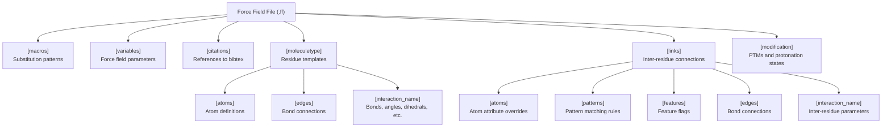
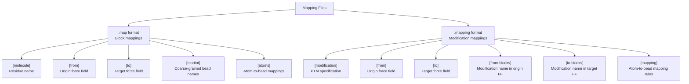
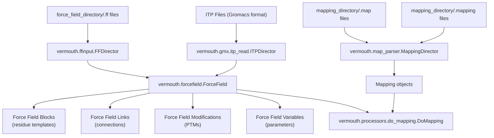
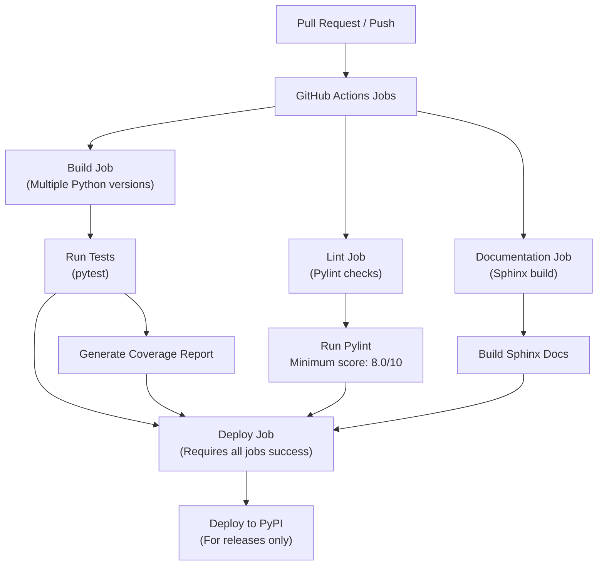
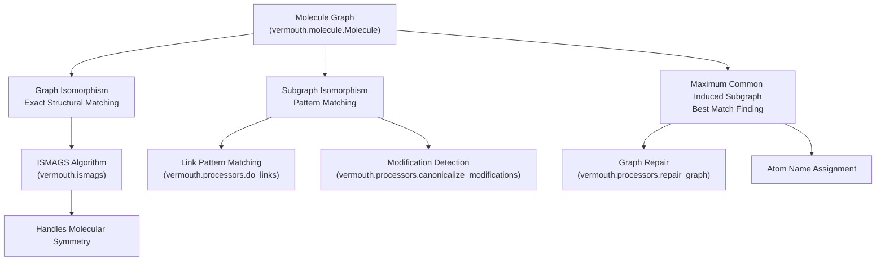
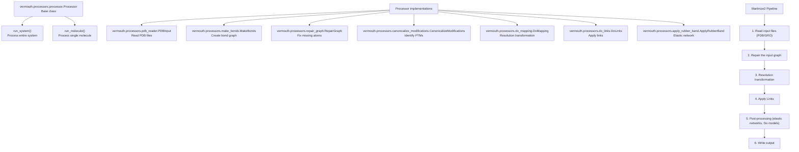

# Advanced Topics

<details>
<summary>Relevant source files</summary>

The following files were used as context for generating this wiki page:

- [.github/workflows/deploy.yml](.github/workflows/deploy.yml)
- [.github/workflows/run_tests.yml](.github/workflows/run_tests.yml)
- [LICENSE](LICENSE)
- [doc/source/data.rst](doc/source/data.rst)
- [doc/source/file_formats.rst](doc/source/file_formats.rst)
- [doc/source/general_overview.rst](doc/source/general_overview.rst)
- [doc/source/graph_algorithms.rst](doc/source/graph_algorithms.rst)
- [doc/source/martinize2_workflow.rst](doc/source/martinize2_workflow.rst)
- [doc/source/processors.rst](doc/source/processors.rst)
- [doc/source/technical_background.rst](doc/source/technical_background.rst)
- [pyproject.toml](pyproject.toml)

</details>


This page covers advanced topics for power users and developers working with the vermouth-martinize system. While the [Basic Usage](#5.1) and other tutorial pages cover common workflows, this section delves into the technical details, file formats, customization options, and development practices essential for extending the system's capabilities.

## File Formats

Vermouth uses specialized file formats to define force fields, mappings between force fields, and molecule descriptions. Understanding these formats is essential for creating custom force fields or modifying existing ones.

### Force Field Files (.ff)

These files define blocks, links, and modifications that describe how atoms interact. The file format uses a directive-based structure with sections and subsections enclosed in square brackets.

**Force Field File Structure**



Sources: [doc/source/file_formats.rst:1-395]()

### Mapping Files (.map & .mapping)

Mapping files define conversions between force fields, typically from a higher resolution (atomistic) to a lower resolution (coarse-grained) representation.

**Mapping File Structure**



Sources: [doc/source/file_formats.rst:409-546]()

## Custom Force Fields

Creating custom force fields allows you to define new molecules, interactions, or modify existing ones. This is essential for working with non-standard molecules or implementing alternative parametrizations.

### Directory Structure

A typical directory structure for a custom force field follows this pattern:

```
my_forcefield/
├── force_fields/
│   └── my_forcefield/
│       ├── my_forcefield.ff     # Main force field file
│       ├── aminoacids.ff        # Residue definitions
│       ├── modifications.ff     # PTMs and alternate states
│       └── citations.bib        # References
└── mappings/
    ├── my_forcefield_to_martini3.map   # Mapping to Martini
    ├── charmm36_to_my_forcefield.map   # Mapping from atomistic
    └── modifications/
        └── phosphorylation.mapping     # PTM mappings
```

### Force Field Implementation

To implement a custom force field, you need to create the following components:

1. **Blocks**: Define all residues/molecules your force field supports
2. **Links**: Define interactions between residues (e.g., peptide bonds)
3. **Modifications**: Define altered states (e.g., PTMs, protonation states)
4. **Mappings**: Create mappings to/from existing force fields

**Force Field Loading Process**



Sources: [doc/source/data.rst:93-105](), [doc/source/martinize2_workflow.rst:197-246]()

## Development Guide

This section covers information for developers who want to contribute to the vermouth-martinize project.

### CI/CD Pipeline

The project uses GitHub Actions for continuous integration and deployment, defined in the `.github/workflows` directory.

**CI/CD Workflow**



Sources: [.github/workflows/run_tests.yml:1-154](), [.github/workflows/deploy.yml:1-151]()

### Testing Framework

The project uses pytest for unit and integration testing, with coverage reporting through the coverage.py tool.

#### Running Tests

To run tests locally:

```bash
# Install test dependencies
pip install -r requirements-tests.txt

# Run tests
pytest -vv

# Generate coverage report
coverage run $(which pytest) -vv
coverage report
```

#### Test Organization

Tests are located in the `vermouth/tests/` directory, organized to mirror the structure of the main code. The project uses hypothesis for property-based testing of complex behaviors.

Sources: [pyproject.toml:9-17](), [.github/workflows/run_tests.yml:52-58]()

## Graph Algorithms

Vermouth represents molecules as graphs, where atoms are nodes and bonds are edges. This enables sophisticated graph operations for molecule manipulation and identification.

**Graph Algorithm Hierarchy**



Sources: [doc/source/graph_algorithms.rst:1-131]()

The various isomorphism algorithms are used throughout the martinize2 pipeline:

1. **Graph isomorphism**: Finding exactly matching graphs
2. **Subgraph isomorphism**: Finding molecular patterns within larger structures
3. **Induced subgraph isomorphism**: Finding patterns while preserving connection patterns
4. **Maximum common induced subgraph**: Finding the largest overlap between two graphs

The ISMAGS algorithm efficiently handles symmetry in molecular graphs, which is particularly important for large molecules with many equivalent atoms.

## Processor Pipeline

Vermouth uses a modular processor-based architecture for transforming molecules. Each processor performs a specific task in the pipeline, allowing for flexible composition of transformation steps.

**Processor Architecture**



Sources: [doc/source/processors.rst:1-19](), [doc/source/martinize2_workflow.rst:1-296]()

To implement a custom processor:

1. Subclass `vermouth.processors.processor.Processor`
2. Implement either `run_molecule` (preferred) or `run_system` method
3. Return a modified molecule or system

## License and Contributors

The vermouth-martinize project is licensed under the Apache License 2.0. This permissive license allows for both academic and commercial use, with appropriate attribution.

Sources: [LICENSE:1-206]()

## Distribution and Packaging

The project uses Python Build and Package (PBP) for building and distributing the package. The package is available on PyPI and can be installed using pip:

```bash
pip install vermouth
```

The package defines several requirements files:
- `requirements-tests.txt`: Dependencies for testing
- `requirements-docs.txt`: Dependencies for building documentation

Sources: [pyproject.toml:1-8](), [.github/workflows/run_tests.yml:45-52]()

---