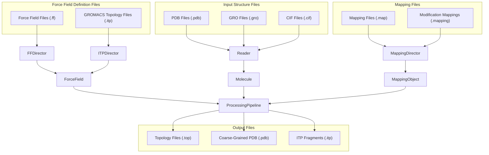
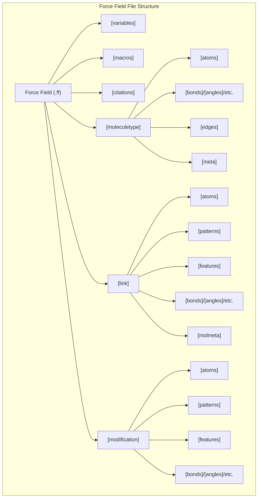
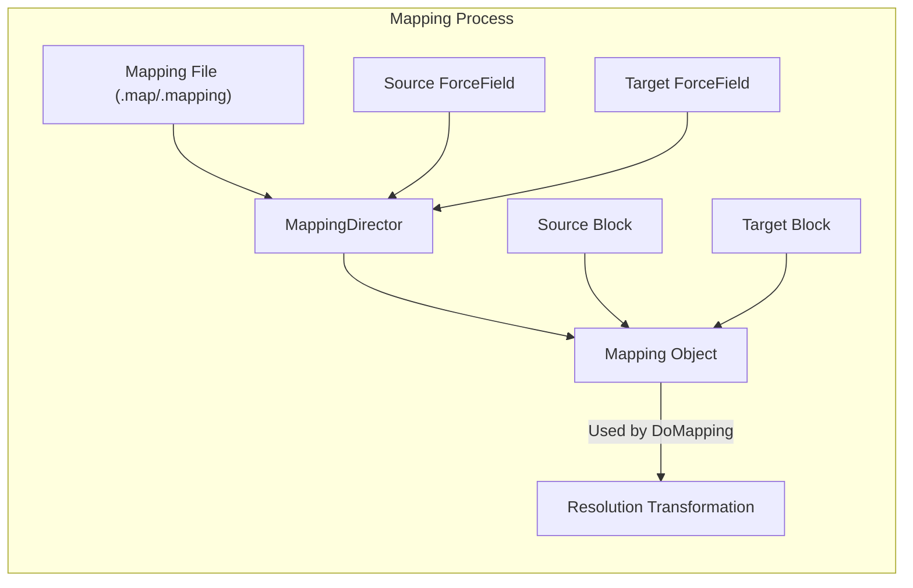
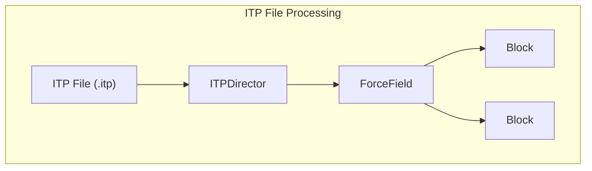
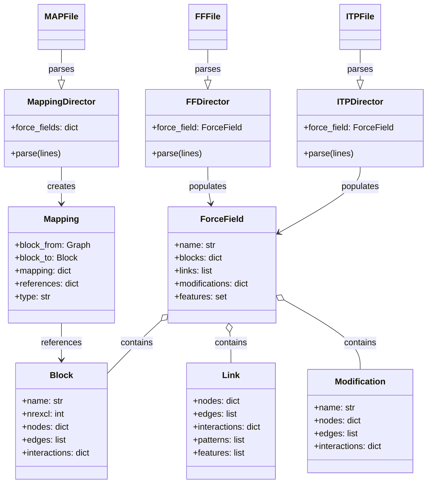
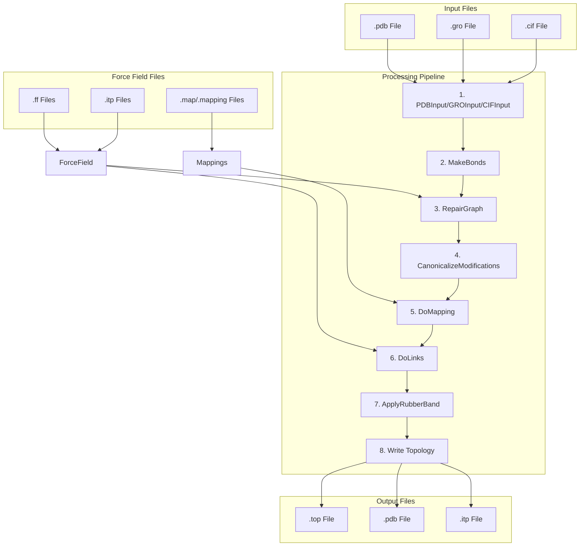

# File Formats

<details>
<summary>Relevant source files</summary>

The following files were used as context for generating this wiki page:

- [doc/source/data.rst](doc/source/data.rst)
- [doc/source/file_formats.rst](doc/source/file_formats.rst)
- [doc/source/general_overview.rst](doc/source/general_overview.rst)
- [doc/source/graph_algorithms.rst](doc/source/graph_algorithms.rst)
- [doc/source/martinize2_workflow.rst](doc/source/martinize2_workflow.rst)
- [doc/source/processors.rst](doc/source/processors.rst)
- [doc/source/technical_background.rst](doc/source/technical_background.rst)
- [vermouth/ffinput.py](vermouth/ffinput.py)
- [vermouth/gmx/itp_read.py](vermouth/gmx/itp_read.py)
- [vermouth/map_input.py](vermouth/map_input.py)
- [vermouth/map_parser.py](vermouth/map_parser.py)
- [vermouth/parser_utils.py](vermouth/parser_utils.py)
- [vermouth/processors/do_mapping.py](vermouth/processors/do_mapping.py)
- [vermouth/tests/test_do_mapping.py](vermouth/tests/test_do_mapping.py)
- [vermouth/tests/test_ff_files.py](vermouth/tests/test_ff_files.py)
- [vermouth/tests/test_forcefield.py](vermouth/tests/test_forcefield.py)
- [vermouth/tests/test_itp_files.py](vermouth/tests/test_itp_files.py)
- [vermouth/tests/test_map_input.py](vermouth/tests/test_map_input.py)
- [vermouth/tests/test_mapping_integrative.py](vermouth/tests/test_mapping_integrative.py)

</details>


This document describes the various file formats used in VerMoUTH and Martinize2. VerMoUTH supports several input and output file formats for representing molecular structures, force fields, and mappings between different force field resolutions. Understanding these file formats is crucial for effectively using the system and creating custom force fields or mappings.

## Overview of File Formats

VerMoUTH utilizes several types of files that serve different purposes in the molecular topology generation workflow:



Sources: [vermouth/ffinput.py:15-23](), [vermouth/gmx/itp_read.py:15-18](), [vermouth/map_input.py:17-19](), [doc/source/file_formats.rst:1-36]()

## 1. Force Field Files (.ff)

Force field (.ff) files describe molecule components for a given force field. These files use a format similar to GROMACS topology files but with additional sections specific to VerMoUTH's needs.

### File Structure and Directives

A force field file consists of multiple sections, each introduced by a directive enclosed in square brackets. The main top-level directives are:



Sources: [vermouth/ffinput.py:63-91](), [doc/source/file_formats.rst:37-162]()

#### Major Directives in .ff Files

| Directive | Purpose | Required | Example |
|-----------|---------|----------|---------|
| `[macros]` | Defines substitution patterns to be used throughout the file | No | `prot_default_bb_type P2` |
| `[variables]` | Defines force field-wide parameters | No | `elastic_network_bond_type 1` |
| `[citations]` | References to publications for the force field | No | `Martini3` |
| `[moleculetype]` | Defines a block (residue/molecule template) | No | `ALA 3` (name + exclusion number) |
| `[link]` | Defines connections between blocks | No | `resname "ALA"` |
| `[modification]` | Defines modifications to blocks | No | `PTM-name` |

Sources: [doc/source/file_formats.rst:44-162](), [vermouth/ffinput.py:95-106]()

#### Moleculetype Sub-directives

| Sub-directive | Purpose | Required | Example |
|---------------|---------|----------|---------|
| `[atoms]` | Lists atoms with properties | Yes | `1 P5 1 GLY BB 1 0 47` |
| `[edges]` | Explicitly adds edges to the molecular graph | No | `BB SC1` |
| `[bonds]` | Defines bond interactions | No | `BB SC1 1 0.47 5000` |
| `[angles]` | Defines angle interactions | No | `BB SC1 SC2 2 100 20` |
| `[dihedrals]` | Defines dihedral interactions | No | `BB SC1 SC2 SC3 1 -30 5 1` |
| `[constraints]` | Defines distance constraints | No | `BB SC1 1 0.47` |
| `[meta]` | Block-specific metadata | No | `flag key1 0.15` |

Sources: [doc/source/file_formats.rst:163-256](), [vermouth/ffinput.py:221-225]()

#### Link Sub-directives

| Sub-directive | Purpose | Required | Example |
|---------------|---------|----------|---------|
| `[atoms]` | Specifies or modifies atom attributes | No | `BB {"resname": "ALA"}` |
| `[patterns]` | Specifies patterns to match | No | `BB +BB` |
| `[features]` | Lists features provided by the link | No | `scfix` |
| `[molmeta]` | Metadata to be added to the molecule | No | `category protein` |
| `[edges]` | Specifies edges that should exist | No | `BB SC1` |
| `[non-edges]` | Specifies edges that should not exist | No | `BB SC2` |

Sources: [doc/source/file_formats.rst:257-351](), [vermouth/ffinput.py:432-466]()

#### Modification Sub-directives

| Sub-directive | Purpose | Required | Example |
|---------------|---------|----------|---------|
| `[atoms]` | Lists atoms to be modified or added | Yes | `C1 {"PTM_atom": true, "element": "C"}` |
| `[bonds]` (and other interactions) | Interactions to add | No | `BB PTM-C1 1 0.33 7500` |

Sources: [doc/source/file_formats.rst:354-369](), [vermouth/ffinput.py:446-462]()

### Special Metadata Syntax

The force field file format allows for special metadata annotations using JSON-style attributes. These can be used to:

1. Group interactions with the `group` attribute
2. Add conditional interactions with `ifdef`/`ifndef` attributes 
3. Add comments to interactions
4. Control parameter versioning

Example:
```
[bonds]
#meta {"group": "Side chain bonds", "ifdef": "FLEXIBLE"}
BB SC1  1 0.47 5000
```

Sources: [doc/source/file_formats.rst:375-407](), [vermouth/ffinput.py:360-376]()

## 2. Mapping Files (.map & .mapping)

Mapping files define how to convert molecular structures between different force field resolutions, such as from atomistic to coarse-grained (forward mapping) or vice versa (backward mapping).



Sources: [vermouth/map_input.py:17-19](), [vermouth/map_parser.py:16-17](), [vermouth/processors/do_mapping.py:16-19]()

### .map File Format

The `.map` file format is used primarily for basic block-to-block mappings. Originally developed for the backward program, it specifies how atoms in one force field correspond to beads in another.

#### Directives in .map Files

| Directive | Purpose | Required | Example |
|-----------|---------|----------|---------|
| `[molecule]` | Name of the residue being mapped | Yes | `ALA` |
| `[from]` | Source force field name | Yes | `universal` |
| `[to]` | Target force field name | Yes | `martini22` |
| `[martini]` | Lists all target beads | Yes | `BB SC1` |
| `[atoms]` | Maps source atoms to target beads | Yes | `1 N BB` |

Example:
```
[molecule]
ALA

[martini]
BB SC1

[atoms]
1 N BB
2 H BB
3 CA BB
4 HA BB
5 CB SC1
6 HB1 SC1
7 HB2 SC1
8 HB3 SC1
9 C BB
10 O BB
```

Sources: [doc/source/file_formats.rst:411-486](), [vermouth/map_input.py:36-40]()

### .mapping File Format

The `.mapping` file format is an extension of the `.map` format, designed specifically for mapping modifications between force fields.

#### Directives in .mapping Files

| Directive | Purpose | Required | Example |
|-----------|---------|----------|---------|
| `[modification]` | Marks start of modification mapping | Yes | _(empty)_ |
| `[from]` | Source force field name | Yes | `amber` |
| `[to]` | Target force field name | Yes | `martini3001` |
| `[from blocks]` | Modification name in source | Yes | `PHOSPHORYLATED` |
| `[to blocks]` | Modification name in target | Yes | `PHOSPHORYLATED` |
| `[from nodes]` | Additional source nodes | No | `P {"atomname": "P", "atype": "P"}` |
| `[to nodes]` | Additional target nodes | No | `PO4 {"atomname": "PO4", "atype": "Qa"}` |

Sources: [doc/source/file_formats.rst:504-527](), [vermouth/map_parser.py:581-630]()

## 3. GROMACS Topology Files (.itp)

GROMACS topology (.itp) files are read by VerMoUTH to define blocks. This allows direct use of GROMACS topologies as sources for force field definitions.



Sources: [vermouth/gmx/itp_read.py:15-18](), [vermouth/gmx/itp_read.py:24-27]()

### ITP File Structure

The ITP file format is based on the GROMACS topology format, with sections for molecule types, atoms, and various interaction types.

#### Main Sections in ITP Files

| Section | Purpose | Example |
|---------|---------|---------|
| `[moleculetype]` | Defines a molecule/residue with exclusion number | `GLY 3` |
| `[atoms]` | Lists atoms with properties | `1 P4 1 ALA BB 1` |
| `[bonds]` | Lists bond interactions | `1 2 1 0.33 1000` |
| `[angles]` | Lists angle interactions | `1 2 3 2 130 25` |
| `[dihedrals]` | Lists dihedral and improper interactions | `1 2 3 4 1 180 10 1` |
| `[constraints]` | Lists distance constraints | `1 2 1 0.33` |

ITP files can also include preprocessor macros like `#ifdef`, `#ifndef`, `#else`, and `#endif`, which are processed by the ITP reader.

Sources: [vermouth/gmx/itp_read.py:25-48](), [vermouth/gmx/itp_read.py:237-246]()

### Key Differences Between .ff and .itp Files

While both .ff and .itp files describe molecular components, there are some important differences:

1. **.ff files**:
   - Support more VerMoUTH-specific features (links, modifications)
   - Use atom names as node identifiers
   - Allow for JSON-style attributes
   - Include mapping-related directives

2. **.itp files**:
   - Use numerical indices for atom references
   - Strictly follow GROMACS syntax
   - Support GROMACS preprocessor directives (`#ifdef`, etc.)
   - Don't support link and modification definitions

Sources: [vermouth/gmx/itp_read.py:24-30](), [vermouth/ffinput.py:63-91]()

## 4. Relationship Between File Formats and System Components

The following diagram illustrates how the different file formats interact with the core data structures in VerMoUTH:



Sources: [vermouth/ffinput.py:62-91](), [vermouth/gmx/itp_read.py:24-36](), [vermouth/map_parser.py:31-117]()

## 5. Processing Pipeline and File Formats

The following diagram shows how file formats fit into the Martinize2 processing pipeline:



Sources: [doc/source/martinize2_workflow.rst:1-36]()

## Summary

The file formats used in VerMoUTH and Martinize2 are designed to support flexible descriptions of molecular structures, force fields, and the mappings between them. The key formats are:

1. **Force field files (.ff)**: Define blocks, links, and modifications for a force field
2. **Mapping files (.map, .mapping)**: Define transformations between force fields
3. **GROMACS topology files (.itp)**: Provide standard GROMACS topology definitions
4. **Structure files (.pdb, .gro, .cif)**: Provide input molecular structures

Understanding these file formats is essential for creating custom force fields, defining new mappings between resolutions, and efficiently using the VerMoUTH/Martinize2 system for molecular simulations.

Sources: [doc/source/file_formats.rst:1-36](), [doc/source/data.rst:1-115]()

---