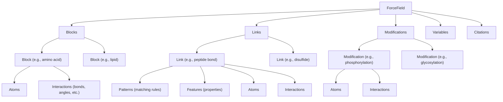
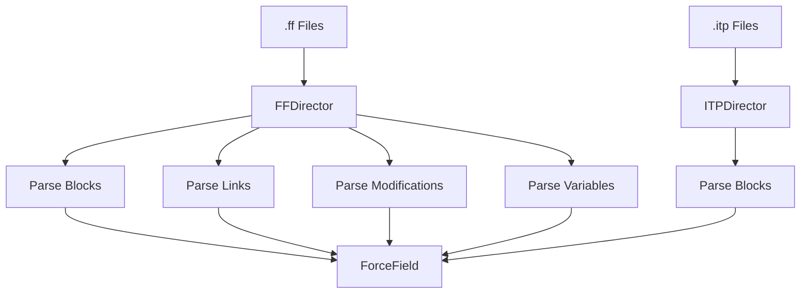

# Custom Force Fields

<details>
<summary>Relevant source files</summary>

The following files were used as context for generating this wiki page:

- [vermouth/data/force_fields/elnedyn21/aminoacids.ff](vermouth/data/force_fields/elnedyn21/aminoacids.ff)
- [vermouth/data/force_fields/elnedyn22/aminoacids.ff](vermouth/data/force_fields/elnedyn22/aminoacids.ff)
- [vermouth/data/force_fields/elnedyn22p/aminoacids.ff](vermouth/data/force_fields/elnedyn22p/aminoacids.ff)
- [vermouth/data/force_fields/martini22/aminoacids.ff](vermouth/data/force_fields/martini22/aminoacids.ff)
- [vermouth/data/force_fields/martini22p/aminoacids.ff](vermouth/data/force_fields/martini22p/aminoacids.ff)
- [vermouth/data/force_fields/martini3001/aminoacids.ff](vermouth/data/force_fields/martini3001/aminoacids.ff)
- [vermouth/data/force_fields/martini3001/general.ff](vermouth/data/force_fields/martini3001/general.ff)
- [vermouth/data/force_fields/martini30b32/aminoacids.ff](vermouth/data/force_fields/martini30b32/aminoacids.ff)
- [vermouth/data/force_fields/martini30dev/aminoacids.ff](vermouth/data/force_fields/martini30dev/aminoacids.ff)
- [vermouth/ffinput.py](vermouth/ffinput.py)
- [vermouth/forcefield.py](vermouth/forcefield.py)
- [vermouth/gmx/itp_read.py](vermouth/gmx/itp_read.py)
- [vermouth/parser_utils.py](vermouth/parser_utils.py)
- [vermouth/selectors.py](vermouth/selectors.py)
- [vermouth/tests/rcsu/test_go_structure_bias.py](vermouth/tests/rcsu/test_go_structure_bias.py)
- [vermouth/tests/test_ff_files.py](vermouth/tests/test_ff_files.py)
- [vermouth/tests/test_forcefield.py](vermouth/tests/test_forcefield.py)
- [vermouth/tests/test_itp_files.py](vermouth/tests/test_itp_files.py)
- [vermouth/tests/test_vs_generation.py](vermouth/tests/test_vs_generation.py)
- [vermouth/tests/test_water_bias.py](vermouth/tests/test_water_bias.py)

</details>


This page explains how to create and use custom force fields in the vermouth-martinize framework. Custom force fields allow you to define your own molecular building blocks, interactions, and modifications for coarse-grained simulations. For information about using the built-in force fields provided with the package, see [Force Fields](#2.2).

## Overview of Force Field Structure

In vermouth-martinize, a force field is represented by the `ForceField` class, which contains several key components:



Sources: [vermouth/forcefield.py:35-82](vermouth/forcefield.py:35-82), [vermouth/molecule.py](vermouth/molecule.py)

## Force Field File Formats

Vermouth-martinize supports two main file formats for defining force fields:

1. **FF Files** (`.ff`): A custom format for defining all force field components
2. **ITP Files** (`.itp`): GROMACS topology files that can define molecular building blocks

### File Parsing Process



Sources: [vermouth/ffinput.py:63-147](vermouth/ffinput.py:63-147), [vermouth/gmx/itp_read.py:24-479](vermouth/gmx/itp_read.py:24-479)

## Creating Custom Force Fields with FF Files

The `.ff` file format is the preferred method for creating custom force fields as it supports all components. Force field files use sections indicated by square brackets (`[ section_name ]`) to define different components.

### Variables Section

Variables can be defined and used throughout the force field:

```
[ variables ]
elastic_network_bond_type 1
res_min_dist 3
prot_default_bb_type P2
```

Variables are referenced using the `$` prefix:

```
[ atoms ]
1   $prot_default_bb_type   1   LEU   BB   1   0
```

Sources: [vermouth/ffinput.py:207-213](vermouth/ffinput.py:207-213)

### Blocks

Blocks represent molecular building blocks like amino acids or lipids. They are defined using the `moleculetype` section followed by atoms and interactions:

```
[ moleculetype ]
; molname   nrexcl
ALA         1

[ atoms ]
;id type resnr residu atom cgnr  charge
1   P4   1     ALA    BB   1     0
2   C3   1     ALA    SC1  2     0

[ bonds ]
;  i   j  funct   length  force.c.
   1   2  1       0.270   7500
```

The `atoms` section defines each atom with:
- ID: Atom identifier (numeric or name)
- Type: Atom type (determines interactions)
- Resnr: Residue number
- Residu: Residue name
- Atom: Atom name
- Cgnr: Charge group
- Charge: Electric charge

Sources: [vermouth/ffinput.py:215-231](vermouth/ffinput.py:215-231), [vermouth/data/force_fields/martini3001/aminoacids.ff:30-57](vermouth/data/force_fields/martini3001/aminoacids.ff:30-57)

### Interactions

Blocks and links can define various types of interactions:

```
[ bonds ]
;  i   j  funct   length  force.c.
   1   2  1       0.270   7500

[ angles ]
;  i   j   k  funct   angle  force.c.
   1   2   3  2       120.0  50.0

[ dihedrals ]
;  i   j   k   l  funct   angle  force.c.
   1   2   3   4  1       180.0  10.0
```

Supported interaction types include:
- `bonds`: Covalent bonds
- `angles`: Bond angles
- `dihedrals`: Proper dihedral angles
- `impropers`: Improper dihedral angles
- `constraints`: Distance constraints
- `pairs`: Non-bonded pairs
- `exclusions`: Excluded interactions

Sources: [vermouth/ffinput.py:274-421](vermouth/ffinput.py:274-421)

### Links

Links define connections between blocks, such as peptide bonds in proteins:

```
[ link ]
[ atoms ]
;atom1 atom2     resname atom  cgnr  charge
 BB    +BB       *       BB    1     0

[ bonds ]
;atom1 atom2  funct  length  force.c.
 BB    +BB    1      0.350   1250

[ angles ]
;atom1 atom2 atom3  funct  angle  force.c.
 -BB   BB    +BB    2      134    25
```

In links, atom names can be prefixed to indicate relative positions:
- `+`: Next residue (e.g., `+BB`)
- `-`: Previous residue (e.g., `-BB`)
- `>`, `<`: Other ordering relationships

Sources: [vermouth/ffinput.py:431-465](vermouth/ffinput.py:431-465), [vermouth/data/force_fields/martini22/aminoacids.ff:593-603](vermouth/data/force_fields/martini22/aminoacids.ff:593-603)

### Patterns and Features

Links can include patterns to specify when they should be applied:

```
[ link ]
[ patterns ]
; Apply to residues with names in protein_resnames
resname $protein_resnames

[ features ]
; Define features provided by this link
protein_backbone
```

The `patterns` section defines conditions for matching blocks, while the `features` section defines properties provided by the link.

Sources: [vermouth/ffinput.py:453-465](vermouth/ffinput.py:453-465)

### Modifications

Modifications define chemical changes to blocks, such as phosphorylation:

```
[ modification ]
SER-P  ; Phosphorylated serine

[ atoms ]
;id  type resnr residu atom cgnr   charge
 BB   P5   1     SER    BB   1      0
 SC1  P1   1     SER    SC1  2      0
 P1   Qa   1     SER-P  P    3     -1.0

[ bonds ]
;  i   j  funct   length  force.c.
  SC1  P1  1       0.28    7500
```

Sources: [vermouth/ffinput.py:437-451](vermouth/ffinput.py:437-451)

## Creating Custom Force Fields with ITP Files

ITP files can also be used to define blocks, though they have limitations compared to FF files. The syntax is similar but with some differences:

```
[ moleculetype ]
; molname   nrexcl
ALA         1

[ atoms ]
;id type resnr residu atom cgnr  charge mass
1   P4   1     ALA    BB   1     0     72
2   C3   1     ALA    SC1  2     0     45

[ bonds ]
;  i   j  funct   length  force.c.
   1   2  1       0.270   7500
```

Key differences compared to FF files:
- ITP files use numeric indices (1-based) for atoms in interactions
- ITP files cannot define links or modifications
- ITP files may include additional parameters like mass

Sources: [vermouth/gmx/itp_read.py:24-266](vermouth/gmx/itp_read.py:24-266)

## Example Force Field Files

Below is a simplified example of a force field definition for alanine residue:

```
[ variables ]
prot_default_bb_type P2
stiff_fc 1000000

[ moleculetype ]
; molname       nrexcl
ALA                1

[ atoms ]
;id type resnr residu atom cgnr   charge
 1   SP2    1   ALA    BB     1      0
 2   TC3    1   ALA    SC1    2      0 

[ constraints ]
#meta {"group": "Side chain bonds", "ifndef": "FLEXIBLE"}
;  i     j   funct   length  
  BB   SC1    1       0.270

[ bonds ]
#meta {"group": "Side chain bonds", "ifdef": "FLEXIBLE"}
;  i     j   funct   length  
  BB   SC1    1       0.270  $stiff_fc
```

This example defines alanine with a backbone bead (BB) and a side chain bead (SC1) connected by either a constraint or a stiff bond depending on whether the "FLEXIBLE" flag is defined.

Sources: [vermouth/data/force_fields/martini3001/aminoacids.ff:30-57](vermouth/data/force_fields/martini3001/aminoacids.ff:30-57)

## Loading and Using Custom Force Fields

To use a custom force field, you need to create a `ForceField` object and load your force field files:

```python
from vermouth.forcefield import ForceField

# Method 1: Load from a directory
force_field = ForceField(directory='path/to/force_field_directory')

# Method 2: Create empty and load manually
force_field = ForceField(name='my_custom_ff')
force_field.read_from('path/to/force_field_directory')

# Method 3: Find force fields in a directory
from vermouth.forcefield import find_force_fields
force_fields = find_force_fields('path/to/force_fields_directory')
```

The force field directory should contain one or more `.ff` or `.itp` files. Conventionally, each force field is organized in its own directory, with the directory name matching the force field name.

Sources: [vermouth/forcefield.py:63-147](vermouth/forcefield.py:63-147), [vermouth/forcefield.py:143-189](vermouth/forcefield.py:143-189)

## Force Field Directory Structure

A typical force field directory structure might look like:

```
my_custom_ff/
├── aminoacids.ff    # Amino acid definitions
├── lipids.ff        # Lipid definitions
├── general.ff       # General parameters
└── citations.bib    # Literature references
```

The force field files are processed in alphabetical order, so you may want to use prefixes to control the loading order if certain definitions depend on others.

Sources: [vermouth/forcefield.py:192-199](vermouth/forcefield.py:192-199)

## Force Field Validation

When creating a custom force field, it's important to validate your definitions to ensure they're correctly formatted and produce the expected results. Common issues to check for include:

1. Missing or invalid parameters
2. Inconsistent atom naming
3. Improper interaction definitions
4. Invalid syntax or undefined variables

You can test your force field by loading it and building simple molecules to ensure the topology is generated as expected.

## Best Practices

1. **Use organization**: Separate different molecule types into different files
2. **Be consistent**: Use consistent naming conventions for atom types
3. **Document extensively**: Add comments to explain the purpose of definitions
4. **Use variables**: Define common parameters as variables for easier maintenance
5. **Include citations**: Reference the sources used for parameters

By following these guidelines, you can create robust and maintainable custom force fields for your simulations.

Sources: [vermouth/data/force_fields/martini3001/aminoacids.ff](vermouth/data/force_fields/martini3001/aminoacids.ff), [vermouth/data/force_fields/martini3001/general.ff](vermouth/data/force_fields/martini3001/general.ff)

---