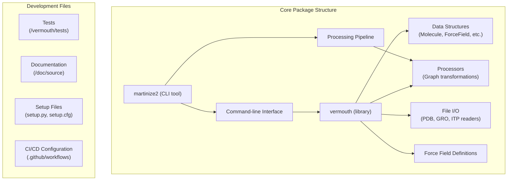
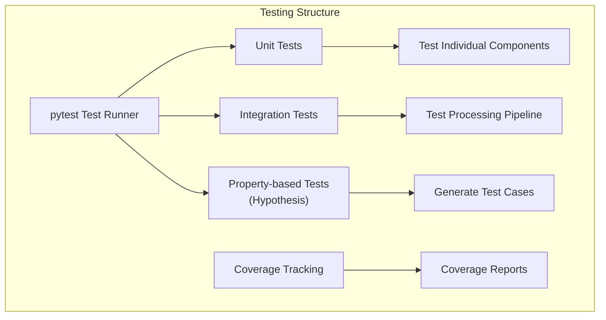
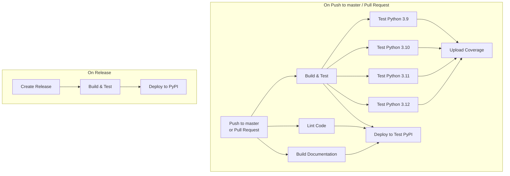

# Development Guide

<details>
<summary>Relevant source files</summary>

The following files were used as context for generating this wiki page:

- [.github/workflows/deploy.yml](.github/workflows/deploy.yml)
- [.github/workflows/run_tests.yml](.github/workflows/run_tests.yml)
- [.zenodo.json](.zenodo.json)
- [LICENSE](LICENSE)
- [README.md](README.md)
- [pyproject.toml](pyproject.toml)
- [setup.cfg](setup.cfg)
- [setup.py](setup.py)
- [vermouth/log_helpers.py](vermouth/log_helpers.py)
- [vermouth/tests/__init__.py](vermouth/tests/__init__.py)
- [vermouth/tests/test_logging.py](vermouth/tests/test_logging.py)

</details>


This guide provides essential information for developers who want to contribute to the vermouth-martinize project. It covers setting up a development environment, understanding the project structure, following coding standards, writing tests, and navigating the continuous integration and deployment pipeline. For specific information about the CI/CD pipeline and testing framework, see [CI/CD Pipeline](#4.3.1) and [Testing Framework](#4.3.2).

## 1. Project Overview

Vermouth-martinize is a Python-based project that consists of:
- The `vermouth` library: A versatile, modular transformation helper for molecular structures
- The `martinize2` command-line tool: A program that uses vermouth to convert atomistic structures to coarse-grained representations

The project follows modern Python development practices with a comprehensive test suite, automated CI/CD pipeline, and standardized code quality checks.

Sources: [README.md:1-19]()

## 2. Setting Up a Development Environment

### 2.1 Prerequisites

- Python 3.9 or greater
- Git
- (Optional) DSSP for secondary structure determination

### 2.2 Development Installation

1. Clone the repository:
   ```bash
   git clone https://github.com/marrink-lab/vermouth-martinize.git
   cd vermouth-martinize
   ```

2. Install in development mode:
   ```bash
   pip install -e .
   ```

3. Install development requirements:
   ```bash
   pip install -r requirements-tests.txt  # Testing dependencies
   pip install -r requirements-docs.txt   # Documentation dependencies
   ```

Sources: [setup.cfg:17-24](), [README.md:30-51]()

### 2.3 Project Structure



Sources: [setup.py:14-30]()

## 3. Development Workflow

### 3.1 Making Changes

1. Create a feature branch from `master`
2. Make your changes
3. Add tests that cover your changes
4. Ensure all tests pass with `pytest -vv`
5. Ensure code meets quality standards with `pylint`
6. Submit a pull request to the `master` branch

### 3.2 Code Style Guidelines

The project uses `pylint` for code quality enforcement with the following thresholds:

- Library code (vermouth): minimum score 8.0
- Command-line tool (martinize2): minimum score 9.0

```bash
# Run pylint checks
pylint --disable=fixme --fail-under=8.0 vermouth
pylint --disable=fixme --fail-under=9.0 bin/martinize2
```

Sources: [.github/workflows/run_tests.yml:88-91]()

### 3.3 Documentation

Documentation is built using Sphinx. New code should include proper docstrings following the project's conventions.

To build documentation locally:

```bash
mkdir -p doc/source/_static
sphinx-build -EnW -b html doc/source/ doc/build/html
```

Sources: [.github/workflows/run_tests.yml:114-117]()

## 4. Testing Framework

The project uses pytest for testing, with hypothesis for property-based testing. Coverage is tracked to ensure comprehensive test coverage.

### 4.1 Running Tests

```bash
# Run all tests
pytest -vv

# Run with coverage
coverage run $(which pytest) -vv
coverage report
```

### 4.2 Writing Tests

Tests should be placed in the `vermouth/tests` directory. The project uses a combination of unit tests, integration tests, and property-based tests.



Sources: [vermouth/tests/test_logging.py:15-17](), [pyproject.toml:9-17]()

### 4.3 Example of a Test

The project uses fixtures, parameterization, and hypothesis for thorough testing. Here's a pattern often used in the tests:

1. Define fixtures for common test data
2. Use hypothesis to generate test cases
3. Use pytest's parameterization for edge cases
4. Test both expected success and failure conditions

Sources: [vermouth/tests/test_logging.py:73-78](), [vermouth/tests/test_logging.py:22-25]()

## 5. Logging System

The project has a sophisticated logging system with custom adapters for formatting and categorizing log messages.

### 5.1 Logging Components

```mermaid
classDiagram
    class "PassingLoggerAdapter" {
        +process(msg, kwargs)
        +log(level, msg, *args, **kwargs)
    }
    
    class "StyleAdapter" {
        +log(level, msg, *args, **kwargs)
    }
    
    class "TypeAdapter" {
        +default_type: str
        +process(msg, kwargs)
    }
    
    class "CountingHandler" {
        +counts: defaultdict
        +handle(record)
        +number_of_counts_by(level, type)
    }
    
    PassingLoggerAdapter <|-- StyleAdapter
    PassingLoggerAdapter <|-- TypeAdapter
    logging.NullHandler <|-- CountingHandler
```

Sources: [vermouth/log_helpers.py:42-140](), [vermouth/log_helpers.py:177-228]()

### 5.2 Using the Logging System

When developing, use the `get_logger` function to obtain a logger:

```python
from vermouth.log_helpers import get_logger

# Get a logger for the current module
logger = get_logger(__name__)

# Log messages with type categorization
logger.info("Processing molecule %s", molecule_id, type="molecule")
logger.warning("Missing atom %s in residue %s", atom_name, residue_id, type="missing_atom")
```

Sources: [vermouth/log_helpers.py:231-242]()

## 6. Continuous Integration and Deployment

The project uses GitHub Actions for CI/CD with jobs for testing, linting, documentation building, and deployment.

### 6.1 CI/CD Pipeline Structure



Sources: [.github/workflows/run_tests.yml:1-154](), [.github/workflows/deploy.yml:1-151]()

### 6.2 CI Checks

Before merging a pull request, the following checks must pass:

1. **Tests**: All tests must pass on Python 3.9, 3.10, 3.11, and 3.12
2. **Code Quality**: Vermouth must have a pylint score >= 8.0, martinize2 >= 9.0
3. **Documentation**: Documentation must build without warnings

Sources: [.github/workflows/run_tests.yml:87-92](), [.github/workflows/run_tests.yml:114-117]()

## 7. Release Process

### 7.1 Version Management

The project uses PBR (Python Build Reasonableness) for version management, which derives version numbers from git tags.

### 7.2 Creating a Release

1. Create and push a git tag for the new version
2. Create a GitHub release
3. The CI/CD pipeline will automatically:
   - Run all tests
   - Build packages (wheel and source distribution)
   - Upload to PyPI

Sources: [setup.cfg:29-33](), [.github/workflows/deploy.yml:117-151]()

## 8. Additional Resources

- **Code Repository**: [GitHub Repo](https://github.com/marrink-lab/vermouth-martinize)
- **Documentation**: [ReadTheDocs](https://vermouth-martinize.readthedocs.io/)
- **Bug Reports**: [GitHub Issues](https://github.com/marrink-lab/vermouth-martinize/issues)
- **License**: Apache 2.0 (see LICENSE file in the repository)

Sources: [README.md:82-119]()

## 9. Contributing to the Project

Contributions are welcome as bug reports and pull requests. The project is under active development by the Marrink Lab at the University of Groningen.

Note that the decision about authorship on resulting academic papers is at the discretion of the core team.

Sources: [README.md:102-107](), [.zenodo.json:1-30]()

---