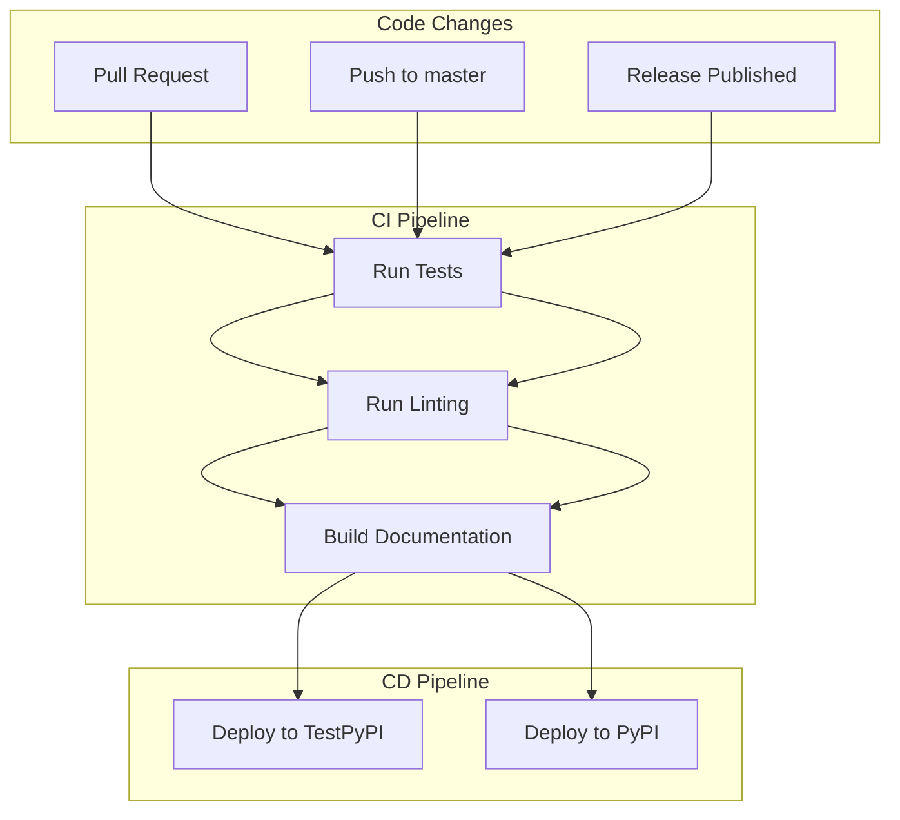
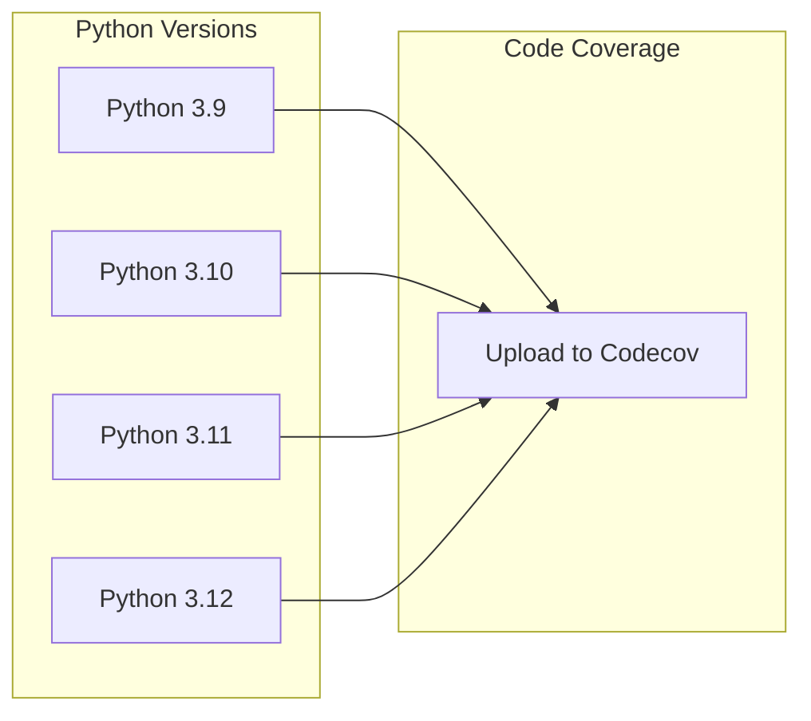
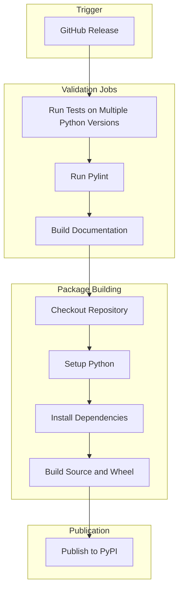
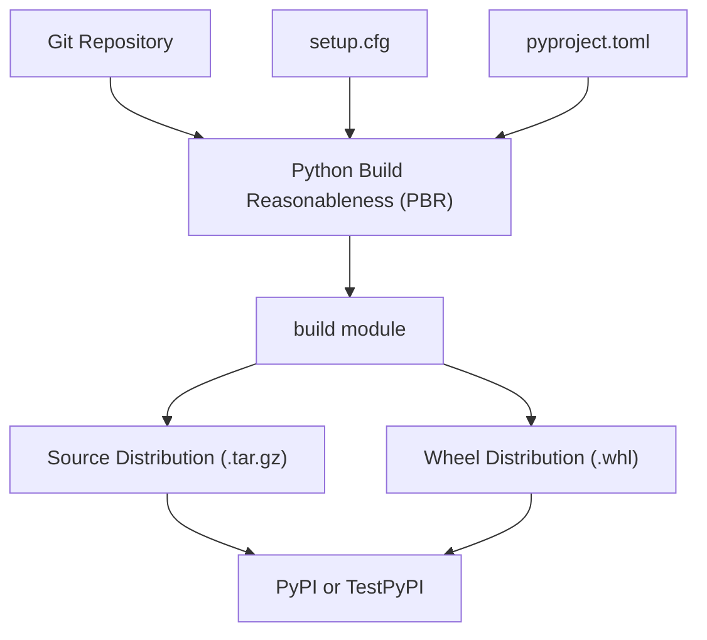

# CI/CD Pipeline

Relevant source files

The following files were used as context for generating this wiki page:

- [.github/workflows/deploy.yml](.github/workflows/deploy.yml)
- [.github/workflows/run_tests.yml](.github/workflows/run_tests.yml)
- [.zenodo.json](.zenodo.json)
- [LICENSE](LICENSE)
- [README.md](README.md)
- [pyproject.toml](pyproject.toml)
- [setup.cfg](setup.cfg)
- [setup.py](setup.py)
- [vermouth/log_helpers.py](vermouth/log_helpers.py)
- [vermouth/tests/__init__.py](vermouth/tests/__init__.py)
- [vermouth/tests/test_logging.py](vermouth/tests/test_logging.py)

This document describes the continuous integration and continuous deployment (CI/CD) pipeline implemented for the vermouth-martinize project. The pipeline automates testing, linting, documentation building, and package deployment processes, helping to maintain code quality and streamline the release process.

For information about writing tests, see [Testing Framework](#4.3.2).

## Overview of the CI/CD Pipeline

The vermouth-martinize project uses GitHub Actions to implement its CI/CD pipeline. The pipeline consists of two main workflows:

1. **Test workflow**: Runs on every push to the master branch and on pull requests
2. **Deploy workflow**: Runs when a new release is published

These workflows ensure that code changes are thoroughly tested before being merged and that releases are automatically published to PyPI.

### CI/CD Pipeline Diagram

Sources: [.github/workflows/run_tests.yml:6-10](), [.github/workflows/run_tests.yml:120-121](), [.github/workflows/deploy.yml:6-8](), [.github/workflows/deploy.yml:118-119]()

## Continuous Integration Workflow

The CI workflow consists of four main jobs that run in sequence: `build` (tests), `lint`, `docs`, and `deploy` (to TestPyPI). This ensures that all aspects of the code are verified before deployment.

### Test Job

The test job is the core of the CI process. It:

1. Runs on multiple Python versions (3.9, 3.10, 3.11, 3.12)
2. Installs DSSP (a dependency for secondary structure determination)
3. Installs the package and test requirements
4. Runs pytest with code coverage
5. Uploads coverage reports to Codecov

### Python Version Test Matrix

Sources: [.github/workflows/run_tests.yml:21-32](), [.github/workflows/run_tests.yml:54-67]()

### Lint Job

The lint job runs Pylint on the codebase with specific quality thresholds:

- The `vermouth` package must achieve at least an 8.0/10 score
- The `martinize2` script must achieve at least a 9.0/10 score

This ensures code quality is maintained across the project.

Sources: [.github/workflows/run_tests.yml:69-92]()

### Documentation Job

The documentation job builds the project documentation using Sphinx. This ensures that documentation is always up to date and properly formatted.

Sources: [.github/workflows/run_tests.yml:94-117]()

## Continuous Deployment Pipeline

The deployment pipeline has two paths:

1. **TestPyPI deployment** - Triggered by successful CI jobs on the master branch
2. **PyPI deployment** - Triggered when a new release is published

### TestPyPI Deployment

After the `build`, `lint`, and `docs` jobs succeed, the `deploy` job:

1. Builds a source distribution and wheel package
2. Publishes the package to TestPyPI

This allows for testing the package installation before an official release.

Sources: [.github/workflows/run_tests.yml:119-154]()

### PyPI Deployment

When a new release is published on GitHub, the deployment workflow:

1. Runs the same build, lint, and documentation jobs as the test workflow
2. Builds a source distribution and wheel package
3. Publishes the package to the official PyPI

Sources: [.github/workflows/deploy.yml:1-151]()

### Deployment Workflow Diagram

Sources: [.github/workflows/deploy.yml:118-151]()

## GitHub Actions Configuration

The CI/CD pipeline is configured using GitHub Actions YAML files located in the `.github/workflows` directory.

### Workflow Triggers

- **Test workflow** (`run_tests.yml`): Triggered on pushes to the master branch and on pull requests to the master branch
- **Deploy workflow** (`deploy.yml`): Triggered when a new release is published

Sources: [.github/workflows/run_tests.yml:6-10](), [.github/workflows/deploy.yml:6-8]()

### Environment Variables

Both workflows use the following environment variables:

- `VERMOUTH_TEST_DSSP`: Set to "mkdssp" to specify the DSSP executable
- `SKIP_GENERATE_AUTHORS`: Set to 1 to skip author generation during build
- `SKIP_WRITE_GIT_CHANGELOG`: Set to 1 to skip changelog generation during build

Sources: [.github/workflows/run_tests.yml:12-15](), [.github/workflows/deploy.yml:10-13]()

## Package Building and Publishing Process

### Package Building Tools

The project uses the following tools for package building:

- **PBR (Python Build Reasonableness)**: Handles versioning based on git tags
- **setuptools**: Handles package metadata and dependencies
- **build**: Modern Python package builder

Sources: [pyproject.toml:1-8](), [setup.cfg:1-48](), [setup.py:1-31]()

### Package Configuration

The package metadata and build configuration are defined in several files:

- **setup.cfg**: Contains package metadata, dependencies, and classifiers
- **pyproject.toml**: Defines build system requirements
- **setup.py**: Handles package data files and script installation

#### Key Configuration Files

| File | Purpose |
|------|---------|
| setup.cfg | Package metadata, dependencies, Python version compatibility |
| pyproject.toml | Build system requirements, pytest configuration, coverage settings |
| setup.py | Package data inclusion, script installation |

Sources: [setup.cfg:1-48](), [pyproject.toml:1-17](), [setup.py:1-31]()

## CI Badges and Status Indicators

The project uses several badges in its README to indicate the status of various CI aspects:

- GitHub Actions build status
- Codecov code coverage
- Documentation status
- DOI for citing the project
- arXiv paper reference

These badges provide quick visibility into the project's health and status.

Sources: [README.md:1-8]()

## Additional CI/CD Considerations

### Code Coverage

Code coverage tracking is implemented through the coverage.py tool and integrated with Codecov. This helps maintain and improve test coverage over time.

The coverage configuration in `pyproject.toml` specifies:
- Branch coverage is enabled
- Certain directories like tests and redistributed code are excluded from coverage reports

Sources: [pyproject.toml:14-17](), [.github/workflows/run_tests.yml:54-67](), [.github/workflows/deploy.yml:52-65]()

### Documentation Generation

Documentation is built using Sphinx with the following settings:
- Source directory: `doc/source`
- Build directory: `doc/build`
- Warnings are treated as errors
- HTML is the primary builder format

Sources: [setup.cfg:44-48](), [.github/workflows/run_tests.yml:94-117]()

---