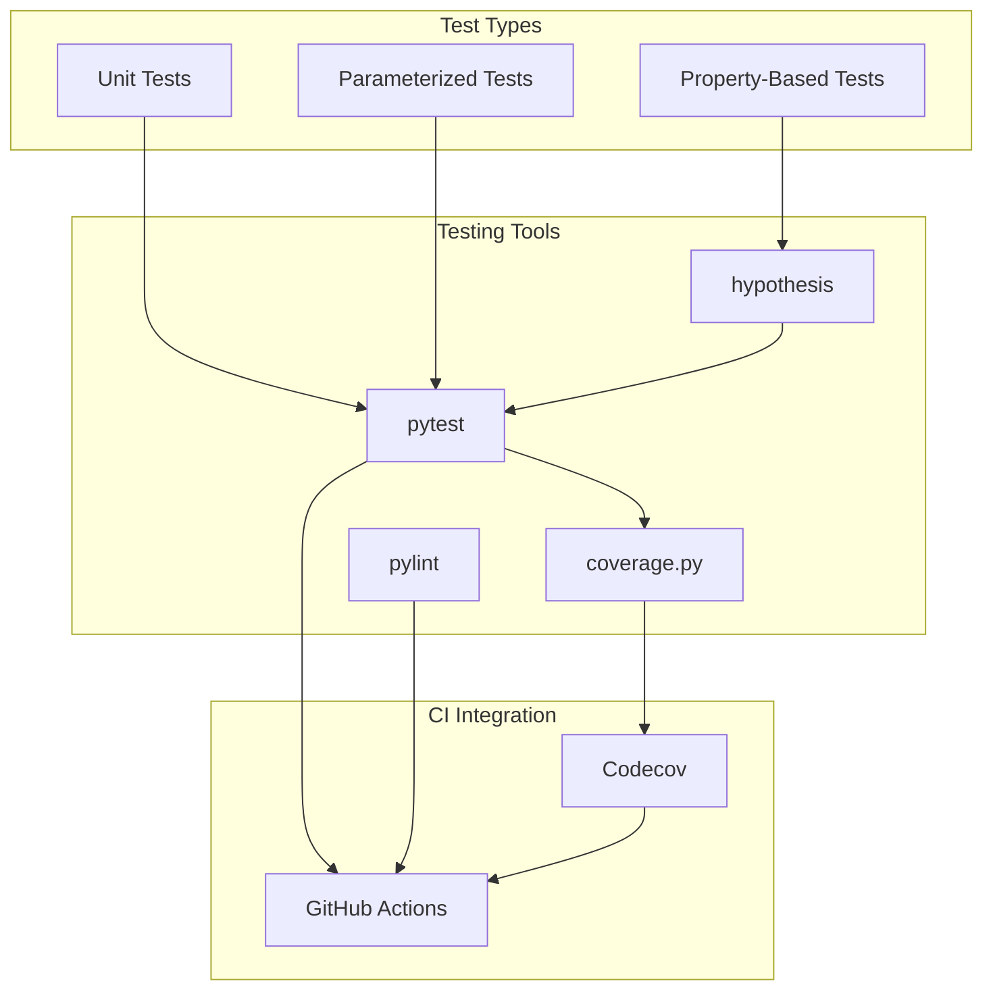
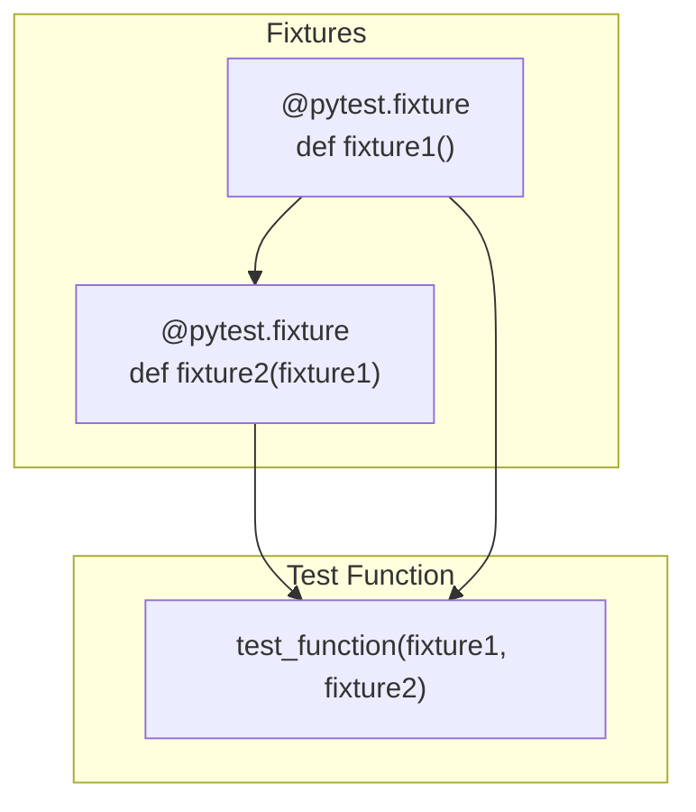
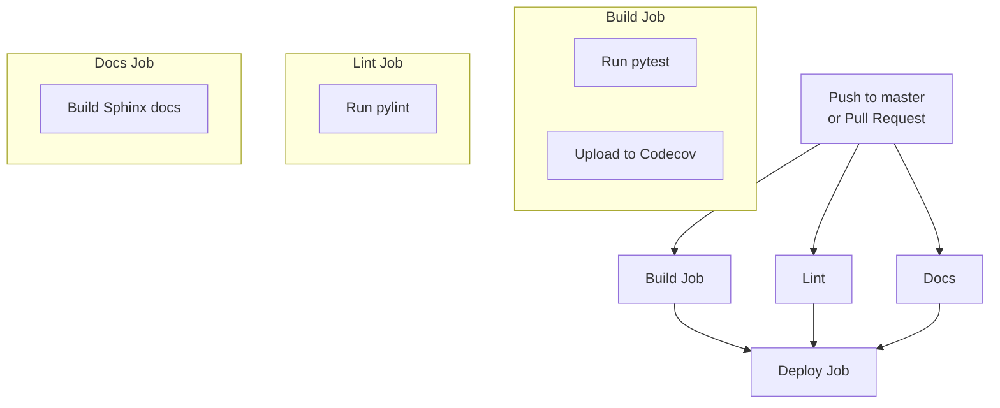
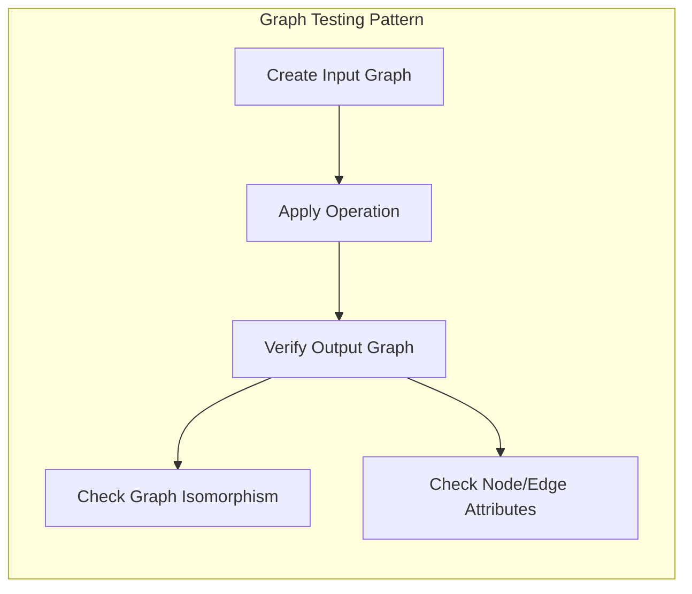

# Testing Framework

<details>
<summary>Relevant source files</summary>

The following files were used as context for generating this wiki page:

- [.github/workflows/deploy.yml](.github/workflows/deploy.yml)
- [.github/workflows/run_tests.yml](.github/workflows/run_tests.yml)
- [LICENSE](LICENSE)
- [pyproject.toml](pyproject.toml)
- [vermouth/ffinput.py](vermouth/ffinput.py)
- [vermouth/gmx/itp_read.py](vermouth/gmx/itp_read.py)
- [vermouth/graph_utils.py](vermouth/graph_utils.py)
- [vermouth/ismags.py](vermouth/ismags.py)
- [vermouth/parser_utils.py](vermouth/parser_utils.py)
- [vermouth/processors/canonicalize_modifications.py](vermouth/processors/canonicalize_modifications.py)
- [vermouth/processors/repair_graph.py](vermouth/processors/repair_graph.py)
- [vermouth/tests/helper_functions.py](vermouth/tests/helper_functions.py)
- [vermouth/tests/test_ff_files.py](vermouth/tests/test_ff_files.py)
- [vermouth/tests/test_forcefield.py](vermouth/tests/test_forcefield.py)
- [vermouth/tests/test_graph_utils.py](vermouth/tests/test_graph_utils.py)
- [vermouth/tests/test_ismags.py](vermouth/tests/test_ismags.py)
- [vermouth/tests/test_itp_files.py](vermouth/tests/test_itp_files.py)
- [vermouth/tests/test_ptm_detection.py](vermouth/tests/test_ptm_detection.py)
- [vermouth/tests/test_repair_graph.py](vermouth/tests/test_repair_graph.py)

</details>


This document describes the testing framework used in the Vermouth-Martinize project. It outlines the tools, patterns, and practices used for testing the codebase, as well as how to write effective tests. For information on the CI/CD pipeline that runs these tests, see [CI/CD Pipeline](#4.3.1).

## Overview

The Vermouth-Martinize project uses a comprehensive testing approach based on pytest, with additional tools for coverage analysis, property-based testing, and code quality checking. Tests are an integral part of the development workflow and are automatically run on all pull requests and commits to the master branch.



Sources: [.github/workflows/run_tests.yml:54-58](), [pyproject.toml:9-16]()

## Test Organization and Structure

Tests in the Vermouth-Martinize project follow a consistent organization pattern.

```mermaid
classDiagram
    class "Project Structure" {
        vermouth/
        vermouth/tests/
        vermouth/tests/test_*.py
        vermouth/tests/helper_functions.py
        vermouth/tests/datafiles/
    }
    
    class "Test File Structure" {
        imports
        fixtures
        test_functions
        helper_functions
    }
    
    class "Test Function" {
        +test_name()
        +@pytest.mark.parametrize()
        +assertions
    }
    
    "Project Structure" --> "Test File Structure": contains
    "Test File Structure" --> "Test Function": contains
```

All tests are located in the `vermouth/tests/` directory with filenames following the pattern `test_*.py`. Helper functions and common fixtures are defined in `helper_functions.py`.

Sources: [pyproject.toml:9-12](), [vermouth/tests/helper_functions.py:15-235]()

## Testing Tools and Configuration

### pytest

The primary testing framework used is pytest. It's configured in the project's `pyproject.toml` file:

```toml
[tool.pytest.ini_options]
addopts = "--import-mode=importlib"
testpaths = ["vermouth/tests"]
python_files = "test_*.py"
```

### Coverage

Code coverage measurement is performed using coverage.py, which is integrated with pytest in the CI pipeline. The configuration in `pyproject.toml` specifies which files to include/exclude:

```toml
[tool.coverage.run]
branch = true
omit = ["vermouth/tests/*", "vermouth/redistributed/*", '*/bin/pytest']
source_pkgs = ["vermouth"]
```

### Pylint

Code quality is enforced using pylint with different thresholds for different parts of the codebase:

- Vermouth library: minimum score of 8.0
- martinize2 command-line tool: minimum score of 9.0

Sources: [.github/workflows/run_tests.yml:88-91](), [pyproject.toml:9-16]()

## Writing Tests

### Basic Test Structure

Tests in the Vermouth-Martinize project typically follow this structure:

```python
# Import required modules
import pytest
import vermouth

# Define test function
def test_function_name():
    # Set up test data
    input_data = ...
    
    # Call the function under test
    result = vermouth.module.function(input_data)
    
    # Assert expected outcomes
    assert result == expected_result
```

### Using Fixtures

Fixtures are extensively used to set up test conditions and provide reusable test components:



Example fixtures are defined in test files like `test_repair_graph.py`, where fixtures create test systems with specific characteristics that can be reused across multiple tests.

Sources: [vermouth/tests/test_repair_graph.py:161-186]()

### Parameterized Testing

Many tests use parameterization to run the same test logic with different input values:

```python
@pytest.mark.parametrize('input_data, expected_output', [
    (input1, output1),
    (input2, output2),
    # ...more test cases
])
def test_something(input_data, expected_output):
    result = function_under_test(input_data)
    assert result == expected_output
```

This approach reduces code duplication and makes it easy to add more test cases.

Sources: [vermouth/tests/test_graph_utils.py:46-68](), [vermouth/tests/test_repair_graph.py:190-200]()

### Property-Based Testing with Hypothesis

For some components, especially those with complex logic like graph algorithms, property-based testing with the Hypothesis library is used:

```python
@given(graph_builder(...))
def test_property(graph):
    # Test that some property holds for any valid graph
    assert property_function(graph)
```

This is particularly evident in the ISMAGS algorithm tests, where randomly generated graphs are used to test isomorphism properties.

Sources: [vermouth/tests/test_ismags.py:152-158]()

## Test Helper Functions

The project includes several helper functions to simplify test writing:

```mermaid
classDiagram
    class "Helper Functions" {
        +make_into_set(iter_of_dict)
        +equal_graphs(g1, g2, node_attrs, edge_attrs)
        +basic_molecule(node_data, edge_data)
        +create_sys_all_attrs(...)
        +test_molecule()
    }
    
    class "Test Functions" {
        +test_something(fixture)
    }
    
    "Helper Functions" --> "Test Functions": used by
```

Key helper functions include:

- `make_into_set()`: Converts iterables of dictionaries to sets for comparison
- `equal_graphs()`: Compares graph isomorphism with attribute matching
- `basic_molecule()`: Creates a simple molecule from node and edge data
- Various fixtures that provide ready-to-use molecular structures

Sources: [vermouth/tests/helper_functions.py:28-34](), [vermouth/tests/helper_functions.py:36-65](), [vermouth/tests/helper_functions.py:88-153]()

## CI/CD Integration

Tests are integrated into the CI/CD pipeline using GitHub Actions:



The pipeline runs tests on multiple Python versions (3.9, 3.10, 3.11, 3.12) to ensure compatibility. Code coverage is measured during test execution and uploaded to Codecov for tracking and visualization.

Sources: [.github/workflows/run_tests.yml:18-33](), [.github/workflows/run_tests.yml:54-67]()

## Test Patterns and Best Practices

### Testing Graph Operations

Since Vermouth-Martinize heavily relies on graph operations, many tests follow patterns for testing graph isomorphism, attribute matching, and transformation correctness:



This pattern can be seen in tests for graph repairs, modifications, and transformations.

Sources: [vermouth/tests/test_repair_graph.py:402-405](), [vermouth/tests/test_graph_utils.py:434-442]()

### Testing Parsers

For testing file parsers (like those for ITP and FF files), the pattern typically involves:

1. Create a string containing the file content
2. Parse the string 
3. Check that the resulting data structure matches expectations

This approach is used in tests like `test_itp_files.py` and `test_ff_files.py`.

Sources: [vermouth/tests/test_itp_files.py:25-35](), [vermouth/tests/test_ff_files.py:27-37]()

## Adding New Tests

When adding new functionality, follow these steps to add tests:

1. Create a new test file in `vermouth/tests/` if testing a new module
2. Use existing test patterns and fixtures where applicable
3. Write parameterized tests to cover multiple input cases
4. Use property-based testing for algorithms with complex properties
5. Ensure your tests have good coverage of edge cases
6. Use meaningful test names that describe what is being tested

---