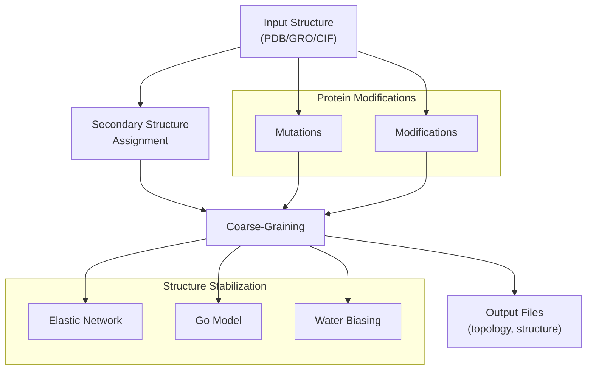
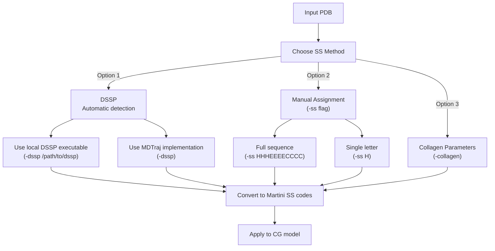
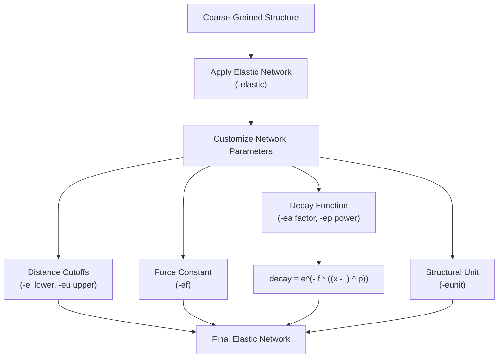
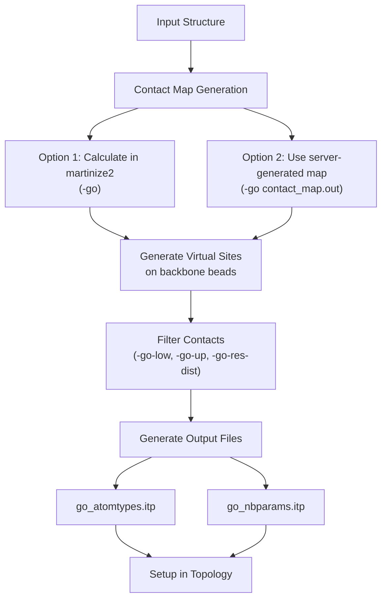
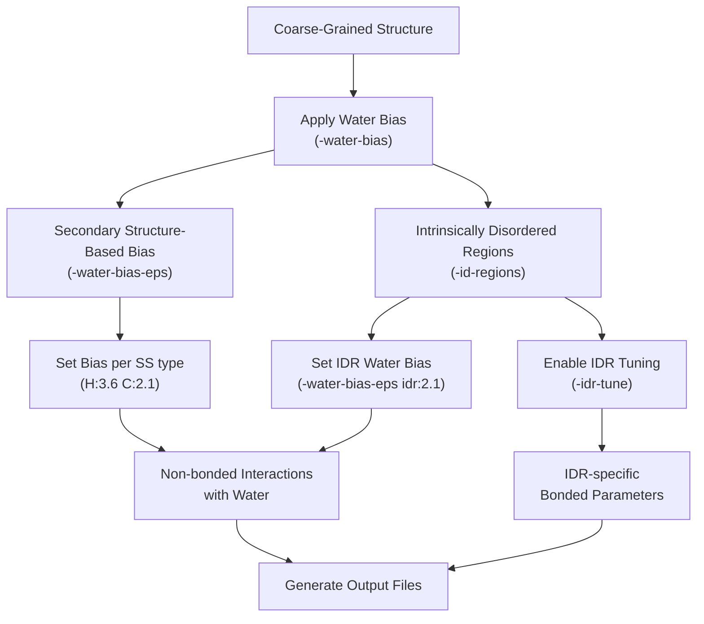
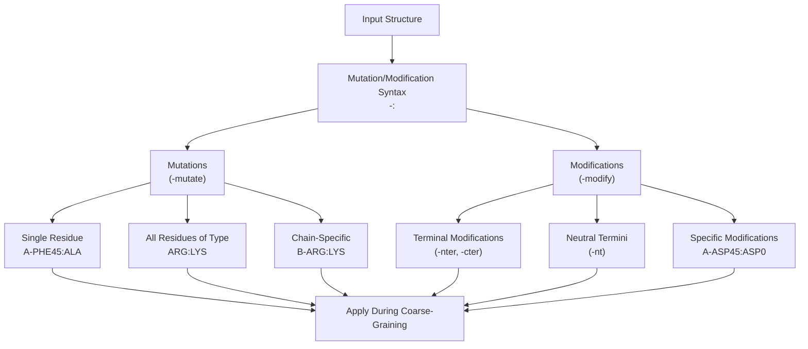

# Tutorials

<details>
<summary>Relevant source files</summary>

The following files were used as context for generating this wiki page:

- [bin/martinize2](bin/martinize2)
- [doc/source/tutorials/basic_usage.rst](doc/source/tutorials/basic_usage.rst)
- [doc/source/tutorials/elastic_examples.png](doc/source/tutorials/elastic_examples.png)
- [doc/source/tutorials/elastic_networks.rst](doc/source/tutorials/elastic_networks.rst)
- [doc/source/tutorials/go_models.rst](doc/source/tutorials/go_models.rst)
- [doc/source/tutorials/index.rst](doc/source/tutorials/index.rst)
- [doc/source/tutorials/mutations_and_modifications.rst](doc/source/tutorials/mutations_and_modifications.rst)
- [doc/source/tutorials/water_biasing.rst](doc/source/tutorials/water_biasing.rst)
- [vermouth/dssp/dssp.py](vermouth/dssp/dssp.py)
- [vermouth/processors/__init__.py](vermouth/processors/__init__.py)
- [vermouth/processors/annotate_idrs.py](vermouth/processors/annotate_idrs.py)
- [vermouth/tests/test_annotate_idrs.py](vermouth/tests/test_annotate_idrs.py)
- [vermouth/tests/test_dssp.py](vermouth/tests/test_dssp.py)
- [vermouth/tests/test_selectors.py](vermouth/tests/test_selectors.py)
- [vermouth/tests/test_version.py](vermouth/tests/test_version.py)

</details>


This page provides practical guides for using martinize2 in various scenarios. It serves as a starting point for both new and experienced users who want to learn how to effectively use martinize2 for coarse-graining molecular structures. These tutorials cover basic usage as well as more advanced features like applying elastic networks, Go models, water biasing, and making mutations or modifications to proteins during the coarse-graining process.

## Tutorial Overview

The following diagram shows the general workflow of martinize2 and the key features covered in these tutorials:



Sources: [bin/martinize2:1-1059](), [vermouth/dssp/dssp.py:1-150]()

## Basic Usage

The most basic use of martinize2 converts an atomistic protein structure to a coarse-grained model:

```
martinize2 -f protein.pdb -o topol.top -x cg_protein.pdb
```

This command takes a protein PDB file as input (`-f`), produces a GROMACS topology file (`-o`), and outputs the coarse-grained structure in PDB format (`-x`). By default, martinize2 uses the Martini 3 force field.

### Force Field Selection

You can select different force fields using the `-ff` option:

```
martinize2 -f protein.pdb -o topol.top -x cg_protein.pdb -ff martini22
```

To see all available force fields:

```
martinize2 -list-ff
```

### Secondary Structure Considerations

For realistic coarse-grained models, you need to account for secondary structure:

```
martinize2 -f protein.pdb -o topol.top -x cg_protein.pdb -dssp
```

Sources: [bin/martinize2:871-971](), [doc/source/tutorials/basic_usage.rst:1-57]()

## Secondary Structure Handling

Secondary structure determination is critical for proper coarse-graining of proteins. Martinize2 offers several options:



### Using DSSP

DSSP automatically determines secondary structure from atomic coordinates:

```
martinize2 -f protein.pdb -o topol.top -x cg_protein.pdb -dssp
```

If you have a local DSSP executable:

```
martinize2 -f protein.pdb -o topol.top -x cg_protein.pdb -dssp /path/to/dssp
```

### Manual Assignment

To manually specify secondary structure:

```
martinize2 -f protein.pdb -o topol.top -x cg_protein.pdb -ss HHHEEEECCCC
```

This requires one character per residue in the protein. Alternatively, to set all residues to the same secondary structure:

```
martinize2 -f protein.pdb -o topol.top -x cg_protein.pdb -ss H
```

Sources: [bin/martinize2:442-461](), [vermouth/dssp/dssp.py:384-446](), [doc/source/tutorials/basic_usage.rst:26-83]()

## Elastic Networks

Elastic networks help maintain protein structure by adding harmonic bonds between backbone beads within a cutoff distance.



To add a basic elastic network:

```
martinize2 -f protein.pdb -o topol.top -x cg_protein.pdb -dssp -elastic
```

### Customizing Elastic Networks

You can customize various aspects of the elastic network:

- Force constant: `-ef 700` (default: 700 kJ/mol/nm²)
- Distance cutoffs: `-el 0` (lower bound, default: 0) and `-eu 0.9` (upper bound, default: 0.9 nm)
- Decay parameters: `-ea` (decay factor) and `-ep` (decay power)
- Structural unit: `-eunit molecule|chain|all|<resid ranges>`

Example with custom parameters:

```
martinize2 -f protein.pdb -o topol.top -x cg_protein.pdb -dssp -elastic -ef 500 -el 0.5 -eu 1.2 -ea 0.5 -ep 2
```

### Structural Units

By default, elastic bonds are only created within each molecule. To change this:

```
martinize2 -f protein.pdb -o topol.top -x cg_protein.pdb -dssp -elastic -eunit chain
```

To specify regions where elastic bonds should be applied:

```
martinize2 -f protein.pdb -o topol.top -x cg_protein.pdb -dssp -elastic -eunit 1:100,150:200
```

This creates elastic bonds within residues 1-100 and 150-200, but not between them.

Sources: [bin/martinize2:472-546](), [doc/source/tutorials/elastic_networks.rst:1-136]()

## Go Models

Go models maintain protein structure through non-bonded interactions based on native contacts. Martinize2 implements this using virtual sites placed on backbone beads.



To add a Go model calculated on-the-fly:

```
martinize2 -f protein.pdb -o topol.top -x cg_protein.pdb -dssp -go
```

To use a pre-calculated contact map:

```
martinize2 -f protein.pdb -o topol.top -x cg_protein.pdb -dssp -go contact_map.out
```

### Customizing Go Models

You can customize Go model parameters:

- Interaction strength: `-go-eps 9.414` (default: 9.414 kJ/mol)
- Distance cutoffs: `-go-low 0.3` (minimum, default: 0.3 nm) and `-go-up 1.1` (maximum, default: 1.1 nm)
- Residue distance cutoff: `-go-res-dist 3` (default: 3 residues)
- Backbone bead name: `-go-backbone BB` (default: BB)
- Virtual site atom name: `-go-atomname CA` (default: CA)

Example with custom parameters:

```
martinize2 -f protein.pdb -o topol.top -x cg_protein.pdb -dssp -go -go-eps 7.5 -go-low 0.4 -go-up 1.0
```

### Using Go Models in Simulations

The Go model generates two additional files:
1. `go_atomtypes.itp`: Defines virtual site atom types
2. `go_nbparams.itp`: Defines non-bonded interactions between virtual sites

To use these in GROMACS, you need to include them in your force field file and activate them with a preprocessor directive:

```
#ifdef GO_VIRT
#include "go_atomtypes.itp"
#endif

[nonbond_params]
...

#ifdef GO_VIRT
#include "go_nbparams.itp"
#endif
```

Then in your topology file, add `#define GO_VIRT` to activate the Go model.

Sources: [bin/martinize2:547-608](), [doc/source/tutorials/go_models.rst:1-184]()

## Water Biasing

Water biasing adjusts the interaction between proteins and water based on secondary structure elements or intrinsically disordered regions.



To apply water bias based on secondary structure:

```
martinize2 -f protein.pdb -o topol.top -x cg_protein.pdb -dssp -water-bias -water-bias-eps H:3.6 C:2.1
```

This creates additional interactions between water and the backbone virtual sites, with an epsilon of 3.6 kJ/mol for helices and 2.1 kJ/mol for coils.

### Intrinsically Disordered Regions

To specify and bias intrinsically disordered regions:

```
martinize2 -f protein.pdb -o topol.top -x cg_protein.pdb -dssp -id-regions 1:10 65:92 -idr-tune -water-bias -water-bias-eps idr:2.1
```

This:
1. Identifies residues 1-10 and 65-92 as disordered regions
2. Applies special bonded parameters with `-idr-tune`
3. Adds water bias with strength 2.1 kJ/mol for these regions

Sources: [bin/martinize2:610-646](), [vermouth/processors/annotate_idrs.py:1-114](), [doc/source/tutorials/water_biasing.rst:1-73]()

## Mutations and Modifications

Martinize2 allows you to apply mutations and modifications to proteins during coarse-graining.



### Mutations

To mutate a specific residue:

```
martinize2 -f protein.pdb -o topol.top -x cg_protein.pdb -dssp -mutate A-PHE45:ALA
```

To mutate all residues of a specific type:

```
martinize2 -f protein.pdb -o topol.top -x cg_protein.pdb -dssp -mutate ARG:LYS
```

To mutate residues only on a specific chain:

```
martinize2 -f protein.pdb -o topol.top -x cg_protein.pdb -dssp -mutate B-ARG:LYS
```

### Modifications

To modify termini:

```
martinize2 -f protein.pdb -o topol.top -x cg_protein.pdb -dssp -nter NH2-ter -cter COOH-ter
```

To use neutral termini (shorthand):

```
martinize2 -f protein.pdb -o topol.top -x cg_protein.pdb -dssp -nt
```

To apply specific modifications:

```
martinize2 -f protein.pdb -o topol.top -x cg_protein.pdb -dssp -modify A-ASP45:ASP0
```

**Note:** While martinize2 can apply mutations and modifications to the topology, it does not create actual coordinates for new atoms. These may appear as "NaN" in the output structure file.

Sources: [bin/martinize2:649-730](), [doc/source/tutorials/mutations_and_modifications.rst:1-54]()

## Additional Features

### Cysteine Bridges

Martinize2 can automatically detect and create cysteine bridges:

```
martinize2 -f protein.pdb -o topol.top -x cg_protein.pdb -dssp -cys auto
```

You can also specify a distance cutoff:

```
martinize2 -f protein.pdb -o topol.top -x cg_protein.pdb -dssp -cys 0.5
```

### Molecule Naming

By default, molecules are named `molecule_0`, `molecule_1`, etc. To change this:

```
martinize2 -f protein.pdb -o topol.top -x cg_protein.pdb -dssp -name myprotein
```

This will name the molecules `myprotein_0`, `myprotein_1`, etc., which is particularly important when using Go models to ensure unique atom names.

### Side Chain Fixing

From version 0.12.0 onward, side chain fixing is applied automatically. For earlier versions, use:

```
martinize2 -f protein.pdb -o topol.top -x cg_protein.pdb -dssp -scfix
```

To disable side chain fixing:

```
martinize2 -f protein.pdb -o topol.top -x cg_protein.pdb -dssp -noscfix
```

Sources: [bin/martinize2:664-671](), [doc/source/tutorials/basic_usage.rst:89-152]()

---