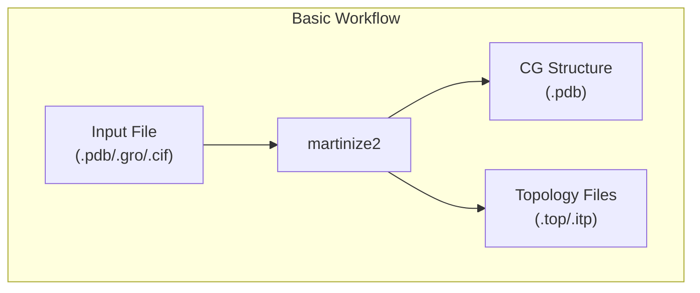
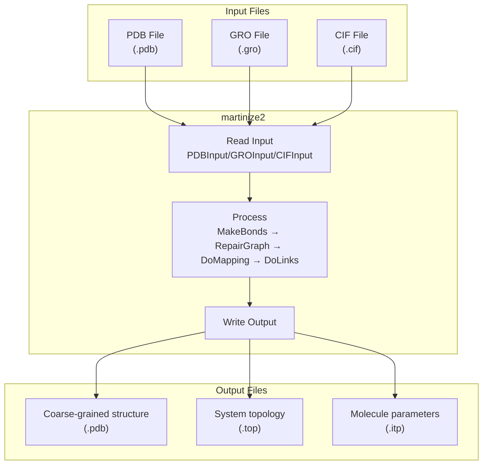
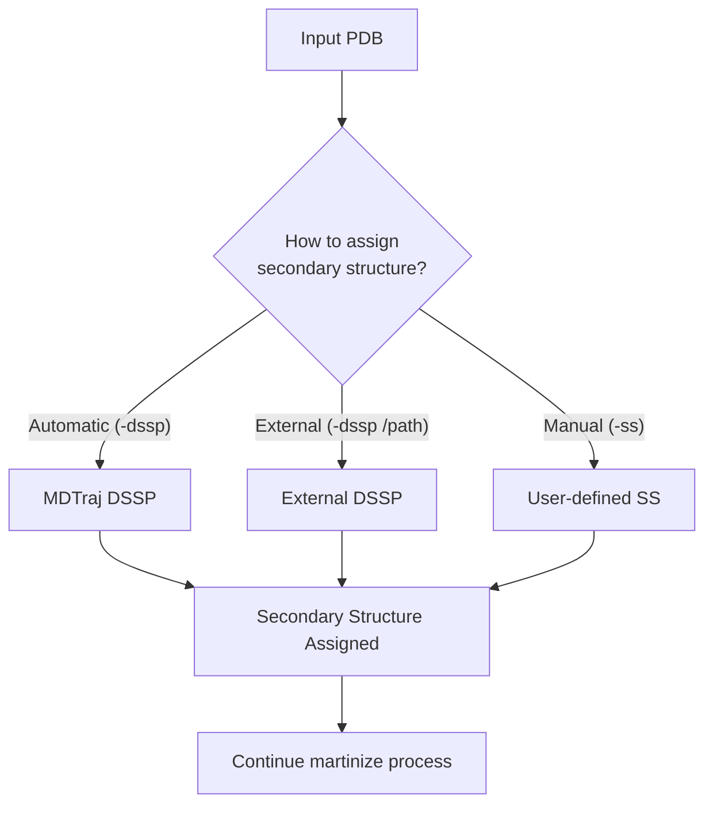
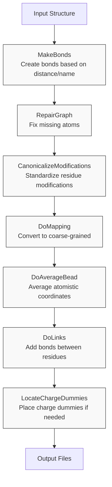

# Basic Usage

<details>
<summary>Relevant source files</summary>

The following files were used as context for generating this wiki page:

- [bin/martinize2](bin/martinize2)
- [doc/source/tutorials/basic_usage.rst](doc/source/tutorials/basic_usage.rst)
- [doc/source/tutorials/elastic_examples.png](doc/source/tutorials/elastic_examples.png)
- [doc/source/tutorials/elastic_networks.rst](doc/source/tutorials/elastic_networks.rst)
- [doc/source/tutorials/go_models.rst](doc/source/tutorials/go_models.rst)
- [doc/source/tutorials/index.rst](doc/source/tutorials/index.rst)
- [doc/source/tutorials/mutations_and_modifications.rst](doc/source/tutorials/mutations_and_modifications.rst)
- [doc/source/tutorials/water_biasing.rst](doc/source/tutorials/water_biasing.rst)
- [vermouth/dssp/dssp.py](vermouth/dssp/dssp.py)
- [vermouth/processors/__init__.py](vermouth/processors/__init__.py)
- [vermouth/processors/annotate_idrs.py](vermouth/processors/annotate_idrs.py)
- [vermouth/tests/test_annotate_idrs.py](vermouth/tests/test_annotate_idrs.py)
- [vermouth/tests/test_dssp.py](vermouth/tests/test_dssp.py)
- [vermouth/tests/test_selectors.py](vermouth/tests/test_selectors.py)
- [vermouth/tests/test_version.py](vermouth/tests/test_version.py)

</details>


This document provides a step-by-step guide for using martinize2, a tool for converting atomistic molecular structures to coarse-grained models using the Martini force field. It covers the basic command-line interface, essential flags, and common usage scenarios. For more advanced features like elastic networks and Go models, see [Adding Elastic Networks](#5.2) and [Working with Go Models](#5.3).

## Martinize2 Overview

Martinize2 is a command-line tool that converts atomistic structures (usually proteins) into coarse-grained models compatible with the Martini force field. The basic workflow involves:

1. Reading an input structure file (PDB, GRO, or CIF)
2. Processing the structure (repairing, mapping to coarse-grained representation)
3. Writing output files (topology and structure) ready for simulation



Sources: [bin/martinize2:1-1100]()

## Command-Line Basics

The most minimal command to convert a protein to a coarse-grained representation:

```
martinize2 -f protein.pdb -o topol.top -x cg_protein.pdb
```

This command:
- Reads an atomistic structure from `protein.pdb`
- Produces a coarse-grained structure in `cg_protein.pdb`
- Generates topology files starting with `topol.top`

By default, martinize2 uses the Martini 3.0.0.1 force field. To view available force fields:

```
martinize2 -list-ff
```

To use a specific force field:

```
martinize2 -f protein.pdb -o topol.top -x cg_protein.pdb -ff martini22
```

Sources: [bin/martinize2:294-399](), [bin/martinize2:806-845](), [doc/source/tutorials/basic_usage.rst:1-19]()

## Input/Output File Structure



Sources: [bin/martinize2:81-104](), [bin/martinize2:169-192](), [bin/martinize2:1000-1033]()

### Output Files Explanation:

- **Coarse-grained structure (.pdb)**: Contains the coordinates of coarse-grained beads
- **System topology (.top)**: Main GROMACS topology file that includes component molecules
- **Molecule parameters (.itp)**: Contains parameters for each molecule type (one per molecule by default)

## Secondary Structure Assignment

Martini requires secondary structure information to correctly parametrize proteins. There are three ways to provide this:

1. **Automatic using DSSP** (recommended):
   ```
   martinize2 -f protein.pdb -o topol.top -x cg_protein.pdb -dssp
   ```
   
2. **Using an external DSSP executable**:
   ```
   martinize2 -f protein.pdb -o topol.top -x cg_protein.pdb -dssp /path/to/dssp
   ```
   
3. **Manual assignment**:
   ```
   martinize2 -f protein.pdb -o topol.top -x cg_protein.pdb -ss HHHHHCCCCCEEEEE
   ```
   Where the string length must match the number of residues, or use a single letter (e.g., `-ss H`) to apply uniformly.



Sources: [bin/martinize2:442-470](), [vermouth/dssp/dssp.py:560-645](), [doc/source/tutorials/basic_usage.rst:20-85]()

## Essential Flags and Options

### Force Field Selection
- `-ff <name>`: Specify the force field (default: martini3001)
- `-from <name>`: Specify the input force field (default: charmm)
- `-ff-dir <path>`: Provide additional force field directory
- `-map-dir <path>`: Provide additional mapping directory

### Side Chain Fixing
Side chain fixing adds special bonded terms to ensure correct sampling of side chain dynamics:
- In martinize2 ≥ 0.12.0, side chain fixing is done automatically
- For older versions, use `-scfix` flag
- To disable, use `-noscfix`

### Cysteine Bridges
Martinize2 can identify and create disulfide bridges:
- `-cys auto`: Automatically detect bridges (default)
- `-cys <distance>`: Use custom distance cutoff in nm
- `-cys none`: Disable cysteine bridges

### Molecule Naming
- `-name <prefix>`: Set prefix for molecule names (default: molecule)
- `-sep`: Write separate topologies for identical chains

Sources: [bin/martinize2:387-414](), [bin/martinize2:649-670](), [bin/martinize2:957-974](), [doc/source/tutorials/basic_usage.rst:89-165]()

## Processing Pipeline



Sources: [bin/martinize2:106-167](), [bin/martinize2:169-192](), [vermouth/processors/__init__.py:1-49]()

## Complete Example

Let's walk through a complete example converting an atomistic protein to a coarse-grained model:

1. **Basic conversion with automatic secondary structure detection**:
   ```
   martinize2 -f protein.pdb -o topol.top -x cg_protein.pdb -dssp
   ```

2. **Examining output files**:
   - `topol.top`: Main topology file that includes:
     - Force field parameters
     - Included molecule parameter files
     - System composition
   - `molecule_0.itp`: Molecule parameters including:
     - Atoms definition
     - Bonds, angles, dihedrals
     - Constraints
   - `cg_protein.pdb`: 3D structure with coarse-grained beads

3. **Building a simulation system** (outside of martinize2):
   - Add solvent, ions, etc. to your system
   - Set up an energy minimization and simulation with GROMACS

Sources: [doc/source/tutorials/basic_usage.rst:1-185]()

## Common Options Table

| Flag | Description | Default | Example |
|------|-------------|---------|---------|
| `-f` | Input structure file | Required | `-f protein.pdb` |
| `-o` | Output topology file | Required | `-o topol.top` |
| `-x` | Output coarse-grained structure | Optional | `-x cg_protein.pdb` |
| `-ff` | Target force field | martini3001 | `-ff martini22` |
| `-dssp` | Use DSSP for secondary structure | - | `-dssp` or `-dssp /path/to/dssp` |
| `-ss` | Manual secondary structure | - | `-ss HHHHEEEECCCC` |
| `-name` | Molecule name prefix | molecule | `-name Protein_A` |
| `-cys` | Cysteine bridge detection | auto | `-cys 0.5` |
| `-ignore` | Ignore residues | - | `-ignore HOH,SOL` |
| `-scfix` | Apply side chain corrections | True (v≥0.12) | Not needed in newer versions |
| `-noscfix` | Disable side chain corrections | - | `-noscfix` |

Sources: [bin/martinize2:293-747]()

## Troubleshooting

### Handling Warnings
Martinize2 issues warnings when it encounters issues. You can control how many warnings are allowed:
```
martinize2 -f protein.pdb -o topol.top -x cg_protein.pdb -maxwarn 10
```

### Missing Atoms
If your input structure has missing atoms, martinize2 will try to repair them. However, for significant gaps, you may need to fix your input structure using external tools.

### Secondary Structure Assignment
If DSSP fails or gives unexpected results, try manually specifying the secondary structure with `-ss`.

Sources: [bin/martinize2:769-780](), [doc/source/tutorials/basic_usage.rst:170-185]()

## Citations

Martinize2 collects paper citation information based on the features used. The citations are printed at the end of execution and included in the output topology files. Please cite all the papers mentioned to give proper credit to the authors.

Sources: [doc/source/tutorials/basic_usage.rst:173-185]()

---