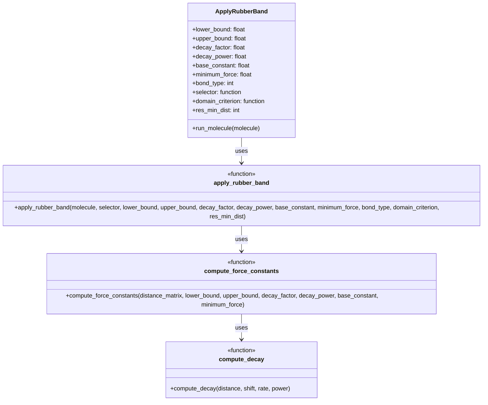
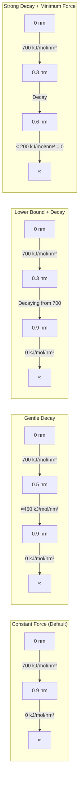
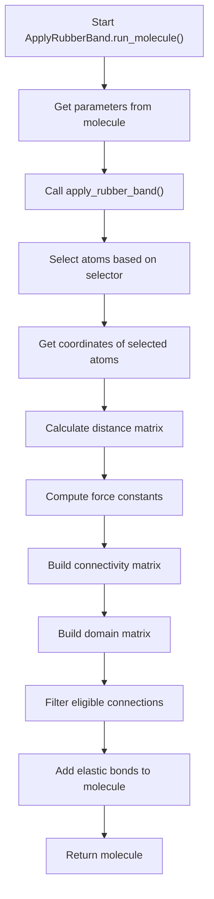

# Adding Elastic Networks

<details>
<summary>Relevant source files</summary>

The following files were used as context for generating this wiki page:

- [doc/source/tutorials/basic_usage.rst](doc/source/tutorials/basic_usage.rst)
- [doc/source/tutorials/elastic_examples.png](doc/source/tutorials/elastic_examples.png)
- [doc/source/tutorials/elastic_networks.rst](doc/source/tutorials/elastic_networks.rst)
- [doc/source/tutorials/go_models.rst](doc/source/tutorials/go_models.rst)
- [doc/source/tutorials/index.rst](doc/source/tutorials/index.rst)
- [doc/source/tutorials/mutations_and_modifications.rst](doc/source/tutorials/mutations_and_modifications.rst)
- [doc/source/tutorials/water_biasing.rst](doc/source/tutorials/water_biasing.rst)
- [vermouth/processors/apply_rubber_band.py](vermouth/processors/apply_rubber_band.py)
- [vermouth/processors/attach_mass.py](vermouth/processors/attach_mass.py)
- [vermouth/processors/average_beads.py](vermouth/processors/average_beads.py)
- [vermouth/processors/gro_reader.py](vermouth/processors/gro_reader.py)
- [vermouth/processors/locate_charge_dummies.py](vermouth/processors/locate_charge_dummies.py)
- [vermouth/processors/pdb_reader.py](vermouth/processors/pdb_reader.py)
- [vermouth/processors/rename_modified_residues.py](vermouth/processors/rename_modified_residues.py)
- [vermouth/tests/test_apply_rubber_band.py](vermouth/tests/test_apply_rubber_band.py)

</details>


This page provides a technical guide for applying elastic networks to molecules in the vermouth-martinize system. Elastic networks are harmonic bonds added between backbone beads to maintain protein structure during coarse-grained simulations. Unlike Gō models (which you can learn about in [Working with Go Models](#5.3)), elastic networks apply distance-based restraints without requiring information about native contacts.

## Overview of Elastic Networks

Elastic networks are a method to maintain protein secondary and tertiary structure in coarse-grained simulations. In Martini and other coarse-grained force fields, additional restraints are necessary to preserve protein folding in the absence of explicit hydrogen bonding.


Sources: [vermouth/processors/apply_rubber_band.py:3-16](), [doc/source/tutorials/elastic_networks.rst:1-13]()

The elastic network implementation adds harmonic bonds between selected backbone beads that are within a certain distance cutoff and meet other specified criteria. The strength of these bonds can be constant or decay with distance according to a mathematical formula.

## Core Components

The elastic network functionality is implemented through the `ApplyRubberBand` processor and its supporting functions.



Sources: [vermouth/processors/apply_rubber_band.py:433-540](), [vermouth/processors/apply_rubber_band.py:226-358](), [vermouth/processors/apply_rubber_band.py:84-107](), [vermouth/processors/apply_rubber_band.py:61-81]()

## Basic Usage

To add an elastic network to a protein, use the `-elastic` flag in the martinize2 command:

```
martinize2 -f protein.pdb -o topol.top -x cg_protein.pdb -ff martini3001 -dssp -elastic
```

This applies the default settings:
- Force constant: 700 kJ/mol/nm² for Martini 3 (500 kJ/mol/nm² for Martini 2)
- Distance cutoffs: 0 nm (lower) to 0.9 nm (upper)
- No decay function applied (constant force within cutoffs)
- Bonds applied only between backbone beads within the same molecule

Sources: [doc/source/tutorials/elastic_networks.rst:38-47]()

## Parameters and Customization

The elastic network behavior can be extensively customized using various command-line parameters.

| Parameter | Description | Default Value |
|-----------|-------------|---------------|
| `-elastic` | Enable elastic network | False |
| `-ef` | Force constant (kJ/mol/nm²) | 700 |
| `-el` | Lower distance cutoff (nm) | 0 |
| `-eu` | Upper distance cutoff (nm) | 0.9 |
| `-ermd` | Minimum residue separation | Set by force field (default 2) |
| `-ea` | Decay factor | 0 |
| `-ep` | Decay power | 1 |
| `-em` | Minimum force constant | 0 |
| `-eb` | Bead selection for elastic bonds | None (defaults to backbone) |
| `-eunit` | Structural unit for bonds | "molecule" |

Sources: [vermouth/processors/apply_rubber_band.py:30-35](), [doc/source/tutorials/elastic_networks.rst:19-31]()

### Customizing Cutoffs

You can customize the distance range for applying elastic bonds:

```
martinize2 -f protein.pdb -o topol.top -x cg_protein.pdb -ff martini3001 -dssp -elastic -el 0.1 -eu 0.5
```

This applies elastic bonds only between backbone beads that are between 0.1 and 0.5 nm apart.

Sources: [doc/source/tutorials/elastic_networks.rst:52-58]()

### Using Decay Functions

The strength of elastic bonds can be made to decay with distance using the exponential decay function:

$$decay = e^{(- f * ((x - l) ^ p)}$$

Where:
- `l` = lower bound (`-el`)
- `f` = decay factor (`-ea`)
- `p` = decay power (`-ep`)

For example, to add a gentle decay to the elastic network:

```
martinize2 -f protein.pdb -o topol.top -x cg_protein.pdb -ff martini3001 -dssp -elastic -el 0.0 -eu 0.9 -ea 0.1 -ep 1
```

Sources: [vermouth/processors/apply_rubber_band.py:61-81](), [doc/source/tutorials/elastic_networks.rst:64-77]()

### Decay Function Examples

Here are several examples of how the elastic network force constant varies with distance under different parameter settings:



Sources: [doc/source/tutorials/elastic_networks.rst:84-101](), [doc/source/tutorials/elastic_examples.png]()

## Defining Structural Units

By default, elastic networks are constructed within each molecule separately. The `-eunit` flag allows you to change this behavior:

| Unit Type | Description |
|-----------|-------------|
| `molecule` | Bonds only within each molecule (default) |
| `chain` | Bonds only within each chain |
| `all` | Bonds can be formed between any molecules in the system |
| `residue_range` | Bonds only within specified residue ranges |

For example, to limit elastic bonds to individual chains:

```
martinize2 -f protein.pdb -o topol.top -x cg_protein.pdb -ff martini3001 -dssp -elastic -eunit chain
```

To define specific regions for elastic networks:

```
martinize2 -f protein.pdb -o topol.top -x cg_protein.pdb -ff martini3001 -dssp -elastic -eunit 1:100,150:200
```

This creates elastic networks within residues 1-100 and 150-200, but not between these regions.

Sources: [doc/source/tutorials/elastic_networks.rst:104-129](), [vermouth/processors/apply_rubber_band.py:392-431]()

## Implementation Details

The core implementation of elastic networks involves several key functions:

### Workflow for Adding Elastic Networks



Sources: [vermouth/processors/apply_rubber_band.py:511-538](), [vermouth/processors/apply_rubber_band.py:226-358]()

### Key Functions

1. `apply_rubber_band`: The main function that adds elastic bonds to a molecule based on specified parameters.
   
2. `compute_decay`: Calculates the decay factor for the force constant as a function of distance using the formula:
   ```
   decay = exp(-rate * ((distance - shift) ** power))
   ```

3. `compute_force_constants`: Computes the force constants for each pair of atoms based on their distance and the decay function.

4. `build_connectivity_matrix`: Creates a matrix indicating which atom pairs are connected within a given separation in the residue graph.

5. `build_pair_matrix`: Constructs a matrix indicating which atom pairs fulfill a given criterion (e.g., being in the same domain).

6. `same_chain`: A domain criterion function that returns true if two atoms are in the same chain.

7. `make_same_region_criterion`: Creates a domain criterion function that returns true if two atoms are in the same user-defined region.

Sources: [vermouth/processors/apply_rubber_band.py:61-81](), [vermouth/processors/apply_rubber_band.py:84-107](), [vermouth/processors/apply_rubber_band.py:110-140](), [vermouth/processors/apply_rubber_band.py:143-193](), [vermouth/processors/apply_rubber_band.py:196-223](), [vermouth/processors/apply_rubber_band.py:367-390](), [vermouth/processors/apply_rubber_band.py:392-431]()

## Testing

The implementation includes extensive tests to verify the correct behavior of elastic networks under various conditions. These tests check:

1. Creation of pair matrices based on domain criteria
2. Building connectivity matrices with different separations
3. Correct application of elastic networks with different parameters
4. Behavior with different chain attributes
5. Region-based elastic networks
6. Handling of edge cases like missing coordinates

Sources: [vermouth/tests/test_apply_rubber_band.py:68-97](), [vermouth/tests/test_apply_rubber_band.py:99-130](), [vermouth/tests/test_apply_rubber_band.py:265-355](), [vermouth/tests/test_apply_rubber_band.py:358-429](), [vermouth/tests/test_apply_rubber_band.py:431-487]()

## Visualization

After generating a structure with an elastic network, you can visualize the network using the [MartiniGlass](https://github.com/Martini-Force-Field-Initiative/MartiniGlass) package, which can help write visualizable topologies for tools like VMD.

Sources: [doc/source/tutorials/elastic_networks.rst:131-136]()

## Advanced Example: Combining Parameters

Here's an example combining multiple parameters to create a customized elastic network:

```
martinize2 -f protein.pdb -o topol.top -x cg_protein.pdb -ff martini3001 -dssp \
  -elastic -el 0.3 -eu 0.9 -ea 0.4 -ep 2 -em 100 -eunit chain
```

This command creates an elastic network where:
- Bonds are only formed between atoms 0.3-0.9 nm apart
- Force constants decay exponentially with a factor of 0.4 and power of 2
- Bonds with force constants below 100 kJ/mol/nm² are removed
- Bonds only form between atoms in the same chain

Sources: [doc/source/tutorials/elastic_networks.rst:78-101]()

## Summary

The elastic network implementation in vermouth-martinize provides a flexible and powerful way to maintain protein structure in coarse-grained simulations. By adjusting parameters and combining features, users can create customized elastic networks tailored to specific simulation needs.

For more advanced structural restraints that use native contacts instead of simple distance cutoffs, see [Working with Go Models](#5.3).

---