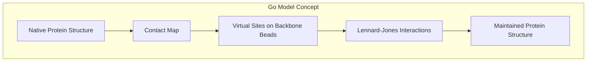
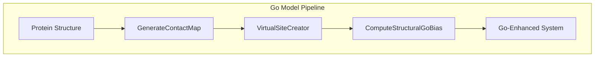
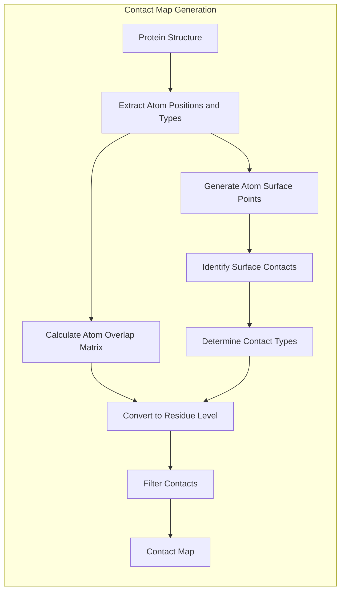
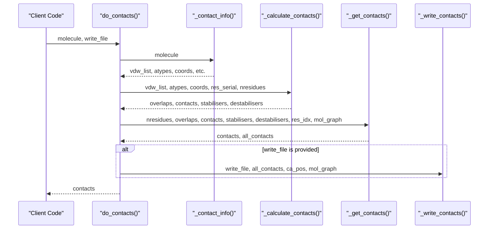
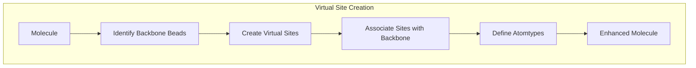
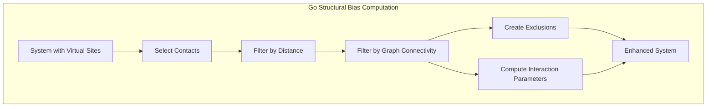
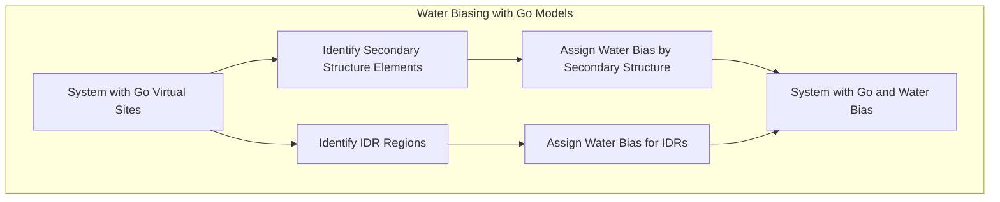

# Working with Go Models

<details>
<summary>Relevant source files</summary>

The following files were used as context for generating this wiki page:

- [doc/source/tutorials/basic_usage.rst](doc/source/tutorials/basic_usage.rst)
- [doc/source/tutorials/elastic_examples.png](doc/source/tutorials/elastic_examples.png)
- [doc/source/tutorials/elastic_networks.rst](doc/source/tutorials/elastic_networks.rst)
- [doc/source/tutorials/go_models.rst](doc/source/tutorials/go_models.rst)
- [doc/source/tutorials/index.rst](doc/source/tutorials/index.rst)
- [doc/source/tutorials/mutations_and_modifications.rst](doc/source/tutorials/mutations_and_modifications.rst)
- [doc/source/tutorials/water_biasing.rst](doc/source/tutorials/water_biasing.rst)
- [vermouth/dssp/__init__.py](vermouth/dssp/__init__.py)
- [vermouth/processors/water_bias.py](vermouth/processors/water_bias.py)
- [vermouth/rcsu/__init__.py](vermouth/rcsu/__init__.py)
- [vermouth/rcsu/contact_map.py](vermouth/rcsu/contact_map.py)
- [vermouth/rcsu/go_pipeline.py](vermouth/rcsu/go_pipeline.py)
- [vermouth/rcsu/go_structure_bias.py](vermouth/rcsu/go_structure_bias.py)
- [vermouth/rcsu/go_utils.py](vermouth/rcsu/go_utils.py)
- [vermouth/rcsu/go_vs_includes.py](vermouth/rcsu/go_vs_includes.py)
- [vermouth/tests/data/test_molecule_contacts.out](vermouth/tests/data/test_molecule_contacts.out)
- [vermouth/tests/rcsu/test_contact_map.py](vermouth/tests/rcsu/test_contact_map.py)
- [vermouth/tests/rcsu/test_go_utils.py](vermouth/tests/rcsu/test_go_utils.py)

</details>


This document explains how to work with Go Models in the vermouth-martinize system to maintain protein structure during coarse-grained simulations. Go Models provide an alternative to elastic networks (covered in [Elastic Networks](#5.2)) for preserving secondary and tertiary structure in Martini proteins through structure-based potentials.

## What are Go Models?

The Martini Go model (also called GoMartini) is a method for maintaining protein structure using native contacts to create a structure-based potential. Unlike elastic networks that apply harmonic bonds directly between backbone beads, Go models apply non-bonded interactions between pairs of beads based on residue overlap and restricted chemical structural unit criteria.

Go models implement structure-based potentials through:

1. The addition of virtual sites positioned on top of backbone beads
2. Definition of Lennard-Jones interactions between specific virtual sites based on the protein's native contacts

This approach allows proteins to maintain their folded structure while permitting more natural dynamics than rigid elastic networks.



Sources: 
- [doc/source/tutorials/go_models.rst:5-13]()
- [doc/source/tutorials/go_models.rst:35-44]()

## Go Model Components and Workflow

The Go model implementation in vermouth consists of several key components that work together in a processing pipeline:



1. **Contact Map Generation**: The first step analyzes the protein structure to identify native contacts between residues using chemical and structural criteria.

2. **Virtual Site Creation**: Virtual sites (with atomname 'CA' by default) are positioned on backbone beads (BB by default) to serve as interaction points.

3. **Structural Bias Computation**: Lennard-Jones interactions are defined between specific virtual sites based on the contact map.

4. **System Output**: The system is enhanced with these Go interactions, maintaining the overall structure during simulation.

Sources:
- [vermouth/rcsu/contact_map.py:779-801]()
- [vermouth/rcsu/go_vs_includes.py:27-138]()
- [vermouth/rcsu/go_structure_bias.py:29-283]()
- [vermouth/rcsu/go_pipeline.py:25-56]()

## Generating Contact Maps

Contact maps are the foundation of Go models, defining which residue pairs should interact. There are two ways to obtain a contact map:

1. **Calculate within Martinize2**: The contact map can be generated automatically as part of the Martinize2 process
2. **External calculation**: Upload a protein structure to the external web server and download the contact map file

The contact map is calculated using the RCSU (Residue Contact Structural Unit) method, which analyzes overlaps and contacts between atoms and residues based on:

- Van der Waals radii of atoms (stored in `PROTEIN_MAP`)
- Atom types and interaction potential (`BOND_TYPE` matrix)
- Surface-based contact detection (using Fibonacci spheres)



The `do_contacts` function handles the entire process:



Sources:
- [vermouth/rcsu/contact_map.py:26-45]() (BOND_TYPE matrix)
- [vermouth/rcsu/contact_map.py:47-298]() (PROTEIN_MAP)
- [vermouth/rcsu/contact_map.py:334-361]() (Surface generation)
- [vermouth/rcsu/contact_map.py:584-608]() (Contact calculation)
- [vermouth/rcsu/contact_map.py:748-776]() (do_contacts function)
- [doc/source/tutorials/go_models.rst:32-44]() (Contact map options)

## Virtual Site Creation

The `VirtualSiteCreator` processor adds virtual sites to backbone beads, which will serve as the interaction points for the Go model:



Key aspects of the virtual site creation:

- Virtual sites are positioned directly on top of backbone beads
- Each virtual site gets a unique atomtype based on molecule name and residue ID
- Virtual sites have zero mass and are connected to their backbone bead via a virtual site interaction
- Atomtypes are defined with zero interaction parameters, as specific interactions will be defined later

Sources:
- [vermouth/rcsu/go_vs_includes.py:27-139]() (VirtualSiteCreator)
- [doc/source/tutorials/go_models.rst:56-59]() (Virtual site description)

## Structural Bias Computation

The `ComputeStructuralGoBias` processor analyzes the contact map and creates non-bonded interactions between specific virtual sites:



Key parameters affecting Go bias computation:

| Parameter | Default | Description |
|-----------|---------|-------------|
| go_eps | 9.414 | Strength of the Go interactions (kJ/mol) |
| go_low | 0.3 | Minimum distance (nm) below which contacts are removed |
| go_up | 1.1 | Maximum distance (nm) above which contacts are removed |
| go_res_dist | 3 | Minimum graph distance below which contacts are removed |

The processor:
1. Filters contacts based on distance and graph connectivity criteria
2. Creates exclusions between backbone beads of contacting residues
3. Computes Lennard-Jones parameters for the interactions
4. Adds these parameters to the system's topology

Sources:
- [vermouth/rcsu/go_structure_bias.py:29-283]() (ComputeStructuralGoBias)
- [doc/source/tutorials/go_models.rst:61-65]() (Parameter description)

## Command-line Usage

To apply a Go model to your protein using Martinize2, you have two main options:

### Option 1: Calculate contact map as part of Martinize2

```
martinize2 -f protein.pdb -o topol.top -x cg_protein.pdb -ff martini3001 -dssp -go
```

### Option 2: Use a pre-calculated contact map

```
martinize2 -f protein.pdb -o topol.top -x cg_protein.pdb -ff martini3001 -dssp -go contact_map.out
```

Additional Go model parameters:

```
-go-eps VALUE      # Strength of Go interactions (default: 9.414 kJ/mol)
-go-low VALUE      # Minimum distance cutoff (default: 0.3 nm)
-go-up VALUE       # Maximum distance cutoff (default: 1.1 nm)
-go-res-dist VALUE # Minimum residue separation (default: 3)
-go-write-file     # Write calculated contact map to file
-go-backbone NAME  # Name of backbone bead for virtual site (default: BB)
-go-atomname NAME  # Name of virtual site atom (default: CA)
```

Sources:
- [doc/source/tutorials/go_models.rst:16-30]() (Command-line options)
- [doc/source/tutorials/go_models.rst:48-53]() (Usage examples)

## Output Files and Integration

When using Go models, Martinize2 generates two additional files beyond the standard output:

1. **go_atomtypes.itp**: Defines the new virtual sites as atom types
2. **go_nbparams.itp**: Defines the specific non-bonded interactions between virtual sites

To use these files in your GROMACS simulation, you need to include them in your Martini force field file:

1. Include the atomtypes at the end of the `[atomtypes]` directive:
```
#ifdef GO_VIRT
#include "go_atomtypes.itp"
#endif
```

2. Include the non-bonded parameters at the end of the `[nonbond_params]` directive:
```
#ifdef GO_VIRT
#include "go_nbparams.itp"
#endif
```

3. Add `#define GO_VIRT` to your topology file to activate the Go model

Sources:
- [doc/source/tutorials/go_models.rst:72-81]() (Output files)
- [doc/source/tutorials/go_models.rst:97-140]() (Including files in topology)

## Water Biasing with Go Models

Water biasing can be applied alongside Go models to influence the solvation properties of different protein regions based on secondary structure:



To apply water bias with Go models:

```
martinize2 -f protein.pdb -o topol.top -x cg_protein.pdb -dssp -go -water-bias -water-bias-eps H:1 C:0.5 E:2
```

For intrinsically disordered regions (IDRs):

```
martinize2 -f protein.pdb -o topol.top -x cg_protein.pdb -dssp -go -id-regions 1:10 65:92 -idr-tune -water-bias -water-bias-eps idr:0.5
```

The `ComputeWaterBias` processor:
1. Identifies regions for water biasing based on secondary structure or IDR annotation
2. Assigns bias strength values based on the provided parameters
3. Creates non-bonded interactions between water and the virtual sites
4. Removes cross-interactions between folded and disordered regions if necessary

Sources:
- [vermouth/processors/water_bias.py:21-191]() (ComputeWaterBias)
- [doc/source/tutorials/water_biasing.rst:6-73]() (Water biasing details)

## Multiple Go Models in a System

When working with multiple proteins that each have their own Go model, additional steps are needed:

1. Use the `-name` flag to ensure unique naming of virtual sites:
```
martinize2 -f protein1.pdb -x cg1.pdb -o topol1.top -go -name protein1
martinize2 -f protein2.pdb -x cg2.pdb -o topol2.top -go -name protein2
```

2. Concatenate all the generated Go model files into combined files:
```
cat protein1_go_atomtypes.itp protein2_go_atomtypes.itp > go_atomtypes.itp
cat protein1_go_nbparams.itp protein2_go_nbparams.itp > go_nbparams.itp
```

3. Include these combined files in your master force field file as described earlier

Note: Interactions between Go models are only defined within each molecule, not between different molecules. This means that in a system with multiple copies of a multimeric protein, the monomers from different complexes will not interact through Go model potentials.

Sources:
- [doc/source/tutorials/go_models.rst:149-175]() (Multiple Go models)

## Visualizing Go Models

To visualize the Go model network and confirm it has been constructed correctly, you can use the MartiniGlass package. This tool can help create visualizable topologies to see the connections defined by your Go model.

Sources:
- [doc/source/tutorials/go_models.rst:178-184]() (Visualization)

---