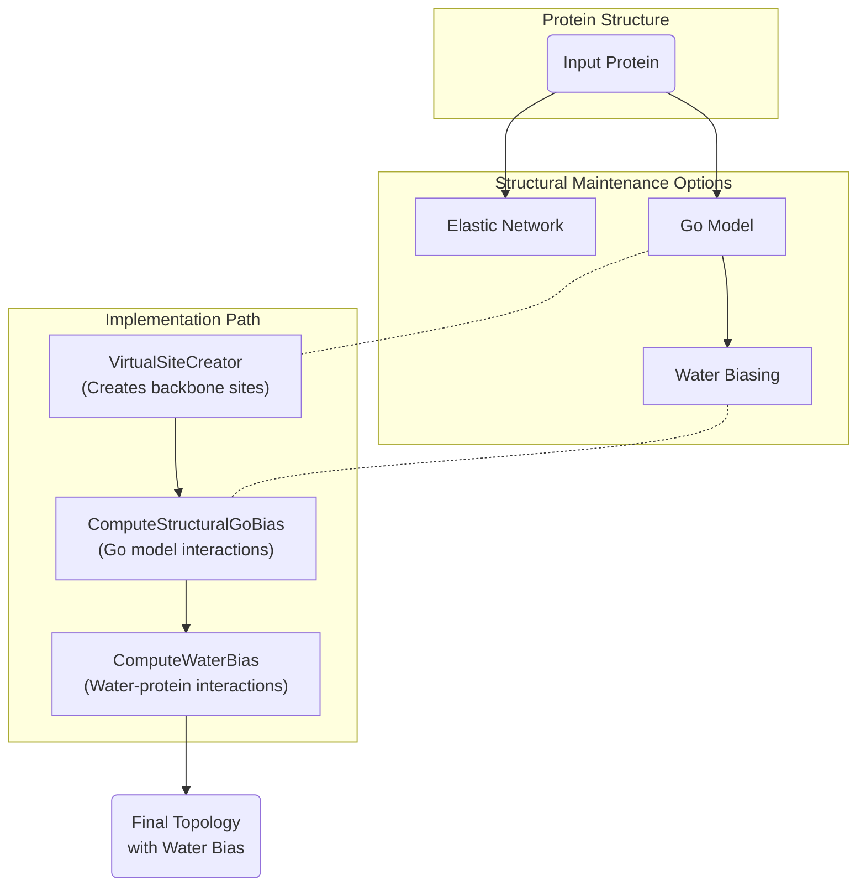
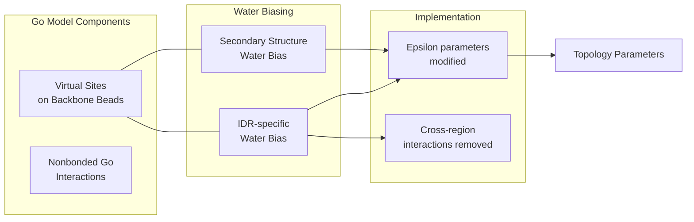
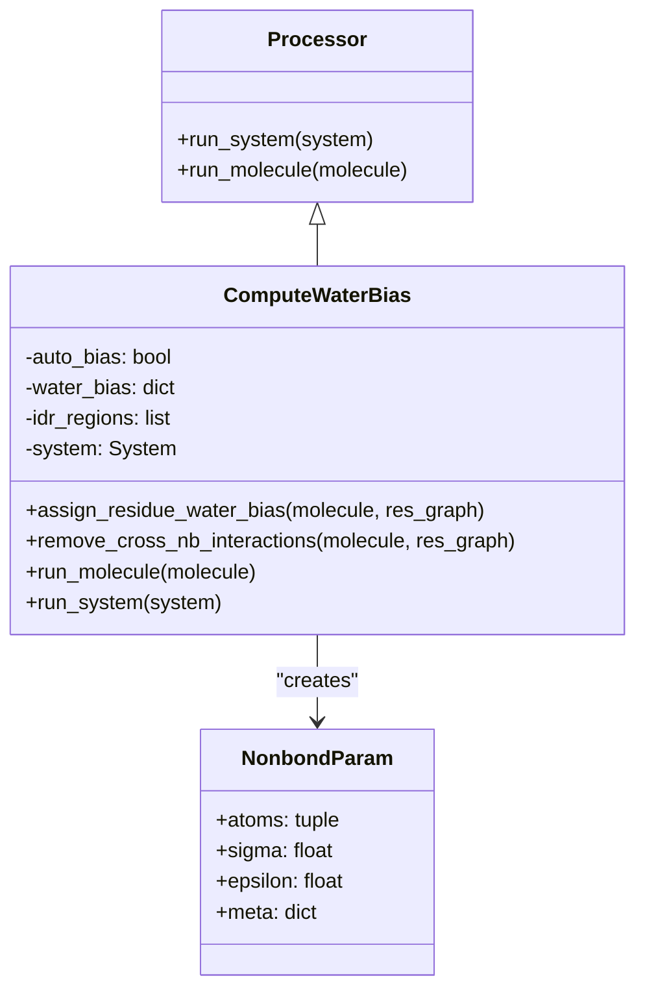

# Water Biasing

<details>
<summary>Relevant source files</summary>

The following files were used as context for generating this wiki page:

- [doc/source/tutorials/basic_usage.rst](doc/source/tutorials/basic_usage.rst)
- [doc/source/tutorials/elastic_examples.png](doc/source/tutorials/elastic_examples.png)
- [doc/source/tutorials/elastic_networks.rst](doc/source/tutorials/elastic_networks.rst)
- [doc/source/tutorials/go_models.rst](doc/source/tutorials/go_models.rst)
- [doc/source/tutorials/index.rst](doc/source/tutorials/index.rst)
- [doc/source/tutorials/mutations_and_modifications.rst](doc/source/tutorials/mutations_and_modifications.rst)
- [doc/source/tutorials/water_biasing.rst](doc/source/tutorials/water_biasing.rst)
- [vermouth/dssp/__init__.py](vermouth/dssp/__init__.py)
- [vermouth/processors/water_bias.py](vermouth/processors/water_bias.py)
- [vermouth/rcsu/__init__.py](vermouth/rcsu/__init__.py)
- [vermouth/rcsu/contact_map.py](vermouth/rcsu/contact_map.py)
- [vermouth/rcsu/go_pipeline.py](vermouth/rcsu/go_pipeline.py)
- [vermouth/rcsu/go_structure_bias.py](vermouth/rcsu/go_structure_bias.py)
- [vermouth/rcsu/go_utils.py](vermouth/rcsu/go_utils.py)
- [vermouth/rcsu/go_vs_includes.py](vermouth/rcsu/go_vs_includes.py)
- [vermouth/tests/data/test_molecule_contacts.out](vermouth/tests/data/test_molecule_contacts.out)
- [vermouth/tests/rcsu/test_contact_map.py](vermouth/tests/rcsu/test_contact_map.py)
- [vermouth/tests/rcsu/test_go_utils.py](vermouth/tests/rcsu/test_go_utils.py)

</details>


Water biasing in martinize2 is a technique to modify the interactions between water molecules and proteins in Martini coarse-grained simulations. This feature allows for tuning solvation properties of proteins based on secondary structure elements or specific regions, such as intrinsically disordered regions (IDRs). Water biasing is particularly useful when working with the Go model for maintaining protein structure in simulations.

For information about related structural maintenance approaches, see [Elastic Networks](#5.2) and [Working with Go Models](#5.3).

## Concept and Purpose

Water biasing addresses an important challenge in coarse-grained protein simulations: different protein regions interact differently with water in reality, but these differences may not be correctly captured in the standard force field. By applying biases to the water interactions, different protein regions can be made more or less hydrophilic/hydrophobic based on their secondary structure or disorder characteristics.

The biasing works by modifying the non-bonded parameters between the backbone virtual sites (used in the Go model) and water molecules.

### Diagram: Water Biasing in the Structural Features Pipeline



Sources: [vermouth/processors/water_bias.py:21-156](), [vermouth/rcsu/go_pipeline.py:13-57](), [vermouth/rcsu/go_vs_includes.py:13-139](), [doc/source/tutorials/water_biasing.rst:1-74]()

## Types of Water Bias

Water biasing in martinize2 can be applied in two primary ways:

1. **Secondary structure-based biasing**: Different secondary structure elements (helices, sheets, coils) can have different biases applied to their water interactions.

2. **Intrinsically disordered region biasing**: Specific regions of a protein identified as intrinsically disordered (IDRs) can have their own water bias parameters, which can help reproduce their expanded conformations in solution.

### Diagram: Water Biasing Mechanism



Sources: [vermouth/processors/water_bias.py:71-120](), [vermouth/processors/water_bias.py:122-155]()

## Implementation Details

The water biasing functionality is primarily implemented in the `ComputeWaterBias` processor. This processor examines each residue in the molecule and applies biases based on its secondary structure or whether it's in a user-defined IDR.

The key components of the implementation are:

1. **Virtual sites**: Water biasing utilizes the virtual sites placed on backbone beads, which are also used by the Go model.

2. **Non-bonded parameters**: The biasing is implemented by modifying the epsilon parameters in Lennard-Jones interactions between the virtual sites and water molecules.

3. **Cross-region interactions**: For IDRs, interactions between folded and disordered regions can be removed to better reproduce IDR behavior.

### Code Structure

The `ComputeWaterBias` processor has the following key methods:

- `assign_residue_water_bias`: Assigns water bias values to residues based on their secondary structure or IDR classification.
- `remove_cross_nb_interactions`: Removes nonbonded Go interactions between folded and disordered regions.



Sources: [vermouth/processors/water_bias.py:21-191](), [vermouth/rcsu/go_utils.py:17-81]()

## Using Water Biasing in martinize2

To apply water biasing, you need to run martinize2 with specific command-line arguments. These can be combined with the Go model arguments, as water biasing typically works in conjunction with the Go model.

### Basic Command-Line Options

- `-water-bias`: Enable automatic water biasing based on secondary structure
- `-water-bias-eps`: Define bias strength by secondary structure (e.g., `H:3.6 C:2.1`)
- `-id-regions`: Specify intrinsically disordered regions by residue ranges
- `-idr-tune`: Apply special bonded potentials to IDR regions

### Example Usage

Here are some example command lines for using water biasing:

1. **Basic Secondary Structure Biasing**:
   ```
   martinize2 -f protein.pdb -o topol.top -x cg_protein.pdb -dssp -water-bias -water-bias-eps H:1
   ```

2. **Multiple Secondary Structure Elements**:
   ```
   martinize2 -f protein.pdb -o topol.top -x cg_protein.pdb -dssp -water-bias -water-bias-eps H:1 C:0.5 E:2
   ```

3. **With IDR Regions**:
   ```
   martinize2 -f protein.pdb -o topol.top -x cg_protein.pdb -dssp -id-regions 1:10 65:92 -idr-tune -water-bias -water-bias-eps idr:0.5
   ```

### Integration with Go Model

Water biasing is typically used with the Go model. When using both:

1. Virtual sites are created for backbone beads
2. Go model interactions are computed between these sites
3. Water biasing is applied as additional interactions between sites and water

The output includes:
- Modified non-bonded parameters in the topology
- Files for virtual sites that need to be included in the system topology

Sources: [doc/source/tutorials/water_biasing.rst:1-74](), [vermouth/rcsu/go_pipeline.py:13-57]()

## Technical Details

### Workflow

When you use water biasing, the following workflow is executed:

1. The Go model processing creates virtual sites on backbone beads
2. The `ComputeWaterBias` processor is called to modify interactions
3. For each residue, based on secondary structure or IDR status:
   - The appropriate epsilon value is retrieved
   - A new non-bonded parameter is created between water and the virtual site
   - These parameters are added to the system's topology

### Determining Water Bias Values

The water bias is determined by several factors:

1. **Secondary structure**: The user-defined bias values for each secondary structure type
2. **IDR regions**: User-defined regions that get special biasing
3. **Bead size**: The sigma value is adjusted based on the backbone bead size

The epsilon value is then applied to create the bias between the virtual site and water molecules.

### Cross-region Interactions

For proteins with both folded domains and IDRs, the `remove_cross_nb_interactions` method can eliminate Go bonds between these regions. This helps to better reproduce the flexible behavior of IDRs while maintaining structure in folded regions.

This approach:
1. Identifies all Go pairs in the molecule
2. Determines which pairs cross between IDR and folded regions
3. Removes these cross-region pairs from the topology parameters

Sources: [vermouth/processors/water_bias.py:122-155](), [vermouth/rcsu/go_utils.py:52-72]()

## Practical Considerations

When using water biasing, keep these considerations in mind:

1. Water biasing requires the Go model to be enabled, as it uses the virtual sites created by that model.

2. The bias values need to be tuned for your specific system. Starting values for different secondary structures might be:
   - Helices (H): ~1-3.6 kJ/mol
   - Coils (C): ~0.5-2.1 kJ/mol
   - Extended/Sheets (E): ~1-2 kJ/mol
   - IDRs: ~0.5 kJ/mol

3. For fully disordered proteins, it may be more convenient to use Polyply rather than martinize2, as Polyply can generate parameters without requiring an atomistic structure.

4. When examining output files, look for the following:
   - `go_atomtypes.itp`: Defines the virtual sites
   - `go_nbparams.itp`: Contains the modified nonbonded parameters, including water biasing

Sources: [doc/source/tutorials/water_biasing.rst:26-73](), [vermouth/processors/water_bias.py:21-191]()

---