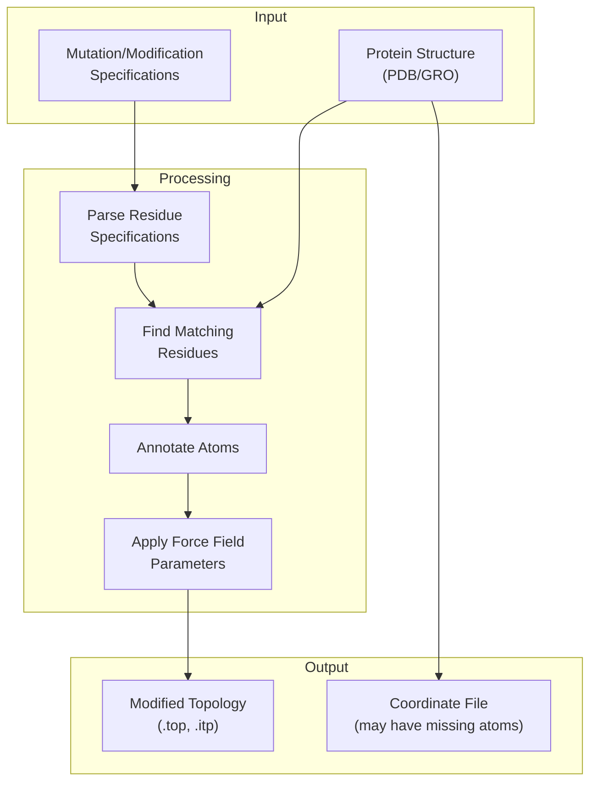
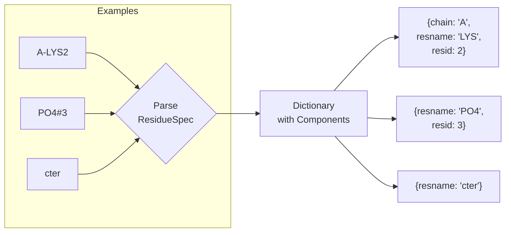
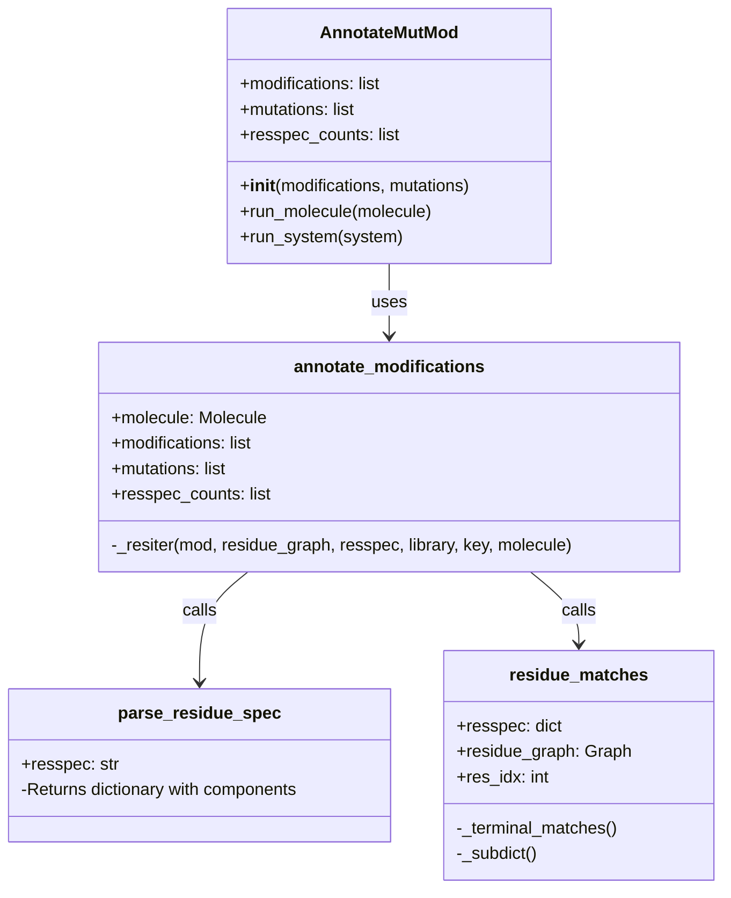
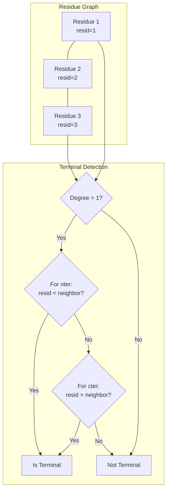

# Mutations and Modifications

<details>
<summary>Relevant source files</summary>

The following files were used as context for generating this wiki page:

- [doc/source/tutorials/basic_usage.rst](doc/source/tutorials/basic_usage.rst)
- [doc/source/tutorials/elastic_examples.png](doc/source/tutorials/elastic_examples.png)
- [doc/source/tutorials/elastic_networks.rst](doc/source/tutorials/elastic_networks.rst)
- [doc/source/tutorials/go_models.rst](doc/source/tutorials/go_models.rst)
- [doc/source/tutorials/index.rst](doc/source/tutorials/index.rst)
- [doc/source/tutorials/mutations_and_modifications.rst](doc/source/tutorials/mutations_and_modifications.rst)
- [doc/source/tutorials/water_biasing.rst](doc/source/tutorials/water_biasing.rst)
- [vermouth/processors/annotate_mut_mod.py](vermouth/processors/annotate_mut_mod.py)
- [vermouth/tests/test_annotate_mut_mod.py](vermouth/tests/test_annotate_mut_mod.py)

</details>


This guide covers how to apply mutations (changing one amino acid to another) and modifications (terminal or side-chain chemical modifications) to protein structures during the coarse-graining process with martinize2. It explains both the command-line syntax for specifying mutations/modifications and the internal mechanisms that handle these transformations. For information about generating elastic networks or Go models to maintain protein structure, see [Elastic Networks](#5.2) and [Go Models](#5.3).

## Overview of Mutations and Modifications

Martinize2 allows you to modify proteins in two fundamental ways:

1. **Mutations**: Replace one amino acid with another (e.g., changing a glycine to an alanine)
2. **Modifications**: Apply chemical modifications to amino acids (e.g., phosphorylation, acetylation, or terminal capping)

It's important to note that while martinize2 generates topology files with the necessary parameters for mutations and modifications, **it does not build coordinates** for these changes. This means that while you'll get the correct topology, the corresponding coordinate file may contain undefined values for the new atoms that weren't present in the original structure.



Sources: [vermouth/processors/annotate_mut_mod.py:269-301](), [doc/source/tutorials/mutations_and_modifications.rst:1-13]()

## Residue Specification Syntax

To specify which residues to mutate or modify, martinize2 uses a specific syntax:

```
[<chain>-][<resname>][[#]<resid>]
```

Where:
- `<chain>`: Optional chain identifier
- `<resname>`: Optional residue name
- `<resid>`: Optional residue number (can be preceded by # if needed)

This flexible syntax allows you to target:
- A specific residue in a specific chain (e.g., `A-PHE45`)
- All residues with a particular name (e.g., `ARG`)
- All residues with a particular number (e.g., `45`)
- All residues in a specific chain (e.g., `A-`)
- Special termini with `nter` and `cter` as the residue name (e.g., `A-nter`)



Sources: [vermouth/processors/annotate_mut_mod.py:28-69](), [vermouth/tests/test_annotate_mut_mod.py:56-71]()

## Command-Line Usage

### Mutating Residues

To mutate residues, use the `-mutate` flag with the format `<chain>-<resname><resid>:<new_resname>`:

```bash
# Mutate phenylalanine at residue 45 in chain A to alanine
martinize2 -f protein.pdb -o topol.top -x cg_protein.pdb -mutate A-PHE45:ALA
```

Multiple mutations can be specified by providing the `-mutate` flag multiple times:

```bash
# Multiple specific mutations
martinize2 -f protein.pdb -o topol.top -x cg_protein.pdb -mutate A-PHE45:ALA -mutate B-ARG50:LYS
```

You can also omit parts of the specification to apply the mutation more broadly:

```bash
# Mutate all arginines in the protein to lysine
martinize2 -f protein.pdb -o topol.top -x cg_protein.pdb -mutate ARG:LYS

# Mutate all arginines in chain B to lysine
martinize2 -f protein.pdb -o topol.top -x cg_protein.pdb -mutate B-ARG:LYS
```

### Applying Modifications

Modifications use the same syntax but with the `-mod` flag:

```bash
# Add a C-terminal modification to the protein
martinize2 -f protein.pdb -o topol.top -x cg_protein.pdb -mod cter:C-ter

# Phosphorylate a specific serine
martinize2 -f protein.pdb -o topol.top -x cg_protein.pdb -mod A-SER12:PHOS
```

Note that the available modifications depend on the force field being used. To see available modifications:

```bash
martinize2 -list-mod -ff martini3001
```

Sources: [doc/source/tutorials/mutations_and_modifications.rst:14-53](), [vermouth/tests/test_annotate_mut_mod.py:212-233]()

## Internal Implementation

The mutation and modification process is implemented through the `AnnotateMutMod` processor, which follows these steps:

1. **Parse residue specifications**: Convert user-provided specifications into dictionaries with keys like 'chain', 'resname', and 'resid'
2. **Create residue graph**: Generate a graph representation of the molecule where each node is a residue
3. **Match residues**: Find residues in the molecule that match the specification
4. **Annotate atoms**: Add attributes to matching atoms indicating the mutation or modification to apply
5. **Apply force field parameters**: Later processors use these annotations to apply the appropriate force field parameters



Sources: [vermouth/processors/annotate_mut_mod.py:213-305](), [vermouth/processors/annotate_mut_mod.py:82-120]()

## Special Terminal Handling

The system has special handling for terminal residues using the `nter` and `cter` keywords:

- `nter`: Matches the N-terminal residue (lowest resid with degree 1)
- `cter`: Matches the C-terminal residue (highest resid with degree 1)

This allows for easy specification of terminal modifications without knowing the exact residue numbers.

When determining if a residue is a terminal, the system checks:
1. If the residue has only one neighbor in the residue graph
2. For `nter`: If its resid is lower than its neighbor's
3. For `cter`: If its resid is higher than its neighbor's



Sources: [vermouth/processors/annotate_mut_mod.py:122-159](), [vermouth/tests/test_annotate_mut_mod.py:236-304]()

## Limitations and Considerations

When using mutations and modifications, keep these limitations in mind:

1. **No coordinate generation**: Martinize2 doesn't generate coordinates for new atoms introduced by mutations or modifications. The resulting coordinate file may have undefined positions for these atoms.

2. **Force field constraints**: Only mutations and modifications defined in the force field can be applied. Each force field defines its own set of available modifications.

3. **Verification**: Check your output topology to ensure the mutations/modifications were applied correctly. The processor will issue warnings if specified residues weren't found.

4. **One-time application**: Mutations and modifications are applied during the coarse-graining process. To change them, you need to rerun martinize2 on your original atomistic structure.

5. **Terminal handling**: Special care should be taken when working with terminals to ensure the correct residues are matched.

## Example Use Cases

### Standard Protein Mutations

For exploring alternative protein sequences or computational mutagenesis:

```bash
# Single point mutation
martinize2 -f protein.pdb -o topol.top -x cg_protein.pdb -mutate A-ASP35:GLU

# Multiple mutations on different chains
martinize2 -f protein.pdb -o topol.top -x cg_protein.pdb -mutate A-ASP35:GLU -mutate B-LYS42:ARG
```

### Post-Translational Modifications

For studying the effects of post-translational modifications:

```bash
# Phosphorylation of multiple residues
martinize2 -f protein.pdb -o topol.top -x cg_protein.pdb -mod A-SER34:PHOS -mod B-THR56:PHOS

# Terminal modifications
martinize2 -f protein.pdb -o topol.top -x cg_protein.pdb -mod cter:COOH -mod nter:NH2
```

### Protein Variant Analysis

For comparing wild-type and mutant proteins:

```bash
# Wild-type
martinize2 -f wild_type.pdb -o wt_topol.top -x wt_cg.pdb

# Disease-associated mutant
martinize2 -f wild_type.pdb -o mut_topol.top -x mut_cg.pdb -mutate A-GLY12:ARG
```

Sources: [doc/source/tutorials/mutations_and_modifications.rst:21-37](), [vermouth/tests/test_annotate_mut_mod.py:186-203]()

## Troubleshooting

If you encounter issues with mutations or modifications, try these steps:

1. **Check residue specifications**: Ensure your residue specifications match the actual residues in your structure.

2. **Verify force field compatibility**: Make sure the mutations or modifications you're trying to apply are defined in your chosen force field.

3. **Examine warnings**: The processor will issue warnings if specified residues weren't found. Look for these in the output log.

4. **Inspect topology**: Check the generated topology files to verify that the mutations or modifications were correctly applied.

Sources: [vermouth/processors/annotate_mut_mod.py:295-305]()