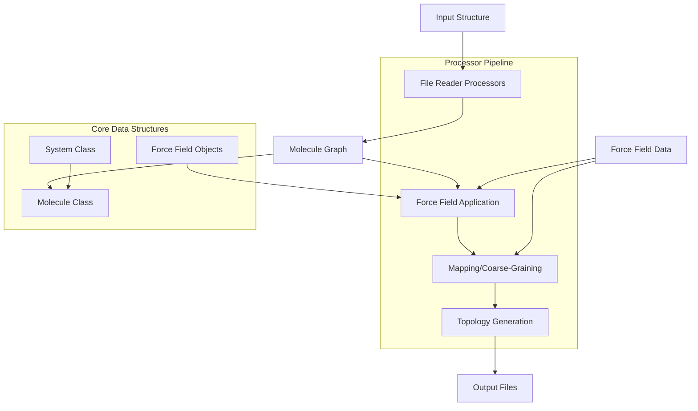
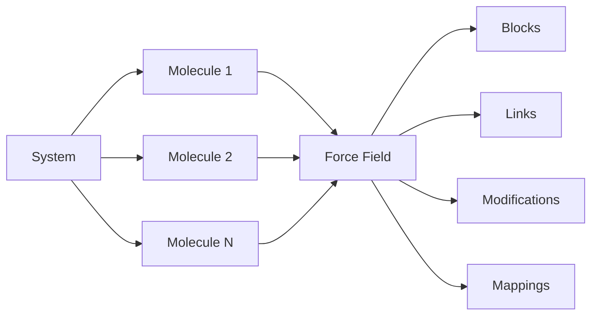

Martinize2 and Vermouth represent a unified framework for molecular topology generation, designed to transform atomic-level molecular structures into simulation-ready systems. This toolkit specializes in coarse-graining molecular dynamics simulations, with particular strength in handling complex polymeric systems including proteins, DNA, and other biomolecules.

## Core Architecture

The system is built around a **graph-based molecular representation** where atoms and coarse-grained beads are nodes, and bonds are edges. This approach enables flexible manipulation of molecular structures regardless of their topology, making it uniquely capable of handling non-linear polymers that challenge traditional tools [vermouth/molecule.py](vermouth/molecule.py#L1-L50).

### Key Components

**Vermouth Library**: The Python engine providing programmatic access to molecular transformations. It implements a modular architecture based on three core concepts:

- **Blocks**: Graph-based descriptions of idealized residues/monomeric units with their MD parameters
- **Links**: Molecular fragments describing interactions between residues/monomers  
- **Modifications**: Deviations from standard blocks, including post-translational modifications

**Martinize2 CLI**: The command-line interface built on Vermouth, providing a familiar workflow for users transitioning from the original Martinize tool [doc/source/general_overview.rst](doc/source/general_overview.rst#L25-L35).

### System Architecture

> [!TIP]
> The processor pipeline architecture enables modular, extensible transformations where each processing step is isolated and can be combined in flexible sequences to achieve different molecular transformations.

## Processing Pipeline

The transformation occurs through a **processor pipeline system** where each processor performs a specific operation on molecular structures [vermouth/processors/__init__.py](vermouth/processors/__init__.py#L1-L51):

### Core Processing Steps

| Processor Type | Function | Example Implementation |
|---|---|---|
| **File Input** | Read coordinate files (PDB, GRO, CIF) | `PDBInput`, `GROInput`, `CIFInput` |
| **Structure Repair** | Fix missing atoms/bonds | `RepairGraph`, `MakeBonds` |
| **Force Field Application** | Apply molecular parameters | `DoLinks`, `DoMapping` |
| **Coarse-Graining** | Transform resolution | `DoMapping`, `DoAverageBead` |
| **Output Generation** | Write topology files | `ApplyPosres`, `SortMoleculeAtoms` |

Each processor inherits from the base `Processor` class and implements either `run_molecule()` for single-molecule operations or `run_system()` for system-wide transformations [vermouth/processors/processor.py](vermouth/processors/processor.py#L21-L41).

## Data Management

The system manages molecular data through a hierarchical structure:

### System Organization
- **System Class**: Container for multiple molecules with force field context [vermouth/system.py](vermouth/system.py#L16-L35)
- **Molecule Class**: Individual molecular graphs with attributes and interactions
- **Force Field Data**: Centralized collection of blocks, links, and modifications [vermouth/data/data.py](vermouth/data/data.py#L1-L44)

## Key Features and Capabilities

### Advanced Molecular Handling

- **Topology-Agnostic Processing**: No assumptions about polymer structure, enabling handling of complex non-linear systems [doc/source/general_overview.rst](doc/source/general_overview.rst#L5-L10)
- **Incomplete Structure Support**: Can process structures with missing atoms or incomplete atom names
- **Post-Translational Modifications**: Native support for PTMs and other molecular modifications
- **Multi-Force Field Support**: While optimized for Martini 2/3, architecture supports broader force field compatibility

### Resolution Transformation

The system excels at converting between different molecular resolutions:

| Transformation | Input | Output | Use Case |
|---|---|---|---|
| **Atomistic → Coarse-Grained** | All-atom PDB | Martini CG structure | Enhanced simulation timescales |
| **Force Field Conversion** | One FF format | Another FF format | Cross-platform compatibility |
| **Topology Generation** | Coordinates + FF | Complete topology | MD simulation setup |

> [!TIP]
> Martinize2 identifies atoms primarily through connectivity analysis, reading CONECT records and using distance-based criteria similar to VMD for inter-residue bonding, ensuring robust structure recognition.

## Integration and Ecosystem

### Installation and Access
- Distributed via PyPI: `pip install vermouth` [README.md](README.md#L35-L40)
- Python 3.9+ requirement
- Optional MDtraj dependency for alternative DSSP functionality
- Development versions available via GitHub

### Documentation and Support
- Comprehensive API documentation at https://vermouth-martinize.readthedocs.io/
- Active development with regular updates
- Community support through GitHub issues
- Academic citation available for research use

## Next Steps

To get started with Martinize2 and Vermouth:

1. **Quick Start**: Begin with basic usage examples and command-line interface
2. **Installation**: Set up the environment with proper dependencies  
3. **Basic Usage**: Learn fundamental operations and common workflows
4. **Architecture Deep Dive**: Explore the underlying system design and processor pipeline

Continue to [Quick Start](2-quick-start) for hands-on examples, or proceed to [Installation and Setup](3-installation-and-setup) for detailed configuration instructions.