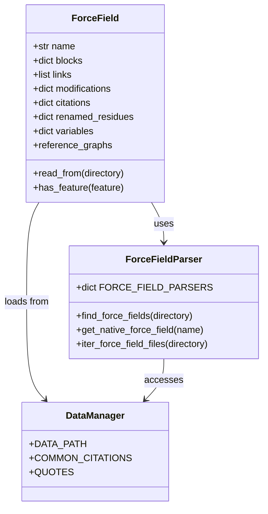

The force field system in VerMoUTH provides a comprehensive framework for managing molecular force field data, including interaction parameters, residue mappings, and citation information. This system enables the modular loading and organization of force field components from various file formats while maintaining a unified interface for molecular topology generation.

## Force Field Architecture

The core of the force field system is built around the `ForceField` class, which serves as a container for all force field-related data. Each force field instance maintains several key components that work together to provide complete molecular description capabilities.

The `ForceField` class [source](vermouth/forcefield.py#L36) encapsulates all force field data through its core attributes:

- **blocks**: Dictionary containing molecular building blocks and their reference graphs
- **links**: List of connection patterns that describe how blocks can be linked together
- **modifications**: Dictionary of post-translational modifications and chemical modifications
- **citations**: Bibliographic references for force field components
- **renamed_residues**: Mapping of residue name variations
- **variables**: Force field-specific variables and parameters

## Data Loading and Management

Force field data is managed through a sophisticated loading system that supports multiple file formats and provides both distributed library access and custom force field loading capabilities.

### Data Path Resolution

The system uses a centralized `DATA_PATH` [source](vermouth/__init__.py#L33) that points to the distributed data directory containing force fields, mappings, and citation files. This path is resolved using modern Python importlib resources when available, falling back to pathlib for older versions.

### Force Field Discovery and Loading

The `find_force_fields` function [source](vermouth/forcefield.py#L143) automatically discovers force fields in a given directory by searching for directories containing at least one RTP file. This enables dynamic loading of multiple force fields without explicit configuration.

For accessing distributed force fields, the `get_native_force_field` function [source](vermouth/forcefield.py#L202) provides a cached interface to the built-in force field library. The system maintains a global cache (`_FORCE_FIELDS`) to ensure force field instances are singletons, which is critical for proper equality comparisons.

### File Format Support

The force field system supports multiple file formats through a parser registry:

| Extension | Parser | Description |
|-----------|--------|-------------|
| `.rtp` | `read_rtp` | GROMACS Residue Topology Parameter files |
| `.ff` | `read_ff` | VerMoUTH force field format |
| `.bib` | `read_bib` | BibTeX citation files |

The `FORCE_FIELD_PARSERS` dictionary [source](vermouth/forcefield.py#L27) maps file extensions to their respective parsing functions, enabling extensible support for new formats.

## Force Field File Formats

### RTP Format Handling

The RTP (Residue Topology Parameter) format is the primary format for describing molecular building blocks. The `read_rtp` function [source](vermouth/gmx/rtp.py#L432) processes these files using a hierarchical iterator system:

- `_IterRTPSections`: Iterates over major sections in the file
- `_IterRTPSubsections`: Handles subsections within each section
- `_IterRTPSubsectionLines`: Processes individual lines within subsections

This hierarchical approach allows for proper parsing of complex RTP files containing multiple residue definitions, bonded parameters, and interaction specifications.

### VerMoUTH FF Format

The `.ff` format is a VerMoOUTH-specific format that extends the ITP format for rapid prototyping of force field components. The `FFDirector` class [source](vermouth/ffinput.py#L63) provides comprehensive parsing support for:

- **Blocks**: Molecular building blocks with atoms, interactions, and metadata
- **Links**: Connection patterns between blocks with pattern matching
- **Modifications**: Chemical and post-translational modifications
- **Variables**: Force field-wide parameter definitions
- **Citations**: Bibliographic references for components

The parser supports all GROMACS interaction types (bonds, angles, dihedrals, constraints, etc.) and extends them with VerMoOUTH-specific features like pattern matching and feature declarations.

## Citation Management

The force field system includes a sophisticated citation management system that tracks bibliographic references for all force field components.

### Common Citations

The `COMMON_CITATIONS` dictionary [source](vermouth/data/data.py#L31) is loaded from `citations.bib` and contains references that apply across multiple force fields. This centralized citation database ensures consistent referencing and avoids duplication.

### Citation Parsing

The `read_bib` function [source](vermouth/citation_parser.py#L173) processes BibTeX files using the `BibTexDirector` class [source](vermouth/citation_parser.py#L16]. This parser extracts citation entries and associates them with specific force field components, enabling proper academic attribution.

## Force Field Features System

The force field system includes a feature declaration mechanism that allows force fields to advertise their capabilities. The `features` property [source](vermouth/forcefield.py#L117) returns a set of all features declared by links in the force field, while the `has_feature` method [source](vermouth/forcefield.py#L127) provides a convenient way to check for specific capabilities.

This feature system enables:
- Conditional processing based on force field capabilities
- Dynamic algorithm selection based on available features
- Compatibility checking between force fields and processing pipelines

## Distributed Force Field Library

The system includes a comprehensive distributed force field library with support for multiple major force field families:

| Force Field | Description | Files |
|-------------|-------------|-------|
| martini22, martini22p | Martini 2.x coarse-grained force fields | RTP, FF, mapping files |
| martini3001, martini30b32 | Martini 3.x force fields | RTP, FF, mapping files |
| charmm | CHARMM all-atom force field | RTP files |
| amber | AMBER all-atom force field | RTP files |
| gromos | GROMOS force field | RTP files |
| elnedyn* | Elastic network force fields | RTP, FF files |

Each force field directory contains the necessary files for complete molecular description, including residue topologies, interaction parameters, and mapping definitions for coarse-graining transformations.

## Integration with Processing Pipeline

The force field system integrates seamlessly with the VerMoOUTH processing pipeline through standardized interfaces. Force fields can be loaded and accessed by processors for:

- **Block selection**: Choosing appropriate molecular building blocks
- **Link application**: Connecting blocks according to force field rules
- **Modification handling**: Applying chemical and post-translational modifications
- **Parameter assignment**: Setting interaction parameters based on force field data
- **Validation**: Ensuring molecular structures comply with force field requirements

This integration enables the processor pipeline to work with any supported force field without requiring force field-specific code, maintaining the system's modularity and extensibility.

The force field system's design prioritizes flexibility, performance, and maintainability, enabling researchers to work with diverse force field families while maintaining a consistent interface for molecular topology generation and coarse-graining transformations.