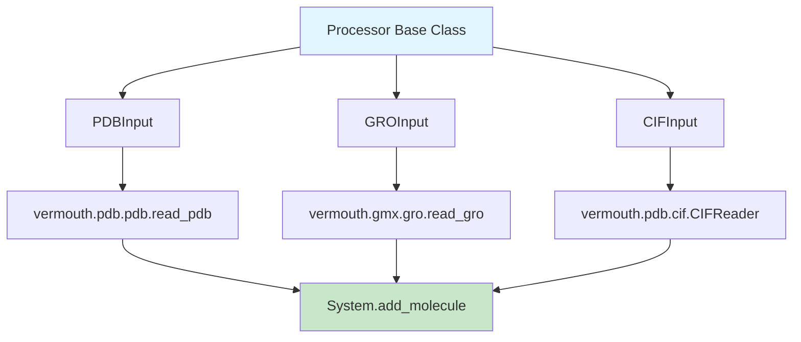

The file I/O processors in vermouth-martinize provide a unified interface for reading molecular structure files in PDB, GRO, and CIF formats. These processors integrate seamlessly with the processor pipeline system, converting external molecular data into the internal graph-based molecular representation used throughout the application.

## Architecture Overview

The file I/O processors follow a consistent design pattern, inheriting from the abstract `Processor` base class and implementing the `run_system` method to populate the system with parsed molecular data [vermouth/processors/processor.py#L21-L34]. Each processor delegates the actual parsing work to specialized format-specific modules while providing a common interface for the pipeline.



## PDB File Processor

The `PDBInput` processor handles Protein Data Bank (PDB) format files, supporting multi-model structures and connectivity information through CONECT records [vermouth/processors/pdb_reader.py#L29-L63].

**Key Features:**
- **Multi-model support**: Select specific models using the `modelidx` parameter
- **Connectivity preservation**: Parses CONECT records to maintain bond information
- **Residue exclusion**: Filter out unwanted residues (default: 'SOL')
- **Hydrogen control**: Option to ignore hydrogen atoms with `ignh=True`

**Constructor Parameters:**
- `filename` (str): Path to the PDB file
- `exclude` (Container[str]): Residue names to exclude (default: empty tuple)
- `ignh` (bool): Discard hydrogens if True (default: False)
- `modelidx` (int): Model number to parse (default: 1)

The processor leverages the `PDBParser` class which implements a comprehensive line-by-line parsing strategy [vermouth/pdb/pdb.py#L32-L446], handling all major PDB record types including ATOM, HETATM, CRYST1, and CONECT records.

## GRO File Processor

The `GROInput` processor reads GROMACS GRO format files, which provide a compact representation of molecular structures with optional velocity information [vermouth/processors/gro_reader.py#L28-L40].

**Key Features:**
- **Automatic format detection**: Detects precision and velocity presence from file content
- **Velocity support**: Preserves atomic velocities when present in the file
- **Box information**: Extracts and stores periodic boundary conditions
- **Flexible field parsing**: Adapts to varying coordinate precision

**Constructor Parameters:**
- `filename` (str): Path to the GRO file
- `exclude` (Container[str]): Residue names to exclude (default: empty tuple)
- `ignh` (bool): Discard hydrogens if True (default: False)

The underlying `read_gro` function performs sophisticated field parsing, automatically detecting coordinate precision and velocity column presence [vermouth/gmx/gro.py#L29-L117].

## CIF File Processor

The `CIFInput` processor handles Crystallographic Information Framework (CIF) files, providing access to structures from the Protein Data Bank's modern format [vermouth/processors/cif_reader.py#L29-L61].

**Key Features:**
- **Multi-model support**: Select specific models from multi-model CIF files
- **Category-based parsing**: Leverages CIF's structured data categories
- **Type casting**: Automatic conversion of string values to appropriate types
- **Comprehensive metadata**: Access to crystallographic and experimental information

**Constructor Parameters:**
- `filename` (str): Path to the CIF file
- `exclude` (Container[str]): Residue names to exclude (default: empty tuple)
- `ignh` (bool): Discard hydrogens if True (default: False)
- `modelidx` (int): Model number to parse (default: 0)

The processor uses the `CIFReader` class which implements category-aware parsing with automatic type conversion [vermouth/pdb/cif.py#L225-L239].

## Common Processing Pattern

All three file I/O processors follow a consistent workflow:

1. **Initialization**: Store file path and parsing options
2. **System processing**: Call the underlying format-specific parser
3. **Molecule integration**: Add parsed molecules to the system using `system.add_molecule()`

> [!TIP]
> All processors return molecules without edges unless the source file contains explicit connectivity information (like CONECT records in PDB files). Bond generation typically requires separate processors in the pipeline.

## Integration with Pipeline System

These processors are designed to work seamlessly within the vermouth-martinize pipeline, serving as the initial data ingestion step. They convert external molecular data into the internal graph representation that subsequent processors can manipulate [vermouth/processors/processor.py#L26-L34].

**Typical Usage Pattern:**
```python
# Example pipeline with file input
system = System()
pdb_processor = PDBInput('protein.pdb', exclude=('SOL', 'HOH'), ignh=True)
pdb_processor.run_system(system)
```

## Format Comparison

| Feature | PDB | GRO | CIF |
|---------|-----|-----|-----|
| Multi-model support | ✓ | ✗ | ✓ |
| Velocity information | ✗ | ✓ | ✓ |
| Connectivity records | ✓ (CONECT) | ✗ | ✗ |
| Metadata richness | High | Low | Very High |
| File size | Large | Small | Medium |
| Precision | Fixed (3 decimals) | Variable | Variable |

> [!TIP]
> Choose GRO format for high-throughput processing of large systems where file size and processing speed are critical. Use PDB when connectivity information or extensive metadata is required. CIF provides the most comprehensive metadata support for crystallographic data.

## Next Steps

After file input processing, the next logical step in the pipeline is typically structure analysis and molecular processing. Continue with [Structure Analysis and Annotations](13-structure-analysis-and-annotations) to understand how the parsed molecular data is further processed and enriched with structural information.

For understanding how these file I/O operations fit into the broader system architecture, refer to [Processor Pipeline System](6-processor-pipeline-system) and [Graph-Based Molecular Representation](7-graph-based-molecular-representation).