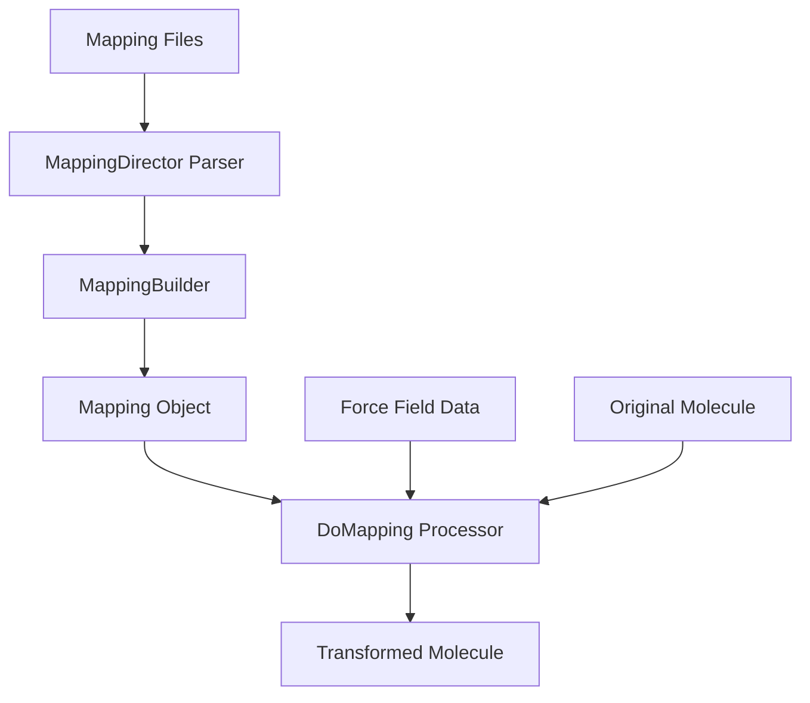

The mapping and coarse-graining system in Vermouth enables transformation of molecular structures between different resolutions, primarily from atomistic to coarse-grained representations. This sophisticated system uses graph-based subgraph isomorphism to identify molecular patterns and apply predefined transformations.

## Core Architecture

The mapping system is built around three main components: the **Mapping** class that defines transformation rules, the **MappingBuilder** that constructs these rules from input files, and the **DoMapping** processor that applies transformations to molecular graphs.



## Mapping File Format

Mapping files define how atoms in one force field correspond to beads in another. The format supports both **block mappings** for standard residues and **modification mappings** for terminal groups and special cases.

### Basic Block Mapping Structure

A typical amino acid mapping file contains:

```
[ molecule ]
ALA

[from]
charmm

[to]
martini3001

[ martini ]
BB SC1

[ mapping ]
charmm27 charmm36

[ atoms ]
    1     N    BB
    2    HN    BB
    3    CA    BB
    4    HA    !BB
    5    CB    SC1
    6   HB1    !SC1
    7   HB2    !SC1
   8   HB3    !SC1
    9     C    BB
   10     O    BB
```

The mapping specifies that atoms 1, 2, 3, 9, and 10 map to the backbone bead (BB), while atoms 5-8 map to the side chain bead (SC1). Atoms marked with `!` are excluded from the coarse-grained representation.

### Modification Mappings

Terminal groups and special chemical modifications use a more complex structure:

```
[ modification ]
[ from ]
charmm
[ to ]
martini3001
[ from blocks ]
C-ter
[ to blocks ]
C-ter

[ from nodes ]
N

[ from edges ]
N CA

[ mapping ]
CA BB
C  BB
O  BB
OXT BB
```

## Mapping Implementation

### The Mapping Class

The `Mapping` class [vermouth/map_parser.py](vermouth/map_parser.py#L31) encapsulates transformation rules and performs subgraph isomorphism to find matching patterns in target molecules. The core mapping operation uses NetworkX's graph isomorphism algorithms:

```python
def map(self, graph, node_match=None, edge_match=None):
    """
    Performs the partial mapping described by this object on `graph`. It
    first find the induced subgraph isomorphisms between `graph` and
    :attr:`block_from`, after which it will process the found isomorphisms
    according to :attr:`mapping`.
    """
```

The mapping process involves:
1. Finding subgraph isomorphisms between the input molecule and the source block pattern
2. Applying the defined atom-to-bead mappings with associated weights
3. Generating the transformed coarse-grained structure

### DoMapping Processor

The `DoMapping` processor [vermouth/processors/do_mapping.py](vermouth/processors/do_mapping.py#L823) orchestrates the transformation process:

```python
def do_mapping(molecule, mappings, to_ff, attribute_keep=(), attribute_must=()):
    """
    Creates a new :class:`~vermouth.molecule.Molecule` in force field `to_ff`
    from `molecule`, based on `mappings`. It does this by doing a subgraph
    isomorphism of all blocks in `mappings` and `molecule`.
    """
```

The processor handles both block mappings for standard residues and modification mappings for special cases, merging them into a coherent coarse-grained structure.

## Force Field Support

Vermouth includes extensive mapping support for multiple force field combinations:

| Force Field Directory | Target Force Field | Supported Source FFs |
|----------------------|-------------------|---------------------|
| martini3001/ | Martini 3.0.0 | charmm36, amber |
| martini3IDP/ | Martini 3 IDP | charmm36, amber |
| elnedyn/ | ElNedyN | charmm36 |
| martini30b32/ | Martini 3.0b32 | charmm36 |

> [!TIP]
> The mapping system uses weighted averaging for bead positioning. When multiple atoms map to a single bead, their positions are weighted according to the mapping weights, ensuring physically meaningful coarse-grained coordinates.

## Advanced Features

### Weight Normalization

Mapping weights are automatically normalized to ensure proper mass distribution [vermouth/map_parser.py](vermouth/map_parser.py#L190):

```python
def _normalize_weights(self):
    """
    Normalize weights in :attr:`mapping` such that the sum of the weights
    of nodes mapping to something is 1.
    """
```

### Attribute Transfer

The system preserves essential molecular attributes during transformation, with configurable control over which attributes to keep from the original molecule versus which to derive from the mapping blocks.

### Chirality Preservation

Special handling for chiral centers ensures stereochemical information is maintained during coarse-graining, as seen in the alanine example with explicit chiral specifications.

## Integration with Workflow

The mapping system integrates seamlessly with the broader Vermouth pipeline. After mapping, the coarse-grained structure can undergo further processing steps like [elastic network application](18-elastic-network-and-structure-biasing) or [topology generation](22-topology-generation-workflow).

> [!TIP]
> For complex molecules with non-standard residues or modifications, custom mapping files can be created following the established format and placed in the appropriate force field directory.

## Next Steps

To understand how molecules are represented and manipulated throughout this process, see [Molecule Class and Graph Operations](8-molecule-class-and-graph-operations). For information on how the transformed structures are used in simulations, refer to [GROMACS Integration](21-gromacs-integration).