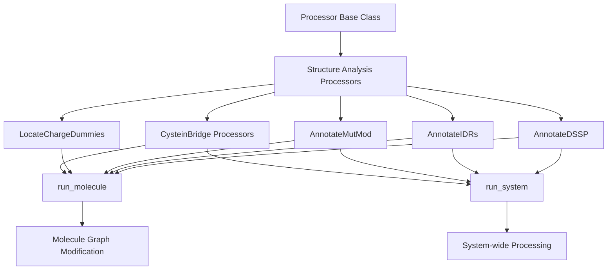

The Structure Analysis and Annotations module in Vermouth provides a comprehensive suite of processors for analyzing molecular structures and adding semantic annotations that enhance downstream processing capabilities. These processors extract structural information, identify special regions, and enrich molecular graphs with metadata essential for accurate coarse-graining and force field application.

## Secondary Structure Analysis

### DSSP Integration and Annotation

The secondary structure analysis capabilities are centered around the DSSP (Dictionary of Secondary Structure of Proteins) algorithm, which assigns secondary structure elements to protein residues based on hydrogen bonding patterns and geometric criteria [vermouth/dssp/dssp.py](vermouth/dssp/dssp.py#L15-L17).

The `AnnotateDSSP` processor serves as the primary interface for secondary structure annotation:

```python
class AnnotateDSSP(Processor):
    name = 'AnnotateDSSP'
    
    def __init__(self, executable=None, savedir=None):
        # Initialize DSSP executable and output directory
    
    def run_molecule(self, molecule):
        # Apply DSSP annotation to individual molecules
```

The core annotation function [`annotate_dssp`](vermouth/dssp/dssp.py#L333-L385) performs the actual structural analysis by:

1. Filtering molecules to identify proteins with valid positions
2. Creating a temporary system for DSSP processing
3. Executing the DSSP algorithm via external callable functions
4. Mapping results back to the original molecular graph

### Martini Secondary Structure Conversion

A critical capability is the conversion from detailed DSSP annotations to Martini-compatible secondary structure representations. The [`convert_dssp_to_martini`](vermouth/dssp/dssp.py#L386-L447) function implements sophisticated pattern matching to translate between structural resolutions:

- **Helical regions**: Differentiates between helix starts (H-bond donors), ends (H-bond acceptors), and core regions
- **Extended structures**: Consolidates β-sheets and extended regions into a single category
- **Special cases**: Handles collagenous fibers, turns, bends, and coils

The conversion uses ordered pattern matching to identify helix boundaries and apply appropriate Martini classifications, ensuring compatibility with the coarse-grained force field requirements.

## Molecular Feature Annotation

### Intrinsically Disordered Regions (IDRs)

The IDR annotation system identifies and marks flexible protein regions that lack stable secondary structure. The [`AnnotateIDRs`](vermouth/processors/annotate_idrs.py#L87-L95) processor implements this functionality:

```python
def annotate_disorder(molecule, id_regions, annotation="cgidr"):
    for region in id_regions:
        for key, node in molecule.nodes.items():
            if _in_chain_and_resid_region(region, node['stash']['resid'], node['chain']):
                molecule.nodes[key][annotation] = True
                # Override secondary structure to coil for disordered regions
                if "cgsecstruct" in node and node["cgsecstruct"] != "C":
                    node["cgsecstruct"] = "C"
                    molecule.meta['modified_cgsecstruct'] = True
```

This annotation is particularly valuable for Go-model construction and structure biasing applications where disordered regions require special treatment.

### Mutations and Modifications

The mutation and modification annotation system enables precise tracking of sequence changes and chemical modifications through the [`AnnotateMutMod`](vermouth/processors/annotate_mut_mod.py#L269-L269) processor. The core function [`annotate_modifications`](vermouth/processors/annotate_mut_mod.py#L213-L268) supports:

- **Residue specification**: Complex matching criteria including chain, residue name, and ID
- **Modification application**: Integration with force field modification libraries
- **Mutation tracking**: Association with block definitions for structural changes
- **Success reporting**: Detailed status tracking for applied modifications

The system uses residue graph traversal to identify targets and applies annotations in-place, maintaining consistency with the molecular representation.

## Specialized Structure Processing

### Charge Dummy Placement

The charge dummy system handles the positioning of virtual particles used in electrostatic modeling. The [`LocateChargeDummies`](vermouth/processors/locate_charge_dummies.py#L195-L195) processor implements sophisticated geometric algorithms for dummy placement:

```python
def locate_all_dummies(molecule, attribute_tag=DEFAULT_DUMMY_ATTRIBUTE):
    dummies = [
        (find_anchor(molecule, dummy_key, attribute_tag), dummy_key)
        for dummy_key in molecule.nodes
        if molecule.nodes[dummy_key].get(attribute_tag, None) is not None
    ]
    # Group by anchor and apply geometric placement algorithms
    grouped_by_anchor = itertools.groupby(dummies, key=operator.itemgetter(0))
    for anchor_key, dummy_pairs in grouped_by_anchor:
        dummy_keys = [pair[1] for pair in dummy_pairs]
        locate_dummy(molecule, anchor_key, dummy_keys, attribute_tag)
```

The placement algorithm utilizes Fibonacci sphere sampling and colinear pair generation to ensure optimal charge distribution around anchor atoms.

### Cysteine Bridge Detection

The cysteine bridge system identifies and manages disulfide bonds through specialized processors. The [`AddCysteinBridgesThreshold`](vermouth/processors/tune_cystein_bridges.py#L78-L78) and [`RemoveCysteinBridgeEdges`](vermouth/processors/tune_cystein_bridges.py#L58-L58) processors provide complementary functionality:

- **Bridge detection**: Distance-based identification of potential disulfide bonds
- **Template matching**: Universal bridge templates for consistent handling
- **Dynamic management**: Addition and removal based on structural criteria

## Processor Integration Architecture

The annotation processors follow a consistent architectural pattern, inheriting from the base `Processor` class and implementing standardized interfaces:



Each processor operates through two main entry points:
- **`run_molecule`**: Processes individual molecular graphs
- **`run_system`**: Handles multi-molecule systems with coordination

## Data Flow and Processing Pipeline

The annotation system integrates seamlessly with the broader Vermouth processing pipeline:

1. **Input validation**: Ensures molecular graphs contain required attributes
2. **Structure analysis**: Applies specialized algorithms for feature detection
3. **Annotation application**: Modifies graph nodes and edges with metadata
4. **Consistency maintenance**: Preserves graph integrity throughout processing
5. **Status reporting**: Provides feedback on processing success and issues

The processors maintain a clear separation of concerns, with each focusing on specific structural aspects while contributing to a comprehensive molecular understanding.

## Integration with Force Field Systems

Annotation processors interact closely with the force field infrastructure, particularly for:

- **Secondary structure mapping**: Translation between different structural representations
- **Modification validation**: Ensuring compatibility with force field definitions
- **Block association**: Linking mutations to appropriate building blocks
- **Parameter assignment**: Supporting downstream topology generation

This integration ensures that structural annotations are not merely descriptive but actively influence the coarse-graining process and force field parameter selection.

The Structure Analysis and Annotations module thus serves as a critical bridge between raw molecular structures and their processed, analysis-ready representations, enabling sophisticated molecular modeling workflows within the Vermouth ecosystem.

For understanding how these annotations feed into the transformation pipeline, see [Mapping and Coarse-Graining](12-mapping-and-coarse-graining). To explore the force field integration aspects, refer to [Martini Force Field Support](14-martini-force-field-support).