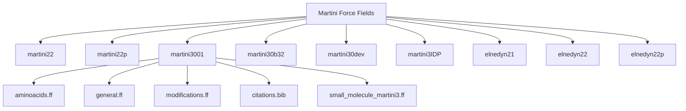

Vermouth-martinize provides comprehensive support for the Martini coarse-grained force field family, enabling molecular dynamics simulations at mesoscopic scales. The system implements a modular architecture that supports multiple Martini versions while maintaining backward compatibility and extensibility for custom force field development.

## Martini Force Field Architecture

The Martini force field implementation follows a hierarchical organization where each force field version is contained in its own directory within `vermouth/data/force_fields/` [source](vermouth/data/force_fields/). The system currently supports multiple Martini variants:



Each force field directory contains standardized files that define the molecular components and interaction parameters:

| File Type | Extension | Purpose | Parser |
|-----------|-----------|---------|--------|
| Force field definitions | `.ff` | Molecule blocks, links, modifications | `read_ff` |
| Residue topology | `.rtp` | Atomic residue definitions | `read_rtp` |
| Citations | `.bib` | Bibliographic references | `read_bib` |

## Force Field Loading System

The force field management system uses a cached singleton pattern to efficiently load and manage force field data [source](vermouth/forcefield.py#L31-L33). The `get_native_force_field()` function provides access to distributed force fields:

```python
def get_native_force_field(name):
    """
    Get a force field from the distributed library knowing its name.
    """
    global _FORCE_FIELDS
    try:
        return _FORCE_FIELDS[name]
    except KeyError:
        _FORCE_FIELDS = find_force_fields(os.path.join(DATA_PATH, 'force_fields'))
        return _FORCE_FIELDS[name]
```

> [!TIP]
> The caching mechanism ensures that force field objects remain singletons, which is crucial for proper comparison operations and memory efficiency during large-scale processing.

## Martini 3 Implementation Details

Martini 3 represents the current state-of-the-art implementation with improved interaction balance and expanded bead type repertoire [source](vermouth/data/force_fields/martini3001/citations.bib#L1-L12). The force field structure includes:

### Amino Acid Definitions
The `aminoacids.ff` file defines protein building blocks with standardized bead types and constraints [source](vermouth/data/force_fields/martini3001/aminoacids.ff#L13-L49):

```
[ macros ]
protein_resnames "CYSG|CYSF|CYSP|GLYM|GLY|ALA|CYS|VAL|LEU|ILE|MET|PRO|HYP|ASN|GLN|ASP|ASPP|ASH|GLU|GLUP|GLH|THR|SER|LYS|LSN|LYN|ARG|HSE|HIS|HSD|HSP|HID|HIP|HIE|PHE|TYR|TRP"
prot_default_bb_type P2
stiff_fc 1000000
```

### Global Variables
The `general.ff` file establishes force field-wide parameters and constants [source](vermouth/data/force_fields/martini3001/general.ff#L13-L22):

```
[ variables ]
center_weight "mass"
regular "0.47"
small "0.41"
tiny "0.34"
water_type "W"
bb_atomname "BB"
```

### Post-Translational Modifications
The `modifications.ff` file defines chemical modifications and terminal variants [source](vermouth/data/force_fields/martini3001/modifications.ff#L1-L35):

```
[ modification ]
C-ter
[ atoms ]
BB {"replace": {"atype": "Q5", "charge": -1}}

[ modification ]
N-ter
[ atoms ]
BB {"replace": {"atype": "Q5", "charge": 1}}
```

## FF File Format Parser

The force field files use a custom `.ff` format that extends the GROMACS ITP format with additional features for molecular graph manipulation [source](vermouth/ffinput.py#L15-L23). The `FFDirector` class handles parsing of:

- **Molecule types** (`[ moleculetype ]`): Define molecular blocks with exclusion parameters
- **Atoms** (`[ atoms ]`): Specify bead types, charges, and connectivity
- **Interactions** (`[ bonds ]`, `[ angles ]`, `[ dihedrals ]`): Define force field parameters
- **Links** (`[ link ]`): Describe molecular connections and transformations
- **Modifications** (`[ modification ]`): Handle chemical modifications and variants

> [!TIP]
> The parser supports conditional directives and meta-information for advanced force field customization, enabling sophisticated molecular modeling scenarios.

## Integration with Processing Pipeline

The Martini force field integrates seamlessly with the vermouth processing pipeline through the `ForceField` class [source](vermouth/forcefield.py#L36-L143). Key integration points include:

- **Reference Graphs**: Access to molecular blocks and templates via `reference_graphs` property
- **Feature Detection**: Automatic identification of force field capabilities through `features` property
- **Pattern Matching**: Support for molecular pattern recognition and transformation
- **Citation Management**: Automatic bibliographic tracking for reproducible simulations

## Scientific Validation and Citations

Each Martini variant includes comprehensive citation metadata tracking the scientific development and validation [source](vermouth/data/force_fields/martini3001/citations.bib#L13-L41). The system maintains references for:

- Core force field development (Martini 3: Nature Methods 2021)
- Small molecule parameterization (Advanced Theory and Simulations 2022)
- Gō-model integration (Nature Communications 2025)
- Protein lipidation parameters (JCTC 2023)

This ensures proper scientific attribution and enables users to trace the theoretical foundations of their simulations.

## Next Steps

For comprehensive understanding of the force field system, explore:

- [Force Field System and Data Management](10-force-field-system-and-data-management) for detailed architecture
- [Custom Force Field Development](15-custom-force-field-development) for extending the system
- [Interaction Parameter Management](16-interaction-parameter-management) for parameter optimization
- [Processor Pipeline System](6-processor-pipeline-system) for integration with molecular processing workflows