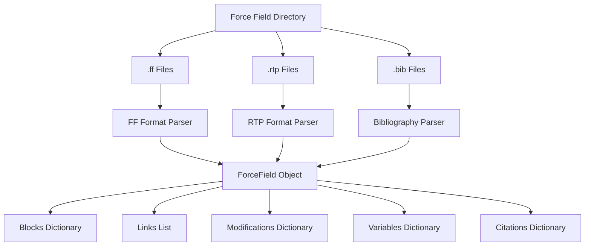

Vermouth-martinize provides a comprehensive framework for developing custom force fields through its modular architecture and extensible file format system. This guide covers the essential components and methodologies for creating and integrating custom force fields into the martinize2 workflow.

## Force Field Architecture Overview

The force field system in vermouth is built around the `ForceField` class, which serves as a centralized container for all force field data including blocks, links, modifications, variables, and citations [vermouth/forcefield.py#L36-L64]. The architecture supports multiple file formats (.ff, .rtp, .bib) through a unified parsing system [vermouth/forcefield.py#L27].



## File Format Support

### FF Format (.ff files)
The FF format is the primary format for custom force field development, providing a flexible test format for rapid prototyping [vermouth/ffinput.py#L16-L23]. It extends the ITP format with enhanced features for molecular component description.

### RTP Format (.rtp files)
For compatibility with GROMACS, the system supports RTP files through the `read_rtp` function [vermouth/gmx/rtp.py#L432-L450], which parses residue topology files and populates the force field object.

### Bibliography Format (.bib files)
Citation management is handled through .bib files, enabling proper attribution of force field parameters and methodologies.

## Force Field Structure Components

### Blocks
Blocks represent molecular building blocks and are stored in the `blocks` dictionary [vermouth/forcefield.py#L65]. Each block contains atom definitions, interactions, and connectivity patterns.

### Links
Links define inter-block connections and are stored as a list in the `links` attribute [vermouth/forcefield.py#L66]. They specify how different molecular components interact.

### Modifications
Modifications allow for dynamic alterations to molecular structures and are stored in the `modifications` dictionary [vermouth/forcefield.py#L67]. Common examples include terminal modifications and post-translational modifications.

### Variables
Global variables are stored in the `variables` dictionary [vermouth/forcefield.py#L68], enabling parameter customization and conditional behavior.

## Creating Custom Force Fields

### Directory Structure
Custom force fields follow a standardized directory structure:
```
custom_forcefield/
├── molecules.ff      # Primary molecule definitions
├── modifications.ff   # Molecular modifications
├── general.ff        # Global variables and settings
└── citations.bib     # Bibliography references
```

### FF File Syntax
The FF format supports multiple sections for comprehensive force field definition:

- **[moleculetype]**: Defines molecular blocks with atom types and interactions
- **[link]**: Specifies inter-block connections and patterns
- **[modification]**: Defines structural modifications
- **[variables]**: Global parameter definitions
- **[citations]**: Reference management

### Example: Custom Amino Acid Definition
```ff
[ moleculetype ]
CUSTOM_AA    1

[ atoms ]
;id type resnr residu atom cgnr   charge
 1   P5   1     CUSTOM_AA    BB     1      0
 2   P4   1     CUSTOM_AA    SC1    2      0

[ bonds ]
; ai aj funct length force.c.
 1  2  1  0.35  1000
```

## Force Field Loading and Management

### Native Force Field Access
The system provides cached access to native force fields through `get_native_force_field(name)` [vermouth/forcefield.py#L202-L210], enabling efficient loading of distributed force fields.

### Custom Force Field Integration
Custom force fields can be loaded using the `ForceField` class constructor with a directory path [vermouth/forcefield.py#L64-L75]:
```python
from vermouth.forcefield import ForceField

custom_ff = ForceField(directory='/path/to/custom_forcefield')
```

### File Discovery
The `iter_force_field_files` function automatically discovers all supported force field files in a directory [vermouth/forcefield.py#L192-L198], handling multiple extensions through a unified interface.

## Advanced Features

### Feature System
Force fields can declare features through links, enabling conditional processing and feature detection [vermouth/forcefield.py#L117-L128]. The `has_feature(feature)` method allows runtime feature checking.

### Citation Management
Comprehensive citation support is built into the force field system, with citations stored at both force field and component levels [vermouth/forcefield.py#L70].

### Pattern Matching
The FF format supports sophisticated pattern matching for molecular recognition and conditional modifications, enabling flexible force field design.

## Integration with Martinize2 Workflow

Custom force fields integrate seamlessly with the martinize2 processor pipeline. The force field object provides access to all molecular components needed for coarse-graining and topology generation.

For detailed information about force field integration with specific processors, refer to [Processor Pipeline System](6-processor-pipeline-system) and [Martini Force Field Support](14-martini-force-field-support).

## Best Practices

1. **Modular Design**: Separate different molecular components into logical files
2. **Consistent Naming**: Use standardized residue and atom naming conventions
3. **Documentation**: Include comprehensive citations and comments
4. **Validation**: Test force field components with known molecular systems
5. **Version Control**: Maintain version information for force field updates

> [!TIP]
> When developing custom force fields, leverage the existing Martini force fields as templates. The martini22, martini3001, and other variants in `vermouth/data/force_fields/` provide excellent reference implementations for common molecular components and interaction patterns.

## Next Steps

For practical implementation details and examples, explore the existing force field implementations in the `vermouth/data/force_fields/` directory. Understanding the interaction between force fields and the processing pipeline will be enhanced by reviewing [Processor Pipeline System](6-processor-pipeline-system) and [Molecule Class and Graph Operations](8-molecule-class-and-graph-operations).