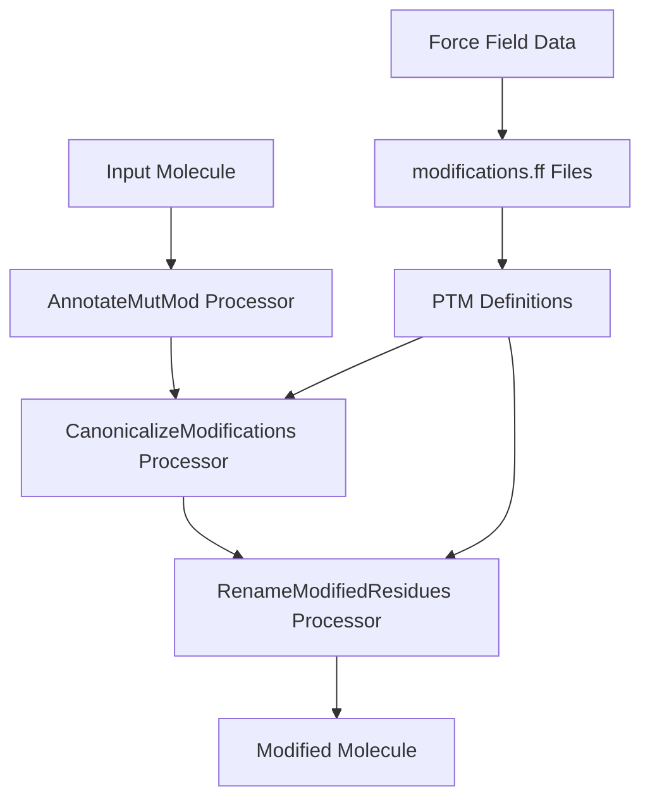

Post-translational modifications (PTMs) represent chemical changes to proteins after their synthesis, playing crucial roles in protein function, regulation, and interaction. In the vermouth-martinize framework, PTMs are handled through a sophisticated system that combines graph-based molecular representation with force field integration to accurately model these modifications in coarse-grained simulations.

## PTM Architecture Overview

The PTM system operates through a multi-stage pipeline that transforms molecular graphs to incorporate modifications while maintaining structural integrity and force field compatibility:

The architecture leverages three core processors that work sequentially to handle PTM detection, canonicalization, and residue renaming. Each processor operates on the molecular graph representation, ensuring that modifications are properly integrated into the coarse-graining workflow.

## PTM Detection and Annotation

The **AnnotateMutMod** processor serves as the entry point for PTM handling, responsible for marking residues that require modifications or mutations. This processor parses residue specifications using a flexible format that supports chain identifiers, residue names, and residue numbers [annotate_mut_mod.py#L28-L50].

The residue specification follows the pattern `[<chain>-][<resname>][[#]<resid>]`, allowing precise targeting of specific residues for modification. For example, `A-LYS2` targets lysine residue 2 in chain A, while `PO4#2` targets residue number 2 regardless of chain.

The processor maintains separate lists for modifications and mutations, applying them through the `annotate_modifications` function that traverses the molecular graph and marks appropriate atoms with modification attributes [annotate_mut_mod.py#L269-L305].

## PTM Canonicalization

The **CanonicalizeModifications** processor performs the core PTM identification and standardization work. This sophisticated system identifies unexpected atoms marked as PTM atoms and canonicalizes their attributes based on known modifications in the force field [canonicalize_modifications.py#L17-L21].

The canonicalization process involves several key steps:

1. **PTM Atom Detection**: The `find_ptm_atoms` function locates all atoms with the `PTM_atom` attribute set to `True`, traversing the molecular graph to identify PTM branches and their anchor nodes [canonicalize_modifications.py#L53-L60].

2. **Graph Matching**: The system uses a specialized node matcher (`ptm_node_matcher`) that compares PTM atoms based on element identity and non-PTM atoms based on atom names [canonicalize_modifications.py#L35-L42].

3. **Modification Identification**: The `identify_ptms` function performs graph isomorphism matching between detected PTM patterns and known modifications from the force field [canonicalize_modifications.py#L114-L125].

4. **Attribute Correction**: Once PTMs are identified, the system corrects atom names and applies the appropriate modifications from the force field definitions.

> [!TIP]
> The PTM detection system requires complete PTM structures in the input file. Missing atoms will prevent proper identification and canonicalization of modifications.

## Force Field Integration

PTM definitions are stored in force field-specific `modifications.ff` files, which contain structured definitions of supported modifications. These files define both atomic modifications and connectivity changes required for each PTM [martini3001/modifications.ff#L1-L50].

Each modification definition includes:

- **Atom specifications**: Define which atoms to modify and their new properties
- **Edge definitions**: Specify connectivity changes for complex modifications
- **Replacement rules**: Define new atom types, charges, and residue names

For example, the LYS-LSN modification defines lysine side-chain neutralization by replacing the SC2 atom type with SN6d and removing the charge [martini3001/modifications.ff#L50-L60].

## Residue Renaming System

The **RenameModifiedResidues** processor handles the final step of PTM integration by updating residue names based on applied modifications. This system uses a mapping from force field data that defines new residue names based on the original residue name and applied modifications [rename_modified_residues.py#L23-L40].

The renaming process:
1. Extracts modification lists from each atom
2. Sorts modifications to ensure consistent ordering
3. Looks up the appropriate new residue name from the force field mapping
4. Updates the residue name in-place

This ensures that modified residues are correctly labeled in the output, facilitating downstream analysis and visualization.

## Supported PTM Types

The system supports a comprehensive range of PTMs across different force fields:

- **Terminal modifications**: C-ter, N-ter, COOH-ter, NH2-ter, CCAP-ter, NCAP-ter
- **Side-chain modifications**: GLU-HE1, GLU-HE2, ASP-HD1, ASP-HD2, LYS-LSN, LYS-HZ3
- **Histidine states**: HIS-HP (protonated), HIS-HE (epsilon), HIS-HD (delta)
- **Complex modifications**: Multi-atom modifications with connectivity changes

Each modification is carefully defined to maintain structural integrity and force field compatibility.

> [!TIP]
> PTM definitions are force field-specific. Always ensure you're using the correct force field version that includes the PTMs you need for your simulation.

## Testing and Validation

The PTM system includes comprehensive testing to ensure reliable modification handling. The test suite covers various scenarios including simple PTM atoms, complex multi-residue modifications, and edge cases like incomplete PTM structures [test_ptm_detection.py#L67-L128].

Test cases validate:
- Correct PTM atom grouping and anchor identification
- Accurate modification recognition through graph matching
- Proper handling of edge cases and error conditions
- Integration with the broader molecular processing pipeline

## Integration with Processing Pipeline

PTM processors integrate seamlessly into the broader martinize2 workflow, working in concert with other processors to produce correctly modified coarse-grained structures. The typical processing order ensures that PTMs are handled after initial structure parsing but before final topology generation.

For developers working with custom PTMs, the system provides extension points through force field modification files and processor customization. The modular architecture allows for adding new PTM definitions without modifying core processing logic.

Understanding PTM processing is essential for accurate protein simulation, as these modifications can significantly impact protein behavior, interactions, and overall system dynamics. The vermouth-martinize PTM system provides a robust foundation for handling these complex chemical transformations in coarse-grained molecular dynamics.

For comprehensive understanding of the molecular processing pipeline, see [Processor Pipeline System](6-processor-pipeline-system). To understand how PTMs integrate with force field data, refer to [Force Field System and Data Management](10-force-field-system-and-data-management).