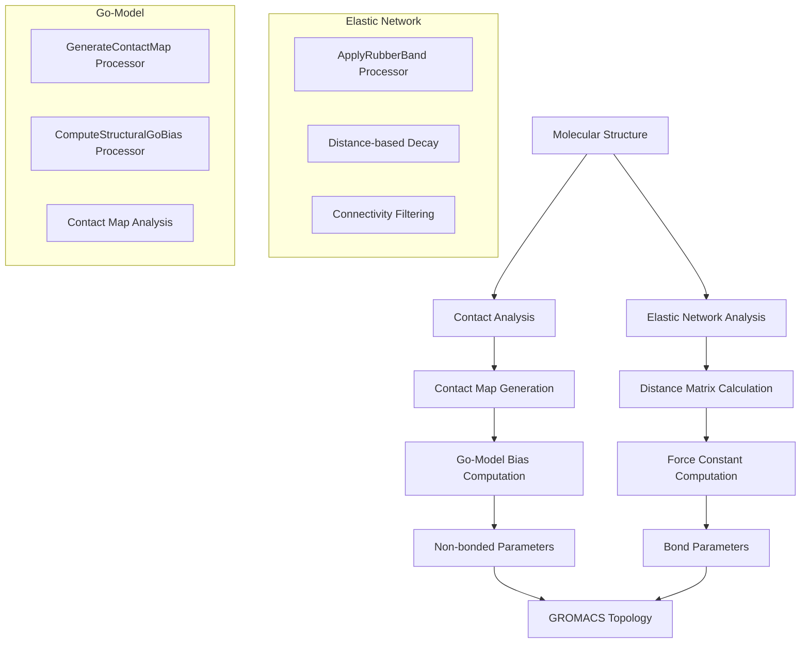

Vermouth provides sophisticated elastic network and structure biasing capabilities that enable researchers to maintain structural integrity during coarse-grained simulations. These features are essential for preserving native protein conformations and implementing structure-based models like Go-models.

## Elastic Network Models

Elastic network models (ENMs) implement harmonic restraints between beads to maintain structural relationships. The primary implementation in vermouth is the **rubber band** elastic network, which adds distance-dependent harmonic bonds between selected beads.

### Rubber Band Implementation

The `ApplyRubberBand` processor creates elastic networks with distance-dependent force constants [apply_rubber_band.py](vermouth/processors/apply_rubber_band.py#L439-L546). The force constant calculation follows a decay function:

```python
def compute_force_constants(distance_matrix, lower_bound, upper_bound,
                            decay_factor, decay_power, base_constant,
                            minimum_force):
    constants = compute_decay(distance_matrix, lower_bound, decay_factor, decay_power)
    np.fill_diagonal(constants, 0)
    constants *= base_constant
    constants[constants < minimum_force] = 0
    constants[constants > base_constant] = base_constant
    constants[distance_matrix > upper_bound] = 0
    return constants
```

> [!TIP]
> The decay function allows for sophisticated force constant modulation where shorter distances receive stronger restraints, following the relationship `k = base_constant * decay_function(distance)`.

### Key Parameters

| Parameter | Default | Description |
|-----------|---------|-------------|
| `lower_bound` | - | Minimum distance for force application |
| `upper_bound` | - | Maximum distance for elastic bonds |
| `decay_factor` | - | Distance decay factor for force constants |
| `decay_power` | - | Power law exponent for distance decay |
| `base_constant` | - | Base force constant value |
| `minimum_force` | - | Minimum force threshold |
| `res_min_dist` | 2 | Minimum residue separation [apply_rubber_band.py](vermouth/processors/apply_rubber_band.py#L32-L34) |

### Connectivity Analysis

The system includes sophisticated connectivity analysis to avoid creating redundant bonds:

```python
def are_connected(graph, left, right, separation):
    """Check if two nodes are already connected within a given separation."""
    try:
        shortest_path = nx.shortest_path_length(graph, left, right)
        return shortest_path <= separation
    except (nx.NetworkXNoPath, KeyError):
        return False
```

This prevents creating elastic bonds between beads that are already covalently or closely connected in the molecular graph.

## Go-Model Structure Biasing

Go-models implement structure-based biasing using native contacts as reference points. Vermouth's Go-model implementation resides in the `rcsu` (residue contact structure utilities) module.

### Contact Map Generation

The `GenerateContactMap` processor calculates native contacts using van der Waals overlap analysis [contact_map.py](vermouth/rcsu/contact_map.py#L779-L808):

```python
def do_contacts(molecule, write_file):
    vdw_list, atypes, coords, res_serial, resids, chains, resnames, res_idx, ca_pos, nresidues, mol_graph = _contact_info(molecule)
    overlaps, contacts, stabilisers, destabilisers = _calculate_contacts(vdw_list, atypes, coords, res_serial, nresidues)
    contacts, all_contacts = _get_contacts(nresidues, overlaps, contacts, stabilisers, destabilisers, res_idx, mol_graph)
```

The contact calculation uses sophisticated geometric analysis including:
- Van der Waals radius calculations
- Surface overlap detection using Fibonacci sphere algorithms
- Contact stabilization/destabilization analysis

### Structural Bias Computation

The `ComputeStructuralGoBias` processor converts contacts into non-bonded interaction parameters [go_structure_bias.py](vermouth/rcsu/go_structure_bias.py#L235-L280):

```python
def compute_go_interaction(self, contacts):
    go_inters = {}
    for atype_a, atype_b, dist in contacts:
        sigma = dist / self.conversion_factor
        contact_bias = NonbondParam(atoms=(atype_a, atype_b),
                                    sigma=sigma,
                                    epsilon=self.go_eps,
                                    meta={"comment": [f"go bond {dist}"]})
        self.system.gmx_topology_params["nonbond_params"].append(contact_bias)
```

> [!TIP]
> The Go-model bias is implemented as Lennard-Jones type non-bonded interactions where the sigma parameter matches the native distance and epsilon provides the bias strength.

### Go-Model Pipeline

The Go-model functionality is integrated through a dedicated pipeline [go_pipeline.py](vermouth/rcsu/go_pipeline.py#L25-L57):

```python
GoPipeline = GoProcessorPipeline([SetMoleculeMeta,
                                  VirtualSiteCreator,
                                  ComputeStructuralGoBias])
```

This pipeline orchestrates the complete Go-model setup including molecule metadata handling, virtual site creation, and structural bias computation.

## Architecture Overview



## Integration and Usage

Both elastic networks and Go-model biasing integrate seamlessly with the vermouth processor pipeline. They can be used independently or in combination:

- **Elastic Networks**: Applied via `ApplyRubberBand` processor with customizable distance criteria and decay functions
- **Go-Models**: Applied via `GoPipeline` which handles the complete structure biasing workflow
- **Combined Usage**: Elastic networks can complement Go-models by providing additional long-range restraints

The parameters are stored in the system's `gmx_topology_params` and automatically written to GROMACS topology files using the standard topology writing functionality.

## Next Steps

For understanding how these biasing methods integrate with the overall transformation workflow, see [Processor Pipeline System](6-processor-pipeline-system). To learn about the molecular graph representation that underlies these calculations, refer to [Graph-Based Molecular Representation](7-graph-based-molecular-representation). For details on force field integration and topology generation, see [GROMACS Integration](21-gromacs-integration).