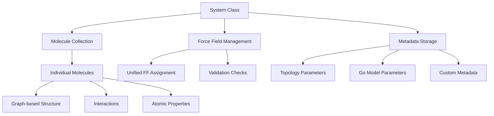
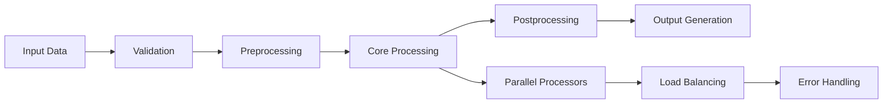

Vermouth-martinize provides a robust architecture for high-throughput molecular processing, enabling efficient handling of large-scale molecular systems through systematic pipeline orchestration and optimized data structures. This capability is essential for processing hundreds or thousands of molecular structures in automated workflows, making it particularly valuable for drug discovery, materials science, and systems biology applications.

## System-Level Processing Architecture

The foundation of high-throughput processing lies in the `System` class, which serves as a container for multiple molecules and provides the interface for batch processing operations. The system maintains a collection of molecules with consistent force field assignments, ensuring uniform processing across all molecular entities [source](vermouth/system.py#L21-L29).



The System class provides essential methods for managing molecular collections:

- **Molecule Addition**: The `add_molecule` method ensures force field consistency and automatically assigns the system's force field to new molecules [source](vermouth/system.py#L58-L66)
- **Particle Counting**: The `num_particles` property efficiently calculates total system size across all molecules [source](vermouth/system.py#L78-L82)
- **System Copying**: Deep copying capabilities enable parallel processing workflows while preserving original data integrity [source](vermouth/system.py#L84-L93)

## Processor Pipeline for Batch Operations

High-throughput processing leverages the abstract `Processor` class, which defines the interface for both molecule-level and system-level transformations. The base `run_system` method implements the core batch processing pattern by iterating through all molecules in a system and applying the molecular transformation sequentially [source](vermouth/processors/processor.py#L26-L35).

This design enables several key high-throughput capabilities:

### Parallel Processing Architecture

The processor system supports both sequential and parallel processing patterns. Each processor operates independently on individual molecules, allowing for straightforward parallelization:

```python
# Sequential processing (default)
for molecule in system.molecules:
    result = processor.run_molecule(molecule)
    processed_molecules.append(result)
```

### Memory-Efficient Processing

The architecture supports in-place modifications to minimize memory overhead during large-scale processing. Processors can modify molecules directly or return new instances, providing flexibility based on memory constraints and processing requirements.

### Specialized High-Throughput Processors

Several processors are specifically designed for high-throughput scenarios:

#### MergeAllMolecules Processor

The `MergeAllMolecules` processor exemplifies system-level optimization by consolidating multiple molecules into a single entity, reducing computational overhead for subsequent operations [source](vermouth/processors/merge_all_molecules.py#L22-L28). This processor:

- Efficiently combines all molecules in a system into the first molecule
- Preserves atomic interactions and connectivity during merging
- Maintains force field consistency across the merged structure
- Optimizes memory usage for large molecular assemblies

The merging process leverages the `merge_molecule` method in the `Molecule` class, which handles complex operations such as atom index offsetting, interaction preservation, and force field validation [source](vermouth/molecule.py#L705-L730).

## Performance Optimization Strategies

### Graph-Based Molecular Representation

Vermouth's use of NetworkX graphs for molecular representation provides inherent advantages for high-throughput processing:

- **Efficient Traversal**: Graph algorithms enable rapid analysis of molecular connectivity and topology
- **Memory Optimization**: Sparse graph representations minimize memory footprint for large molecules
- **Algorithmic Flexibility**: Rich ecosystem of graph algorithms supports diverse analysis tasks

### Batch Processing Patterns

The system supports several high-throughput processing patterns:

1. **Sequential Pipeline**: Processors are chained together, with each operating on the entire system
2. **Parallel Molecule Processing**: Individual molecules are processed concurrently across multiple cores
3. **Chunked Processing**: Large systems are divided into manageable chunks for memory-efficient processing

### Resource Management

High-throughput workflows benefit from several resource management features:

- **Lazy Loading**: Molecular data is loaded on-demand to minimize memory usage
- **Incremental Processing**: Systems can be processed incrementally, enabling handling of datasets larger than available memory
- **Checkpoint/Restart**: Processing state can be saved and restored for long-running workflows

## Integration with External Tools

The high-throughput architecture seamlessly integrates with external computational tools:

- **GROMACS Integration**: Direct support for GROMACS file formats and topology generation [source](vermouth/gmx/)
- **Parallel File I/O**: Optimized readers and writers for PDB, GRO, and CIF formats support concurrent access
- **Cluster Computing**: The modular processor architecture facilitates deployment on high-performance computing clusters

## Scalability Considerations

The system demonstrates excellent scalability characteristics:

- **Linear Scaling**: Processing time scales linearly with the number of molecules for most operations
- **Memory Efficiency**: Graph-based representation minimizes memory overhead
- **I/O Optimization**: Batch file operations reduce disk access overhead

For extremely large datasets, the system supports distributed processing patterns where multiple instances can work on different subsets of the data, with results merged at the end of processing.

## Best Practices for High-Throughput Processing

### Processor Design Guidelines

When creating custom processors for high-throughput workflows:

1. **Implement Efficient Algorithms**: Use O(n) or O(n log n) algorithms where possible
2. **Minimize Memory Allocations**: Reuse data structures and avoid unnecessary copying
3. **Handle Edge Cases**: Ensure robust processing of malformed or incomplete molecular data
4. **Provide Progress Feedback**: Implement logging and progress reporting for long-running operations

### Workflow Optimization

Optimal high-throughput workflows typically follow this pattern:



## Future Directions

The high-throughput processing architecture continues to evolve with ongoing developments in:

- **GPU Acceleration**: Integration with GPU-accelerated molecular processing libraries
- **Cloud-Native Processing**: Support for containerized deployment and cloud-based scaling
- **Machine Learning Integration**: Automated parameter optimization and intelligent processing pipelines

This robust foundation ensures that vermouth-martinize can handle the increasing computational demands of modern molecular simulation workflows while maintaining flexibility and extensibility for future requirements.

For deeper understanding of the processing pipeline, refer to [Processor Pipeline System](6-processor-pipeline-system) and for molecular data structures, see [Molecule Class and Graph Operations](8-molecule-class-and-graph-operations).