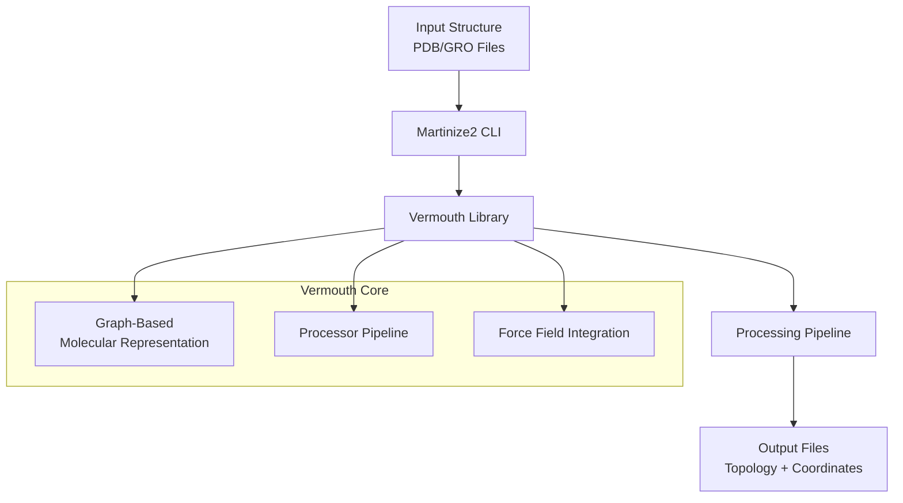

Martinize2 and Vermouth provide a unified framework for transforming molecular structures between different resolutions, with primary focus on generating coarse-grained topologies from atomistic structures for the Martini force field. This quick start guide will help you get up and running with basic molecular transformations.

## System Architecture Overview

The system consists of two main components: **Vermouth** (the Python library) and **Martinize2** (the command-line interface). Vermouth handles the core transformation logic using graph-based molecular representations, while Martinize2 provides an accessible CLI for common workflows.



## Installation and Basic Setup

### Prerequisites
- Python 3.9 or higher
- pip package manager

### Installation Commands

```bash
# Install the latest stable release
pip install vermouth

# Update existing installation
pip install -U vermouth

# Install development version (advanced users)
pip install git+https://github.com/marrink-lab/vermouth-martinize.git#vermouth
```

> [!TIP]
> The installation adds the `martinize2` command to your system PATH. Verify installation by running `martinize2 -h` to see available options.

### Optional Dependencies

For enhanced secondary structure assignment, you can install **MDTraj** as an alternative to DSSP:

```bash
pip install mdtraj
```

## Your First Molecular Transformation

### Basic Command Structure

The fundamental martinize2 workflow transforms atomistic structures to coarse-grained representations:

```bash
martinize2 -f input.pdb -x output.pdb -o topology.top -ff forcefield
```

### Practical Example: Protein Coarse-Graining

Let's transform a lysozyme protein structure from atomistic to Martini 3 coarse-grained representation:

```bash
martinize2 -f lysozyme.pdb \
           -x cg_lysozyme.pdb \
           -o topology.top \
           -ff martini3001 \
           -dssp \
           -elastic
```

**Command Breakdown:**

| Parameter | Description | Purpose |
|-----------|-------------|---------|
| `-f lysozyme.pdb` | Input structure file | Atomistic protein structure |
| `-x cg_lysozyme.pdb` | Output coordinate file | Coarse-grained coordinates |
| `-o topology.top` | Output topology file | GROMACS topology |
| `-ff martini3001` | Force field selection | Martini 3 force field |
| `-dssp` | Secondary structure assignment | Improves accuracy |
| `-elastic` | Elastic network generation | Maintains structure |

### Processing Pipeline Overview

Martinize2 executes a six-stage transformation pipeline [source](doc/source/martinize2_workflow.rst#L1-L20):


## Supported File Formats and Features

### Input Formats
- **PDB files** (preferred) - Contains complete structural information including chain identifiers and connectivity records
- **GRO files** - Basic coordinate format

### Output Formats
- **GROMACS topology files** (`.top`) - Complete force field topology
- **Coordinate files** - Both atomistic and coarse-grained structures

### Key Capabilities

| Feature | Description | Use Case |
|---------|-------------|----------|
| **Multi-scale Support** | Handles both atomistic and coarse-grained representations | Resolution transformation studies |
| **Polymer Flexibility** | No assumptions about polymer linearity | Complex biomolecules, branched polymers |
| **PTM Support** | Post-translational modifications | Realistic protein modeling |
| **Structure Repair** | Handles missing atoms and non-standard names | Experimental structure processing |

## Common Workflows and Options

### Mutation and Modification

Apply point mutations or modifications during processing:

```bash
# Mutate specific residue
martinize2 -f protein.pdb -mutate PHE42:ALA -x mutated.pdb -o top.top

# Apply terminal modifications
martinize2 -f protein.pdb -nter NTER -cter CTER -x modified.pdb -o top.top
```

### Debugging and Troubleshooting

When martinize2 encounters potential issues, it provides several debugging options:

```bash
# Verbose output for debugging
martinize2 -f input.pdb -vv -x output.pdb -o top.top

# Write intermediate graphs for inspection
martinize2 -f input.pdb -write-graph -write-repair -x output.pdb -o top.top

# Override warnings (use with caution)
martinize2 -f input.pdb -maxwarn 5 -x output.pdb -o top.top
```

> [!TIP]
> Always review warning messages carefully. Martinize2 refuses to write output files when it detects potentially invalid topologies to prevent simulation errors.

## Next Steps

Now that you have a basic understanding of Martinize2, consider exploring:

- **[Installation and Setup](3-installation-and-setup)** - Detailed installation instructions and environment configuration
- **[Basic Martinize2 Usage](4-basic-martinize2-usage)** - Comprehensive command-line options and advanced workflows  
- **[Vermouth Library Architecture](5-vermouth-library-architecture)** - Understanding the underlying Python library for programmatic use

For complete documentation and API reference, visit the official documentation at https://vermouth-martinize.readthedocs.io/