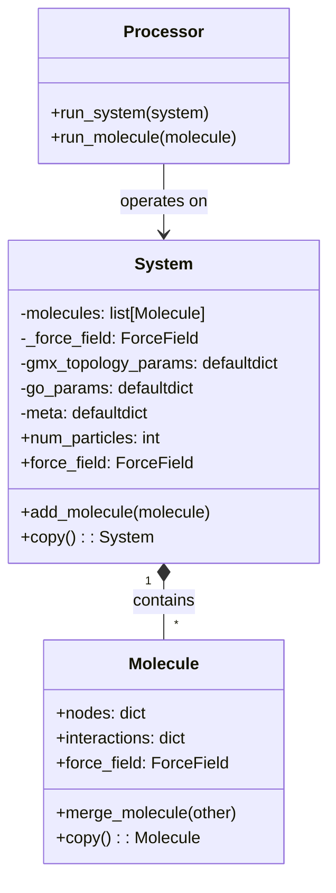

The System class serves as the central container for managing collections of molecules within the Vermouth molecular simulation framework. It provides a unified interface for handling multi-molecule systems, ensuring force field consistency, and coordinating molecular operations across complex biomolecular simulations.

## System Architecture Overview

The System class implements a hierarchical management structure where individual molecules are organized and controlled through a centralized interface. This design enables efficient handling of large-scale molecular systems while maintaining strict force field compatibility and metadata management.



> [!TIP]
> The System class maintains strict force field consistency across all contained molecules, preventing incompatible force field mixing through validation during molecule addition.

## Core System Components

### Molecule Container Management

The System class maintains a list of Molecule objects as its primary data structure, with each molecule representing an independent molecular entity within the larger system. The container supports dynamic addition of molecules through the `add_molecule` method, which includes comprehensive validation to ensure force field compatibility [system.py#L58-L66](vermouth/system.py#L58-L66).

The molecule addition process follows a sophisticated validation workflow:
1. **Force Field Inheritance**: New molecules automatically inherit the system's force field if they lack one
2. **System Force Field Update**: The system updates its force field when adding the first molecule with a defined force field
3. **Compatibility Validation**: Strict checking prevents mixing molecules with different force fields

```python
def add_molecule(self, molecule):
    if molecule.force_field is None:
        molecule._force_field = self.force_field
    if self.force_field is None:
        self.force_field = molecule.force_field
    if molecule.force_field != self.force_field:
        raise KeyError(f'Cannot add Molecule with force field '
                       f'{molecule.force_field} to system with force field '
                       f'{self.force_field}')
    self.molecules.append(molecule)
```

### Force Field Management

Force field handling in the System class demonstrates a sophisticated inheritance and validation mechanism. The `force_field` property acts as both a getter and setter, ensuring consistency across all contained molecules [system.py#L38-L54](vermouth/system.py#L38-L54). When the system's force field is modified, all molecules are automatically updated to maintain consistency.

### Metadata and Parameter Storage

Beyond molecules and force fields, the System class provides specialized containers for various simulation parameters:
- **gmx_topology_params**: GROMACS topology-specific parameters
- **go_params**: Go-model parameters for structure biasing
- **meta**: General-purpose metadata storage

These containers use `defaultdict(list)` structures, enabling flexible parameter accumulation during processing pipelines.

## Multi-Molecule Operations

### System-Level Processing

The System class integrates seamlessly with Vermouth's processor architecture, enabling system-wide transformations. Processors like `MergeAllMolecules` and `MergeChains` demonstrate the system's capability to manipulate entire molecular collections [merge_all_molecules.py#L29-L33](vermouth/processors/merge_all_molecules.py#L29-L33).

The `MergeAllMolecules` processor exemplifies system-level operations by consolidating all molecules into a single entity:

```python
def run_system(self, system):
    if not system.molecules:
        return system
    
    molecule = system.molecules[0]
    for other in system.molecules[1:]:
        molecule.merge_molecule(other)
    
    system.molecules = [molecule]
    return system
```

### Molecule Merging Strategies

The system supports multiple merging strategies through specialized processors:
- **Complete Merging**: `MergeAllMolecules` consolidates all molecules into one
- **Chain-Based Merging**: `MergeChains` merges molecules based on chain identifiers

These operations leverage the underlying `Molecule.merge_molecule` method, which handles the complex graph-based merging of molecular structures [molecule.py#L705-L783](vermouth/molecule.py#L705-L783).

## System Properties and Utilities

### Particle Counting

The `num_particles` property provides efficient calculation of the total particle count across all molecules in the system [system.py#L77-L82](vermouth/system.py#L77-L82):

```python
@property
def num_particles(self):
    return sum(len(mol) for mol in self.molecules)
```

### System Cloning

The `copy` method creates deep copies of the entire system, including all contained molecules while preserving force field associations [system.py#L84-L93](vermouth/system.py#L84-L93). This capability is essential for creating simulation snapshots and performing comparative analyses.

## Error Handling and Validation

The System class implements robust error handling, particularly for force field compatibility. The test suite demonstrates comprehensive validation scenarios:

1. **Force Field Mismatch Detection**: Prevents adding molecules with incompatible force fields [test_system.py#L25-L42](vermouth/tests/test_system.py#L25-L42)
2. **Automatic Force Field Assignment**: Handles systems that initially lack force fields [test_system.py#L43-L59](vermouth/tests/test_system.py#L43-L59)

> [!TIP]
> Force field validation occurs during molecule addition, ensuring early detection of incompatibilities before expensive processing operations begin.

## Integration with Processing Pipeline

The System class serves as the primary data structure for processor pipelines, enabling complex molecular transformations. Processors can operate at the system level, modifying multiple molecules simultaneously while maintaining consistency across the entire molecular ensemble.

This integration allows for sophisticated workflows such as:
- Multi-chain protein processing
- Solvent system preparation
- Coarse-graining transformations
- Topology generation for mixed molecular systems

The System class thus provides the foundational architecture for managing complex molecular simulations while ensuring data integrity and processing efficiency.

For more detailed information about specific molecular operations, see [Molecule Class and Graph Operations](8-molecule-class-and-graph-operations). To understand how systems integrate with simulation workflows, refer to [Topology Generation Workflow](22-topology-generation-workflow).