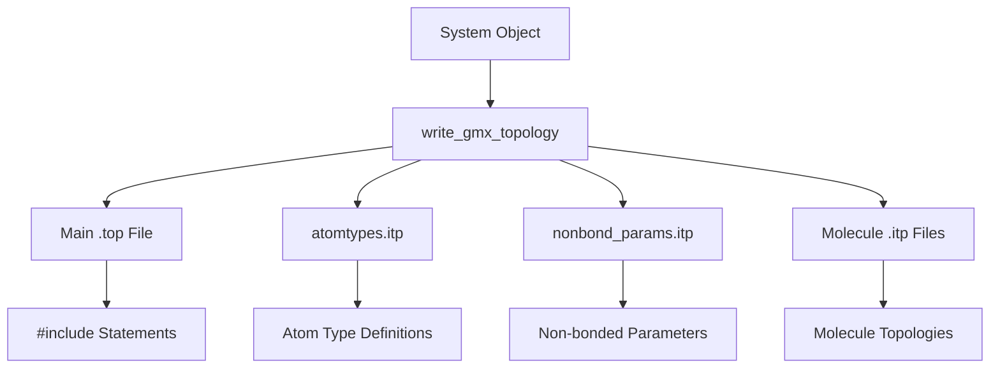
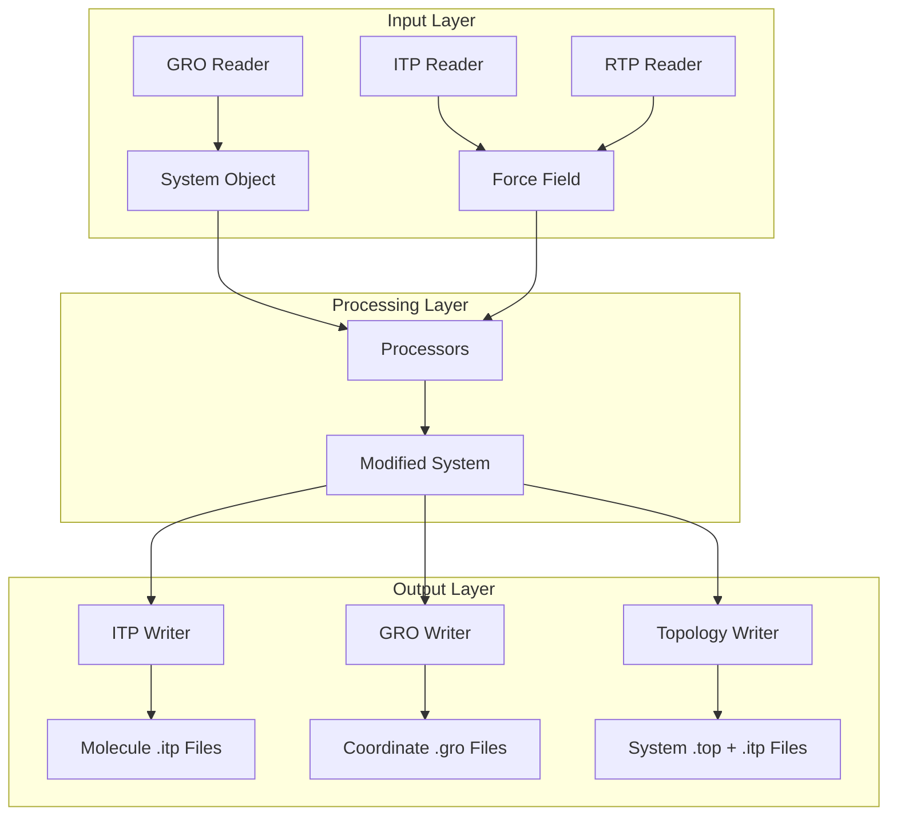

Vermouth provides comprehensive GROMACS integration through dedicated modules for handling GROMACS file formats and topology generation. The integration enables seamless conversion between molecular representations and GROMACS-compatible files, supporting the complete workflow from structure input to simulation-ready topologies.

## GROMACS File Format Support

The `vermouth.gmx` module contains specialized handlers for all major GROMACS file formats, ensuring compatibility with the GROMACS simulation ecosystem.

### GRO File Handling

GRO (GROningen) files are handled through the `gro.py` module, providing both reading and writing capabilities:

- **Reading**: The `read_gro()` function parses GRO files to create Molecule objects, supporting residue exclusion and hydrogen filtering options [source](vermouth/gmx/gro.py#L29-L46)
- **Writing**: The `write_gro()` function exports System objects to GRO format with configurable precision and box parameters [source](vermouth/gmx/gro.py#L118-L136)

The GRO processor integration allows direct pipeline usage through the `GROInput` processor class [source](vermouth/processors/gro_reader.py#L28-L39).

### ITP File Processing

ITP (Include Topology) files are central to GROMACS force field definitions:

- **Writing**: The `write_molecule_itp()` function generates complete ITP files including atoms, bonds, angles, dihedrals, and other interaction parameters [source](vermouth/gmx/itp.py#L77-L100)
- **Reading**: The `read_itp()` function parses ITP files using the sophisticated `ITPDirector` class that handles all GROMACS topology sections [source](vermouth/gmx/itp_read.py#L473-L485)

The ITP reader supports all standard GROMACS sections including moleculetype, atoms, bonds, angles, dihedrals, constraints, and various virtual site types [source](vermouth/gmx/itp_read.py#L260-L286).

### RTP File Support

RTP (Residue Topology Parameter) files are processed through the `rtp.py` module, which handles the complex hierarchical structure of RTP files:

- **Section Iterators**: Three-tier iterator system (`_IterRTPSections`, `_IterRTPSubsections`, `_IterRTPSubsectionLines`) provides structured access to RTP content [source](vermouth/gmx/rtp.py#L126-L169)
- **Block Processing**: The `read_rtp()` function parses blocks and links from RTP files to populate force field definitions [source](vermouth/gmx/rtp.py#L432-L450)

## Topology Generation System

The topology generation system creates complete GROMACS topology files from Vermouth System objects.

### Topology File Structure

The `write_gmx_topology()` function generates hierarchical topology files:

The function creates a main topology file with included parameter files, separating different directive types into dedicated ITP files for better organization [source](vermouth/gmx/topology.py#L116-L140).

### Parameter Management

Two key functions handle topology parameters:

- **Atom Types**: `write_atomtypes()` generates [atomtypes] sections with mass, sigma, epsilon, and metadata [source](vermouth/gmx/topology.py#L40-L46)
- **Non-bonded Parameters**: `write_nonbond_params()` creates [nonbond_params] sections for pair interactions [source](vermouth/gmx/topology.py#L78-L84)

Both functions support C6/C12 parameter conversion through the `sigma_epsilon_to_C6_C12()` utility [source](vermouth/gmx/topology.py#L31-L36).

## GROMACS Preprocessor Variables

Vermouth supports GROMACS preprocessing variables for topology customization, enabling simulation-specific modifications without altering force field files.

### Supported Variables

| Variable | Purpose | Usage in .mdp file |
|----------|---------|-------------------|
| `FLEXIBLE` | Switches bonds between harmonic and constraints | `define = -DFLEXIBLE` |
| `POSRES` | Activates position restraints | `define = -DPOSRES` |
| `POSRES_FC` | Controls position restraint force constant | `define = -DPOSRES -DPOSRES_FC=500` |

These variables integrate with GROMACS preprocessing system, allowing conditional topology sections based on simulation parameters [source](doc/source/gromacs_variables.rst#L4-L44).

## Integration Architecture

The GROMACS integration follows Vermouth's modular architecture:

This architecture enables flexible workflows where different input formats can be processed through the same pipeline and output in various GROMACS-compatible formats.

## Usage Patterns

### Typical Workflow

1. **Input**: Read structures using GRO or PDB readers
2. **Processing**: Apply molecular transformations through processors
3. **Output**: Generate complete GROMACS topology files

The integration supports both programmatic usage through direct function calls and pipeline-based processing through the processor system.

### Processor Integration

GROMACS file operations are integrated into the processor pipeline through dedicated processors:

- `GROInput`: Reads GRO files into the pipeline [source](vermouth/processors/gro_reader.py#L28-L39)
- File writers can be integrated as output processors for automated file generation

This integration allows seamless incorporation of GROMACS operations into complex molecular processing workflows.

## Next Steps

For complete workflow understanding, see:
- [Topology Generation Workflow](22-topology-generation-workflow) for detailed topology creation processes
- [Force Field System and Data Management](10-force-field-system-and-data-management) for force field integration details
- [Processor Pipeline System](6-processor-pipeline-system) for processing architecture information