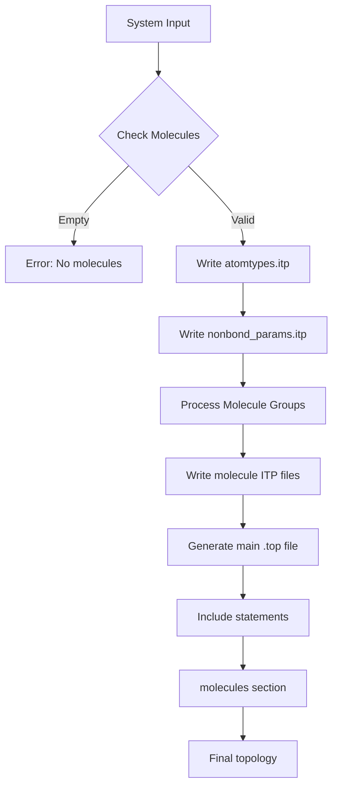

The topology generation workflow in vermouth represents the culmination of molecular processing, transforming processed molecular graphs into GROMACS-compatible topology files. This workflow bridges the gap between the internal graph-based molecular representation and the simulation-ready format required by GROMACS.

## System-Level Topology Architecture

The topology generation process operates at the system level through the `System` class, which manages collections of molecules and their associated force field parameters [source](vermouth/system.py#L21-L30). The system serves as the central container that orchestrates the final output generation, maintaining references to all molecules and their collective topology parameters.

The workflow follows a hierarchical organization where the system contains multiple molecules, each potentially representing different molecular types (proteins, lipids, solvents). This structure enables efficient management of complex biomolecular systems with heterogeneous components.

## GROMACS Topology File Generation

The core topology generation is handled by the `write_gmx_topology` function in `vermouth/gmx/topology.py` [source](vermouth/gmx/topology.py#L116-L122). This function implements a sophisticated multi-file output strategy that separates different topology components into specialized files:

The function generates a main `.top` file that includes multiple `.itp` files for different molecular types and parameters. This modular approach enhances maintainability and follows GROMACS best practices for topology organization.

### Molecule Group Processing

The topology generator employs intelligent molecule grouping based on molecule types (`moltype`) [source](vermouth/gmx/topology.py#L160-L200). Using `itertools.groupby`, it processes consecutive molecules with the same type, which is crucial for maintaining the correct order in the final `[ molecules ]` section. This approach preserves the original molecular arrangement while optimizing file generation.

Each unique molecule type triggers the creation of a dedicated `.itp` file containing all the molecular parameters, interactions, and metadata. The system tracks which molecule types have been processed to avoid duplicate file generation.

## ITP File Generation and Molecular Parameters

Individual molecule topology files (`.itp`) are generated using the `write_molecule_itp` function [source](vermouth/gmx/itp.py#L77-L150). This function handles the detailed formatting of molecular information into GROMACS ITP format, including:

- **Atom definitions**: Each atom must have attributes for atom type, residue ID, residue name, atom name, and charge group
- **Molecule metadata**: Including exclusion lists (`nrexcl`) and molecule type information
- **Section formatting**: Proper alignment and formatting of all topology sections

The function performs comprehensive validation to ensure all required molecular information is present before writing the topology file. This validation prevents generation of incomplete or invalid topology files.

## Parameter Management and Force Field Integration

The topology generation process integrates closely with the force field system through `system.gmx_topology_params` [source](vermouth/gmx/topology.py#L40-L84). This parameter storage contains:

- **Atom types**: Definitions of all atom types used in the system
- **Non-bonded parameters**: Lennard-Jones and other non-bonded interaction parameters
- **Conversion utilities**: Functions to transform between different parameter representations (σ-ε to C6-C12)

The system supports both σ-ε and C6-C12 parameter formats, with automatic conversion handled by the `sigma_epsilon_to_C6_C12` function [source](vermouth/gmx/topology.py#L31-L36).

## File Writing Strategy and Error Handling

Vermouth employs a sophisticated deferred file writing mechanism through the `DeferredFileWriter` class [source](vermouth/file_writer.py#L52-L153). This singleton class provides atomic file operations that prevent corruption of existing files:

1. **Temporary file creation**: All writes go to temporary files first
2. **Validation period**: Files remain temporary until explicit finalization
3. **Atomic move operations**: Temporary files are moved to final destinations only after successful completion
4. **Backup management**: Existing files are backed up following GROMACS conventions

This approach ensures that topology generation failures don't leave partially written or corrupted files, which is critical for reproducible simulations.

## Citation Management and Documentation

The topology generation workflow automatically includes relevant citations in generated files [source](vermouth/gmx/topology.py#L185-L195). Each molecule's force field citations are collected and formatted according to the force field's citation mapping. This automatic citation inclusion ensures proper attribution of force field parameters and methodologies.

The system maintains a hierarchical citation structure where common citations are combined with molecule-specific references, creating comprehensive documentation within the generated topology files.

## Integration with Processing Pipeline

The topology generation represents the final stage of the martinize2 processing pipeline [source](doc/source/martinize2_workflow.rst#L286-L296). After all molecular transformations, mappings, and post-processing steps are complete, the topology generation converts the processed molecular graphs into simulation-ready files.

This integration ensures that all modifications, elastic networks, and other processing results are properly reflected in the final topology files. The workflow maintains consistency between the internal graph representation and the external file format throughout the process.

## Advanced Features and Extensions

The topology generation system supports several advanced features:

- **Conditional parameter inclusion**: Based on system defines and molecular properties
- **Custom section formatting**: Through pre-section and post-section line specifications
- **Multi-molecule systems**: Efficient handling of heterogeneous molecular assemblies
- **GROMACS character limits**: Automatic handling of GROMACS parsing limitations

These features enable the generation of complex topologies for sophisticated biomolecular simulations while maintaining compatibility with GROMACS requirements.

---

The topology generation workflow represents a critical bridge between vermouth's internal molecular representation and GROMACS simulation requirements. Through careful design of the file writing strategy, parameter management, and integration with the processing pipeline, it ensures reliable and reproducible topology generation for complex biomolecular systems.

For deeper understanding of the processing pipeline that feeds into topology generation, refer to [Processor Pipeline System](6-processor-pipeline-system) and [Molecule Class and Graph Operations](8-molecule-class-and-graph-operations).