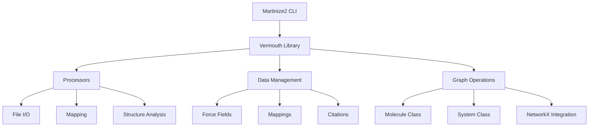

This guide provides comprehensive instructions for installing and setting up Martinize2 and Vermouth, the ultimate resolution transformation tools for molecular dynamics simulations. These tools enable the conversion of atomistic structures to coarse-grained representations, primarily designed for the Martini force field and GROMACS simulation engine.

## System Requirements

Before proceeding with installation, ensure your system meets the following prerequisites:

**Python Version:** Python 3.9 or greater is required [setup.cfg#L33-L37](setup.cfg#L33-L37). The package has been tested and supports Python versions 3.9, 3.10, 3.11, and 3.12.

**Operating System:** The package is OS-independent and works on Windows, macOS, and Linux systems [setup.cfg#L30](setup.cfg#L30).

**Core Dependencies:** The installation automatically handles these essential packages:
- **numpy** for numerical computations
- **networkx ≥ 2.0** for graph operations 
- **scipy** for scientific computing
- **pbr** for Python build reasonableness

> [!TIP]
> NetworkX version 2.0 or higher is strictly required for graph-based molecular transformations. Ensure your package manager installs the correct version.

## Installation Methods

### Standard Installation (Recommended)

The most straightforward method is installing from PyPI using pip:

```bash
pip install vermouth
```

This command installs the latest stable release and automatically adds the `martinize2` executable to your system PATH [README.md#L44-L46](README.md#L44-L46).

### Development Installation

For researchers wanting to experiment with cutting-edge features or contribute to development:

```bash
pip install git+https://github.com/marrink-lab/vermouth-martinize.git#vermouth
```

> [!TIP]
> Development versions may contain bugs that produce incorrect topologies. Always carefully validate your results when using development versions.

### Updating Existing Installation

To update an existing installation to the latest version:

```bash
pip install -U vermouth
```

## Optional Dependencies

### MDTraj Integration

For enhanced trajectory analysis capabilities as an alternative to DSSP:

```bash
pip install vermouth[mdtraj]
```

Or install MDTraj separately:

```bash
pip install mdtraj
```

### CIF File Support

For handling Crystallographic Information Framework files:

```bash
pip install vermouth[PyCifRW]
```

Or install PyCifRW separately:

```bash
pip install PyCifRW
```

## Verification Installation

After installation, verify that Martinize2 is properly installed by running:

```bash
martinize2 -h
```

This command displays the available options and confirms the program is accessible [README.md#L58-L60](README.md#L58-L60).

## Project Architecture Overview

Understanding the project structure helps with troubleshooting and development:



### Key Directory Structure

| Directory | Purpose | Key Components |
|-----------|---------|----------------|
| `vermouth/` | Core library | Processors, data structures, graph operations |
| `vermouth/processors/` | Transformation pipeline | File I/O, mapping, analysis processors |
| `vermouth/data/` | Force field data | Martini force fields, mappings, citations |
| `vermouth/gmx/` | GROMACS integration | Topology, coordinate file handling |
| `vermouth/pdb/` | Structure file support | PDB and CIF file parsing |


## Development Environment Setup

For developers wishing to contribute or extend the functionality:

### Install Test Dependencies

```bash
pip install -r requirements-tests.txt
```

This includes testing frameworks like pytest, coverage tools, and additional dependencies for comprehensive testing [requirements-tests.txt#L1-L12](requirements-tests.txt#L1-L12).

### Install Documentation Dependencies

```bash
pip install -r requirements-docs.txt
```

Required for building local documentation with Sphinx [requirements-docs.txt#L1-L8](requirements-docs.txt#L1-L8).

### Running Tests

Execute the test suite to verify your development environment:

```bash
pytest vermouth/tests/
```

The project uses pytest for testing with coverage reporting and hypothesis-based property testing [pyproject.toml#L4-L7](pyproject.toml#L4-L7).

## Common Installation Issues

### Python Version Conflicts

Ensure you're using Python 3.9+. Check your version:

```bash
python --version
```

### Permission Errors

If you encounter permission issues, consider using a virtual environment:

```bash
python -m venv venv
source venv/bin/activate  # On Windows: venv\Scripts\activate
pip install vermouth
```

### NetworkX Version Conflicts

The package requires NetworkX ≥ 2.0. If you encounter compatibility issues:

```bash
pip install 'networkx>=2.0'
```

## Next Steps

After successful installation, you can proceed to:

- **[Basic Martinize2 Usage](4-basic-martinize2-usage)** - Learn fundamental command-line operations
- **[Quick Start](2-quick-start)** - Get started with simple examples
- **[Overview](1-overview)** - Understand the project's scope and capabilities

For detailed API documentation and advanced usage patterns, the complete documentation is available at https://vermouth-martinize.readthedocs.io/ [README.md#L108-L110](README.md#L108-L110).