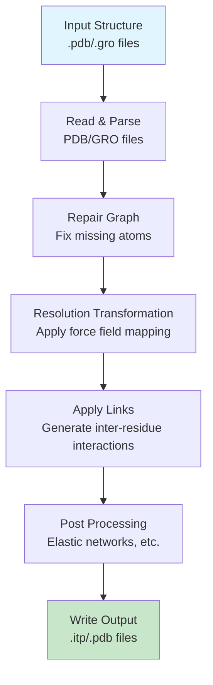

Martinize2 is the command-line interface for the Vermouth library, designed to transform atomistic molecular structures into coarse-grained models, primarily for the Martini force field. This guide covers the essential usage patterns for beginners working with molecular dynamics simulations.

## Core Workflow Overview

Martinize2 operates through a systematic six-stage pipeline that transforms your input structure into a ready-to-use coarse-grained model:



## Basic Command Structure

The fundamental martinize2 command follows this pattern:

```bash
martinize2 -f input.pdb -o output.top -x output_cg.pdb [options]
```

### Essential Parameters

| Parameter | Description | Required | Example |
|-----------|-------------|----------|---------|
| `-f` | Input structure file | Yes | `-f protein.pdb` |
| `-o` | Output topology file | Yes | `-o topol.top` |
| `-x` | Output coordinate file | Yes | `-x cg_protein.pdb` |
| `-ff` | Target force field | Recommended | `-ff martini3001` |

## Quick Start Examples

### Minimal Protein Conversion

The simplest usage converts a protein structure to the default Martini3 force field:

```bash
martinize2 -f protein.pdb -o topol.top -x cg_protein.pdb
```

This command attempts automatic conversion but may lack proper secondary structure treatment.

### Complete Protein Processing

For physically realistic simulations, include secondary structure assignment:

```bash
martinize2 -f protein.pdb -o topol.top -x cg_protein.pdb -ff martini3001 -dssp
```

> [!TIP]
> Secondary structure assignment is crucial for accurate Martini protein simulations. Martinize2 offers two methods: external DSSP executable or the built-in mdtraj implementation.

## Secondary Structure Handling

### Automatic DSSP Assignment

**Option 1: External DSSP**
```bash
martinize2 -f protein.pdb -o topol.top -x cg_protein.pdb -ff martini3001 -dssp /path/to/dssp
```

**Option 2: mdtraj Integration**
```bash
martinize2 -f protein.pdb -o topol.top -x cg_protein.pdb -ff martini3001 -dssp
```

### Manual Secondary Structure Specification

When you know the secondary structure, use the `-ss` flag:

```bash
# All residues as helix
martinize2 -f protein.pdb -o topol.top -x cg_protein.pdb -ss H

# Mixed structure (10 residues: 5 helix, 5 coil)
martinize2 -f protein.pdb -o topol.top -x cg_protein.pdb -ss HHHHHCCCCC
```

## Advanced Basic Features

### Side Chain Fixing

Side chain fixing ensures proper sampling of side chain dynamics and is **automatic in martinize2 ≥ 0.12.0**:

```bash
# Modern versions (automatic)
martinize2 -f protein.pdb -o topol.top -x cg_protein.pdb -ff martini3001

# Legacy versions (manual)
martinize2 -f protein.pdb -o topol.top -x cg_protein.pdb -ff martini3001 -scfix

# Disable automatic fixing
martinize2 -f protein.pdb -o topol.top -x cg_protein.pdb -ff martini3001 -noscfix
```

### Cysteine Bridge Detection

Martinize2 automatically identifies disulfide bridges:

```bash
# Automatic detection (default)
martinize2 -f protein.pdb -o topol.top -x cg_protein.pdb -ff martini3001 -cys auto

# Custom distance cutoff
martinize2 -f protein.pdb -o topol.top -x cg_protein.pdb -ff martini3001 -cys 5.0
```

### Molecule Naming

Prevent naming conflicts in multi-protein systems:

```bash
martinize2 -f protein.pdb -o topol.top -x cg_protein.pdb -ff martini3001 -name MYPROTEIN
```

This generates molecules named `MYPROTEIN_0`, `MYPROTEIN_1`, etc., instead of the default `molecule_0`, `molecule_1`.

## Available Force Fields

List all supported force fields:

```bash
martinize2 -list-ff
```

Common options include:
- `martini3001` - Martini 3 protein force field
- `martini22` - Legacy Martini 2 force field
- Custom force fields (specify path with `-ff`)

## Troubleshooting and Debugging

### Common Issues

1. **Missing Atoms Warning**: Check your input structure for incomplete residues
2. **Unknown Residues**: Verify residue names match force field expectations
3. **Secondary Structure Assignment**: Ensure DSSP is properly installed or use manual specification

### Debug Options

Enhance output verbosity for troubleshooting:

```bash
# Verbose output
martinize2 -f protein.pdb -o topol.top -x cg_protein.pdb -v

# Very verbose output
martinize2 -f protein.pdb -o topol.top -x cg_protein.pdb -vv

# Write intermediate graphs for inspection
martinize2 -f protein.pdb -o topol.top -x cg_protein.pdb -write-graph -write-repair
```

## Output Files

Martinize2 generates several output files:

| File Type | Description | Extension |
|-----------|-------------|-----------|
| Topology | Molecular topology and parameters | `.top`, `.itp` |
| Coordinates | Coarse-grained structure | `.pdb` |
| Log | Processing information and citations | Console output |

### Citation Information

Martinize2 automatically generates appropriate citations based on features used. These appear in both the console output and topology file headers. **All cited papers should be referenced in your publications** to ensure proper credit to the developers and methods.

## Next Steps

After mastering basic usage, explore these advanced features:

- **[Elastic Networks](elastic-networks)**: Add structure-preserving restraints
- **[Gō Models](go-models)**: Implement structure-based potentials  
- **[Mutations and Modifications](mutations-and-modifications)**: Modify protein sequences
- **[Water Biasing](water-biasing)**: Optimize solvent interactions

For deeper understanding of the underlying architecture, continue with **[Vermouth Library Architecture](5-vermouth-library-architecture)** to learn about the graph-based molecular representation system that powers Martinize2.