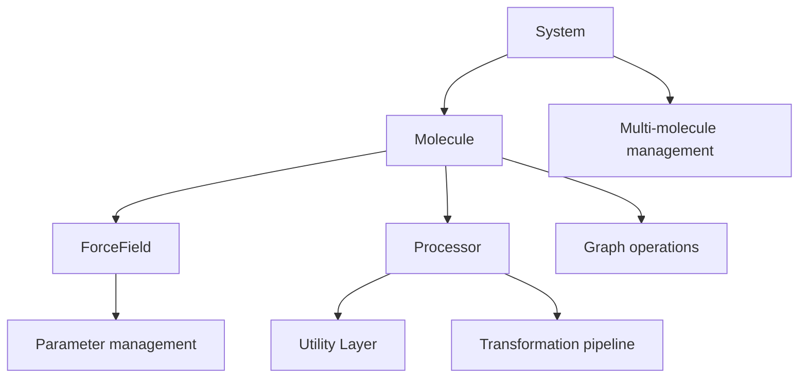
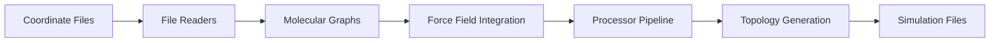

The Vermouth library serves as the computational engine behind martinize2, providing a **Very Modular Universal Transformation Helper** for creating molecular dynamics topologies from coordinate files. This architecture overview examines the core components that enable systematic molecular transformations through a graph-based approach.

## Core Architectural Principles

Vermouth operates on three fundamental pillars: **graph-based molecular representation**, **processor pipeline system**, and **force field abstraction**. The library treats molecules as mathematical graphs where atoms become nodes and bonds become edges, enabling sophisticated topological operations while preserving chemical validity.

The architecture follows a **layered design pattern** with clear separation of concerns:

## Core Components

### System Class: The Container Layer

The `System` class serves as the top-level container managing collections of molecules within a unified force field context. Located in [`vermouth/system.py`](vermouth/system.py#L21-L30), it provides:

- **Molecule aggregation**: Maintains a list of `Molecule` objects representing the complete molecular system
- **Force field coordination**: Ensures all molecules share consistent force field parameters
- **Particle accounting**: Tracks total particle counts across all molecules
- **Deep copying capabilities**: Enables system duplication for parallel processing

The System class acts as the primary interface for high-level operations, delegating molecular-specific transformations to its constituent molecules.

### Molecule Class: The Graph Foundation

At the heart of Vermouth lies the `Molecule` class, extending NetworkX's `Graph` to represent molecular structures. Defined in [`vermouth/molecule.py`](vermouth/molecule.py#L331-L340), this class implements:

- **Node-based atom representation**: Each atom becomes a graph node with associated attributes
- **Edge-based connectivity**: Bonds and constraints are represented as graph edges
- **Interaction management**: Beyond graph topology, molecules maintain separate interaction dictionaries for angles, dihedrals, and other force field terms
- **Ordered node preservation**: Uses `OrderedDict` as `node_dict_factory` to maintain atom order critical for topology generation

> [!TIP]
> The dual representation—graph topology for connectivity plus separate interaction dictionaries—allows Vermouth to handle both structural transformations and force field parameterization independently, a key architectural advantage for coarse-graining operations.

### ForceField Class: Parameter Abstraction

The `ForceField` class in [`vermouth/forcefield.py`](vermouth/forcefield.py#L36-L45) provides a comprehensive abstraction for molecular mechanics force fields:

- **Modular file loading**: Supports multiple file formats (.rtp, .ff, .bib) through a parser registry
- **Reference graph management**: Maintains collections of blocks, links, and modifications as molecular templates
- **Feature declaration system**: Links can declare capabilities enabling conditional processing
- **Native force field caching**: Optimizes loading of built-in force fields

This design enables seamless integration of custom force fields while maintaining compatibility with standard formats like Martini.

### Processor System: Transformation Pipeline

The processor architecture implements a **chain of responsibility pattern** for molecular transformations. The base `Processor` class in [`vermouth/processors/processor.py`](vermouth/processors/processor.py#L21-L30) defines:

- **System-level processing**: `run_system` method iterates over all molecules
- **Molecule-level transformation**: Abstract `run_molecule` method implemented by subclasses
- **In-place modification**: Processors directly modify molecular structures for efficiency

The processor directory contains 25+ specialized processors covering file I/O, mapping operations, structure analysis, and force field integration, forming a comprehensive transformation toolkit.

## Data Flow Architecture

Vermouth follows a **unidirectional data flow** pattern:

1. **Input parsing**: File readers convert coordinate files to molecular graphs
2. **Force field application**: Templates and parameters are applied to molecules
3. **Processing pipeline**: Sequential processors transform molecular structure
4. **Output generation**: Formatted topology files are written for simulation packages

## Integration Points

The architecture provides several key integration points:

- **File format support**: PDB, GRO, CIF readers in dedicated modules
- **GROMACS integration**: Specialized topology generation in `vermouth/gmx/`
- **Structure analysis**: DSSP secondary structure assignment and RCSU contact mapping
- **Custom processors**: Extensible framework for domain-specific transformations

## Design Benefits

This architecture delivers several advantages for molecular simulation workflows:

- **Modularity**: Each component can be developed and tested independently
- **Extensibility**: New force fields and processors integrate seamlessly
- **Performance**: In-place graph operations minimize memory overhead
- **Flexibility**: Graph representation supports both atomistic and coarse-grained models
- **Maintainability**: Clear separation of concerns simplifies code evolution

> [!TIP]
> The graph-based approach enables sophisticated topological operations that would be extremely complex with traditional array-based molecular representations, particularly for coarse-graining where atom-to-bead mappings require non-local transformations.

## Next Steps

To understand how these components work together in practice, explore the [Processor Pipeline System](6-processor-pipeline-system) documentation, which details how individual processors are orchestrated to complete molecular transformations. For deeper insight into molecular representation, see [Graph-Based Molecular Representation](7-graph-based-molecular-representation).