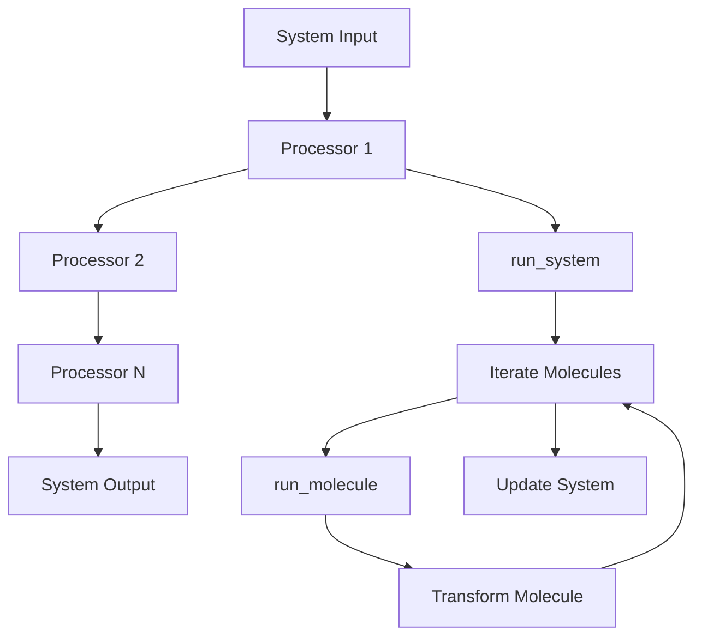

The Processor Pipeline System forms the computational backbone of vermouth-martinize, implementing a modular, graph-based approach to molecular transformation. This system enables sophisticated molecular processing workflows through a chain of specialized processors that operate on molecular graphs, transforming input structures into coarse-grained representations suitable for molecular dynamics simulations.

## Architecture Overview

The processor system is built around a simple yet powerful abstraction: each processor implements the `Processor` base class [processor.py](vermouth/processors/processor.py#L21), which provides two core methods for operating at different scales:

- **`run_system(system)`**: Processes an entire system containing multiple molecules [processor.py](vermouth/processors/processor.py#L26)
- **`run_molecule(molecule)`**: Processes individual molecules and must be implemented by subclasses [processor.py](vermouth/processors/processor.py#L40)

The system-level operation iterates through all molecules in the system, applying the molecular transformation to each one and updating the system's molecule collection in-place [processor.py](vermouth/processors/processor.py#L27-L35).



## Core Processor Categories

The vermouth library provides over 25 specialized processors organized into functional categories:

### File I/O Processors
These processors handle the ingestion of molecular structure data from various formats:

- **`PDBInput`**: Reads PDB files with configurable exclusion criteria and hydrogen handling [pdb_reader.py](vermouth/processors/pdb_reader.py#L29)
- **`GROInput`**: Processes GROMACS GRO format files
- **`CIFInput`**: Handles crystallographic information files

### Structure Transformation Processors
These processors modify molecular topology and connectivity:

- **`MakeBonds`**: Adds edges based on geometric criteria and reference blocks [make_bonds.py](vermouth/processors/make_bonds.py#L309)
- **`RepairGraph`**: Rebuilds missing atoms and canonicalizes atom names using reference structures [repair_graph.py](vermouth/processors/repair_graph.py#L478)
- **`DoMapping`**: Performs resolution transformation between force fields using mapping definitions [do_mapping.py](vermouth/processors/do_mapping.py#L823)

### Annotation and Analysis Processors
These processors add metadata and structural annotations:

- **`AnnotateMutMod`**: Identifies mutations and modifications
- **`AnnotateIDRs`**: Detects intrinsically disordered regions
- **`NameMolType`**: Assigns molecular type classifications

### Force Field Integration Processors
These processors bridge molecular structures with force field parameters:

- **`DoLinks`**: Establishes inter-residue connections
- **`ApplyPosres`**: Applies position restraints
- **`AttachMass`**: Attaches mass information to atoms

## Pipeline Execution Model

The processor pipeline follows a sequential execution model where each processor receives the output of the previous one. This design enables:

**Incremental Transformation**: Complex molecular transformations are broken down into manageable steps, each handling a specific aspect of the conversion process.

**Modular Composition**: Users can mix and match processors to create custom workflows tailored to specific molecular systems and analysis requirements.

**Error Isolation**: Failures in individual processors can be isolated without affecting the entire pipeline, facilitating debugging and troubleshooting.

> [!TIP]
> The processor system's strength lies in its graph-based approach, where molecules are represented as NetworkX graphs. This enables powerful graph algorithms for molecular analysis and transformation while maintaining compatibility with standard molecular representations.

## Processor Implementation Patterns

### Configuration-Based Processors
Most processors follow a configuration pattern where behavior is controlled through constructor parameters:

```python
# Example: MakeBonds processor configuration
processor = MakeBonds(
    allow_name=True,    # Use reference block edges
    allow_dist=True,    # Use distance-based edge detection
    fudge=1.2          # Van der Waals radius scaling factor
)
```

### System vs. Molecule Operations
Processors can operate at two levels:

- **System-level processors** (like `PDBInput`) modify the entire system structure [pdb_reader.py](vermouth/processors/pdb_reader.py#L58)
- **Molecule-level processors** (like `DoMapping`) transform individual molecules and rely on the base class system iteration [do_mapping.py](vermouth/processors/do_mapping.py#L869)

## Integration with Molecular Graphs

The processor system is tightly integrated with vermouth's graph-based molecular representation. Each processor operates on `Molecule` objects, which are NetworkX graphs enhanced with molecular metadata. This integration enables:

- **Graph algorithms** for connectivity analysis and structure repair
- **Node/edge attributes** for storing atomic and bond information
- **Subgraph operations** for residue-level transformations
- **Graph matching** for mapping between different resolutions

The pipeline maintains molecular topology throughout the transformation process, ensuring that structural relationships are preserved or appropriately modified during coarse-graining operations.

> [!TIP]
> Processors maintain a clear separation between data transformation and business logic. The base `Processor` class handles the iteration mechanics, while subclasses focus on implementing specific molecular transformations.

## Next Steps

To understand how individual molecules are represented and manipulated within this pipeline system, explore the [Graph-Based Molecular Representation](7-graph-based-molecular-representation) documentation. For practical examples of processor usage in molecular workflows, see the [File I/O Processors](11-file-i-o-processors-pdb-gro-cif) and [Mapping and Coarse-Graining](12-mapping-and-coarse-graining) sections.