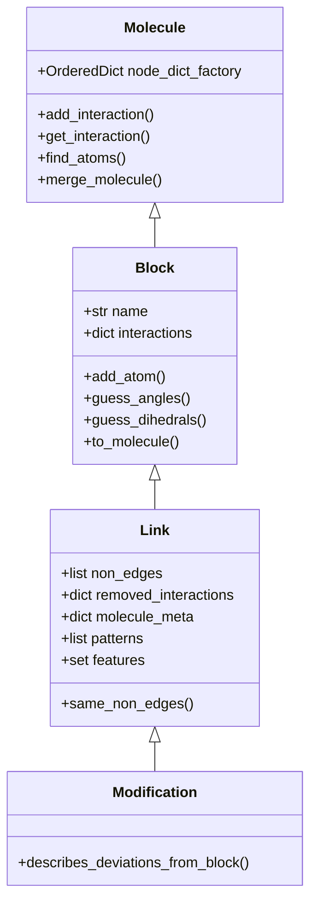
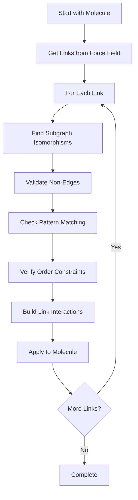

The vermouth-martinize system employs a sophisticated hierarchical architecture for molecular topology definition, built upon three core abstractions: Blocks, Links, and Modifications. These components work together to enable flexible and extensible molecular modeling, particularly for complex biomolecular systems with post-translational modifications and inter-residue connections.

## Core Architecture Overview

## Blocks: Residue Topology Templates

**Blocks** serve as the fundamental building blocks for molecular topology, representing residue templates with predefined atomic structure and interaction patterns [vermouth/molecule.py#L1051-L1120](vermouth/molecule.py#L1051-L1120).

### Block Structure and Properties

Each Block inherits from the `Molecule` class and extends it with residue-specific attributes:

- **Name**: Identifies the residue type (e.g., "ALA", "GLY")
- **Interactions**: Dictionary containing bonds, angles, dihedrals, and other force field parameters
- **Ordered Node Storage**: Maintains consistent atom ordering through `OrderedDict` factory

> [!TIP]
> Blocks use an ordered node factory to ensure deterministic atom ordering, which is crucial for consistent topology generation and mapping operations.

### Key Block Methods

The `Block` class provides essential methods for topology manipulation:

- **`add_atom()`**: Adds atoms with required 'atomname' attribute [vermouth/molecule.py#L1101-L1112](vermouth/molecule.py#L1101-L1112)
- **`guess_angles()`**: Automatically generates angle interactions from bond topology [vermouth/molecule.py#L1142-L1158](vermouth/molecule.py#L1142-L1158)
- **`guess_dihedrals()`**: Creates proper and improper dihedral angles [vermouth/molecule.py#L1159-L1180](vermouth/molecule.py#L1159-L1180)
- **`to_molecule()`**: Converts block template to actual molecule with offset handling [vermouth/molecule.py#L1217-L1278](vermouth/molecule.py#L1217-L1278)

## Links: Inter-Residue Connection Templates

**Links** extend Blocks to define connections between residues, enabling complex molecular topology construction [vermouth/molecule.py#L1279-L1380](vermouth/molecule.py#L1279-L1380).

### Link Matching System

Links employ sophisticated pattern matching through several mechanisms:

#### Link Predicates
The system uses `LinkPredicate` classes for flexible attribute matching [vermouth/molecule.py#L35-L120](vermouth/molecule.py#L35-L120):

- **`Choice`**: Tests if attribute is in predefined list
- **`Regex`**: Matches attributes against regular expressions  
- **`NotDefinedOrNot`**: Handles undefined or non-matching attributes

#### Pattern Matching Algorithm
The `match_link()` function implements comprehensive link matching [vermouth/processors/do_links.py#L237-L276](vermouth/processors/do_links.py#L237-L276):

1. **Graph Isomorphism**: Uses NetworkX isomorphism for structural matching
2. **Non-Edge Validation**: Ensures forbidden connections are avoided
3. **Pattern Evaluation**: Applies custom pattern matching rules
4. **Order Verification**: Validates residue sequence order consistency

### Link Components

| Component | Purpose | Key Attributes |
|-----------|---------|----------------|
| **non_edges** | Forbidden connections | List of anchor-attribute pairs |
| **removed_interactions** | Interactions to delete | Dict of interaction types |
| **molecule_meta** | Molecular metadata | Matching criteria |
| **patterns** | Custom matching rules | Predicate-based patterns |
| **features** | Required features | Set of feature flags |

> [!TIP]
> Links support both positive matching (what should connect) and negative matching (what should not connect), providing precise control over topology assembly.

## Modifications: Deviation Templates

**Modifications** inherit from Links and represent deviations from standard Block definitions, particularly useful for post-translational modifications (PTMs) and non-standard residues [vermouth/molecule.py#L1380-L1384](vermouth/molecule.py#L1380-L1384).

### Modification Processing Pipeline

The system processes modifications through the `CanonicalizeModifications` processor [vermouth/processors/canonicalize_modifications.py#L372-L383](vermouth/processors/canonicalize_modifications.py#L372-L383):

#### PTM Identification
The `identify_ptms()` function performs sophisticated PTM detection [vermouth/processors/canonicalize_modifications.py#L114-L160](vermouth/processors/canonicalize_modifications.py#L114-L160):

1. **PTM Atom Detection**: Identifies atoms marked with `PTM_atom` attribute
2. **Anchor Validation**: Ensures PTMs are properly anchored to non-PTM atoms
3. **Coverage Analysis**: Determines which known PTMs cover observed modifications
4. **Graph Covering**: Uses algorithmic approach to find optimal PTM combinations

#### PTM Node Matching
The `ptm_node_matcher()` function provides specialized comparison logic [vermouth/processors/canonicalize_modifications.py#L35-L52](vermouth/processors/canonicalize_modifications.py#L35-L52):

- PTM atoms require element matching
- Non-PTM atoms require atomname matching
- Handles mixed PTM/non-PTM scenarios

## Integration and Application

### Link Application Process

The `DoLinks` processor applies links to molecules through a systematic workflow [vermouth/processors/do_links.py#L290-L296](vermouth/processors/do_links.py#L290-L296):

### Parameter Effectors

Links can dynamically compute interaction parameters using `LinkParameterEffector` classes [vermouth/molecule.py#L152-L326](vermouth/molecule.py#L152-L326):

| Effector | Calculation | Required Atoms |
|----------|------------|----------------|
| **ParamDistance** | Distance between atoms | 2 |
| **ParamAngle** | Angle in degrees | 3 |
| **ParamDihedral** | Dihedral angle in degrees | 4 |
| **ParamDihedralPhase** | Phase-shifted dihedral | 4 |

## Data Organization

The system organizes modification and mapping data in structured directories [vermouth/data/](vermouth/data/):

- **Force Fields**: Organization by force field type (Martini, CHARMM, AMBER, etc.)
- **Mappings**: Atom-to-bead mapping files for different residues
- **Modifications**: Specialized mapping files for PTMs and non-standard residues

## Advanced Features

### Multi-Modification Support
The system handles multiple simultaneous modifications through tuple-based naming (e.g., `('C-ter',)`), enabling complex modification scenarios [vermouth/processors/do_links.py#L27-L33](vermouth/processors/do_links.py#L27-L33).

### Flexible Attribute Matching
Link predicates provide extensible matching criteria beyond simple equality, supporting regular expressions, choice lists, and conditional logic [vermouth/molecule.py#L35-L130](vermouth/molecule.py#L35-L130).

### Topology Consistency
The system maintains topology consistency through interaction management, edge creation from interactions, and proper handling of removed interactions [vermouth/molecule.py#L1011-L1047](vermouth/molecule.py#L1011-L1047).

## Related Documentation

For deeper understanding of related concepts:
- [Molecule Class and Graph Operations](8-molecule-class-and-graph-operations) - Core molecular representation
- [Force Field System and Data Management](10-force-field-system-and-data-management) - Force field integration
- [Post-Translational Modifications](17-post-translational-modifications) - Advanced PTM handling
- [Processor Pipeline System](6-processor-pipeline-system) - Processing architecture