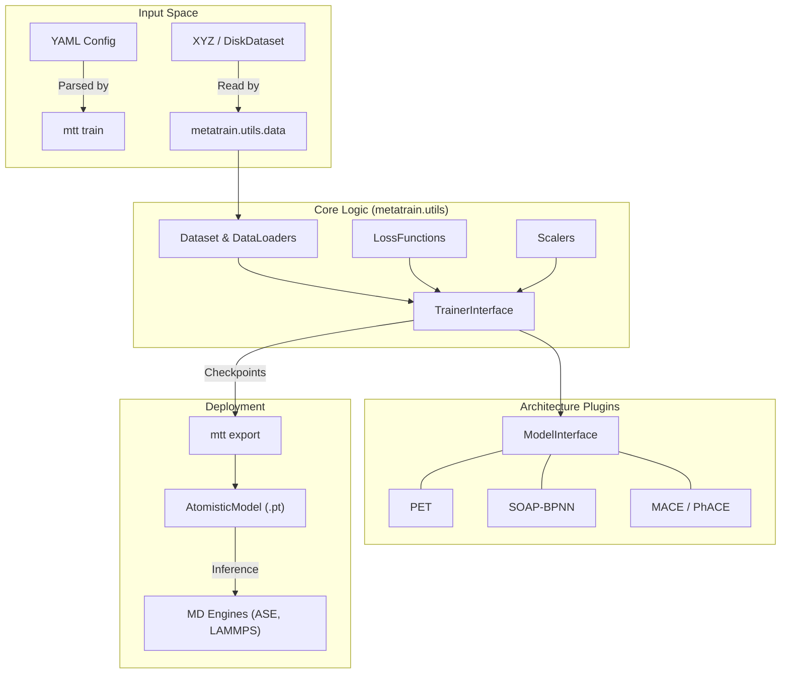
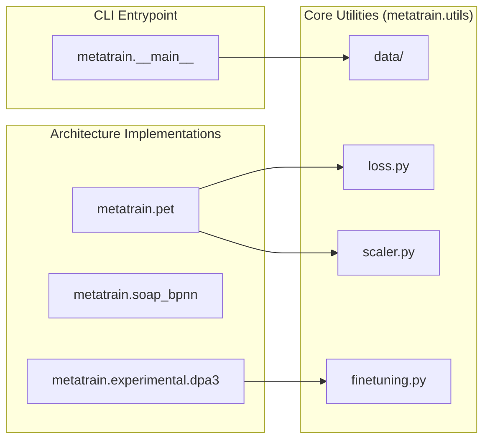

# Overview

Relevant source files

The following files were used as context for generating this wiki page:

- [.codecov.yml](.codecov.yml)
- [CODEOWNERS](CODEOWNERS)
- [README.md](README.md)
- [ci/cscs.yml](ci/cscs.yml)
- [docs/src/dev-docs/utils/units.rst](docs/src/dev-docs/utils/units.rst)
- [docs/src/getting-started/index.rst](docs/src/getting-started/index.rst)
- [docs/src/getting-started/units.rst](docs/src/getting-started/units.rst)
- [docs/src/index.rst](docs/src/index.rst)
- [docs/src/installation.rst](docs/src/installation.rst)
- [docs/src/robots.txt](docs/src/robots.txt)
- [docs/src/workflow.png](docs/src/workflow.png)
- [docs/static/images/workflow-dark.svg](docs/static/images/workflow-dark.svg)
- [docs/static/images/workflow.svg](docs/static/images/workflow.svg)
- [examples/0-beginner/00-basic-usage.sh](examples/0-beginner/00-basic-usage.sh)
- [pyproject.toml](pyproject.toml)
- [src/metatrain/experimental/dpa3/documentation.py](src/metatrain/experimental/dpa3/documentation.py)
- [src/metatrain/experimental/dpa3/model.py](src/metatrain/experimental/dpa3/model.py)
- [src/metatrain/experimental/flashmd_symplectic/documentation.py](src/metatrain/experimental/flashmd_symplectic/documentation.py)
- [tests/test_readme.py](tests/test_readme.py)
- [tests/test_registered_archs.py](tests/test_registered_archs.py)
- [tox.ini](tox.ini)

`metatrain` is a unified command-line interface (CLI) and framework designed to **train**, **evaluate**, and **export** machine learning atomistic models [README.md:14-16](). It provides a standardized environment that bridges diverse machine learning architectures with molecular dynamics (MD) engines like ASE, LAMMPS, and i-PI through the `metatomic` interface [README.md:16-19]().

The core philosophy of `metatrain` is to transform any [TorchScript](https://pytorch.org/docs/stable/jit.html)-compatible architecture into an end-to-end model with a homogeneous user interface [README.md:21-26]().

### System Architecture and Workflow

The following diagram illustrates how the major subsystems relate, from raw data ingestion to the deployment of trained models.

**High-Level Workflow Diagram**

**Sources:** [README.md:14-27](), [pyproject.toml:53-54](), [src/metatrain/experimental/dpa3/documentation.py:54-58]()

### Key Features

*   **Unified CLI:** A single entry point `mtt` (defined in `metatrain.__main__:main`) handles training, evaluation, and exporting [pyproject.toml:53-54]().
*   **Modular Architectures:** Supports a wide range of architectures including GNNs (PET, MACE, DPA3), descriptors (SOAP-BPNN, GAP), and specialized models (FlashMD, LLPR) [README.md:35-52]().
*   **Standardized Data Pipeline:** Uses `metatensor` and `metatomic` for data representation, ensuring compatibility across different physical targets like energy, forces, and virial stress [pyproject.toml:15-18]().
*   **Production Ready:** Models are exported as standalone TorchScript files that include all necessary metadata and neighbor list requirements [README.md:16-19]().

### Supported Architectures

`metatrain` categorizes architectures into stable and experimental tiers. Each architecture is integrated as a plugin that satisfies a specific `ModelInterface` and `TrainerInterface`.

| Category | Architectures |
| :--- | :--- |
| **Stable** | PET, SOAP-BPNN, GAP, Composition, LLPR |
| **Experimental** | MACE, PhACE, DPA3, FlashMD, Symplectic FlashMD, Classifier |

**Sources:** [README.md:35-52](), [.codecov.yml:21-77](), [tox.ini:11-21]()

### Codebase Organization

The repository is structured to separate core training utilities from specific model implementations.

**Code Entity Association**

**Sources:** [pyproject.toml:100-101](), [tox.ini:40-47](), [.codecov.yml:8-13]()

### Next Steps

To dive deeper into specific areas of `metatrain`, refer to the following child pages:

*   **[Getting Started](#1.1)**: Installation via `pip` or `conda`, and a quickstart guide for running your first training with `mtt train` using a YAML configuration.
*   **[Key Concepts and Design Principles](#1.2)**: In-depth explanation of the modular plugin system, the data model (metatensor), and the lifecycle of supported architectures.

**Sources:** [README.md:77-132](), [docs/src/getting-started/index.rst:1-14](), [docs/src/index.rst:17-29]()

---