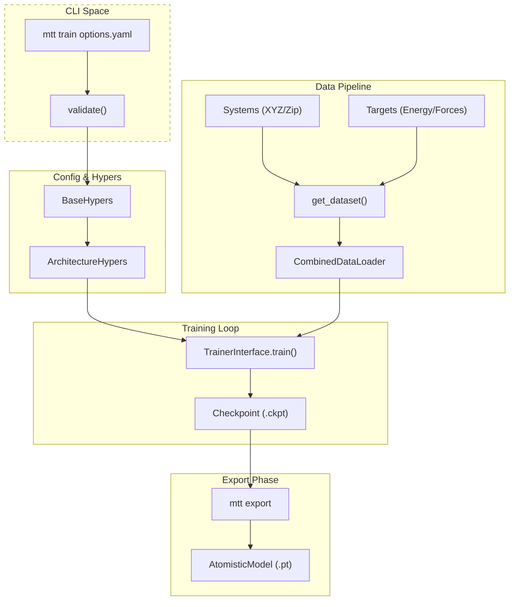
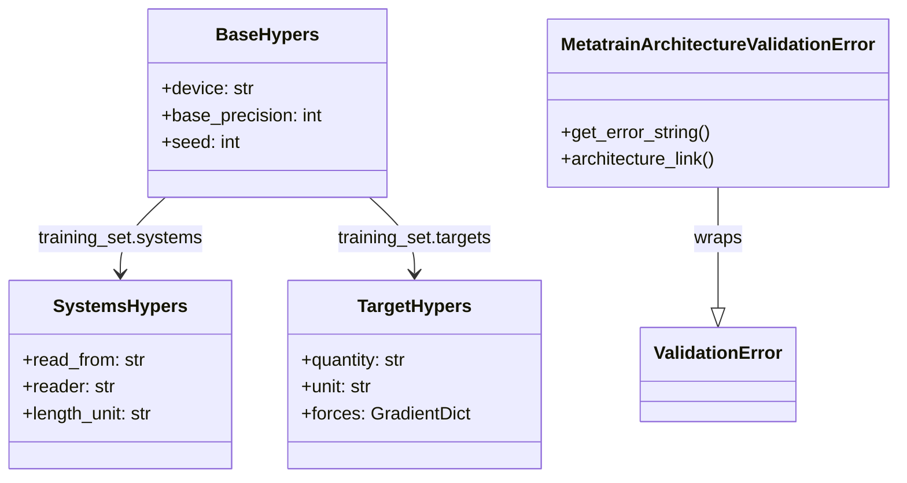

# Getting Started

<details>
<summary>Relevant source files</summary>

The following files were used as context for generating this wiki page:

- [docs/src/architectures/generate.py](docs/src/architectures/generate.py)
- [docs/src/concepts/dataset-formats.rst](docs/src/concepts/dataset-formats.rst)
- [docs/src/concepts/fine-tuning.rst](docs/src/concepts/fine-tuning.rst)
- [docs/src/concepts/index.rst](docs/src/concepts/index.rst)
- [docs/src/faq.rst](docs/src/faq.rst)
- [docs/src/getting-started/override.rst](docs/src/getting-started/override.rst)
- [docs/src/getting-started/quickstart.rst](docs/src/getting-started/quickstart.rst)
- [docs/src/getting-started/train_yaml_config.rst](docs/src/getting-started/train_yaml_config.rst)
- [examples/0-beginner/01-data_preparation.py](examples/0-beginner/01-data_preparation.py)
- [examples/0-beginner/02-fine-tuning.py](examples/0-beginner/02-fine-tuning.py)
- [examples/0-beginner/04-parity_plot.py](examples/0-beginner/04-parity_plot.py)
- [examples/0-beginner/05-run_ase.py](examples/0-beginner/05-run_ase.py)
- [examples/0-beginner/options-ft-eval.yaml](examples/0-beginner/options-ft-eval.yaml)
- [examples/0-beginner/options-ft.yaml](examples/0-beginner/options-ft.yaml)
- [examples/1-advanced/01-llpr.py](examples/1-advanced/01-llpr.py)
- [examples/1-advanced/02-zbl.py](examples/1-advanced/02-zbl.py)
- [src/metatrain/utils/pydantic.py](src/metatrain/utils/pydantic.py)

</details>


This page provides a technical guide for installing `metatrain`, executing your first training run using the `mtt` CLI, and understanding the structure of the YAML configuration files. It covers the workflow from raw atomistic data to a trained and exported model ready for production simulations.

## Installation

`metatrain` can be installed via `pip`. It depends on the `metatensor` and `metatomic` ecosystems for data representation and atomistic model interfaces.

```bash
pip install metatrain
```

For GPU support, ensure that `torch` is installed with the appropriate CUDA toolkit version.

## Quickstart Workflow

The standard workflow involves preparing a dataset (e.g., an Extended XYZ file), defining a YAML configuration, training the model, and exporting it for use in simulation engines like ASE or LAMMPS.

### 1. Data Preparation
For small datasets (<10k structures), a standard `.xyz` file is sufficient. For larger datasets, `metatrain` supports optimized formats like `DiskDataset` (compressed zip) and `MemmapDataset` (binary memory-mapped arrays) [examples/0-beginner/01-data_preparation.py:19-22]().

### 2. Training with `mtt`
The `mtt` CLI is the primary entry point. To start training:
```bash
mtt train options.yaml
```

### 3. Model Export
Once training is complete, the model must be exported to a `.pt` file to be used as a `metatomic` calculator [examples/0-beginner/05-run_ase.py:39-43]().
```bash
mtt export --checkpoint outputs/path/to/checkpoint.ckpt --output model.pt
```

## The `mtt` CLI Data Flow

The following diagram illustrates how the `mtt` CLI interacts with the internal data pipeline and architecture trainers.

**Title: mtt Train Execution Flow**

Sources: [src/metatrain/utils/pydantic.py:89-122](), [docs/src/getting-started/train_yaml_config.rst:11-23](), [examples/0-beginner/05-run_ase.py:39-43]()

## Training YAML Configuration Reference

The training configuration is divided into five primary sections [docs/src/getting-started/train_yaml_config.rst:17-23]().

### Computational Parameters
Defines the hardware and precision settings.
```yaml
device: cuda          # cpu, cuda, or mps
base_precision: 32    # 32 or 64
seed: 0               # For reproducibility
```
Sources: [docs/src/getting-started/train_yaml_config.rst:33-37]()

### Architecture
Specifies the model type and its specific hyperparameters.
```yaml
architecture:
    name: "soap_bpnn"
    model:
        soap:
            cutoff: 5.0
    training:
        num_epochs: 100
        learning_rate: 1e-3
```
Sources: [docs/src/getting-started/train_yaml_config.rst:58-66](), [docs/src/getting-started/override.rst:29-35]()

### Data Specification
The `training_set`, `validation_set`, and `test_set` define the inputs and targets.

| Section | Description |
| :--- | :--- |
| `systems` | Path to structures (XYZ, `.zip`, or memmap) [docs/src/getting-started/train_yaml_config.rst:116-116](). |
| `targets` | Dictionary of outputs to predict (e.g., `energy`) [docs/src/getting-started/train_yaml_config.rst:117-117](). |
| `indices` | Optional subset of the data to use [docs/src/getting-started/train_yaml_config.rst:120-120](). |

#### Target and Gradient Configuration
Targets usually represent energies, while gradients represent forces or stress.
```yaml
training_set:
  systems: "data.xyz"
  targets:
    energy:
      key: "U0"
      unit: "eV"
      forces: "force_key" # Automatically enables force training
```
Sources: [docs/src/getting-started/train_yaml_config.rst:186-192](), [docs/src/getting-started/train_yaml_config.rst:214-220]()

## Implementation: Hyperparameter Validation

`metatrain` uses `pydantic` for strict validation of the YAML input. The `validate` function in `metatrain.utils.pydantic` ensures that the provided YAML matches the `BaseHypers` or architecture-specific `ModelHypers` and `TrainerHypers`.

**Title: Hyperparameter Mapping**

Sources: [src/metatrain/utils/pydantic.py:125-147](), [docs/src/getting-started/train_yaml_config.rst:157-160](), [docs/src/getting-started/train_yaml_config.rst:201-204]()

## Command Line Overrides

You can override any YAML parameter directly from the CLI using the `-r` or `--override` flag. This uses a dot-notation path to the parameter [docs/src/getting-started/override.rst:53-57]().

Example:
```bash
mtt train options.yaml -r architecture.training.num_epochs=500 -r base_precision=64
```
Sources: [docs/src/getting-started/override.rst:53-60]()

## Advanced Usage: Fine-tuning

Fine-tuning allows adapting a pre-trained model (e.g., PET-MAD) to a new dataset. This is triggered by providing a `read_from` path in the `finetune` block of the architecture training section [docs/src/concepts/fine-tuning.rst:40-44]().

```yaml
architecture:
  training:
    finetune:
      method: "full"
      read_from: "pretrained.ckpt"
```
Sources: [docs/src/concepts/fine-tuning.rst:40-44](), [examples/0-beginner/02-fine-tuning.py:24-32]()

---