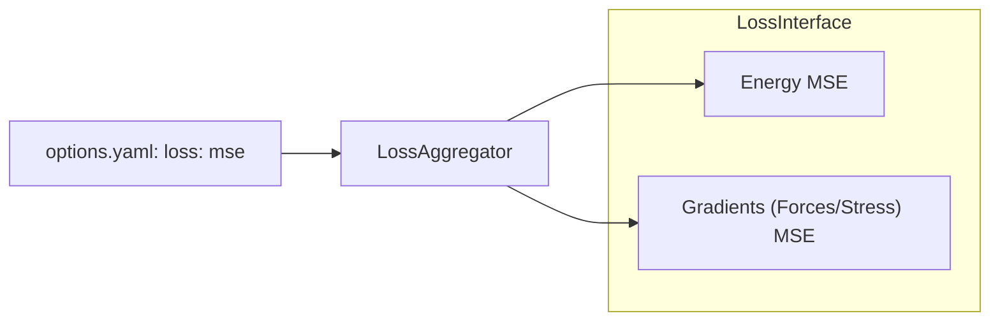

# Key Concepts and Design Principles

<details>
<summary>Relevant source files</summary>

The following files were used as context for generating this wiki page:

- [docs/src/concepts/auxiliary-outputs.rst](docs/src/concepts/auxiliary-outputs.rst)
- [docs/src/concepts/loss-functions.rst](docs/src/concepts/loss-functions.rst)
- [docs/src/dev-docs/new-architecture.rst](docs/src/dev-docs/new-architecture.rst)
- [examples/0-beginner/options-memmap.yaml](examples/0-beginner/options-memmap.yaml)
- [examples/1-advanced/03-fitting-generic-targets.py](examples/1-advanced/03-fitting-generic-targets.py)
- [examples/1-advanced/07-dos-training.py](examples/1-advanced/07-dos-training.py)
- [examples/1-advanced/DOS_structures.xyz](examples/1-advanced/DOS_structures.xyz)
- [examples/1-advanced/options-dos.yaml](examples/1-advanced/options-dos.yaml)
- [examples/1-advanced/options-no-llpr.yaml](examples/1-advanced/options-no-llpr.yaml)
- [src/metatrain/experimental/dpa3/tests/test_compile.py](src/metatrain/experimental/dpa3/tests/test_compile.py)
- [src/metatrain/experimental/dpa3/tests/test_pretrained.py](src/metatrain/experimental/dpa3/tests/test_pretrained.py)
- [src/metatrain/experimental/dpa3/tests/test_regression.py](src/metatrain/experimental/dpa3/tests/test_regression.py)
- [src/metatrain/share/base_hypers.py](src/metatrain/share/base_hypers.py)
- [src/metatrain/utils/abc.py](src/metatrain/utils/abc.py)
- [src/metatrain/utils/architectures.py](src/metatrain/utils/architectures.py)
- [src/metatrain/utils/units.py](src/metatrain/utils/units.py)
- [tests/cli/test_base_precision.py](tests/cli/test_base_precision.py)
- [tests/utils/test_architectures.py](tests/utils/test_architectures.py)
- [tests/utils/test_pydantic.py](tests/utils/test_pydantic.py)
- [tests/utils/test_units.py](tests/utils/test_units.py)

</details>


This page explains the core design philosophy of `metatrain`, including its modular architecture plugin system, the data model based on `metatensor` and `metatomic`, and the lifecycle management of model architectures.

## Modular Architecture Plugin System

`metatrain` is designed as a modular framework where different atomistic machine learning architectures can be plugged in. Each architecture is a self-contained module that must adhere to a specific directory structure and API contract defined by abstract base classes.

### Architecture Structure
Every architecture must implement four primary files within its directory (e.g., `src/metatrain/<name>/` or `src/metatrain/experimental/<name>/`):
1.  `model.py`: Contains the `Model` class.
2.  `trainer.py`: Contains the `Trainer` class.
3.  `documentation.py`: Defines hyperparameter schemas and default values.
4.  `__init__.py`: Exposes the classes via `__model__` and `__trainer__` aliases.

**Sources:** [docs/src/dev-docs/new-architecture.rst:81-93](), [src/metatrain/utils/architectures.py:179-201]()

### The Architecture Contract
Architectures interact with the training CLI through the `ModelInterface` and `TrainerInterface`.

#### Model Interface (`ModelInterface`)
The `ModelInterface` ensures that every model can be initialized, executed, restarted for transfer learning, and exported to a production-ready format.
-   `forward()`: The main execution logic taking `metatomic.torch.System` objects.
-   `restart()`: Logic for adapting a model to new datasets or targets (e.g., fine-tuning).
-   `export()`: Converts the model into a `metatomic.torch.AtomisticModel`.

#### Trainer Interface (`TrainerInterface`)
The `TrainerInterface` standardizes the training loop, ensuring consistency across different architectures (e.g., SOAP-BPNN vs. PET).
-   `train()`: The entry point for the training process, handling data loaders and checkpoints.

**Sources:** [src/metatrain/utils/abc.py:29-196](), [docs/src/dev-docs/new-architecture.rst:59-66]()

### Architecture Lifecycle Diagram
The following diagram illustrates how the `mtt train` CLI interacts with these code entities.

```mermaid
graph TD
    subgraph "CLI Space (mtt train)"
        CLI["metatrain.cli.train"]
    end

    subgraph "Architecture Plugin Space"
        Init["__init__.py"]
        Model["Model(ModelInterface)"]
        Trainer["Trainer(TrainerInterface)"]
        Doc["documentation.py"]
    end

    CLI -->|Imports| Init
    Init -->|Provides| Model
    Init -->|Provides| Trainer
    CLI -->|Validates Hypers| Doc
    CLI -->|Calls| Trainer
    Trainer -->|Updates| Model
    Model -->|Produces| Checkpoint[".ckpt file"]
    Model -->|export()| Exported[".pt AtomisticModel"]
```
**Sources:** [docs/src/dev-docs/new-architecture.rst:13-55](), [src/metatrain/utils/architectures.py:117-126]()

---

## Data Model and Naming Conventions

`metatrain` relies on `metatensor` for data representation and `metatomic` for atomistic system definitions.

### Target Naming and Quantities
Targets in the dataset are identified by keys. While keys can be arbitrary, `metatrain` uses the `quantity` field to apply special logic (e.g., for `energy`).
-   **Energy association**: If a target is marked with `quantity: energy`, `metatrain` automatically looks for `forces` (gradients w.r.t positions) and `stress` (gradients w.r.t strain).
-   **Custom Targets**: For non-energy targets, users must specify `quantity` if they want to leverage specific physical constraints or unit conversions.

**Sources:** [src/metatrain/share/base_hypers.py:187-200](), [docs/src/concepts/loss-functions.rst:73-104]()

### Units and Precision
-   **Length Units**: Highly recommended for simulations. Units like `angstrom` are internally normalized (e.g., to `A`).
-   **Gradient Units**: Derived automatically (e.g., `energy_unit / length_unit` for forces).
-   **Base Precision**: Controlled via the `base_precision` global option (16, 32, or 64). Architectures use `BasePrecision.value` (an OmegaConf interpolation `${base_precision}`) to stay synchronized with the user's global setting.

**Sources:** [src/metatrain/utils/units.py:4-26](), [src/metatrain/share/base_hypers.py:19-33](), [tests/cli/test_base_precision.py:27-45]()

---

## Architecture Lifecycle: Stable vs. Experimental

Architectures in `metatrain` follow a strict lifecycle to balance innovation with stability.

| Status | Location | Description |
| :--- | :--- | :--- |
| **Stable** | `src/metatrain/<name>` | Fully tested, documented, and follows all API contracts. |
| **Experimental** | `src/metatrain/experimental/<name>` | New or research-oriented architectures. May have breaking API changes. |
| **Deprecated** | `src/metatrain/deprecated/<name>` | Older architectures slated for removal. |

The `check_architecture_name` function enforces this by requiring the `experimental.` or `deprecated.` prefix in the configuration file if the architecture is not in the stable root.

**Sources:** [src/metatrain/utils/architectures.py:16-57](), [src/metatrain/utils/architectures.py:179-201]()

---

## Loss and Auxiliary Outputs

### Loss Configuration
`metatrain` supports a hierarchical loss specification. A single `loss: mse` shorthand expands to a full per-target and per-gradient configuration.


**Sources:** [docs/src/concepts/loss-functions.rst:65-72](), [docs/src/concepts/loss-functions.rst:112-130]()

### Specialized Losses
-   **Masked Losses**: `masked_mse`, `masked_mae`, etc., are used when datasets contain padded values or specific energy ranges (common in Electronic Density of States training).
-   **Shift Agnostic MSE**: Used for targets where the absolute reference is ill-defined (e.g., DOS).

**Sources:** [docs/src/concepts/loss-functions.rst:146-164](), [examples/1-advanced/07-dos-training.py:5-10]()

---

## Checkpoint Versioning

To ensure long-term compatibility, `metatrain` implements a checkpoint versioning system.
-   Each `Model` and `Trainer` class defines a `__checkpoint_version__`.
-   When loading an old checkpoint, `upgrade_checkpoint()` is called to migrate the state dictionary to the current architecture version before training or export.

**Sources:** [src/metatrain/utils/abc.py:43-47](), [src/metatrain/utils/abc.py:192-196](), [docs/src/dev-docs/new-architecture.rst:138-141]()

---