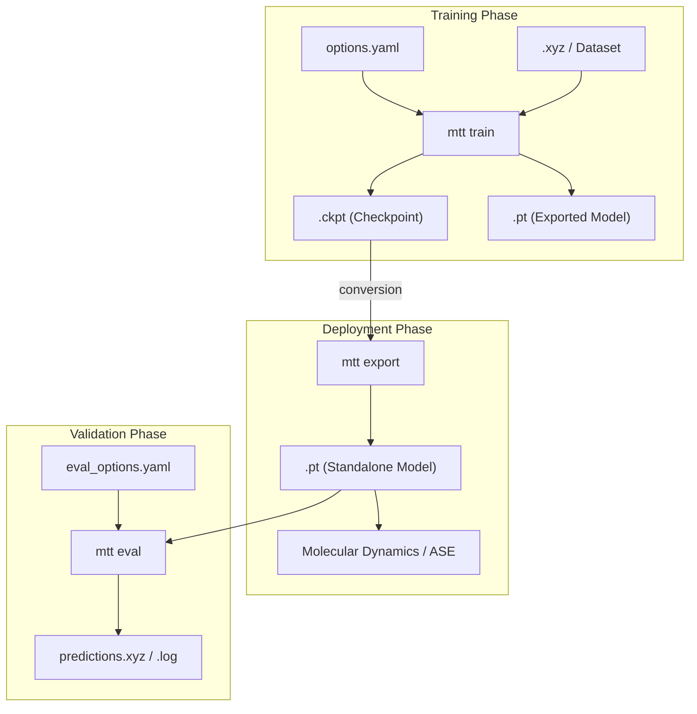
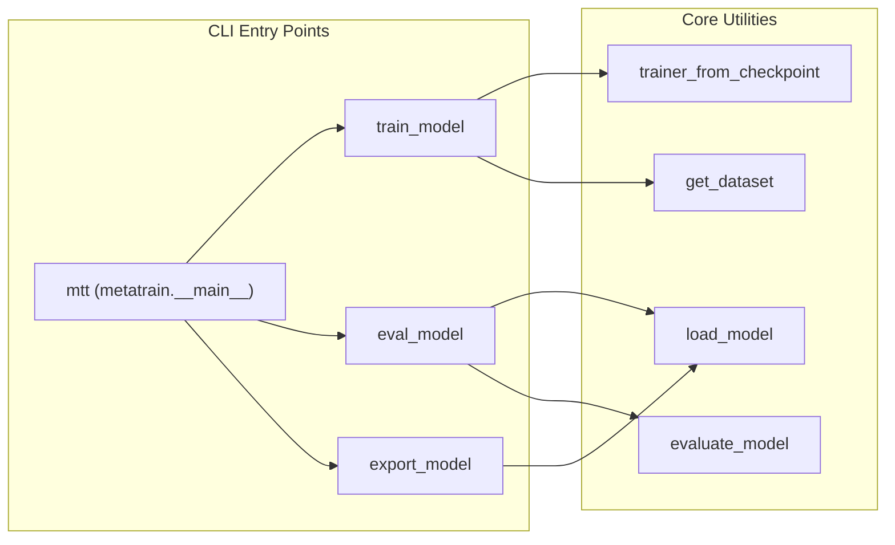

# CLI Reference

Relevant source files

The following files were used as context for generating this wiki page:

- [docs/src/dev-docs/changelog.rst](docs/src/dev-docs/changelog.rst)
- [docs/src/getting-started/checkpoints.rst](docs/src/getting-started/checkpoints.rst)
- [src/metatrain/__main__.py](src/metatrain/__main__.py)
- [src/metatrain/cli/eval.py](src/metatrain/cli/eval.py)
- [src/metatrain/cli/export.py](src/metatrain/cli/export.py)
- [src/metatrain/cli/train.py](src/metatrain/cli/train.py)
- [src/metatrain/share/metatrain-completion.bash](src/metatrain/share/metatrain-completion.bash)
- [src/metatrain/utils/io.py](src/metatrain/utils/io.py)
- [src/metatrain/utils/logging.py](src/metatrain/utils/logging.py)
- [tests/cli/test_cli.py](tests/cli/test_cli.py)
- [tests/cli/test_eval_model.py](tests/cli/test_eval_model.py)
- [tests/cli/test_export_model.py](tests/cli/test_export_model.py)
- [tests/cli/test_train_model.py](tests/cli/test_train_model.py)
- [tests/utils/test_io.py](tests/utils/test_io.py)
- [tests/utils/test_logging.py](tests/utils/test_logging.py)

The `mtt` command-line interface is the primary entry point for interacting with the `metatrain` ecosystem. It provides a unified interface for the three main stages of the machine learning lifecycle in atomistic modeling: training, evaluation, and deployment.

The CLI is structured into three main sub-commands:
1. `mtt train`: Ingests raw data and a configuration YAML to produce model checkpoints.
2. `mtt eval`: Runs inference on an exported model to generate predictions and calculate error metrics.
3. `mtt export`: Converts training checkpoints into standalone, deployable model files.

### Command Hierarchy and Data Flow

The following diagram illustrates how the sub-commands relate to one another and the filesystem entities they produce or consume.

**Figure 1: mtt Command and File Lifecycle**

**Sources:** [src/metatrain/cli/train.py:103-114](), [src/metatrain/cli/eval.py:69-84](), [src/metatrain/cli/export.py:29-45]()

---

### Sub-Command Overview

#### mtt train — Training Pipeline
The `train` sub-command is used to start or resume a training run. It requires an options YAML file that specifies the architecture (e.g., `soap_bpnn`, `pet`), dataset paths, and training hyperparameters [src/metatrain/cli/train.py:110-114]().

Key features include:
*   **Automatic Restarting**: Use `--restart auto` to automatically pick up from the latest checkpoint in the `outputs/` directory [src/metatrain/cli/train.py:137-145]().
*   **Command-line Overrides**: Any YAML option can be overridden via the `-r` or `--override` flag (e.g., `-r architecture.training.num_epochs=10`) [src/metatrain/cli/train.py:148-153]().
*   **Logging**: Supports standard console logging, CSV file logging, and integration with Weights & Biases (`wandb`) [src/metatrain/cli/train.py:169-200]().

For details on configuration and lifecycle, see [mtt train — Training Pipeline](#2.1).

#### mtt eval — Model Evaluation
The `eval` sub-command performs inference using an exported `.pt` model. It is designed to handle large-scale datasets by streaming predictions to disk to avoid memory exhaustion [docs/src/dev-docs/changelog.rst:114-117]().

Key features include:
*   **Metric Accumulation**: Automatically calculates RMSE and MAE for all targets defined in the evaluation options [src/metatrain/cli/eval.py:161-172]().
*   **Flexible Output**: Can write predictions to `.xyz` files or directly into `MemmapDataset` directories for high-performance re-reading [src/metatrain/cli/eval.py:98-109]().
*   **Warm-up**: By default, runs 10 iterations to warm up CUDA kernels for representative timing [src/metatrain/cli/eval.py:125-137]().

For details on metrics and writers, see [mtt eval — Model Evaluation](#2.2).

#### mtt export — Model Export
The `export` sub-command converts a `.ckpt` (which contains training state like optimizer weights) into a production-ready `.pt` `AtomisticModel`. This step is mandatory for using models in external simulation engines like LAMMPS or ASE [docs/src/getting-started/checkpoints.rst:83-88]().

Key features include:
*   **Remote Sourcing**: Can export models directly from a URL or the Hugging Face Hub [src/metatrain/cli/export.py:187-197]().
*   **Metadata Injection**: Allows attaching authors, references, and descriptions to the model via a YAML file [src/metatrain/cli/export.py:71-78]().
*   **Extension Collection**: Automatically gathers required C++ extensions into an `extensions/` folder for deployment [src/metatrain/cli/export.py:59-69]().

For details on metadata and remote models, see [mtt export — Model Export](#2.3).

---

### Internal Architecture Mapping

The CLI acts as a wrapper around internal utility classes and the `ModelInterface`/`TrainerInterface` contracts.

**Figure 2: CLI to Code Entity Mapping**

**Sources:** [src/metatrain/cli/train.py:25-42](), [src/metatrain/cli/eval.py:19-39](), [src/metatrain/cli/export.py:11-12]()

### Common Arguments
The following arguments are shared across multiple sub-commands:

| Argument | Sub-commands | Description |
| :--- | :--- | :--- |
| `-o`, `--output` | `train`, `eval`, `export` | Specifies the primary output file path. |
| `-e`, `--extensions` | `train`, `eval`, `export` | Directory for collecting or loading model extensions. |
| `--token` | `export` | Hugging Face API token for private repositories. |

**Sources:** [src/metatrain/cli/train.py:115-135](), [src/metatrain/cli/eval.py:86-109](), [src/metatrain/cli/export.py:48-99]()

---