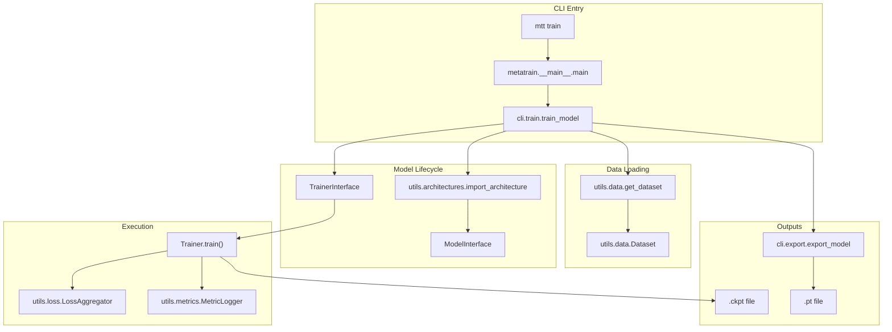
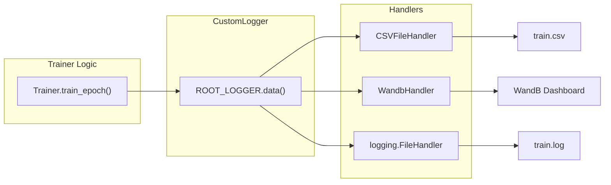

# mtt train — Training Pipeline

<details>
<summary>Relevant source files</summary>

The following files were used as context for generating this wiki page:

- [docs/src/dev-docs/new-loss.rst](docs/src/dev-docs/new-loss.rst)
- [src/metatrain/__main__.py](src/metatrain/__main__.py)
- [src/metatrain/cli/train.py](src/metatrain/cli/train.py)
- [src/metatrain/utils/distributed/distributed_data_parallel.py](src/metatrain/utils/distributed/distributed_data_parallel.py)
- [src/metatrain/utils/distributed/logging.py](src/metatrain/utils/distributed/logging.py)
- [src/metatrain/utils/distributed/slurm.py](src/metatrain/utils/distributed/slurm.py)
- [src/metatrain/utils/logging.py](src/metatrain/utils/logging.py)
- [src/metatrain/utils/loss.py](src/metatrain/utils/loss.py)
- [src/metatrain/utils/metrics.py](src/metatrain/utils/metrics.py)
- [src/metatrain/utils/omegaconf.py](src/metatrain/utils/omegaconf.py)
- [src/metatrain/utils/per_atom.py](src/metatrain/utils/per_atom.py)
- [src/metatrain/utils/testing/training.py](src/metatrain/utils/testing/training.py)
- [tests/cli/test_cli.py](tests/cli/test_cli.py)
- [tests/cli/test_train_model.py](tests/cli/test_train_model.py)
- [tests/distributed/options-distributed-finetuning.yaml](tests/distributed/options-distributed-finetuning.yaml)
- [tests/distributed/options-distributed-multitarget.yaml](tests/distributed/options-distributed-multitarget.yaml)
- [tests/distributed/options-distributed.yaml](tests/distributed/options-distributed.yaml)
- [tests/distributed/options.yaml](tests/distributed/options.yaml)
- [tests/distributed/readme.txt](tests/distributed/readme.txt)
- [tests/utils/test_logging.py](tests/utils/test_logging.py)
- [tests/utils/test_loss.py](tests/utils/test_loss.py)
- [tests/utils/test_metrics.py](tests/utils/test_metrics.py)
- [tests/utils/test_slurm.py](tests/utils/test_slurm.py)

</details>


The `mtt train` command is the central entry point for training atomistic models in `metatrain`. It orchestrates the lifecycle from raw data ingestion and hyperparameter validation to model optimization, checkpointing, and final export. The pipeline is designed to be architecture-agnostic, using a standardized `TrainerInterface` and `ModelInterface` to interact with different GNNs or kernel-based models.

### Training Lifecycle Overview

When `mtt train` is invoked, it follows a structured execution flow managed primarily by the `train_model` function in `src/metatrain/cli/train.py`.

1.  **Initialization**: The CLI parses the YAML configuration and command-line overrides [src/metatrain/cli/train.py:156-166](). It sets up the output directory structure, typically under `outputs/%Y-%m-%d/%H-%M-%S` [src/metatrain/__main__.py:75-92]().
2.  **Data Preparation**: Datasets are loaded via `get_dataset` [src/metatrain/cli/train.py:290-305](). If a single dataset is provided, it is split into training, validation, and test sets based on the configuration [src/metatrain/cli/train.py:307-338]().
3.  **Model & Trainer Setup**: The specified architecture is imported dynamically [src/metatrain/cli/train.py:440-442](). If starting from scratch, a new model is initialized; if restarting or fine-tuning, the model is loaded from a checkpoint [src/metatrain/cli/train.py:456-490]().
4.  **Optimization Loop**: The `Trainer.train()` method is called, which handles the epoch loop, backpropagation, and metric logging [src/metatrain/cli/train.py:560-571]().
5.  **Finalization**: The best model (based on validation loss) is reloaded, evaluated on the test set, and exported as a `.pt` file for production use [src/metatrain/cli/train.py:573-614]().

#### Pipeline Data Flow
The following diagram maps the high-level training logic to specific code entities.

**Training Pipeline Entity Map**

**Sources:** [src/metatrain/cli/train.py:25-614](), [src/metatrain/__main__.py:27-121](), [src/metatrain/utils/abc.py:1-50]().

---

### YAML Configuration and Overrides

The training pipeline is driven by a YAML configuration file. `metatrain` uses `OmegaConf` to handle these options, allowing for variable interpolation (e.g., `${default_device:}`) and dynamic overrides.

*   **Base Options**: Global settings like `device`, `base_precision`, and `seed` [src/metatrain/utils/omegaconf.py:137-144]().
*   **Architecture**: Defines the model name and architecture-specific hyperparameters [src/metatrain/cli/train.py:440-454]().
*   **Dataset**: Configures the paths to systems and target values (energies, forces, etc.) [src/metatrain/utils/omegaconf.py:147-201]().

**Command-line Overrides**:
Users can override any YAML parameter using the `-r` or `--override` flag. This is useful for grid searches or quick adjustments without editing files.
```bash
mtt train options.yaml -r architecture.training.num_epochs=100 -r architecture.training.batch_size=32
```
**Sources:** [src/metatrain/cli/train.py:148-153](), [src/metatrain/utils/omegaconf.py:126-144](), [tests/cli/test_train_model.py:176-204]().

---

### Restart, Finetune, and Transfer Learning

The pipeline supports three distinct modes for continuing or adapting training:

| Mode | Flag | Behavior |
| :--- | :--- | :--- |
| **Restart** | `--restart <path>.ckpt` | Resumes training from a specific checkpoint. Restores the optimizer state, epoch count, and scaler state [src/metatrain/cli/train.py:481-490](). |
| **Auto-Restart** | `--restart auto` | Automatically finds the most recent checkpoint in the `outputs/` directory to resume an interrupted job [src/metatrain/cli/train.py:220-244](). |
| **Finetune** | `architecture.finetune` | Loads weights from a pre-trained model but initializes a new optimizer. Can include frozen layers or LoRA adapters [src/metatrain/cli/train.py:456-470](). |

**Sources:** [src/metatrain/cli/train.py:219-244](), [src/metatrain/cli/train.py:456-490](), [tests/cli/test_train_model.py:205-212]().

---

### Loss Functions and Metrics

The `LossAggregator` combines multiple loss terms (e.g., energy MSE + force MSE) into a single scalar for backpropagation.

#### Loss Implementation
All loss functions inherit from `LossInterface` [src/metatrain/utils/loss.py:35-112](). The pipeline supports:
*   **Pointwise Losses**: `TensorMapMSELoss`, `TensorMapMAELoss`, `TensorMapHuberLoss` [src/metatrain/utils/loss.py:118-204]().
*   **Masked Losses**: Allows ignoring specific atoms or systems during training via a mask [src/metatrain/utils/loss.py:187-194]().
*   **Uncertainty Losses**: `TensorMapGaussianNLLLoss` and `TensorMapGaussianCRPSLoss` for probabilistic models [tests/utils/test_loss.py:11-24]().

#### Metric Accumulation
Metrics are tracked using `RMSEAccumulator` and `MAEAccumulator` [src/metatrain/utils/metrics.py:51-210](). These classes handle `metatensor` objects, ensuring that errors are computed correctly across different blocks and gradients (e.g., forces as energy gradients) [src/metatrain/utils/metrics.py:149-173]().

**Sources:** [src/metatrain/utils/loss.py:35-204](), [src/metatrain/utils/metrics.py:51-210](), [tests/utils/test_metrics.py:74-111]().

---

### Logging and Telemetry

`metatrain` provides a multi-channel logging system via the `CustomLogger` [src/metatrain/utils/logging.py:143-157]().

1.  **Console/File Logging**: Standard text logs are saved to `train.log`.
2.  **Structured CSV**: Training and validation metrics are saved to `train.csv` via `CSVFileHandler` for easy plotting [src/metatrain/utils/logging.py:37-89]().
3.  **Weights & Biases (WandB)**: If configured, the `WandbHandler` streams metrics and hyperparameters to the WandB dashboard [src/metatrain/utils/logging.py:90-141]().

**Logging Data Flow**

**Sources:** [src/metatrain/utils/logging.py:37-165](), [src/metatrain/cli/train.py:169-202]().

---

### Distributed Training

For large-scale datasets, `metatrain` supports distributed data-parallel (DDP) training.

*   **Device Selection**: The pipeline automatically detects available GPUs and assigns ranks [src/metatrain/utils/devices.py:57-76]().
*   **Slurm Integration**: Built-in support for Slurm environments. It automatically detects `SLURM_JOB_ID` and initializes the NCCL process group [src/metatrain/utils/distributed/slurm.py:9-85]().
*   **Synchronization**: The `MetricLogger` and `LossAggregator` ensure that metrics are averaged across all ranks using `all_gather` operations to provide a global view of the training progress [src/metatrain/utils/metrics.py:37-48]().

**Sources:** [src/metatrain/utils/distributed/slurm.py:9-85](), [src/metatrain/utils/metrics.py:37-48](), [src/metatrain/utils/omegaconf.py:57-76]().

---