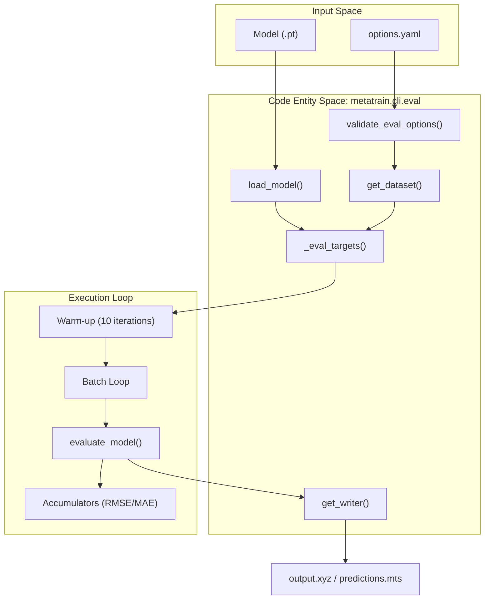
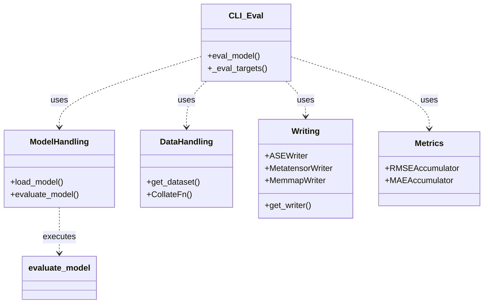

# mtt eval — Model Evaluation

<details>
<summary>Relevant source files</summary>

The following files were used as context for generating this wiki page:

- [docs/src/dev-docs/changelog.rst](docs/src/dev-docs/changelog.rst)
- [docs/src/dev-docs/utils/data/writers.rst](docs/src/dev-docs/utils/data/writers.rst)
- [src/metatrain/cli/eval.py](src/metatrain/cli/eval.py)
- [src/metatrain/utils/data/readers/ase.py](src/metatrain/utils/data/readers/ase.py)
- [src/metatrain/utils/data/readers/readers.py](src/metatrain/utils/data/readers/readers.py)
- [src/metatrain/utils/data/writers/__init__.py](src/metatrain/utils/data/writers/__init__.py)
- [src/metatrain/utils/data/writers/ase.py](src/metatrain/utils/data/writers/ase.py)
- [src/metatrain/utils/data/writers/memmap.py](src/metatrain/utils/data/writers/memmap.py)
- [src/metatrain/utils/data/writers/metatensor.py](src/metatrain/utils/data/writers/metatensor.py)
- [src/metatrain/utils/data/writers/writers.py](src/metatrain/utils/data/writers/writers.py)
- [src/metatrain/utils/evaluate_model.py](src/metatrain/utils/evaluate_model.py)
- [src/metatrain/utils/neighbor_lists.py](src/metatrain/utils/neighbor_lists.py)
- [tests/cli/test_eval_model.py](tests/cli/test_eval_model.py)
- [tests/utils/data/test_readers.py](tests/utils/data/test_readers.py)
- [tests/utils/data/test_writers.py](tests/utils/data/test_writers.py)

</details>


The `mtt eval` command is the primary entry point for running inference with exported models. It supports loading `.pt` files (exported via `mtt export`), running them on new datasets, accumulating accuracy metrics (RMSE/MAE), and streaming predictions to various output formats.

## Overview and Data Flow

The evaluation pipeline is designed to handle large-scale datasets by streaming data through a `DataLoader` and writing results to disk batch-by-batch to avoid memory exhaustion [src/metatrain/cli/eval.py:115-117]().

### Evaluation Pipeline Diagram
This diagram illustrates the flow from an exported model file and a YAML configuration to final metrics and prediction files.


**Sources:** [src/metatrain/cli/eval.py:140-173](), [src/metatrain/utils/evaluate_model.py:21-31]()

## Key Components

### 1. Model Loading and Device Selection
The evaluation script loads the model using `load_model`, which handles both standard TorchScript modules and `AtomisticModel` objects [src/metatrain/utils/io.py:39](). It automatically detects the supported devices from the model capabilities and moves the model to the appropriate device (e.g., CUDA) and precision (typically `float32` or `float64`) [src/metatrain/cli/eval.py:184-191]().

### 2. Warm-up Procedure
By default, `mtt eval` performs a warm-up of 10 iterations [src/metatrain/cli/eval.py:129-137](). This is critical for accurate timing measurements, as it allows the JIT compiler and CUDA kernels to initialize before the main evaluation loop begins [src/metatrain/cli/eval.py:133-135](). This behavior can be disabled using the `--no-warm-up` flag [docs/src/dev-docs/changelog.rst:39]().

### 3. Inference Engine: `evaluate_model`
The core logic resides in `evaluate_model`, which manages:
* **Gradient Computation:** If the target (e.g., energy) requires gradients (e.g., forces or stress), it uses `compute_gradient` via autograd [src/metatrain/utils/evaluate_model.py:60-72]().
* **Neighbor List Handling:** It ensures that systems have the neighbor lists requested by the model [src/metatrain/utils/neighbor_lists.py:49-57]().
* **Consistency Checks:** Optionally validates that the model's supported outputs match the requested evaluation targets [src/metatrain/utils/evaluate_model.py:56-57]().

**Sources:** [src/metatrain/utils/evaluate_model.py:21-160](), [src/metatrain/utils/neighbor_lists.py:98-122]()

## Output Writers

Metatrain uses a factory pattern via `get_writer` to determine how predictions are stored based on the output path provided with the `-o` flag [src/metatrain/utils/data/writers/__init__.py:53-87]().

| Format | Extension | Writer Class | Behavior |
| :--- | :--- | :--- | :--- |
| **ASE XYZ** | `.xyz`, `.extxyz` | `ASEWriter` | Streams each batch to an Extended XYZ file. Maps internal names to external names (e.g., energy gradients to `forces`) [src/metatrain/utils/data/writers/ase.py:16-26](). |
| **Metatensor** | `.mts` | `MetatensorWriter` | Saves batches to temp files and merges them into a single `.mts` file at the end [src/metatrain/utils/data/writers/metatensor.py:13-26](). |
| **DiskDataset** | `.zip` | `DiskDatasetWriter` | Writes systems and predictions into a zipped dataset format [src/metatrain/utils/data/writers/__init__.py:44](). |
| **Memmap** | `path/` (trailing `/`) | `MemmapWriter` | Writes to a directory of binary files. Useful for very large datasets [docs/src/dev-docs/changelog.rst:43-46](). |

**Sources:** [src/metatrain/utils/data/writers/__init__.py:41-51](), [src/metatrain/utils/data/writers/ase.py:39-47](), [src/metatrain/utils/data/writers/metatensor.py:39-54]()

## Metric Accumulation

During evaluation, accuracy metrics are computed per target. The system uses specific accumulators to track errors across batches:

* **RMSEAccumulator:** Computes the Root Mean Square Error [src/metatrain/utils/metrics.py:41]().
* **MAEAccumulator:** Computes the Mean Absolute Error [src/metatrain/utils/metrics.py:41]().
* **Per-Atom Normalization:** For quantities like energy, metrics are often reported "per atom" by dividing the total error by the number of atoms in the system via `average_by_num_atoms` [src/metatrain/utils/per_atom.py:47]().

**Sources:** [src/metatrain/cli/eval.py:228-251](), [src/metatrain/utils/metrics.py:41]()

## Code Entity Association

This diagram maps high-level CLI concepts to the specific classes and functions in the codebase.


**Sources:** [src/metatrain/cli/eval.py:1-51](), [src/metatrain/utils/evaluate_model.py:21-31](), [src/metatrain/utils/data/writers/__init__.py:53-58]()

## Usage Example

To evaluate an exported model `model.pt` on a dataset defined in `eval.yaml` and save predictions to `results.xyz`:

```bash
mtt eval model.pt eval.yaml -o results.xyz --batch-size 8 --check-consistency
```

For large datasets where memory-mapped output is preferred:
```bash
mtt eval model.pt eval.yaml -o predictions_dir/
```
*Note the trailing slash in `predictions_dir/` which triggers the `MemmapWriter` [src/metatrain/utils/data/writers/__init__.py:90-100]().*

**Sources:** [src/metatrain/cli/eval.py:75-137](), [docs/src/dev-docs/changelog.rst:43-46]()

---