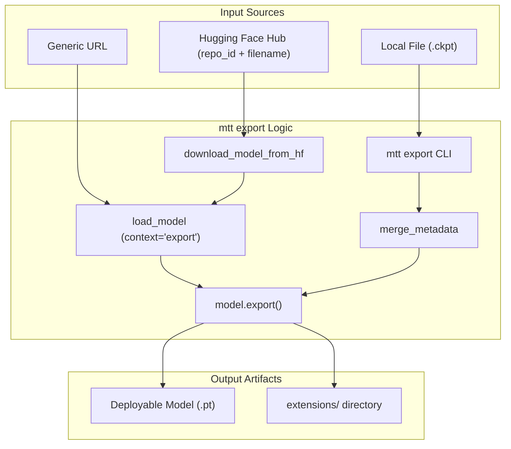
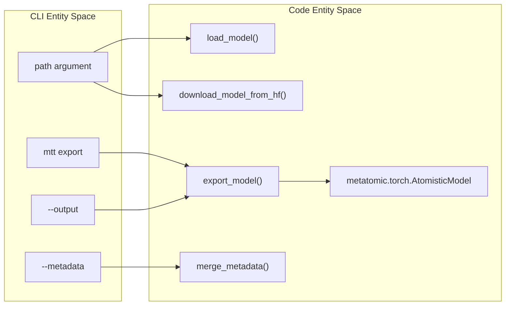

# mtt export — Model Export

Relevant source files

The following files were used as context for generating this wiki page:

- [docs/src/dev-docs/utils/transfer.rst](docs/src/dev-docs/utils/transfer.rst)
- [docs/src/getting-started/checkpoints.rst](docs/src/getting-started/checkpoints.rst)
- [src/metatrain/cli/export.py](src/metatrain/cli/export.py)
- [src/metatrain/share/metatrain-completion.bash](src/metatrain/share/metatrain-completion.bash)
- [src/metatrain/utils/__init__.py](src/metatrain/utils/__init__.py)
- [src/metatrain/utils/io.py](src/metatrain/utils/io.py)
- [src/metatrain/utils/sum_over_atoms.py](src/metatrain/utils/sum_over_atoms.py)
- [src/metatrain/utils/transfer.py](src/metatrain/utils/transfer.py)
- [tests/cli/test_export_model.py](tests/cli/test_export_model.py)
- [tests/utils/test_io.py](tests/utils/test_io.py)
- [tests/utils/test_sum_over_atoms.py](tests/utils/test_sum_over_atoms.py)
- [tests/utils/test_transfer.py](tests/utils/test_transfer.py)

The `mtt export` command is the bridge between a trained model checkpoint and a deployable atomistic potential. It converts internal training checkpoints (`.ckpt`) into standalone TorchScript-based `AtomisticModel` files (`.pt`) compatible with the `metatomic` ecosystem [src/metatrain/cli/export.py:164-172]().

## Overview and Data Flow

The export process involves loading a model from a checkpoint, optionally merging it with new metadata, collecting required compiled extensions, and serializing the result as a `metatomic.torch.AtomisticModel` [src/metatrain/cli/export.py:218-235]().

### Export Pipeline Diagram
The following diagram illustrates the data flow from various input sources to the final exported artifact.

**Model Export Logic Flow**

Sources: [src/metatrain/cli/export.py:164-216](), [src/metatrain/utils/io.py:134-187]()

## CLI Usage and Parameters

The CLI provides flexible ways to specify source models and customize the output.

| Argument | Description | Code Reference |
| :--- | :--- | :--- |
| `path` | Path to checkpoint, URL, or HF Hub identifier. | [src/metatrain/cli/export.py:37-45]() |
| `-o`, `--output` | Filename of the exported model (defaults to `.pt`). | [src/metatrain/cli/export.py:48-57]() |
| `-e`, `--extensions` | Directory to collect compiled extensions (default: `extensions/`). | [src/metatrain/cli/export.py:58-69]() |
| `-m`, `--metadata` | YAML file containing model name, authors, and references. | [src/metatrain/cli/export.py:71-78]() |
| `--token` | Hugging Face API token for private repositories. | [src/metatrain/cli/export.py:91-99]() |

### Input Source Handling
The `export_model` function supports three primary input formats [src/metatrain/cli/export.py:179-198]():
1. **Local Path**: `mtt export model.ckpt`
2. **HF Repository**: `mtt export metatensor/metatrain-test model.ckpt`
3. **URL**: `mtt export https://huggingface.co/.../model.ckpt`

Sources: [src/metatrain/cli/export.py:29-101]()

## Implementation Details

### Model Loading and Versioning
When `load_model` is called with a checkpoint path, it utilizes `model_from_checkpoint` with `context="export"` [src/metatrain/utils/io.py:182-187](). This context ensures the model is instantiated specifically for serialization rather than training. 

The system checks for architecture compatibility and handles versioning. If a checkpoint version is mismatched with the current architecture implementation, an upgrade is attempted; otherwise, a `RuntimeError` is raised [tests/utils/test_io.py:81-98]().

### Metadata Injection
Metadata can be injected during export to ensure the model carries its provenance (authors, description, references) into production [docs/src/getting-started/checkpoints.rst:90-103](). 
- If a metadata YAML is provided via `--metadata`, it is parsed into a `metatomic.torch.ModelMetadata` object [src/metatrain/cli/export.py:121-122]().
- This metadata is merged with any existing metadata in the checkpoint using `merge_metadata` [src/metatrain/cli/export.py:224-232]().

### Extension Collection
Many architectures rely on custom C++ extensions (e.g., `metatomic`, `rascaline`). During export, these dependencies are collected into the directory specified by the `--extensions` flag [src/metatrain/cli/export.py:168](). This ensures that the `.pt` file can be loaded in environments (like C++ MD engines) where the Python training environment is not present [tests/cli/test_export_model.py:32-35]().

**Entity Mapping: CLI to Implementation**

Sources: [src/metatrain/cli/export.py:16-101](), [src/metatrain/utils/io.py:134-162]()

## Hugging Face Hub Integration

`metatrain` provides first-class support for Hugging Face Hub. 
- **Automatic Downloading**: If the path matches the HF URL pattern, `_hf_hub_download_url` is invoked [src/metatrain/utils/io.py:75-108]().
- **Authentication**: Tokens can be provided via the `--token` CLI flag or the `HF_TOKEN` environment variable [src/metatrain/cli/export.py:108-120]().
- **Versioning**: Users can specify a specific `revision` (branch, tag, or commit hash) to ensure reproducibility [src/metatrain/cli/export.py:80-89]().

Sources: [src/metatrain/utils/io.py:15-21](), [src/metatrain/utils/io.py:111-131]()

## Checkpoint vs. Exported Model

| Feature | Checkpoint (`.ckpt`) | Exported Model (`.pt`) |
| :--- | :--- | :--- |
| **Primary Use** | Restarting/Finetuning training | Inference / Production MD |
| **Format** | Python Pickle (`torch.save`) | TorchScript (`AtomisticModel`) |
| **Dependencies** | Requires `metatrain` and architecture code | Standalone (with extensions) |
| **Metadata** | Minimal training state | Full authorship and references |

Sources: [docs/src/getting-started/checkpoints.rst:6-16](), [docs/src/getting-started/checkpoints.rst:83-88]()

---