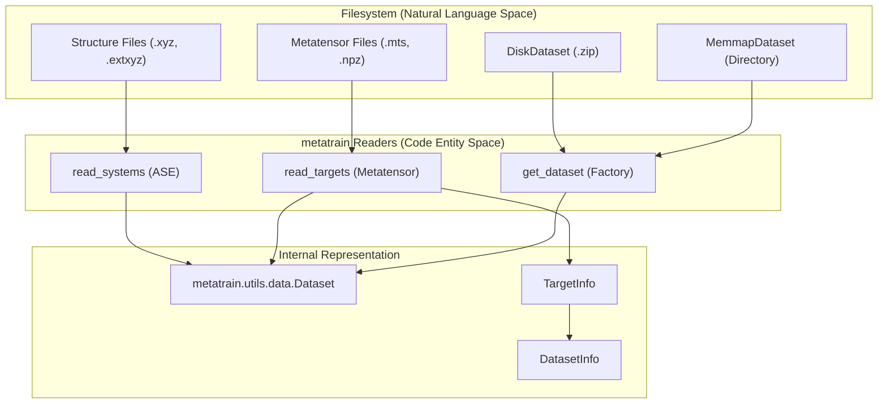
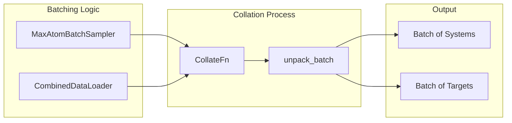

# Data Pipeline

Relevant source files

The following files were used as context for generating this wiki page:

- [src/metatrain/pet/modules/conditioning.py](src/metatrain/pet/modules/conditioning.py)
- [src/metatrain/pet/tests/checkpoints/model-v11_trainer-v13.ckpt.gz](src/metatrain/pet/tests/checkpoints/model-v11_trainer-v13.ckpt.gz)
- [src/metatrain/pet/tests/checkpoints/model-v15_trainer-v13.ckpt.gz](src/metatrain/pet/tests/checkpoints/model-v15_trainer-v13.ckpt.gz)
- [src/metatrain/utils/data/__init__.py](src/metatrain/utils/data/__init__.py)
- [src/metatrain/utils/data/dataset.py](src/metatrain/utils/data/dataset.py)
- [src/metatrain/utils/data/get_dataset.py](src/metatrain/utils/data/get_dataset.py)
- [tests/utils/data/test_combine_dataloaders.py](tests/utils/data/test_combine_dataloaders.py)
- [tests/utils/data/test_dataset.py](tests/utils/data/test_dataset.py)
- [tests/utils/data/test_get_dataset.py](tests/utils/data/test_get_dataset.py)
- [tests/utils/data/test_samplers.py](tests/utils/data/test_samplers.py)

The metatrain data pipeline is a modular infrastructure designed to handle atomistic data from various sources, ranging from small-scale research datasets to massive, distributed training sets. It provides a unified interface for reading atomic structures, managing physical targets (energies, forces, etc.), and efficiently batching data for training deep learning models.

The pipeline is built on top of [metatensor](https://github.com/lab-cosmo/metatensor) and [metatomic](https://github.com/metatomic/metatomic), ensuring that all data representations are physically consistent and metadata-rich.

## Core Data Representations

At the heart of the pipeline are two primary metadata containers that communicate dataset properties to the model architectures:

*   **`TargetInfo`**: Stores metadata for a specific training target, including its physical quantity, units, and the layout (keys and components) of the underlying `TensorMap` [src/metatrain/utils/data/target_info.py:10-41]().
*   **`DatasetInfo`**: A global container for a dataset's metadata. It tracks the length units, all unique atomic types present in the system, and a dictionary of `TargetInfo` objects for all active targets [src/metatrain/utils/data/dataset.py:70-108]().

### Data Flow Overview

The following diagram illustrates how raw files are transformed into the internal `Dataset` representation used by the trainers.

**System and Target Ingestion Flow**

*Sources: [src/metatrain/utils/data/get_dataset.py:12-68](), [src/metatrain/utils/data/dataset.py:70-108](), [src/metatrain/utils/data/target_info.py:10-41]()*

## Subsystems

The data pipeline is divided into three functional areas, each covered in detail on its own child page.

### 1. Dataset Formats and Readers
Metatrain supports three primary dataset backends to balance memory usage and performance:
*   **In-Memory `Dataset`**: Standard PyTorch-like dataset where all data is loaded into RAM.
*   **`DiskDataset`**: Uses a smart-zip infrastructure to store structures and targets in a compressed `.zip` file, loading only what is needed for the current batch [src/metatrain/utils/data/dataset.py:332-345]().
*   **`MemmapDataset`**: A binary format that uses memory-mapping for extremely fast random access on large-scale datasets [src/metatrain/utils/data/dataset.py:641-654]().

For details, see [Dataset Formats and Readers](#3.1).

### 2. Batching, Sampling, and Collation
Batching atomistic data requires specialized logic to handle varying numbers of atoms per system.
*   **`MaxAtomBatchSampler`**: Groups structures into batches based on a maximum total atom count rather than a fixed number of systems, preventing out-of-memory (OOM) errors [src/metatrain/utils/data/samplers.py:122-156]().
*   **`CollateFn`**: Merges individual `metatomic.torch.System` objects and `metatensor.torch.TensorMap` targets into a single contiguous batch ready for the GPU [src/metatrain/utils/data/dataset.py:922-945]().
*   **`CombinedDataLoader`**: Allows training on multiple disparate datasets (e.g., mixing QM9 and MD data) by interleaving batches [src/metatrain/utils/data/combine_dataloaders.py:11-38]().

For details, see [Batching, Sampling, and Collation](#3.2).

### 3. Neighbor Lists and System Transforms
Before data enters the model, it often requires geometric preprocessing:
*   **Neighbor Lists**: Computed via `metatomic` using either `vesin` (optimized) or ASE fallbacks. Options are managed via `NeighborListOptions` [src/metatrain/utils/data/dataset.py:23-30]().
*   **Conditioning**: Attaching system-level information like total `charge` or `spin_multiplicity` to the data structures [src/metatrain/pet/modules/conditioning.py:8-27]().
*   **Augmentation**: Rotational data augmentation for non-equivariant models or verification of equivariant ones.

For details, see [Neighbor Lists and System Transforms](#3.3).

## Data Pipeline Entities

| Entity | Role | Source |
| :--- | :--- | :--- |
| `get_dataset` | Factory function that dispatches to the correct reader based on file extension or directory structure. | [src/metatrain/utils/data/get_dataset.py:12-68]() |
| `Dataset` | The core container holding `System` objects and target `TensorMap`s. | [src/metatrain/utils/data/dataset.py:843-858]() |
| `unpack_batch` | Utility to separate a collated batch back into its constituent systems and targets for model consumption. | [src/metatrain/utils/data/dataset.py:1016-1044]() |
| `TargetInfo` | Metadata describing a specific output (e.g. "energy" in "eV"). | [src/metatrain/utils/data/target_info.py:10-41]() |

**Batching and Collation Logic**

*Sources: [src/metatrain/utils/data/samplers.py:122-156](), [src/metatrain/utils/data/dataset.py:922-945](), [src/metatrain/utils/data/dataset.py:1016-1044]()*

**Sources:**
- [src/metatrain/utils/data/dataset.py:70-108]()
- [src/metatrain/utils/data/dataset.py:843-858]()
- [src/metatrain/utils/data/dataset.py:922-945]()
- [src/metatrain/utils/data/get_dataset.py:12-68]()
- [src/metatrain/utils/data/target_info.py:10-41]()
- [src/metatrain/utils/data/samplers.py:122-156]()

---