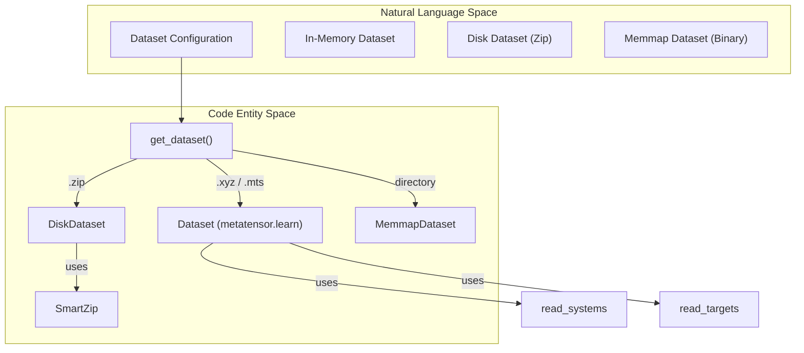
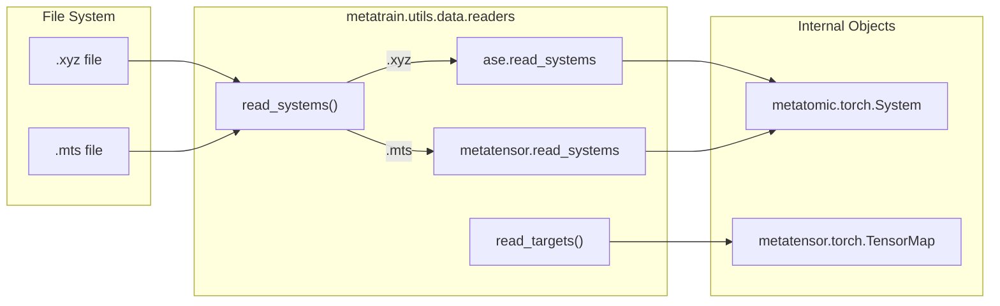

# Dataset Formats and Readers

Relevant source files

The following files were used as context for generating this wiki page:

- [docs/src/concepts/dataset-formats.rst](docs/src/concepts/dataset-formats.rst)
- [docs/src/concepts/index.rst](docs/src/concepts/index.rst)
- [docs/src/faq.rst](docs/src/faq.rst)
- [examples/0-beginner/01-data_preparation.py](examples/0-beginner/01-data_preparation.py)
- [src/metatrain/pet/modules/conditioning.py](src/metatrain/pet/modules/conditioning.py)
- [src/metatrain/pet/tests/checkpoints/model-v15_trainer-v13.ckpt.gz](src/metatrain/pet/tests/checkpoints/model-v15_trainer-v13.ckpt.gz)
- [src/metatrain/utils/data/dataset.py](src/metatrain/utils/data/dataset.py)
- [src/metatrain/utils/data/get_dataset.py](src/metatrain/utils/data/get_dataset.py)
- [src/metatrain/utils/data/readers/ase.py](src/metatrain/utils/data/readers/ase.py)
- [src/metatrain/utils/data/readers/metatensor.py](src/metatrain/utils/data/readers/metatensor.py)
- [src/metatrain/utils/data/readers/readers.py](src/metatrain/utils/data/readers/readers.py)
- [src/metatrain/utils/data/target_info.py](src/metatrain/utils/data/target_info.py)
- [src/metatrain/utils/evaluate_model.py](src/metatrain/utils/evaluate_model.py)
- [src/metatrain/utils/neighbor_lists.py](src/metatrain/utils/neighbor_lists.py)
- [tests/utils/data/test_combine_dataloaders.py](tests/utils/data/test_combine_dataloaders.py)
- [tests/utils/data/test_dataset.py](tests/utils/data/test_dataset.py)
- [tests/utils/data/test_readers.py](tests/utils/data/test_readers.py)
- [tests/utils/data/test_readers_metatensor.py](tests/utils/data/test_readers_metatensor.py)
- [tests/utils/data/test_target_info.py](tests/utils/data/test_target_info.py)

This page describes how `metatrain` ingests atomistic data from various file formats and represents it internally using `metatensor` and `metatomic` structures. The system supports three primary data backends designed to balance ease of use with high-performance I/O for large-scale training.

## Data Backends

`metatrain` provides three implementations of the `Dataset` interface, each optimized for different scales and storage environments.

| Backend | Format | Use Case | Implementation |
| :--- | :--- | :--- | :--- |
| **In-Memory** | `.xyz`, `.extxyz`, `.mts` | Small datasets (<10k structures) where data fits in RAM. | `metatensor.learn.data.Dataset` |
| **DiskDataset** | `.zip` (smart-zip) | Large datasets; data is lazily loaded from a compressed zip archive. | [src/metatrain/utils/data/dataset.py:381-383]() |
| **MemmapDataset** | Binary `.npy`/`.bin` | Massive datasets on parallel filesystems; uses memory-mapped arrays. | [src/metatrain/utils/data/dataset.py:539-541]() |

### DiskDataset
The `DiskDataset` uses a "smart-zip" infrastructure. It stores atomistic systems and target `TensorMaps` as serialized buffers within a zip file. During training, only the required samples for a batch are decompressed and loaded into memory [src/metatrain/utils/data/dataset.py:465-475]().

### MemmapDataset
Designed for HPC environments, `MemmapDataset` stores data in raw binary files (positions, cells, types) and uses `numpy.memmap` to map these files into the process's virtual address space [src/metatrain/utils/data/dataset.py:539-541](). This allows multiple training processes to share the same physical memory pages for the dataset. Note that this format currently does not support spherical targets [examples/0-beginner/01-data_preparation.py:177-177]().

### Data Representation Logic
The following diagram bridges the high-level dataset concepts to their implementation classes and the `get_dataset` factory.

**Dataset Factory and Backend Mapping**

Sources: [src/metatrain/utils/data/get_dataset.py:12-68](), [src/metatrain/utils/data/dataset.py:381-383](), [src/metatrain/utils/data/dataset.py:539-541]()

---

## Metadata Containers

Metadata about the dataset is managed by two primary classes: `DatasetInfo` and `TargetInfo`. These ensure that units, physical quantities, and tensor shapes are consistent across the training pipeline.

### TargetInfo
`TargetInfo` stores metadata for a specific training target (e.g., energy, forces, dipole). It encapsulates:
- **Layout**: A `TensorMap` with zero samples that defines the expected names for samples, components, and properties [src/metatrain/utils/data/target_info.py:19-24]().
- **Quantity & Unit**: Physical metadata used for unit conversion (e.g., "energy" in "eV") [src/metatrain/utils/data/target_info.py:25-32]().
- **Gradients**: A list of available gradients, such as `positions` (forces) or `strain` (stress/virial) [src/metatrain/utils/data/target_info.py:66-71]().

### DatasetInfo
`DatasetInfo` acts as a global container for the entire dataset's metadata, including:
- **Length Units**: The unit used for atomic positions and cell dimensions [src/metatrain/utils/data/dataset.py:102-102]().
- **Atomic Types**: A sorted list of unique chemical species present in the data [src/metatrain/utils/data/dataset.py:103-103]().
- **Targets**: A dictionary mapping target names to their respective `TargetInfo` objects [src/metatrain/utils/data/dataset.py:104-104]().

Sources: [src/metatrain/utils/data/target_info.py:16-60](), [src/metatrain/utils/data/dataset.py:70-108]()

---

## Readers and Data Flow

The `read_systems` and `read_targets` functions are the entry points for the in-memory data pipeline. They delegate the actual parsing to specialized reader modules.

### Reader Modules
1.  **ASE Reader**: Used for `.xyz` and `.extxyz` files. It converts `ase.Atoms` objects into `metatomic.torch.System` objects [src/metatrain/utils/data/readers/ase.py]().
2.  **Metatensor Reader**: Used for `.mts` files, which store data directly as `metatensor.torch.TensorMap` objects [src/metatrain/utils/data/readers/metatensor.py]().

### Internal Data Flow
The `get_dataset` factory coordinates the reading process based on the file extension or explicit `reader` option.

**Reader Implementation Flow**

Sources: [src/metatrain/utils/data/readers/readers.py:29-71](), [src/metatrain/utils/data/readers/readers.py:74-102](), [src/metatrain/utils/data/get_dataset.py:50-66]()

### Target Validation
When reading targets, `metatrain` validates target names against `metatomic` standard outputs. Custom targets must be prefixed with `mtt::` [src/metatrain/utils/data/readers/readers.py:93-96](). The reader also ensures that all data is loaded in double precision (`torch.float64`) to prevent numerical instability during gradient computation [src/metatrain/utils/data/readers/readers.py:179-180]().

---

## Evaluation and Gradients

The `evaluate_model` function bridges the gap between the dataset and the model. It handles the preparation of systems for autograd, specifically for energy gradients like forces and stress.

Key steps in `evaluate_model`:
1.  **System Preparation**: Sets `requires_grad` on positions and/or strain based on the requested `TargetInfo` gradients [src/metatrain/utils/evaluate_model.py:78-86]().
2.  **Model Execution**: Calls the model's forward pass to obtain outputs [src/metatrain/utils/evaluate_model.py:90-90]().
3.  **Gradient Computation**: If the target is an "energy" and requires gradients, it uses `torch.autograd` to compute derivatives with respect to positions (forces) or strain (stress) [src/metatrain/utils/evaluate_model.py:107-156]().

Sources: [src/metatrain/utils/evaluate_model.py:21-160]()

---