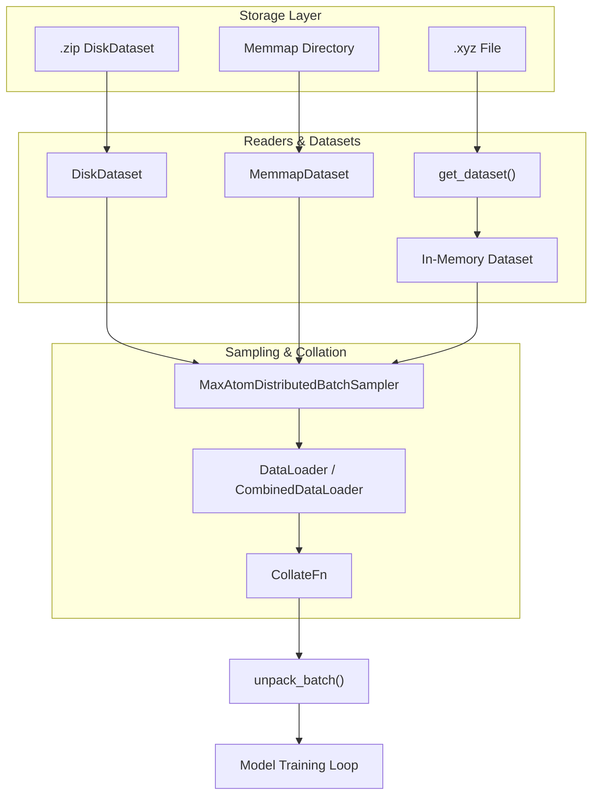
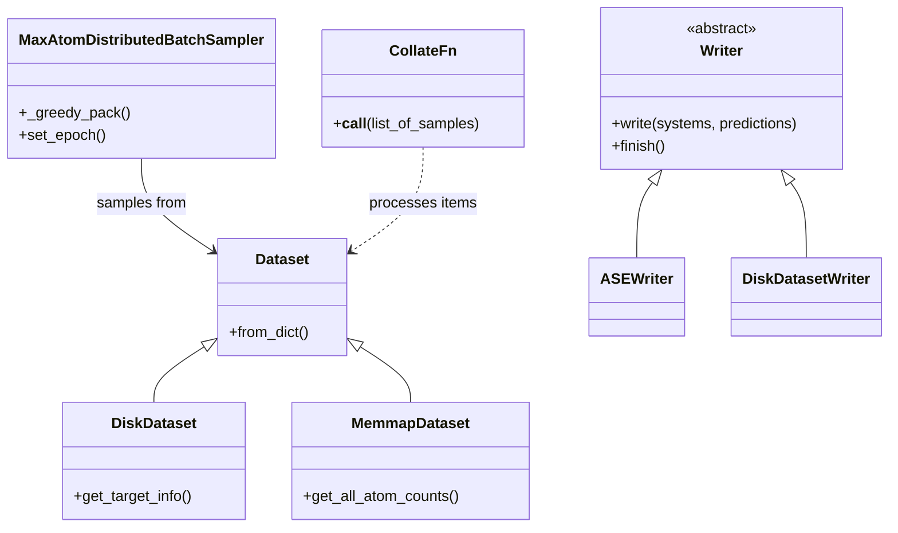

# Batching, Sampling, and Collation

Relevant source files

The following files were used as context for generating this wiki page:

- [docs/src/dev-docs/utils/data/writers.rst](docs/src/dev-docs/utils/data/writers.rst)
- [src/metatrain/pet/modules/conditioning.py](src/metatrain/pet/modules/conditioning.py)
- [src/metatrain/pet/tests/checkpoints/model-v15_trainer-v13.ckpt.gz](src/metatrain/pet/tests/checkpoints/model-v15_trainer-v13.ckpt.gz)
- [src/metatrain/utils/data/dataset.py](src/metatrain/utils/data/dataset.py)
- [src/metatrain/utils/data/get_dataset.py](src/metatrain/utils/data/get_dataset.py)
- [src/metatrain/utils/data/samplers.py](src/metatrain/utils/data/samplers.py)
- [src/metatrain/utils/data/smart_zip.py](src/metatrain/utils/data/smart_zip.py)
- [src/metatrain/utils/data/writers/__init__.py](src/metatrain/utils/data/writers/__init__.py)
- [src/metatrain/utils/data/writers/ase.py](src/metatrain/utils/data/writers/ase.py)
- [src/metatrain/utils/data/writers/diskdataset.py](src/metatrain/utils/data/writers/diskdataset.py)
- [src/metatrain/utils/data/writers/memmap.py](src/metatrain/utils/data/writers/memmap.py)
- [src/metatrain/utils/data/writers/metatensor.py](src/metatrain/utils/data/writers/metatensor.py)
- [src/metatrain/utils/data/writers/writers.py](src/metatrain/utils/data/writers/writers.py)
- [tests/utils/data/test_combine_dataloaders.py](tests/utils/data/test_combine_dataloaders.py)
- [tests/utils/data/test_dataset.py](tests/utils/data/test_dataset.py)
- [tests/utils/data/test_smart_zip.py](tests/utils/data/test_smart_zip.py)
- [tests/utils/data/test_writers.py](tests/utils/data/test_writers.py)

This page describes the infrastructure used by `metatrain` to aggregate atomistic data into training batches, sample them efficiently for distributed training, and write predictions to various disk formats. The system is designed to handle large-scale datasets that exceed available RAM by using memory-mapped files and smart-zip archives.

## Collation and Batch Unpacking

The collation process transforms a list of individual dataset items (systems and their associated targets) into a single batch object suitable for model consumption.

### CollateFn
The `CollateFn` class is responsible for joining multiple `metatomic.torch.System` objects and their corresponding `metatensor.torch.TensorMap` targets into a batched representation `[metatrain/utils/data/dataset.py:350-353]()`. 

- **System Batching**: Systems are joined using `metatomic.torch.System.join`, which handles the concatenation of atomic positions, types, and cell information.
- **Target Batching**: Targets are joined along the `samples` axis using `metatensor.learn.data.group_and_join` `[metatrain/utils/data/dataset.py:421-424]()`. This ensures that labels (e.g., `system` indices) are correctly shifted to remain unique within the batch.

### unpack_batch
Once a batch is produced by the `DataLoader`, the `unpack_batch` function is used to separate the joined data back into its constituent components for the training loop `[metatrain/utils/data/dataset.py:467-471]()`.

| Component | Type | Description |
| :--- | :--- | :--- |
| **Systems** | `List[System]` | A list of atomistic systems in the batch. |
| **Targets** | `Dict[str, TensorMap]` | A dictionary mapping target names to their batched `TensorMap` values. |

**Sources**: `src/metatrain/utils/data/dataset.py`

## Efficient Large-Scale Sampling

Training on large atomistic datasets requires strategies to balance GPU memory and computational efficiency, especially when systems vary significantly in size.

### MaxAtomDistributedBatchSampler
The `MaxAtomDistributedBatchSampler` implements "greedy packing" to create batches based on a maximum number of atoms rather than a fixed number of systems `[metatrain/utils/data/samplers.py:103-110]()`.

1. **Packing**: At initialization, it iterates through the dataset to retrieve atom counts via `get_num_atoms(i)` `[metatrain/utils/data/samplers.py:160]()`.
2. **Greedy Algorithm**: It fills a batch until adding the next system would exceed `max_atoms`. Systems larger than `max_atoms` are skipped `[metatrain/utils/data/samplers.py:42-58]()`.
3. **Distributed Support**: It supports `num_replicas` and `rank` for DDP (Distributed Data Parallel) training. It shuffles the *order* of pre-packed batches each epoch to maintain determinism across restarts `[metatrain/utils/data/samplers.py:106-110]()`.

### CombinedDataLoader
When training on multiple datasets (e.g., multi-task learning), the `CombinedDataLoader` wraps multiple `DataLoader` instances `[metatrain/utils/data/dataset.py:491-494]()`. It can yield batches sequentially or by randomly sampling from the available loaders to mix data types within an epoch `[tests/utils/data/test_combine_dataloaders.py:145-147]()`.

**Sources**: `src/metatrain/utils/data/samplers.py`, `src/metatrain/utils/data/dataset.py`

## Data Writing Infrastructure

`metatrain` provides a flexible writer system to save model predictions and systems to disk. The `get_writer` factory selects the implementation based on the file extension `[metatrain/utils/data/writers/__init__.py:53-58]()`.

### Writer Implementations

| Writer Class | Extension | Description |
| :--- | :--- | :--- |
| `ASEWriter` | `.xyz` | Writes systems and predictions to Extended XYZ files using the ASE library `[metatrain/utils/data/writers/ase.py:16-18]()`. |
| `DiskDatasetWriter` | `.zip` | Writes data into the `DiskDataset` format (zipped `.mta` and `.mts` files) `[metatrain/utils/data/writers/diskdataset.py:56-60]()`. |
| `MemmapWriter` | `dir/` | Writes binary data to a directory for memory-mapped access `[metatrain/utils/data/writers/__init__.py:50]()`. |
| `MetatensorWriter` | `.mts` | Writes predictions as standalone Metatensor files `[metatrain/utils/data/writers/metatensor.py:13-15]()`. |

### Implementation Detail: Memory Management
To avoid unbounded memory growth when writing large evaluation sets, writers like `MetatensorWriter` save batch predictions to temporary files on disk during the `write()` phase and only concatenate them during the `finish()` call `[metatrain/utils/data/writers/metatensor.py:39-42]()`.

**Sources**: `src/metatrain/utils/data/writers/__init__.py`, `src/metatrain/utils/data/writers/ase.py`, `src/metatrain/utils/data/writers/metatensor.py`

## Data Flow Diagram

The following diagram illustrates the flow from raw data on disk to the training loop.

**Data Pipeline Flow**

**Sources**: `src/metatrain/utils/data/get_dataset.py`, `src/metatrain/utils/data/dataset.py`, `src/metatrain/utils/data/samplers.py`

## Smart-Zip and Memmap Infrastructure

For datasets with millions of structures, `metatrain` utilizes specialized backends:

1.  **SmartZip**: A wrapper around `zipfile` that allows random access to individual members without re-scanning the central directory, optimized for the `DiskDataset` format `[metatrain/utils/data/dataset.py:39]()`.
2.  **MemmapDataset**: Uses `numpy.memmap` to map large binary arrays (positions, types, targets) directly into the process's virtual address space. This allows the OS to manage data loading/caching lazily `[metatrain/utils/data/dataset.py:25]()`.

**Code Entity Mapping**

**Sources**: `src/metatrain/utils/data/dataset.py`, `src/metatrain/utils/data/samplers.py`, `src/metatrain/utils/data/writers/writers.py`

---