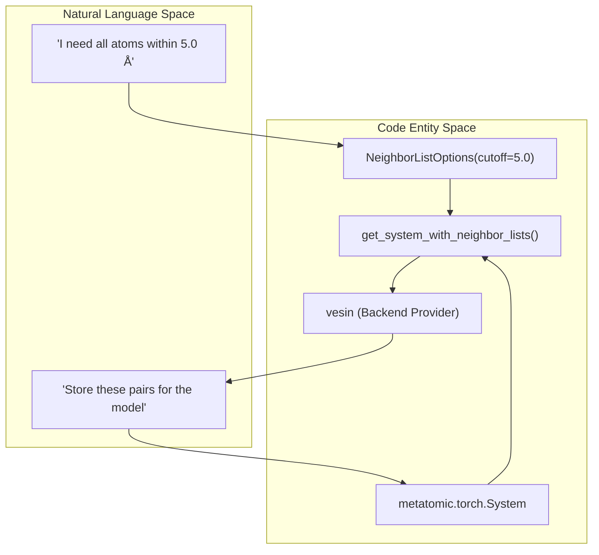
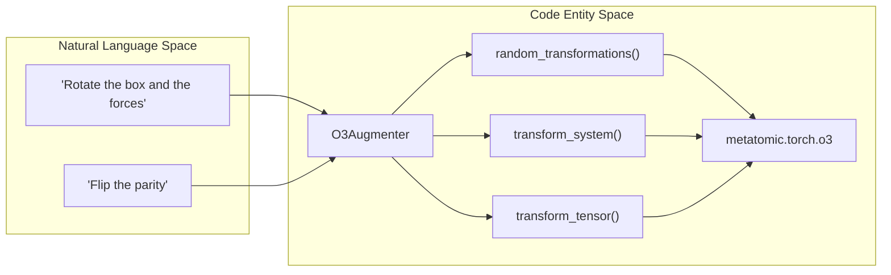

# Neighbor Lists and System Transforms

Relevant source files

The following files were used as context for generating this wiki page:

- [src/metatrain/experimental/phace/tests/test_regression.py](src/metatrain/experimental/phace/tests/test_regression.py)
- [src/metatrain/pet/tests/test_regression.py](src/metatrain/pet/tests/test_regression.py)
- [src/metatrain/utils/augmentation.py](src/metatrain/utils/augmentation.py)
- [src/metatrain/utils/data/readers/ase.py](src/metatrain/utils/data/readers/ase.py)
- [src/metatrain/utils/data/readers/readers.py](src/metatrain/utils/data/readers/readers.py)
- [src/metatrain/utils/evaluate_model.py](src/metatrain/utils/evaluate_model.py)
- [src/metatrain/utils/long_range.py](src/metatrain/utils/long_range.py)
- [src/metatrain/utils/neighbor_lists.py](src/metatrain/utils/neighbor_lists.py)
- [src/metatrain/utils/scaler/_base_scaler.py](src/metatrain/utils/scaler/_base_scaler.py)
- [src/metatrain/utils/scaler/scaler.py](src/metatrain/utils/scaler/scaler.py)
- [src/metatrain/utils/system_data.py](src/metatrain/utils/system_data.py)
- [src/metatrain/utils/testing/output.py](src/metatrain/utils/testing/output.py)
- [tests/__init__.py](tests/__init__.py)
- [tests/cli/__init__.py](tests/cli/__init__.py)
- [tests/utils/__init__.py](tests/utils/__init__.py)
- [tests/utils/data/test_readers.py](tests/utils/data/test_readers.py)
- [tests/utils/test_abc.py](tests/utils/test_abc.py)
- [tests/utils/test_augmentation.py](tests/utils/test_augmentation.py)
- [tests/utils/test_evaluate_model.py](tests/utils/test_evaluate_model.py)
- [tests/utils/test_long_range.py](tests/utils/test_long_range.py)
- [tests/utils/test_output_gradient.py](tests/utils/test_output_gradient.py)
- [tests/utils/test_scaler.py](tests/utils/test_scaler.py)

This section covers the mechanisms for computing spatial relationships between atoms and transforming atomistic systems for training. It details the neighbor list infrastructure, rotational data augmentation, and the scaling of target values.

## Neighbor List Infrastructure

Neighbor lists are essential for atomistic models to identify atoms within a specified cutoff radius. `metatrain` utilizes `metatomic` and `vesin` (with an ASE fallback) to compute these lists efficiently.

### NeighborListOptions
The `NeighborListOptions` class [src/metatrain/utils/neighbor_lists.py:20-35]() defines the parameters for neighbor list construction, including the `cutoff`, whether to use a `full_list` (including both $i-j$ and $j-i$ pairs), and whether to include `self_interactions`.

### System Preparation
To attach neighbor lists to a `System` object, the utility `get_system_with_neighbor_lists` is used. This function ensures that the requested neighbor lists are computed and stored within the system's internal registry [src/metatrain/utils/neighbor_lists.py:65-90]().

Models specify their requirements via `requested_neighbor_lists()` [src/metatrain/utils/testing/output.py:134-136](). During evaluation, `evaluate_model` calls `_prepare_system` to set up gradients and neighbor lists for the input systems [src/metatrain/utils/evaluate_model.py:78-87]().

### Natural Language to Code Entity Space: Neighbor List Flow
The following diagram maps the logical request for spatial neighbors to the specific code entities that handle the computation and storage.

**Sources:** [src/metatrain/utils/neighbor_lists.py:20-90](), [src/metatrain/utils/testing/output.py:126-136]()

---

## O3Augmenter: Rotational Augmentation

Data augmentation is critical for training equivariant models. The `O3Augmenter` class applies random O(3) transformations (rotations and improper rotations) to systems and their associated targets [src/metatrain/utils/augmentation.py:16-35]().

### Key Features
- **Group Selection**: Supports `"O3"` (rotations + inversions) or `"inversions"` only [src/metatrain/utils/augmentation.py:34-40]().
- **Tensor Transformation**: Uses `metatomic.torch.o3.transform_tensor` to rotate `TensorMap` targets based on their irreps (e.g., vectors, dipoles, or spherical harmonics) [src/metatrain/utils/augmentation.py:117-120]().
- **Mask Handling**: Extra data ending in `_mask` is explicitly excluded from rotation to maintain logical validity [src/metatrain/utils/augmentation.py:127-129]().

### Natural Language to Code Entity Space: Augmentation Logic
This diagram bridges the intent of "rotating the dataset" to the internal classes and external library calls.

**Sources:** [src/metatrain/utils/augmentation.py:47-133](), [tests/utils/test_augmentation.py:147-187]()

---

## Target Scaling

The `Scaler` class is responsible for normalizing target values (e.g., energies, forces) to have unit variance, which stabilizes the training process [src/metatrain/utils/scaler/scaler.py:23-31]().

### Scaling Lifecycle
1. **Initialization**: The `Scaler` is initialized with `DatasetInfo` to identify targets and their layouts [src/metatrain/utils/scaler/scaler.py:36-60]().
2. **Training**: The `train_model` method computes the standard deviation of targets across the dataset. It can remove contributions from `additive_models` (like `CompositionModel`) before calculating the scale [src/metatrain/utils/scaler/scaler.py:145-180]().
3. **Inference**: During the forward pass, the model's raw outputs are multiplied by the computed scales [src/metatrain/utils/scaler/scaler.py:126-131]().

### Implementation Details
The `Scaler` uses `BaseScaler` internally to manage `TensorMap` objects containing the scales [src/metatrain/utils/scaler/_base_scaler.py:17-48](). It supports:
- **Per-target scaling**: A single scale for the entire target.
- **Per-property scaling**: Different scales for different properties within a block [src/metatrain/utils/scaler/_base_scaler.py:188-195]().
- **Fixed weights**: Overriding computed scales with user-defined values [src/metatrain/utils/scaler/scaler.py:168-173]().

**Sources:** [src/metatrain/utils/scaler/scaler.py:23-180](), [src/metatrain/utils/scaler/_base_scaler.py:17-195](), [tests/utils/test_scaler.py:26-131]()

---

## System Conditioning

System conditioning allows models to incorporate global or atomic-level information such as total charge or spin states.

### Long-Range Featurization
For systems where long-range interactions (e.g., Coulomb) are significant, `metatrain` provides the `LongRangeFeaturizer` [src/metatrain/utils/long_range.py:28-45](). This module integrates with `torch-pme` to compute potentials using Ewald summation or P3M [src/metatrain/utils/long_range.py:60-82]().

### Data Flow for Evaluation
When `evaluate_model` is called, it handles the complex orchestration of system preparation, neighbor list registration, and gradient tracking [src/metatrain/utils/evaluate_model.py:21-46]().

| Function | Role |
| :--- | :--- |
| `_prepare_system` | Sets `requires_grad` on positions/cell and attaches neighbor lists [src/metatrain/utils/evaluate_model.py:78-84](). |
| `register_autograd_neighbors` | Ensures neighbor list distances are tracked by autograd [src/metatrain/utils/evaluate_model.py:13-14](). |
| `compute_gradient` | Calculates forces (negative position gradient) and stress/virial (strain gradient) [src/metatrain/utils/evaluate_model.py:106-112](). |

**Sources:** [src/metatrain/utils/evaluate_model.py:21-160](), [src/metatrain/utils/long_range.py:28-170]()

---