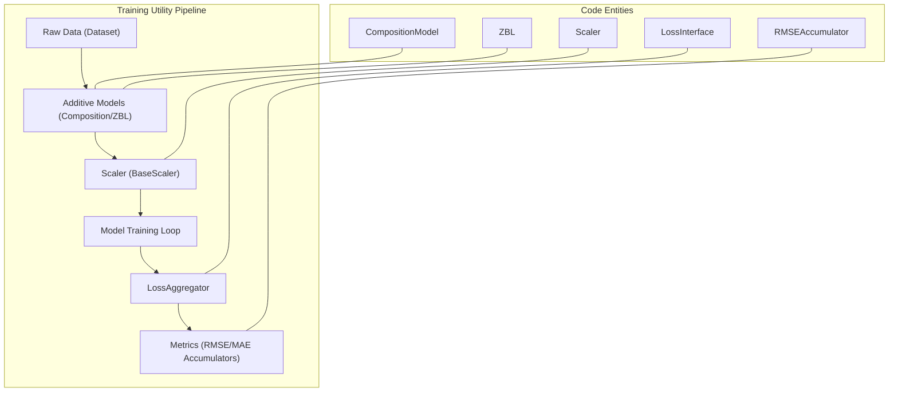
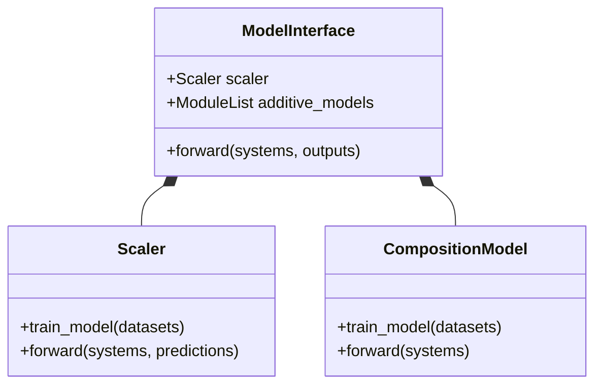

# Training Utilities

Relevant source files

The following files were used as context for generating this wiki page:

- [docs/src/dev-docs/new-loss.rst](docs/src/dev-docs/new-loss.rst)
- [src/metatrain/experimental/mace/model.py](src/metatrain/experimental/mace/model.py)
- [src/metatrain/experimental/phace/model.py](src/metatrain/experimental/phace/model.py)
- [src/metatrain/experimental/phace/tests/test_regression.py](src/metatrain/experimental/phace/tests/test_regression.py)
- [src/metatrain/pet/tests/test_regression.py](src/metatrain/pet/tests/test_regression.py)
- [src/metatrain/utils/additive/remove.py](src/metatrain/utils/additive/remove.py)
- [src/metatrain/utils/augmentation.py](src/metatrain/utils/augmentation.py)
- [src/metatrain/utils/data/atomic_basis_helpers.py](src/metatrain/utils/data/atomic_basis_helpers.py)
- [src/metatrain/utils/loss.py](src/metatrain/utils/loss.py)
- [src/metatrain/utils/metrics.py](src/metatrain/utils/metrics.py)
- [src/metatrain/utils/omegaconf.py](src/metatrain/utils/omegaconf.py)
- [src/metatrain/utils/per_atom.py](src/metatrain/utils/per_atom.py)
- [src/metatrain/utils/scaler/_base_scaler.py](src/metatrain/utils/scaler/_base_scaler.py)
- [src/metatrain/utils/scaler/scaler.py](src/metatrain/utils/scaler/scaler.py)
- [src/metatrain/utils/testing/output.py](src/metatrain/utils/testing/output.py)
- [tests/utils/data/test_atomic_basis_helpers.py](tests/utils/data/test_atomic_basis_helpers.py)
- [tests/utils/test_additive.py](tests/utils/test_additive.py)
- [tests/utils/test_augmentation.py](tests/utils/test_augmentation.py)
- [tests/utils/test_loss.py](tests/utils/test_loss.py)
- [tests/utils/test_metrics.py](tests/utils/test_metrics.py)
- [tests/utils/test_scaler.py](tests/utils/test_scaler.py)

The `metatrain` codebase provides a suite of shared utilities that standardize how different model architectures handle physical constraints, data scaling, and error quantification. These utilities ensure that whether a user is training a Point Edge Transformer (PET) or a SOAP-BPNN, the treatment of units, baseline energies, and loss functions remains consistent.

### System Overview

The training utilities bridge the gap between raw model outputs and the physical targets defined in the datasets. This is achieved through a pipeline of transforms:

1.  **Additive Models**: Remove known physical baselines (like isolated atom energies) from the training data.
2.  **Target Scaling**: Normalize the remaining signal to a unit-variance scale to stabilize optimization.
3.  **Loss Computation**: Evaluate the model using standardized loss functions (MSE, Huber) and their gradients (Forces, Stress).
4.  **Metrics**: Accumulate statistics (RMSE, MAE) across batches for validation.

**Sources**: [src/metatrain/utils/scaler/scaler.py:145-175](), [src/metatrain/utils/loss.py:35-50](), [src/metatrain/utils/metrics.py:51-60]()

---

### Loss Functions ([Loss Functions](#4.1))

The loss system is built around the `LossInterface` [src/metatrain/utils/loss.py:35-45](), which defines how to compare `metatensor.torch.TensorMap` objects. The `LossAggregator` combines multiple loss terms (e.g., energy, forces, and stress) based on a `LossSpecification` [src/metatrain/utils/loss.py:28-33]().

*   **Supported Types**: Includes `MSELoss`, `HuberLoss`, and specialized losses for gradients.
*   **Gradients**: Automatically handles losses for `forces` (negative gradient of energy w.r.t positions) and `stress` (gradient w.r.t strain).

For details on configuring weights and adding custom terms, see [Loss Functions](#4.1).

**Sources**: [src/metatrain/utils/loss.py:118-142](), [src/metatrain/utils/loss.py:178-201]()

---

### Target Scaling ([Target Scaling](#4.2))

The `Scaler` [src/metatrain/utils/scaler/scaler.py:23-31]() is responsible for bringing target values to a scale optimal for neural network training. It uses the `BaseScaler` [src/metatrain/utils/scaler/_base_scaler.py]() to compute and store per-target and per-property standard deviations.

*   **Automatic Fitting**: Computes scales from the training set during the `train_model` phase [src/metatrain/utils/scaler/scaler.py:145-154]().
*   **Fixed Weights**: Allows overriding computed scales via `fixed_weights` configuration [src/metatrain/utils/scaler/scaler.py:168-172]().
*   **Dtype Support**: Enforces `float64` during scale accumulation to prevent precision loss [src/metatrain/utils/scaler/scaler.py:100-105]().

For details on the scaling lifecycle and checkpointing, see [Target Scaling](#4.2).

**Sources**: [src/metatrain/utils/scaler/scaler.py:23-60](), [src/metatrain/utils/scaler/scaler.py:145-175]()

---

### Additive Models ([Additive Models](#4.3))

Additive models represent known physical contributions that are added to the core model's prediction. The primary implementation is the `CompositionModel` [src/metatrain/composition/__init__.py](), which fits per-species energy baselines.

*   **ZBL Potential**: Provides short-range repulsion via the `ZBL` class [src/metatrain/utils/additive/__init__.py]().
*   **Transformations**: The `remove_additive` utility [src/metatrain/utils/additive/remove.py]() subtracts these contributions from training targets so the model only learns the "interaction" energy.
*   **Atomic Basis**: Helpers like `densify_atomic_basis_target` [src/metatrain/utils/data/atomic_basis_helpers.py:176-180]() manage the representation of species-dependent properties.

For details on baseline fitting and ZBL integration, see [Additive Models](#4.3).

**Sources**: [tests/utils/test_additive.py:10-14](), [src/metatrain/utils/data/atomic_basis_helpers.py:176-193]()

---

### Metrics and Gradient Computation ([Metrics and Gradient Computation](#4.4))

Evaluation is standardized through accumulators that process `TensorMap` outputs.

*   **Accumulators**: `RMSEAccumulator` and `MAEAccumulator` [src/metatrain/utils/metrics.py:51-60]() track errors across the entire validation set.
*   **Normalization**: Supports "per-atom" normalization for energies and other extensive properties [src/metatrain/utils/metrics.py:87-92]().
*   **Autograd Gradients**: Utilities for computing physical gradients (forces/stress) using Torch autograd are provided to ensure consistency across architectures.

For details on metric reporting and gradient utilities, see [Metrics and Gradient Computation](#4.4).

**Sources**: [src/metatrain/utils/metrics.py:69-84](), [tests/utils/test_metrics.py:74-92]()

---

### Architecture Utility Integration

Every architecture (e.g., `MetaMACE`, `PhACE`) must integrate these utilities in its `ModelInterface` [src/metatrain/utils/abc.py]().

**Sources**: [src/metatrain/experimental/mace/model.py:51-105](), [src/metatrain/experimental/phace/model.py:53-156]()

---