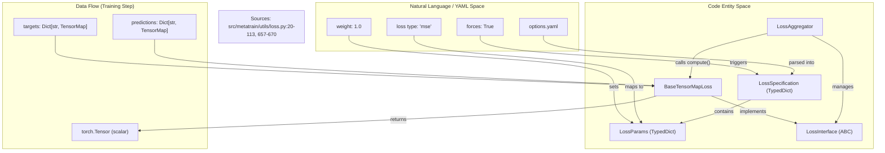
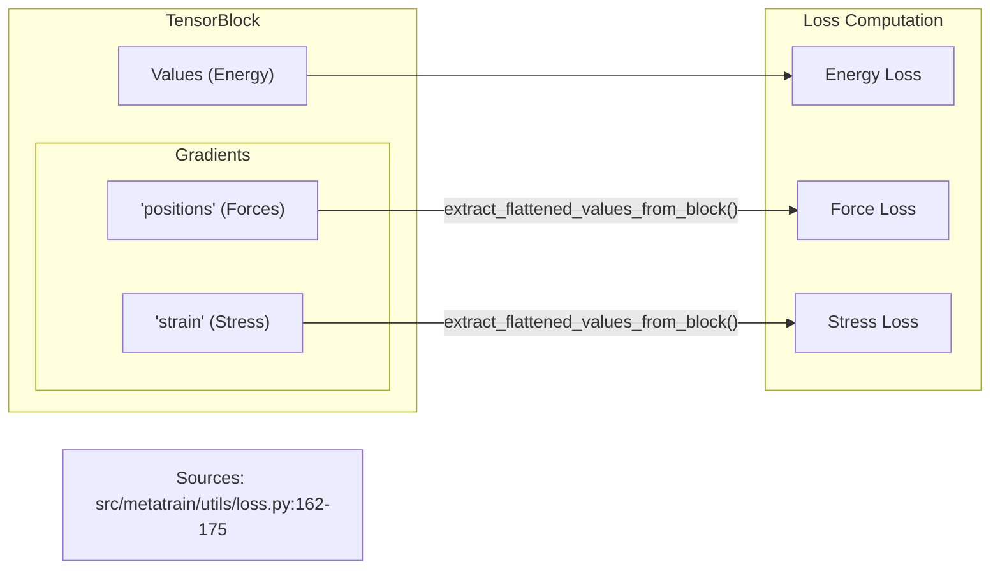

# Loss Functions

<details>
<summary>Relevant source files</summary>

The following files were used as context for generating this wiki page:

- [docs/src/concepts/loss-functions.rst](docs/src/concepts/loss-functions.rst)
- [docs/src/dev-docs/new-loss.rst](docs/src/dev-docs/new-loss.rst)
- [examples/1-advanced/07-dos-training.py](examples/1-advanced/07-dos-training.py)
- [examples/1-advanced/DOS_structures.xyz](examples/1-advanced/DOS_structures.xyz)
- [examples/1-advanced/options-dos.yaml](examples/1-advanced/options-dos.yaml)
- [examples/1-advanced/options-no-llpr.yaml](examples/1-advanced/options-no-llpr.yaml)
- [src/metatrain/utils/loss.py](src/metatrain/utils/loss.py)
- [src/metatrain/utils/omegaconf.py](src/metatrain/utils/omegaconf.py)
- [tests/utils/test_loss.py](tests/utils/test_loss.py)

</details>


Loss functions in `metatrain` are responsible for quantifying the error between model predictions and ground truth data. The system is designed to handle multiple targets (e.g., energy, dipole) and their respective gradients (e.g., forces, stress) through a modular aggregation framework.

## Architecture Overview

The loss system is built around the `LossInterface` [src/metatrain/utils/loss.py:35-45](), which provides a unified API for computing losses from `metatensor` `TensorMap` objects. The `LossAggregator` [src/metatrain/utils/loss.py:657-670]() manages the collection of individual loss terms and computes a weighted sum for the final optimization objective.

### Key Components and Data Flow

The following diagram illustrates how the configuration provided in a YAML file is transformed into functional code entities and how data flows through them during a training step.

**Diagram: Configuration to Execution Mapping**


Sources: [src/metatrain/utils/loss.py:20-113](), [src/metatrain/utils/loss.py:657-670]().

## Loss Specification and Parameters

Losses are defined using `LossSpecification` and `LossParams` [src/metatrain/utils/loss.py:20-33]().

| Parameter | Type | Default | Description |
| :--- | :--- | :--- | :--- |
| `type` | `str` | `"mse"` | The algorithm used (e.g., `mse`, `mae`, `huber`, `masked_mse`). |
| `weight` | `float` | `1.0` | Scalar multiplier for this loss term in the total sum. |
| `reduction` | `str` | `"mean"` | How to reduce the loss across the batch (`mean`, `sum`, `none`). |
| `gradients` | `dict` | `{}` | Nested `LossParams` for gradients like `positions` or `strain`. |

Sources: [src/metatrain/utils/loss.py:20-33]().

## Built-in Loss Types

Most built-in losses inherit from `BaseTensorMapLoss` [src/metatrain/utils/loss.py:118-130](), which handles the flattening and alignment of `metatensor` blocks before applying standard PyTorch loss functions.

### Standard Pointwise Losses
- **MSE (`mse`)**: `TensorMapMSELoss` uses `torch.nn.MSELoss` [src/metatrain/utils/loss.py:214-231]().
- **MAE (`mae`)**: `TensorMapMAELoss` uses `torch.nn.L1Loss` [src/metatrain/utils/loss.py:234-251]().
- **Huber (`huber`)**: `TensorMapHuberLoss` uses `torch.nn.HuberLoss` with a configurable `delta` parameter [src/metatrain/utils/loss.py:254-282]().

### Masked Losses
Masked losses are used when targets contain padded or invalid values (e.g., electronic DOS calculations [examples/1-advanced/07-dos-training.py:56-63]()). These require an auxiliary mask `TensorMap` provided in `extra_data` [src/metatrain/utils/loss.py:293-305]().
- **Masked MSE**: `TensorMapMaskedMSELoss` [src/metatrain/utils/loss.py:317-340]().
- **Masked MAE**: `TensorMapMaskedMAELoss` [src/metatrain/utils/loss.py:343-366]().
- **Masked Huber**: `TensorMapMaskedHuberLoss` [src/metatrain/utils/loss.py:369-402]().

### Specialized Losses
- **Shift Agnostic MSE**: `ShiftAgnosticMSELoss` [src/metatrain/utils/loss.py:488-500](), specifically designed for targets where the absolute reference is ill-defined, such as the Density of States (DOS) [examples/1-advanced/07-dos-training.py:5-10]().
- **Gaussian NLL/CRPS**: Used for uncertainty quantification in LLPR models [src/metatrain/utils/loss.py:564-577]().

Sources: [src/metatrain/utils/loss.py:214-402](), [src/metatrain/utils/loss.py:488-500](), [examples/1-advanced/07-dos-training.py:5-63]().

## Gradient Losses (Forces and Stress)

In atomistic modeling, forces are the negative gradient of energy with respect to positions. `metatrain` handles this by extracting the `gradient` field from the `TensorBlock` [src/metatrain/utils/loss.py:171-175]().

**Diagram: Gradient Loss Extraction**


Sources: [src/metatrain/utils/loss.py:162-175]().

## Adding Custom Loss Functions

To add a custom loss function, you must implement the `LossInterface` [docs/src/dev-docs/new-loss.rst:10-17]().

1.  **Inherit** from `LossInterface` [src/metatrain/utils/loss.py:35]().
2.  **Implement `compute`**: This method receives `predictions` and `targets` as dictionaries of `TensorMap` objects [src/metatrain/utils/loss.py:68-73]().
3.  **Register** the loss in the `LossType` enum (internal) or provide a factory mechanism.

```python
class CustomLoss(LossInterface):
    def compute(self, predictions, targets, extra_data=None):
        # Extract specific TensorMap using self.target
        pred_tm = predictions[self.target]
        targ_tm = targets[self.target]
        
        # Custom logic using torch operations
        loss = torch.sum((pred_tm.block(0).values - targ_tm.block(0).values)**4)
        return loss
```

Sources: [src/metatrain/utils/loss.py:35-84](), [docs/src/dev-docs/new-loss.rst:25-43]().

## Loss Aggregator

The `LossAggregator` is the central object used by trainers. It is initialized with a `LossSpecification` and the `TargetInfo` [src/metatrain/utils/loss.py:657-680]().

During the `compute` call, the aggregator:
1.  Iterates over all configured targets [src/metatrain/utils/loss.py:716-720]().
2.  Calls each individual `LossInterface` instance [src/metatrain/utils/loss.py:734]().
3.  Applies the weights and sums the results [src/metatrain/utils/loss.py:735-738]().
4.  Returns both the total scalar loss and a dictionary of individual components for logging [src/metatrain/utils/loss.py:741-742]().

Sources: [src/metatrain/utils/loss.py:657-742]().

---