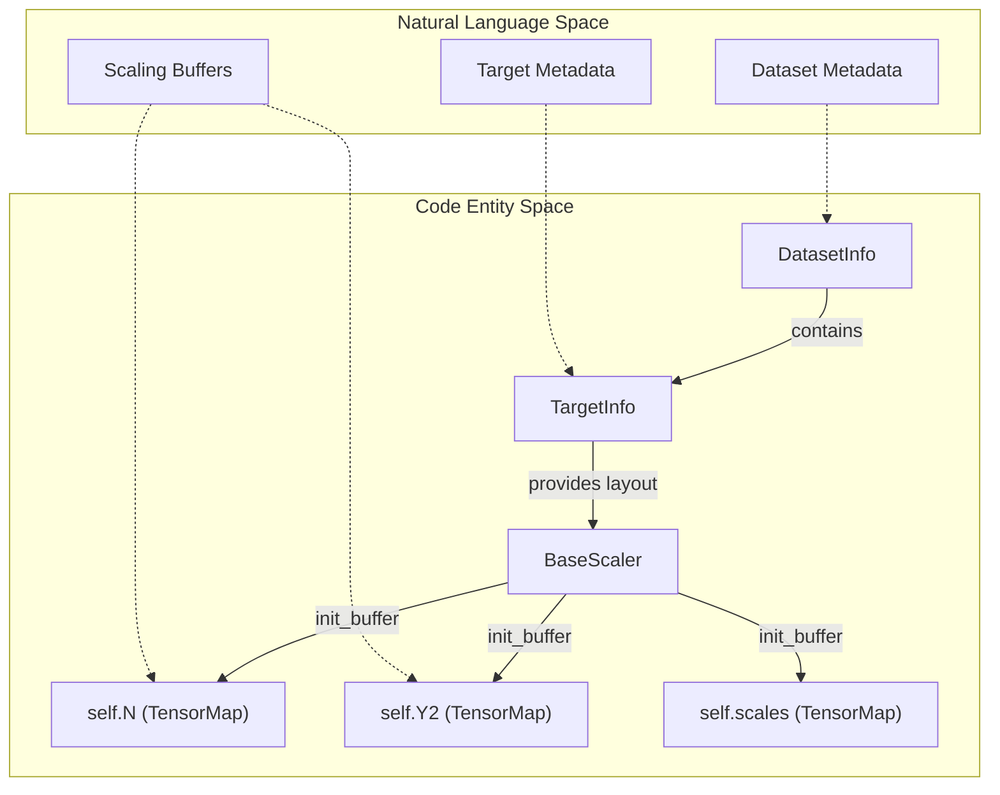
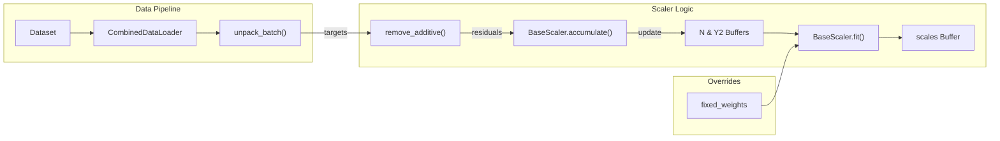

# Target Scaling

Relevant source files

The following files were used as context for generating this wiki page:

- [src/metatrain/experimental/phace/tests/test_regression.py](src/metatrain/experimental/phace/tests/test_regression.py)
- [src/metatrain/pet/tests/test_regression.py](src/metatrain/pet/tests/test_regression.py)
- [src/metatrain/utils/augmentation.py](src/metatrain/utils/augmentation.py)
- [src/metatrain/utils/scaler/_base_scaler.py](src/metatrain/utils/scaler/_base_scaler.py)
- [src/metatrain/utils/scaler/checkpoints.py](src/metatrain/utils/scaler/checkpoints.py)
- [src/metatrain/utils/scaler/scaler.py](src/metatrain/utils/scaler/scaler.py)
- [src/metatrain/utils/testing/output.py](src/metatrain/utils/testing/output.py)
- [tests/utils/test_augmentation.py](tests/utils/test_augmentation.py)
- [tests/utils/test_scaler.py](tests/utils/test_scaler.py)

The `Scaler` and `BaseScaler` classes provide an automated mechanism for normalizing training targets. Scaling is essential for multi-target training to ensure that different physical quantities (e.g., energy, forces, dipole moments) contribute equitably to the loss function and that model weights are initialized in a regime conducive to learning.

## Overview and Implementation

The scaling system is split into two layers:
1.  **`BaseScaler`**: A core `torch.nn.Module` that handles the accumulation of statistics (sums of squares) and the mathematical fitting of scales. It is designed to be agnostic of the training pipeline [src/metatrain/utils/scaler/_base_scaler.py:17-33]().
2.  **`Scaler`**: A wrapper around `BaseScaler` that integrates with the `metatrain` data pipeline, handling `Dataset` objects, `Dataloader` creation, and additive model removal during the fitting process [src/metatrain/utils/scaler/scaler.py:23-31]().

### Scaling Logic
Scales are computed as the standard deviation of the targets. For multi-property or multi-block targets, the system distinguishes between two types of scales:
*   **Per-target scales**: Applied to the entire target to normalize its overall magnitude [src/metatrain/utils/scaler/_base_scaler.py:45-45]().
*   **Per-property scales**: Applied to individual properties or blocks within a `TensorMap` [src/metatrain/utils/scaler/_base_scaler.py:44-44]().

For per-atom targets (e.g., atomic energies), scales are computed per atomic type by default [src/metatrain/utils/scaler/scaler.py:25-27]().

### Code Entity Mapping: Scaler Initialization
The following diagram shows how `DatasetInfo` and `TargetInfo` metadata drive the initialization of the scaling buffers within `BaseScaler`.

"Scaler Initialization"

Sources: [src/metatrain/utils/scaler/scaler.py:46-61](), [src/metatrain/utils/scaler/_base_scaler.py:117-164]()

---

## Scaling Lifecycle

The lifecycle of a `Scaler` involves three distinct phases: training (fitting), application (forward), and state management (checkpoints/restarts).

### 1. Training (`train_model`)
During the training phase, the `Scaler` iterates through the training data to accumulate $N$ (count) and $Y^2$ (sum of squares).
*   **Additive Removal**: If additive models (like `CompositionModel`) are present, their contributions are subtracted from the targets before statistics are accumulated [src/metatrain/utils/scaler/scaler.py:164-165]().
*   **Fixed Weights**: Users can override the automated scaling by providing `fixed_weights`. This can be a single float for a target or a dictionary mapping atomic types to specific weights [src/metatrain/utils/scaler/scaler.py:168-172]().
*   **Fitting**: Once accumulation is complete, `fit()` is called to compute the standard deviation: $\sigma = \sqrt{\frac{\sum Y^2}{N}}$ [src/metatrain/utils/scaler/_base_scaler.py:343-353]().

### 2. Forward Pass
During training and inference, the `Scaler` is called to transform raw model outputs into scaled outputs (or vice versa).
*   **Forward**: Multiplies the input `TensorMap` by the computed scales [src/metatrain/utils/scaler/_base_scaler.py:534-539]().
*   **remove_scale**: A utility function to divide by the scales, typically used to bring model predictions back to physical units [src/metatrain/utils/scaler/scaler.py:19-19]().

### 3. Restart and Checkpointing
Scalers store their state as buffers within the `state_dict`. 
*   **Versioning**: Checkpoints from older versions of `metatrain` that used a single scale per target are automatically updated to the new per-property scale format during loading via `update_per_property_scales` [src/metatrain/utils/scaler/checkpoints.py:9-18]().

### Data Flow: Training Lifecycle
The diagram below illustrates the flow of data from the raw dataset through additive model removal to the final fitting of scales.

"Scaler Training Lifecycle"

Sources: [src/metatrain/utils/scaler/scaler.py:145-176](), [src/metatrain/utils/scaler/_base_scaler.py:233-280](), [src/metatrain/utils/scaler/_base_scaler.py:311-341]()

---

## Key Functions and Classes

### `BaseScaler` Class
| Method | Description |
| :--- | :--- |
| `add_output` | Initializes `TensorMap` buffers for a new target based on its layout (per-atom or per-structure) [src/metatrain/utils/scaler/_base_scaler.py:74-108](). |
| `accumulate` | Updates $N$ and $Y^2$ for a batch of data. Uses `atomic_type` as a sample label for per-atom targets [src/metatrain/utils/scaler/_base_scaler.py:233-250](). |
| `fit` | Computes the final scales from accumulated statistics or applies `fixed_weights` [src/metatrain/utils/scaler/_base_scaler.py:311-325](). |

### `Scaler` Class
| Method | Description |
| :--- | :--- |
| `train_model` | High-level API that manages the `DataLoader` loop and coordinates with `additive_models` [src/metatrain/utils/scaler/scaler.py:145-154](). |
| `forward` | Applies the scaling factors to a dictionary of model outputs [src/metatrain/utils/scaler/scaler.py:218-223](). |

### Checkpoint Migration
When loading an older model, `update_per_property_scales` performs the following transformation:
1.  Loads the old `scales_tm` from the `scaler_buffer` [src/metatrain/utils/scaler/checkpoints.py:48-48]().
2.  Assigns it to `per_target_scaler_buffer` [src/metatrain/utils/scaler/checkpoints.py:51-53]().
3.  Creates a new `per_property_scaler_buffer` initialized to ones [src/metatrain/utils/scaler/checkpoints.py:54-56]().

Sources: [src/metatrain/utils/scaler/scaler.py](), [src/metatrain/utils/scaler/_base_scaler.py](), [src/metatrain/utils/scaler/checkpoints.py]()

---