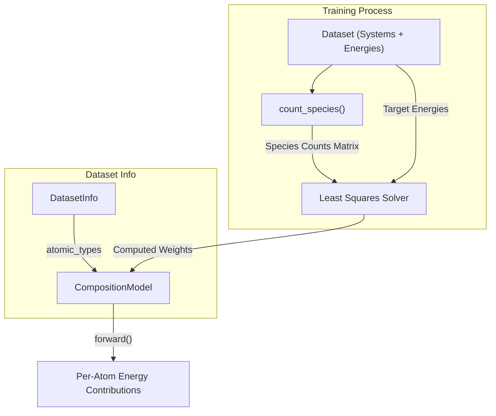
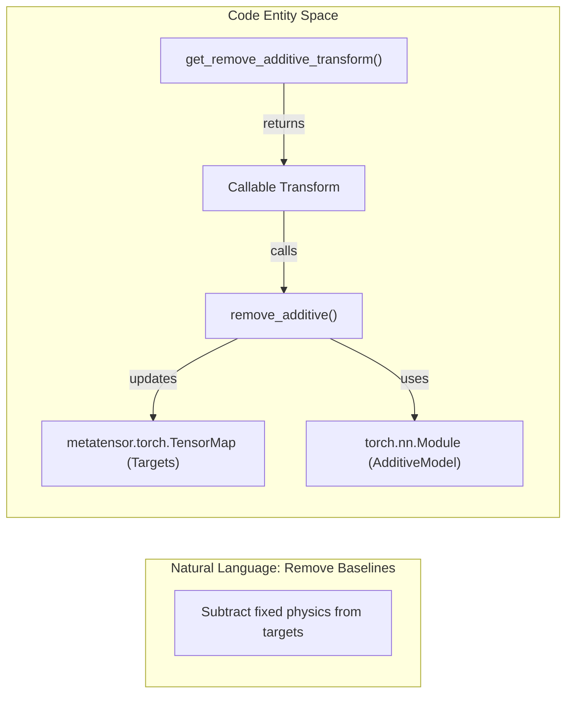

# Additive Models

Relevant source files

The following files were used as context for generating this wiki page:

- [src/metatrain/composition/tests/test_basic.py](src/metatrain/composition/tests/test_basic.py)
- [src/metatrain/experimental/mace/model.py](src/metatrain/experimental/mace/model.py)
- [src/metatrain/experimental/phace/model.py](src/metatrain/experimental/phace/model.py)
- [src/metatrain/utils/additive/__init__.py](src/metatrain/utils/additive/__init__.py)
- [src/metatrain/utils/additive/remove.py](src/metatrain/utils/additive/remove.py)
- [src/metatrain/utils/additive/zbl.py](src/metatrain/utils/additive/zbl.py)
- [src/metatrain/utils/data/atomic_basis_helpers.py](src/metatrain/utils/data/atomic_basis_helpers.py)
- [tests/utils/data/test_atomic_basis_helpers.py](tests/utils/data/test_atomic_basis_helpers.py)
- [tests/utils/test_additive.py](tests/utils/test_additive.py)

Additive models in `metatrain` provide physical baselines and short-range corrections that are combined with the learned atomic potential. These models are typically used to "subtract out" known physical effects from the training data, allowing the core neural network architecture to focus on learning the remaining many-body interactions.

## CompositionModel

The `CompositionModel` implements per-species energy baselines. It assumes that the total energy of a system is the sum of independent contributions from each atom, where the contribution depends only on the atom's chemical species (atomic number).

### Implementation and Logic
- **Training**: During `train_model`, the weights for each species are calculated using a least-squares fit on the provided dataset `[metatrain/composition/__init__.py:122-124]()`. It solves the linear system $E_{total} = \sum_{s} N_s w_s$, where $N_s$ is the count of species $s$ and $w_s$ is the weight for that species.
- **Fixed Weights**: Users can provide `fixed_weights` via a dictionary (e.g., mapping atomic numbers to specific energy values) to bypass the least-squares fitting `[metatrain/composition/__init__.py:166-169]()`.
- **Inference**: In the `forward` pass, the model identifies the types of atoms in the input `System` and assigns the pre-calculated weights to each atom `[metatrain/composition/__init__.py:270-285]()`.

### Data Flow for Composition Fitting
The following diagram shows how `CompositionModel` interacts with the dataset to produce species-specific weights.

**Composition Weight Fitting Flow**

Sources: `[metatrain/composition/__init__.py:122-180]()`, `[tests/utils/test_additive.py:122-139]()`

---

## ZBL (Ziegler-Biersack-Littmark)

The `ZBL` class implements a short-range repulsive potential to prevent atoms from overlapping during simulations, which is particularly important for high-energy collisions or when the neural network is extrapolated to very short distances.

### Key Features
- **Implementation**: Follows the LAMMPS `pair_zbl` implementation with the inner cutoff set to 0 `[src/metatrain/utils/additive/zbl.py:18-22]()`.
- **Cutoffs**: The outer cutoff is automatically determined as the sum of the covalent radii of the two atoms, sourced from ASE `[src/metatrain/utils/additive/zbl.py:80-92]()`.
- **Integration**: It calculates pairwise interactions based on a neighbor list and sums them over edges to provide node (per-atom) energies `[src/metatrain/utils/additive/zbl.py:160-170]()`.

Sources: `[src/metatrain/utils/additive/zbl.py:14-28]()`, `[src/metatrain/utils/additive/zbl.py:133-175]()`

---

## The `remove_additive` Transform

To train a model on the "residual" energy, the additive contributions must be subtracted from the raw training targets. This is handled by the `remove_additive` utility.

### Execution Logic
1. **Evaluation**: The `additive_model` is evaluated on the training systems using `evaluate_model` `[src/metatrain/utils/additive/remove.py:44-53]()`.
2. **Subtraction**: The resulting `TensorMap` is subtracted from the original targets. This subtraction occurs in "dense" space to ensure compatibility between different atomic types `[src/metatrain/utils/additive/remove.py:40-41]()`.
3. **Gradient Handling**: If the targets contain gradients (like forces), the transform also detaches the additive contribution to ensure that the training process does not attempt to backpropagate through the static additive model `[src/metatrain/utils/additive/remove.py:75-77]()`.

### Code Entity Space: Additive Transformation
This diagram maps the natural language concept of "removing baselines" to the specific code entities involved.

**Target Transformation Diagram**

Sources: `[src/metatrain/utils/additive/remove.py:15-29]()`, `[src/metatrain/utils/additive/remove.py:148-160]()`

---

## Atomic Basis Helpers

For models dealing with atomic-basis targets (e.g., Hamiltonian elements or electron density), the additive models and the training pipeline use `atomic_basis_helpers` to manage the layout of `TensorMap` blocks.

### Densification and Sparsification
- **Densification**: Moves the `atom_type` dimension from the `TensorMap` keys to the samples. This creates a "dense" representation where all atoms of all types are represented in a unified block, padded with `fill_value` (usually `NaN` or `0.0`) where a specific species does not have certain basis functions `[src/metatrain/utils/data/atomic_basis_helpers.py:66-82]()`.
- **Sparsification**: The inverse operation, moving the species information back to the keys. This is used during model export or evaluation to provide a cleaner output `[src/metatrain/utils/data/atomic_basis_helpers.py:243-255]()`.

### Key Functions
| Function | Purpose |
| :--- | :--- |
| `densify_atomic_basis_target` | Pushes `atom_type` keys into samples for uniform batching `[src/metatrain/utils/data/atomic_basis_helpers.py:176-180]()`. |
| `sparsify_atomic_basis_target` | Pulls species info back into keys from samples `[src/metatrain/utils/data/atomic_basis_helpers.py:243-247]()`. |
| `get_per_atom_sample_labels` | Constructs "system" and "atom" labels for a list of systems `[src/metatrain/utils/data/atomic_basis_helpers.py:15-29]()`. |

Sources: `[src/metatrain/utils/data/atomic_basis_helpers.py:176-199]()`, `[tests/utils/data/test_atomic_basis_helpers.py:196-210]()`

---

## Integration with Training Pipeline

Additive models are integrated into architectures like `MetaMACE` or `PhACE` and managed by the `Trainer`.

1. **Initialization**: The architecture initializes `CompositionModel` and optionally `ZBL` based on hyperparameters `[src/metatrain/experimental/phace/model.py:130-150]()`.
2. **Trainer Setup**: The trainer uses `get_remove_additive_transform` to create a data transform that is applied to every batch before it reaches the loss function `[src/metatrain/utils/additive/remove.py:148-160]()`.
3. **Inference/Export**: When the model is exported or used for inference, the `additive_models` are included in the `torch.nn.ModuleList` of the architecture. The outputs of these models are added back to the neural network's predictions to provide the final physical values `[src/metatrain/experimental/mace/model.py:101-102]()`.

Sources: `[src/metatrain/experimental/phace/model.py:130-150]()`, `[src/metatrain/experimental/mace/model.py:142-168]()`

---