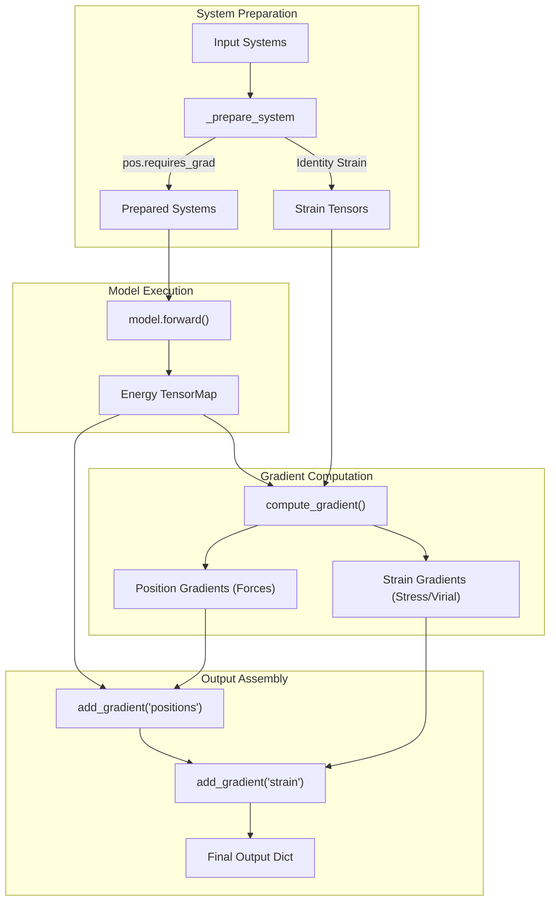
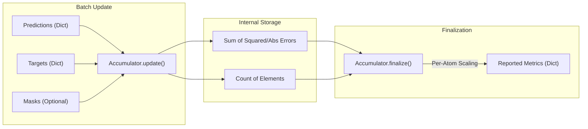

# Metrics and Gradient Computation

Relevant source files

The following files were used as context for generating this wiki page:

- [docs/src/dev-docs/utils/per_atom.rst](docs/src/dev-docs/utils/per_atom.rst)
- [src/metatrain/utils/data/readers/ase.py](src/metatrain/utils/data/readers/ase.py)
- [src/metatrain/utils/data/readers/readers.py](src/metatrain/utils/data/readers/readers.py)
- [src/metatrain/utils/evaluate_model.py](src/metatrain/utils/evaluate_model.py)
- [src/metatrain/utils/long_range.py](src/metatrain/utils/long_range.py)
- [src/metatrain/utils/metrics.py](src/metatrain/utils/metrics.py)
- [src/metatrain/utils/neighbor_lists.py](src/metatrain/utils/neighbor_lists.py)
- [src/metatrain/utils/per_atom.py](src/metatrain/utils/per_atom.py)
- [tests/__init__.py](tests/__init__.py)
- [tests/cli/__init__.py](tests/cli/__init__.py)
- [tests/utils/__init__.py](tests/utils/__init__.py)
- [tests/utils/data/test_readers.py](tests/utils/data/test_readers.py)
- [tests/utils/test_abc.py](tests/utils/test_abc.py)
- [tests/utils/test_evaluate_model.py](tests/utils/test_evaluate_model.py)
- [tests/utils/test_long_range.py](tests/utils/test_long_range.py)
- [tests/utils/test_metrics.py](tests/utils/test_metrics.py)
- [tests/utils/test_output_gradient.py](tests/utils/test_output_gradient.py)
- [tests/utils/test_per_atom.py](tests/utils/test_per_atom.py)

This page describes the utilities in `metatrain` for evaluating models, computing physical gradients (forces and stress) via autograd, and accumulating error metrics such as RMSE and MAE. These utilities bridge the gap between raw model outputs and the physical properties required for training and evaluation.

## Model Evaluation and Gradient Flow

The core of the evaluation pipeline is the `evaluate_model` function [src/metatrain/utils/evaluate_model.py:21-46](). It handles the execution of both training-time modules and exported `AtomisticModel` objects.

### Automated Gradient Computation
`metatrain` uses PyTorch's autograd to compute derivatives of energy with respect to atomic positions (forces) and lattice strain (stress/virial). The `compute_gradient` utility [src/metatrain/utils/output_gradient.py:12]() wraps `torch.autograd.grad` to handle batching and graph lifecycle management.

1.  **Preparation**: Systems are prepared by setting `requires_grad=True` on positions or by applying a strain tensor if requested [src/metatrain/utils/evaluate_model.py:78-87]().
2.  **Forward Pass**: The model computes the base target (e.g., energy).
3.  **Backward Pass**: `compute_gradient` is called to calculate the derivatives [src/metatrain/utils/evaluate_model.py:107-112]().
4.  **Metadata Attachment**: Gradients are converted into `TensorBlock` objects and attached to the main output `TensorMap` using names like `positions` or `strain` [src/metatrain/utils/evaluate_model.py:115-121]().

### Diagram: Evaluation and Gradient Data Flow

The following diagram illustrates how a system is processed to produce energy and its gradients.

| Entity | Code Reference |
| :--- | :--- |
| `evaluate_model` | `src/metatrain/utils/evaluate_model.py` |
| `compute_gradient` | `src/metatrain/utils/output_gradient.py` |
| `System` | `metatomic.torch.System` |
| `TensorMap` | `metatensor.torch.TensorMap` |

**Evaluation Gradient Flow**

Sources: [src/metatrain/utils/evaluate_model.py:21-160](), [src/metatrain/utils/output_gradient.py:12]()

---

## Per-Atom Normalization

To ensure that error metrics and losses are comparable across systems of different sizes, `metatrain` provides utilities to normalize extensive quantities by the number of atoms.

### `divide_by_num_atoms` logic
The normalization logic in `divide_by_num_atoms` [src/metatrain/utils/per_atom.py:40-55]() is "atom-aware":
*   **Intensive Quantities**: If a block or gradient block contains an `atom` key in its samples (e.g., forces, which are already per-atom), it is **not** divided [src/metatrain/utils/per_atom.py:59-60]().
*   **Extensive Quantities**: If the `atom` key is missing (e.g., total energy, virial), the values are divided by the number of atoms in the corresponding system [src/metatrain/utils/per_atom.py:62-70]().

This ensures that while total energy is converted to energy-per-atom, the forces remain unchanged.

Sources: [src/metatrain/utils/per_atom.py:8-91]()

---

## Metric Accumulators

Metrics are tracked during training and evaluation using accumulator classes that handle running sums of errors across batches.

### Supported Accumulators
*   **`RMSEAccumulator`**: Computes the Root Mean Square Error [src/metatrain/utils/metrics.py:51]().
*   **`MAEAccumulator`**: Computes the Mean Absolute Error [src/metatrain/utils/metrics.py:246]().

### Key Features
1.  **Gradient Support**: These classes automatically detect gradients (like `positions` or `strain`) attached to the `TensorMap` and compute separate metrics for them [src/metatrain/utils/metrics.py:149-157]().
2.  **Masking**: Supports `extra_data` masks to ignore specific samples or atoms during metric calculation [src/metatrain/utils/metrics.py:90-95]().
3.  **NaN Handling**: Automatically ignores `NaN` values in target data [src/metatrain/utils/metrics.py:117-118]().
4.  **Distributed Training**: `_get_global_keys` ensures all ranks in a distributed setup synchronize the set of targets being tracked [src/metatrain/utils/metrics.py:37-48]().

### Diagram: Metric Accumulation System

| Component | Code Entity |
| :--- | :--- |
| Accumulator Interface | `RMSEAccumulator` / `MAEAccumulator` |
| Update Method | `update(predictions, targets)` |
| Finalization | `finalize(not_per_atom)` |
| Data Storage | `self.information` (Dict[str, Tuple[float, int]]) |

**Metric Tracking Workflow**

Sources: [src/metatrain/utils/metrics.py:51-314](), [tests/utils/test_metrics.py:74-111]()

---

## Summary of Metric Keys

When `finalize()` is called, it returns a dictionary of strings. The keys are constructed based on the target name and the gradient type:

| Property Type | Metric Key Suffix | Example (Target: `energy`) |
| :--- | :--- | :--- |
| Base Values | `RMSE (per atom)` | `energy RMSE (per atom)` |
| Position Gradients | `_positions_gradients RMSE` | `energy_positions_gradients RMSE` |
| Strain Gradients | `_strain_gradients RMSE (per atom)` | `energy_strain_gradients RMSE (per atom)` |

Note: The `(per atom)` suffix is appended unless the key is included in the `not_per_atom` list during finalization [src/metatrain/utils/metrics.py:214-220]().

Sources: [src/metatrain/utils/metrics.py:200-243](), [tests/utils/test_metrics.py:87-91]()

---