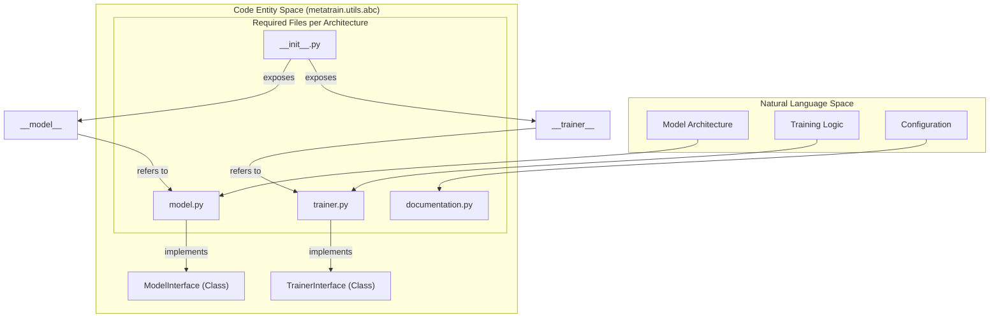
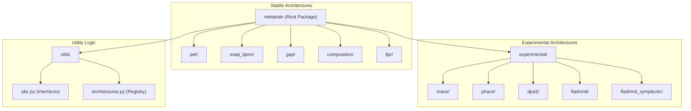

# Model Architectures

Relevant source files

The following files were used as context for generating this wiki page:

- [.codecov.yml](.codecov.yml)
- [CODEOWNERS](CODEOWNERS)
- [README.md](README.md)
- [docs/src/dev-docs/new-architecture.rst](docs/src/dev-docs/new-architecture.rst)
- [src/metatrain/experimental/dpa3/documentation.py](src/metatrain/experimental/dpa3/documentation.py)
- [src/metatrain/experimental/dpa3/model.py](src/metatrain/experimental/dpa3/model.py)
- [src/metatrain/experimental/flashmd_symplectic/documentation.py](src/metatrain/experimental/flashmd_symplectic/documentation.py)
- [src/metatrain/share/base_hypers.py](src/metatrain/share/base_hypers.py)
- [src/metatrain/utils/abc.py](src/metatrain/utils/abc.py)
- [src/metatrain/utils/architectures.py](src/metatrain/utils/architectures.py)
- [tests/cli/test_base_precision.py](tests/cli/test_base_precision.py)
- [tests/test_readme.py](tests/test_readme.py)
- [tests/test_registered_archs.py](tests/test_registered_archs.py)
- [tests/utils/test_architectures.py](tests/utils/test_architectures.py)
- [tests/utils/test_pydantic.py](tests/utils/test_pydantic.py)

`metatrain` provides a unified interface for training, evaluating, and exporting a diverse set of atomistic model architectures. By adhering to a common contract, different machine learning potentials—ranging from established Gaussian processes to cutting-edge Transformers—can be used interchangeably within the same training pipeline.

### Architecture Lifecycle

Architectures in `metatrain` are categorized into three stages to manage their stability and maintenance:

| Category | Description | Path |
| :--- | :--- | :--- |
| **Stable** | Production-ready architectures with stable APIs and comprehensive testing. | `src/metatrain/<name>` |
| **Experimental** | New or research-oriented architectures. APIs may change; documentation might be incomplete. | `src/metatrain/experimental/<name>` |
| **Deprecated** | Older architectures slated for removal. Users are encouraged to migrate. | `src/metatrain/deprecated/<name>` |

Sources: [.codecov.yml:21-77](), [src/metatrain/utils/architectures.py:179-201]()

---

### Core Interfaces: Model and Trainer

Every architecture must implement two primary classes that satisfy the `metatrain` contract. This allows the `mtt` CLI to interact with any model without knowing its internal physics or neural network structure.

#### 1. ModelInterface
The `ModelInterface` (inheriting from `torch.nn.Module`) defines how a model processes atomic systems and how it is exported for production use.
- **`forward()`**: Computes requested outputs (e.g., energy, forces) for a list of `metatomic.torch.System` objects.
- **`restart()`**: Handles the transition when starting a new training run from a checkpoint, allowing for fine-tuning or transfer learning.
- **`export()`**: Converts the internal model into a standalone `metatomic.torch.AtomisticModel` for use in MD engines like ASE or LAMMPS.

#### 2. TrainerInterface
The `TrainerInterface` manages the optimization loop.
- **`train()`**: The main entry point for the training process, receiving datasets, devices, and dtypes.
- **`load_checkpoint()`**: Logic for restoring the optimizer state and training progress.

#### Architecture-Code Association
The following diagram illustrates how the abstract interfaces relate to the concrete file structure required for every architecture.

**Architecture Contract Diagram**

Sources: [src/metatrain/utils/abc.py:29-198](), [docs/src/dev-docs/new-architecture.rst:87-93](), [docs/src/dev-docs/new-architecture.rst:182-188]()

---

### Available Architectures

The following table summarizes the primary architectures available in `metatrain`.

| Architecture | Category | Description |
| :--- | :--- | :--- |
| **PET** | Stable | Point Edge Transformer; a high-performance GNN using attention mechanisms. |
| **SOAP-BPNN** | Stable | Behler-Parrinello Neural Network using SOAP descriptors. |
| **GAP** | Stable | Gaussian Approximation Potential using Sparse Kernel Ridge Regression. |
| **MACE** | Experimental | Higher-order equivariant message passing neural network. |
| **PhACE** | Experimental | SO(3)-equivariant model with fast tensor products. |
| **DPA3** | Experimental | Deep Potential Attention 3 with Line Graph representations. |
| **FlashMD** | Experimental | Direct prediction of MD trajectories (Standard & Symplectic). |
| **LLPR** | Stable | Uncertainty quantification wrapper (Last-Layer Prediction Rigidity). |

Sources: [README.md:30-66](), [.codecov.yml:21-77](), [src/metatrain/utils/architectures.py:25-45]()

---

### Navigation: Child Pages

Detailed documentation for each architecture group can be found in the following sub-pages:

*   **[PET — Point Edge Transformer](#5.1)**
    Deep dive into the PET architecture, including its Transformer-based GNN design, long-range Ewald/P3M support, and system conditioning.
*   **[SOAP-BPNN and GAP](#5.2)**
    Covers the legacy and alchemical modes of the SOAP-BPNN and the kernel-based GAP architecture.
*   **[Experimental Architectures: MACE, PhACE, DPA3, FlashMD, Classifier](#5.3)**
    Details on experimental wrappers and research models, including the symplectic constraints of FlashMD and the deepmd-kit integration for DPA3.
*   **[LLPR — Uncertainty Quantification](#5.4)**
    Explanation of the LLPR wrapper used to provide calibrated uncertainty estimates for any underlying model.
*   **[Fine-tuning and Transfer Learning](#5.5)**
    Strategies for adapting pre-trained models to new datasets or target quantities using LoRA or head inheritance.

---

### System Overview Diagram
This diagram maps the high-level architecture categories to their internal package locations.

**Package Structure Diagram**

Sources: [src/metatrain/utils/architectures.py:170-201](), [.codecov.yml:21-77](), [CODEOWNERS:1-15]()

---