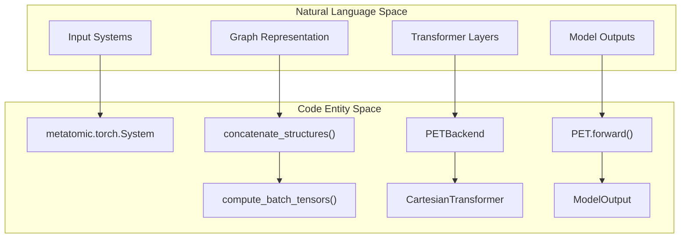
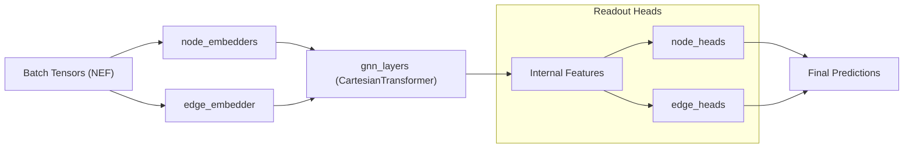

# PET — Point Edge Transformer

Relevant source files

The following files were used as context for generating this wiki page:

- [examples/1-advanced/10-pet-hidden-features.py](examples/1-advanced/10-pet-hidden-features.py)
- [src/metatrain/experimental/flashmd/model.py](src/metatrain/experimental/flashmd/model.py)
- [src/metatrain/experimental/flashmd_symplectic/model.py](src/metatrain/experimental/flashmd_symplectic/model.py)
- [src/metatrain/llpr/model.py](src/metatrain/llpr/model.py)
- [src/metatrain/pet/checkpoints.py](src/metatrain/pet/checkpoints.py)
- [src/metatrain/pet/documentation.py](src/metatrain/pet/documentation.py)
- [src/metatrain/pet/model.py](src/metatrain/pet/model.py)
- [src/metatrain/pet/modules/adaptive_cutoff.py](src/metatrain/pet/modules/adaptive_cutoff.py)
- [src/metatrain/pet/modules/backend.py](src/metatrain/pet/modules/backend.py)
- [src/metatrain/pet/modules/diagnostic.py](src/metatrain/pet/modules/diagnostic.py)
- [src/metatrain/pet/modules/structures.py](src/metatrain/pet/modules/structures.py)
- [src/metatrain/pet/modules/transformer.py](src/metatrain/pet/modules/transformer.py)
- [src/metatrain/pet/tests/checkpoints/model-v14_trainer-v13.ckpt.gz](src/metatrain/pet/tests/checkpoints/model-v14_trainer-v13.ckpt.gz)
- [src/metatrain/pet/tests/test_adaptive_cutoff.py](src/metatrain/pet/tests/test_adaptive_cutoff.py)
- [src/metatrain/pet/tests/test_conditioning.py](src/metatrain/pet/tests/test_conditioning.py)
- [src/metatrain/pet/tests/test_diagnostic.py](src/metatrain/pet/tests/test_diagnostic.py)
- [src/metatrain/pet/tests/test_feature_extraction.py](src/metatrain/pet/tests/test_feature_extraction.py)
- [src/metatrain/pet/tests/test_finetuning.py](src/metatrain/pet/tests/test_finetuning.py)
- [src/metatrain/pet/tests/test_functionality.py](src/metatrain/pet/tests/test_functionality.py)
- [src/metatrain/pet/tests/test_non_strict_nl.py](src/metatrain/pet/tests/test_non_strict_nl.py)
- [src/metatrain/pet/trainer.py](src/metatrain/pet/trainer.py)
- [src/metatrain/soap_bpnn/trainer.py](src/metatrain/soap_bpnn/trainer.py)

The **Point Edge Transformer (PET)** is a metatrain-native implementation of the architecture originally proposed in [arXiv:2305.19302v3](https://arxiv.org/abs/2305.19302v3) [src/metatrain/pet/model.py:52-56](). It is designed for high-performance atomistic machine learning, featuring a cleaner, more modular design than the original reference implementation while adding support for long-range interactions, system conditioning, and faster inference via fast attention [src/metatrain/pet/documentation.py:5-11]().

## Architecture Design

PET is a Graph Neural Network (GNN) that operates on a node-edge-feature (NEF) representation. The model consists of a `PETBackend` which manages learnable submodules and a high-level `PET` class that handles metatensor integration and data flow [src/metatrain/pet/model.py:105-109]().

### Data Flow and NEF Format
The architecture processes systems by concatenating them into a single batch of tensors [src/metatrain/pet/modules/structures.py:70-90](). These are then converted into the NEF format required by the featurizer [src/metatrain/pet/modules/structures.py:198-207]().

### Diagram: High-Level Component Mapping
This diagram maps the natural language concepts of the PET architecture to the specific code entities in the `metatrain.pet` submodule.

**Sources:** [src/metatrain/pet/model.py:10-17](), [src/metatrain/pet/modules/structures.py:70-82](), [src/metatrain/pet/modules/backend.py:36-36]().

## Key Features

### Adaptive Cutoff
PET supports an adaptive cutoff scheme where each atom can have a unique cutoff radius based on a target number of neighbors (`num_neighbors_adaptive`) [src/metatrain/pet/model.py:165-174]().
*   **Solver Method:** Uses a Newton-bisection root finder to solve $n_{total}(r) = num\_neighbors\_adaptive$ [src/metatrain/pet/modules/adaptive_cutoff.py:110-148]().
*   **Grid Method:** A legacy behavior that evaluates neighbor counts on a discrete probe-cutoff grid [src/metatrain/pet/documentation.py:175-183]().

### System Conditioning
The model can condition predictions on global system properties such as **total charge** and **spin multiplicity** [src/metatrain/pet/documentation.py:27-32](). This allows the model to distinguish between different electronic states of the same nuclear geometry [src/metatrain/pet/documentation.py:27-29]().

### Featurizer Types
PET provides two main featurizer architectures:
1.  **Feedforward:** Uses a single readout layer and MLPs to combine features across GNN layers [src/metatrain/pet/model.py:109-123]().
2.  **Residual:** Uses multiple readout layers corresponding to each GNN layer [src/metatrain/pet/model.py:124-127]().

### Long-Range Interactions
Long-range effects are handled via the `LongRangeFeaturizer`, which supports Ewald-summation-like descriptors or P3M methods to capture interactions beyond the local cutoff [src/metatrain/pet/model.py:144-159]().

## Implementation Detail: PETBackend

The `PETBackend` is the pure-PyTorch core of the model. It contains the learnable parameters and the logic for message passing and attention.

### Diagram: PETBackend Internal Data Flow
This diagram illustrates how the `PETBackend` processes atomistic data from input tensors to final target predictions.

**Sources:** [src/metatrain/pet/modules/backend.py:36-36](), [src/metatrain/pet/model.py:109-141]().

## Diagnostic Hooks and Features
PET includes diagnostic capabilities for model inspection:
*   **Internal Features:** Can output the `feature` tensor representing the state before the final heads [src/metatrain/pet/model.py:117-118]().
*   **Cutoff Stats:** The `mtt::aux::cutoff_stats` output provides per-atom diagnostic information, including the calculated atomic cutoff and the actual number of neighbors [src/metatrain/pet/model.py:119-127]().
*   **Diagnostic Handles:** Uses hooks to extract intermediate activations for debugging [src/metatrain/pet/modules/diagnostic.py:41-43]().

## Training and Checkpoints

### Learning Rate Scheduler
The PET trainer utilizes a `CosineAnnealing` scheduler with a linear warmup phase [src/metatrain/pet/trainer.py:52-82](). The warmup fraction and total epochs are configurable via `TrainerHypers` [src/metatrain/pet/trainer.py:65-66]().

### Checkpoint Versioning
The architecture maintains strict versioning for both the model and the trainer to ensure backward compatibility and safe migrations.
| Component | Current Version | Update Logic Location |
| :--- | :--- | :--- |
| **PET Model** | 16 | `src/metatrain/pet/checkpoints.py` |
| **PET Trainer** | 13 | `src/metatrain/pet/trainer.py` |

**Sources:** [src/metatrain/pet/model.py:62-62](), [src/metatrain/pet/trainer.py:86-86](), [src/metatrain/pet/checkpoints.py:13-180]().

## Hyperparameter Reference

| Hyperparameter | Type | Description |
| :--- | :--- | :--- |
| `cutoff` | `float` | Interaction radius (default: 4.5 Å) [src/metatrain/pet/documentation.py:158-164](). |
| `d_pet` | `int` | Dimension of the edge features (default: 128) [src/metatrain/pet/documentation.py:195-195](). |
| `num_gnn_layers` | `int` | Number of message-passing steps [src/metatrain/pet/model.py:89-89](). |
| `num_neighbors_adaptive`| `Optional[int]` | Target neighbor count for adaptive cutoff [src/metatrain/pet/documentation.py:165-174](). |
| `system_conditioning` | `bool` | Enables charge/spin-dependent predictions [src/metatrain/pet/documentation.py:38-38](). |

**Sources:** [src/metatrain/pet/documentation.py:155-200](), [src/metatrain/pet/model.py:76-90]().

---