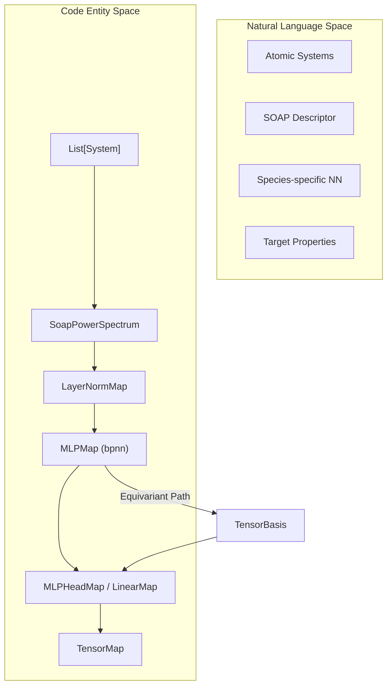
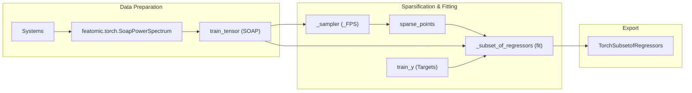

# SOAP-BPNN and GAP

Relevant source files

The following files were used as context for generating this wiki page:

- [src/metatrain/experimental/flashmd/checkpoints.py](src/metatrain/experimental/flashmd/checkpoints.py)
- [src/metatrain/experimental/flashmd/documentation.py](src/metatrain/experimental/flashmd/documentation.py)
- [src/metatrain/experimental/mace/documentation.py](src/metatrain/experimental/mace/documentation.py)
- [src/metatrain/gap/model.py](src/metatrain/gap/model.py)
- [src/metatrain/gap/tests/test_errors.py](src/metatrain/gap/tests/test_errors.py)
- [src/metatrain/gap/tests/test_regression.py](src/metatrain/gap/tests/test_regression.py)
- [src/metatrain/gap/tests/test_torchscript.py](src/metatrain/gap/tests/test_torchscript.py)
- [src/metatrain/gap/trainer.py](src/metatrain/gap/trainer.py)
- [src/metatrain/soap_bpnn/checkpoints.py](src/metatrain/soap_bpnn/checkpoints.py)
- [src/metatrain/soap_bpnn/documentation.py](src/metatrain/soap_bpnn/documentation.py)
- [src/metatrain/soap_bpnn/model.py](src/metatrain/soap_bpnn/model.py)
- [src/metatrain/soap_bpnn/modules/power_spectrum.py](src/metatrain/soap_bpnn/modules/power_spectrum.py)
- [src/metatrain/soap_bpnn/modules/tensor_basis.py](src/metatrain/soap_bpnn/modules/tensor_basis.py)
- [src/metatrain/soap_bpnn/tests/checkpoints/model-v5_trainer-v8.ckpt.gz](src/metatrain/soap_bpnn/tests/checkpoints/model-v5_trainer-v8.ckpt.gz)
- [src/metatrain/soap_bpnn/tests/checkpoints/model-v6_trainer-v8.ckpt.gz](src/metatrain/soap_bpnn/tests/checkpoints/model-v6_trainer-v8.ckpt.gz)
- [src/metatrain/soap_bpnn/tests/checkpoints/model-v7_trainer-v8.ckpt.gz](src/metatrain/soap_bpnn/tests/checkpoints/model-v7_trainer-v8.ckpt.gz)
- [src/metatrain/soap_bpnn/tests/checkpoints/model-v8_trainer-v10.ckpt.gz](src/metatrain/soap_bpnn/tests/checkpoints/model-v8_trainer-v10.ckpt.gz)
- [src/metatrain/soap_bpnn/tests/test_basic.py](src/metatrain/soap_bpnn/tests/test_basic.py)
- [src/metatrain/soap_bpnn/tests/test_functionality.py](src/metatrain/soap_bpnn/tests/test_functionality.py)
- [src/metatrain/soap_bpnn/tests/test_regression.py](src/metatrain/soap_bpnn/tests/test_regression.py)

This page covers the implementation details of the SOAP-BPNN and GAP architectures within `metatrain`. These architectures leverage the Smooth Overlap of Atomic Positions (SOAP) descriptors to represent local atomic environments for property prediction.

## SOAP-BPNN

The SOAP-BPNN architecture is a Behler-Parrinello type neural network [src/metatrain/soap_bpnn/documentation.py:5-9]() that uses SOAP descriptors as atomic descriptors. It is implemented via the `SoapBpnn` class [src/metatrain/soap_bpnn/model.py:190]().

### Legacy vs. Alchemical Modes
The architecture supports two primary operational modes controlled by the `legacy` hyperparameter [src/metatrain/soap_bpnn/documentation.py:105-107]():

1.  **Legacy Mode (`legacy: true`)**: Uses a separate Multi-Layer Perceptron (MLP) for each atomic species. There is no shared chemical embedding; species are treated as distinct categories [src/metatrain/soap_bpnn/documentation.py:105-107]().
2.  **Modern/Alchemical Mode (`legacy: false`)**: Employs alchemical embeddings to represent chemical species in a continuous space, allowing for shared weights across different atom types [src/metatrain/soap_bpnn/modules/tensor_basis.py:38-45]().

### Core Components and Data Flow

The `SoapBpnn` model processes atomic systems through a series of modules to produce invariant or equivariant outputs.

| Component | Class/Module | Role |
| :--- | :--- | :--- |
| **Descriptor** | `SoapPowerSpectrum` | Computes SOAP power spectrum features [src/metatrain/soap_bpnn/modules/power_spectrum.py](). |
| **Mapping** | `MLPMap` | A `ModuleMap` containing species-specific MLPs for invariant features [src/metatrain/soap_bpnn/model.py:48](). |
| **Normalization** | `LayerNormMap` | Applies `LayerNorm` per species to the descriptors [src/metatrain/soap_bpnn/model.py:94](). |
| **Basis Expansion** | `TensorBasis` | Handles spherical and Cartesian tensor targets by constructing a suitable basis [src/metatrain/soap_bpnn/modules/tensor_basis.py:321](). |

#### Invariant and Equivariant Handling
The architecture can predict both scalars (invariants) and tensors (equivariants). For tensorial targets, it utilizes `ClebschGordanReal` contractions [src/metatrain/soap_bpnn/modules/tensor_basis.py:246]() to ensure rotational equivariance.

- **Spherical Tensors**: Handled by expanding targets into irreducible representations (irreps) [src/metatrain/soap_bpnn/tests/test_functionality.py:117-148]().
- **Cartesian Tensors**: Supports rank-1 (vectors, e.g., dipoles) and rank-2 (tensors, e.g., stress) outputs [src/metatrain/soap_bpnn/tests/test_functionality.py:59-114]().

### SOAP-BPNN Architecture Overview
This diagram illustrates the flow from atomic systems to the final property prediction, highlighting the `ModuleMap` abstractions.

Sources: [src/metatrain/soap_bpnn/model.py:190-250](), [src/metatrain/soap_bpnn/modules/power_spectrum.py](), [src/metatrain/soap_bpnn/modules/tensor_basis.py:321]()

---

## GAP (Gaussian Approximation Potential)

The GAP architecture in `metatrain` is a kernel-based regression model using SOAP features. It is implemented in the `GAP` class [src/metatrain/gap/model.py:28](). Currently, the GAP implementation is restricted to single-output energy-like scalar targets [src/metatrain/gap/model.py:47-70]().

### Key Implementation Details

1.  **Subset of Regressors (SoR)**: Instead of using the full training set as the basis for the kernel, GAP uses a sparse subset of points [src/metatrain/gap/model.py:118-120]().
2.  **Sparse Point Selection**: Uses Farthest Point Sampling (FPS) via the `_FPS` sampler to select representative atomic environments from the training data [src/metatrain/gap/model.py:122]().
3.  **Fitting Process**: The `Trainer` fits the model using the `SubsetOfRegressors.fit` method, which solves the kernel ridge regression (KRR) problem considering both energies and forces (if available) [src/metatrain/gap/trainer.py:130-137]().
4.  **CPU Only**: The GAP architecture is currently restricted to `cpu` execution and `float64` precision [src/metatrain/gap/model.py:30-31]().

### GAP Data Flow and Fitting
The following diagram maps the mathematical GAP fitting process to the specific classes in the implementation.

Sources: [src/metatrain/gap/model.py:110-141](), [src/metatrain/gap/trainer.py:98-141]()

### Comparison Table: SOAP-BPNN vs GAP

| Feature | SOAP-BPNN | GAP |
| :--- | :--- | :--- |
| **Model Type** | Neural Network (BPNN) | Kernel Ridge Regression (KRR) |
| **Scaling** | Highly scalable to large datasets | Limited by kernel matrix size (uses SoR) |
| **Devices** | CPU, CUDA [src/metatrain/soap_bpnn/model.py:192]() | CPU only [src/metatrain/gap/model.py:30]() |
| **Dtypes** | float32, float64 [src/metatrain/soap_bpnn/model.py:193]() | float64 only [src/metatrain/gap/model.py:31]() |
| **Equivariance** | Supports tensors/vectors [src/metatrain/soap_bpnn/model.py:207-208]() | Scalar only [src/metatrain/gap/model.py:52-60]() |
| **Checkpointing** | Versioned restarts supported [src/metatrain/soap_bpnn/model.py:191]() | No restart support [src/metatrain/gap/model.py:170-180]() |

---

## Shared Utilities

Both architectures utilize common `metatrain` components for baseline corrections and scaling:

- **CompositionModel**: Used by both to subtract per-species atomic energy baselines before training the main model [src/metatrain/soap_bpnn/model.py:19](), [src/metatrain/gap/model.py:146]().
- **ZBL**: Optional short-range repulsive potential [src/metatrain/soap_bpnn/model.py:21](), [src/metatrain/gap/model.py:150]().
- **Neighbor Lists**: Both architectures rely on the system's neighbor lists, typically requested via `get_requested_neighbor_lists` [src/metatrain/soap_bpnn/tests/test_regression.py:37](), [src/metatrain/gap/trainer.py:79]().

Sources: [src/metatrain/soap_bpnn/model.py:19-21](), [src/metatrain/gap/model.py:146-165]()

---